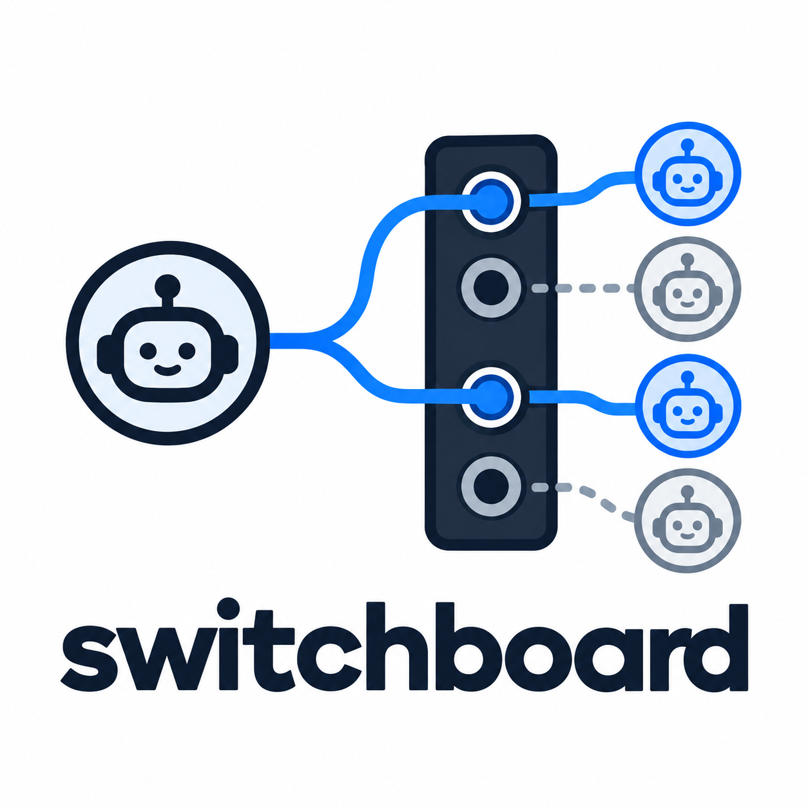

# Switchboard



Switchboard is a headless controller that lets one orchestrating agent delegate coding work to AI coding CLIs
(Claude Code and Codex in this stage) through their documented automation surfaces, behind a single MCP tool surface.
It runs on your own machine and reuses the logins you already made with those CLIs. Switchboard itself never handles
provider credentials.

## Status

Pre-release. The package is private and is not published to any registry; you build it from source.

- **Milestone 1 (foundation) is done**: run ledger, workspaces, run lifecycle, reconciliation and the operator CLI
  (`doctor`, `runs`). See [ROADMAP §6](docs/ROADMAP.md#6-milestones) for the evidence.
- **Milestone 2 (Claude Code and Codex adapters plus the MCP slice) is `Partial`.** The Claude Code and Codex
  adapters, the MCP server and `switchboard serve` exist and pass their tests on recorded or synthetic fixtures and a
  fake provider. The 2026-10-13 operator-machine live checks
  ([`docs/research/live-checks-2026-10-13.md`](docs/research/live-checks-2026-10-13.md)) ran the real Claude Code
  2.1.296 (14 of 16 checks held; two need a failing run) and codex-cli 0.162.1 (flag assumptions held; Codex has not
  run through Switchboard). The opt-in `npm run test:live` smoke test has not been run by the operator personally. See
  [ROADMAP §6.2](docs/ROADMAP.md#62-m2-claude-code-adapter-and-mcp-slice-tasks).
- **Milestone 3 (isolation) is `Partial`.** Approvals, privileged runs and retention are implemented; the live
  malicious-fixture checks are not. See [ROADMAP §6](docs/ROADMAP.md#6-milestones) for each task.
- **Milestone 9 (projects and controlled commits) is `Partial`.** Projects, the agent `commit` tool, finalize-only
  commits, ref snapshots, push, dynamic projects, signing and concurrent-run worktrees are implemented and tested for
  `host` environments on a fake provider with real Git in temporary repositories. It is not `Done`: nothing has run
  against a live provider through Switchboard's own tool channel, signing was tried only with a throwaway GnuPG key,
  pushing from dynamic projects is not wired, and container environments need milestone 10. The exceptions are listed
  in [ROADMAP §6.3](docs/ROADMAP.md#63-m9-projects-and-controlled-commits-tasks) (task T9.8).
- **Milestone 5 (continuity) is `Partial`.** `continue_task` resumes the provider's native session or hands off to
  another provider from a bundle built from Switchboard's own records, and `get_artifacts` and `runs show` show the
  handoff. It is tested on two fake providers, including a check that the controller opens no provider state directory.
  It is not `Done`: no run of a real Claude Code and Codex pair has been made (the opt-in `npm run test:live:pair`
  script exists and has not been run), and resume for the providers of milestone 4 is not built. See
  [ROADMAP §6.9](docs/ROADMAP.md#69-m5-continuity-tasks).
- **Milestone 6 (capacity and resilience) is `Partial`.** `get_capacity` and `switchboard capacity` show per-provider
  estimates with their sources, a circuit breaker holds a failing provider back, retryable failures are retried
  automatically as linked successor runs, and quota exhaustion fails over to another provider or returns. All of this
  is tested on fake providers. It is not `Done`: what Claude Code and Codex print on a real rate limit or quota stop has
  not been captured (operator task T6.11), and no provider is known to publish an enforceable rate limit, so there is no
  rate gate. See [ROADMAP §6.11](docs/ROADMAP.md#611-m6-capacity-and-resilience-tasks).
- **Milestone 7 (routing) is `Partial`.** Eligible providers are scored from Switchboard's own records, every route
  decision is stored and replays exactly, `explain_route` shows why a run went where it did, a project stays on its
  provider until a listed reason moves it (`switchboard affinity list|reset`), and `minimum_capability` is enforced
  against operator-declared model capabilities in the model registry (`src/routing/minimum-capability.test.ts`). All
  of this is tested on fake providers. It is not `Done`: the cache-friendly prompt order is not built (ROADMAP T7.9,
  Could) and real-provider model flags wait for adapter work. See [Routing and affinity](#routing-and-affinity) and
  [ROADMAP §6.12](docs/ROADMAP.md#612-m7-routing-tasks).
- **Milestone 11 (inner agent) is `Partial`.** T11.1 to T11.12 are done on fakes: an optional HTTP backend, privacy
  gates, `doctor` and `inner` reporting, commit-message drafting, handoff condensation (T11.10, a service function) and
  record-only routing classification (T11.11). Two tasks are wired into production `serve` run paths: the commit-message
  task (the optional `message` on the `commit` tool) and routing classification (`serve` admission, continuation and
  quota failover, with heuristic fallback when inner is off or unavailable). Handoff condensation, PR drafting,
  verification-summary, run-title and a live backend are not. T11.5 usage-surface pins merged
  [#362](https://github.com/zemdregon/switchboard/pull/362) (suspended-task and project-off denials, re-ask deadline
  counts, shared-subscription label routing, whole `inner_shared_subscription` doctor checks, `enabled: false` with the
  flag set, capacity collector `source` exclusion), [#396](https://github.com/zemdregon/switchboard/pull/396)
  (usage accounting at the quota-failover routing call site, the one `serve`-path classification recorded under a
  run) and [#407](https://github.com/zemdregon/switchboard/pull/407) (`get_run` byte-identical over Streamable HTTP
  and from a second session; a `shares_subscription_with` value that is no provider config id refused at `doctor`
  and `inner test`). See [ROADMAP §6.6](docs/ROADMAP.md#66-m11-inner-agent-tasks).
- **Milestone 12 (retrieval index) is `Partial`.** Tasks T12.0 to T12.7 are done on fakes: the spike, `rag`
  configuration and per-project store, the scanner through chunker, the embedding port (fake and `http` backends
  behind the locality gates), incremental background indexing in `serve`, `switchboard index status|rebuild|clear`
  and a `doctor` section, an untrusted context pack at admission that never changes the stored request or the
  run's outcome, the read-only MCP tool `search_project_context`, and optional global sharing (`rag.global`,
  `contribute_to_global`, `use_global`, all off by default). Agent-callable search (T12.9) and an opt-in live
  embedding backend are not `Done`. See [Retrieval index](#retrieval-index-milestone-12),
  [ROADMAP §6.7](docs/ROADMAP.md#67-m12-retrieval-index-tasks) and the merged requirements and design evidence in
  [SRS §3.15](docs/requirements/SRS.md#implementation-evidence-partial-m12),
  [PRD CAP-13](docs/requirements/PRD.md#implementation-evidence-partial-m12--cap-13),
  [HLD §2.1](docs/design/HLD.md#21-comp-rag-implementation-evidence-m12-t121t123),
  [LLD §14](docs/design/LLD.md#14-retrieval-index) and [TDD §3.13](docs/design/TDD.md#313-retrieval-index).
- **Milestone 13 (network MCP transport) is done.** `serve` can expose the MCP tools over Streamable HTTP with OAuth
  2.1 (an embedded authorization server with an operator consent page, PKCE, client registration that the operator
  approves, audience-bound opaque tokens). It is off by default and binds to loopback; put your own TLS proxy in
  front of it. A test runs the whole path from client registration and PKCE to a tool call. Residual risks are listed
  under [HLD TB-12](docs/design/HLD.md#3-trust-boundaries). See
  [ROADMAP §6.10](docs/ROADMAP.md#610-m13-network-mcp-transport-tasks).
- **Milestone 4 (adapter expansion) is `Partial`.** Shared registry, conformance plumbing, `adapters validate`, the ACP
  client and a macOS CI leg are done; Grok Build, Antigravity, Cursor and OpenCode each have a module, compile matrix
  and parser work on synthetic fixtures. Grok Build has module, compile-matrix, parser (partial: T4.23; every Done-when
  case has a supervisor-replayed JSONL fixture on `main` ([#260](https://github.com/zemdregon/switchboard/pull/260))),
  auth-preflight, conformance suite (T4.25), malicious-fixture leg (partial: T4.26; synthetic command fields,
  readable native login and repository configuration gaps;
  [#291](https://github.com/zemdregon/switchboard/pull/291),
  [#302](https://github.com/zemdregon/switchboard/pull/302),
  [#308](https://github.com/zemdregon/switchboard/pull/308),
  [#326](https://github.com/zemdregon/switchboard/pull/326),
  [#345](https://github.com/zemdregon/switchboard/pull/345),
  [#351](https://github.com/zemdregon/switchboard/pull/351),
  [#358](https://github.com/zemdregon/switchboard/pull/358)) and Git declaration fixture tests on
  synthetic fixtures (README [Grok Build CLI](#grok-build-cli-milestone-4), ROADMAP T4.22 to T4.27); live smoke, live
  malicious leg and `adapters validate` remain operator work (T4.28).
  [#302](https://github.com/zemdregon/switchboard/pull/302) through
  [#358](https://github.com/zemdregon/switchboard/pull/358) extend synthetic malicious replay only (including
  completing both cut-line positions across categories and exits, parser fall-through paths at exit `2` and `137`,
  trailing `tool_call_update` after `end`, and JSON-encoding variants); parser residual pins
  ([#342](https://github.com/zemdregon/switchboard/pull/342),
  [#354](https://github.com/zemdregon/switchboard/pull/354),
  [#372](https://github.com/zemdregon/switchboard/pull/372)) leave the parser unchanged; none of them validate the
  live CLI or close T4.23's or T4.26's gaps. Antigravity has a
  parser (partial: T4.33; unrecorded-shape, fallback and own-property hardening pins plus structured
  `backing_provider`/`model` on `session_bound`, all synthetic,
  [#272](https://github.com/zemdregon/switchboard/pull/272),
  [#276](https://github.com/zemdregon/switchboard/pull/276),
  [#297](https://github.com/zemdregon/switchboard/pull/297)),
  a conformance suite (partial: native resume, T4.35; replay dialect edge cases
  [#281](https://github.com/zemdregon/switchboard/pull/281) and Go `flag`-boundary walking
  [#292](https://github.com/zemdregon/switchboard/pull/292)), a malicious-fixture leg (partial: synthetic refusal,
  guard-blocked and trailing-tool fail-closed replay streams, hostile repository entries and FR-POL-04, T4.36;
  [#257](https://github.com/zemdregon/switchboard/pull/257),
  [#262](https://github.com/zemdregon/switchboard/pull/262),
  [#280](https://github.com/zemdregon/switchboard/pull/280))
  and a Git declaration on synthetic fixtures (README [Antigravity CLI](#antigravity-cli-milestone-4), ROADMAP T4.32 to
  T4.37); [#295](https://github.com/zemdregon/switchboard/pull/295) through
  [#373](https://github.com/zemdregon/switchboard/pull/373) extend synthetic parser, conformance and malicious replay
  only and do not validate the live CLI.
  Live smoke, live malicious leg and `adapters validate` for Antigravity remain operator work (T4.38). Cursor has
  module, compile-matrix, parser (partial: T4.43 until operator capture; supervisor-replayed JSONL fixtures,
  [#283](https://github.com/zemdregon/switchboard/pull/283),
  [#287](https://github.com/zemdregon/switchboard/pull/287),
  [#299](https://github.com/zemdregon/switchboard/pull/299),
  [#324](https://github.com/zemdregon/switchboard/pull/324), residual ordering and resume/compile-parity pins
  [#333](https://github.com/zemdregon/switchboard/pull/333), resume-id matrix and `denied_after_result.jsonl`
  [#341](https://github.com/zemdregon/switchboard/pull/341), parser residual branches
  [#348](https://github.com/zemdregon/switchboard/pull/348) and `idless_guard.jsonl`
  [#360](https://github.com/zemdregon/switchboard/pull/360)), auth-preflight, a conformance suite on synthetic
  fixtures (T4.45; replay dialect hardening, 59 compile/env refusal checks, and fixtures including
  `denied_after_write`, `permission_denied_perm`, `resume_unknown_id`, `unknown_event`, `unsafe_id_after_bound` and
  `git_write_guard_args`,
  [#309](https://github.com/zemdregon/switchboard/pull/309),
  [#315](https://github.com/zemdregon/switchboard/pull/315)), malicious-fixture leg (T4.46; category/exit matrix and
  12 partial streams, [#316](https://github.com/zemdregon/switchboard/pull/316); residual cells at exits 2 and 137 and
  guard-only Git writes, [#367](https://github.com/zemdregon/switchboard/pull/367)) and Git declaration
  fixture tests on synthetic fixtures (README [Cursor CLI](#cursor-cli-milestone-4), ROADMAP T4.42 to T4.47); live
  smoke, live malicious leg and `adapters validate` remain operator work (T4.48). OpenCode has module, compile-matrix,
  probe, registry entry, parser (partial: T4.53 until operator capture; supervisor-replayed JSONL fixtures,
  [#274](https://github.com/zemdregon/switchboard/pull/274),
  [#290](https://github.com/zemdregon/switchboard/pull/290),
  [#311](https://github.com/zemdregon/switchboard/pull/311),
  [#321](https://github.com/zemdregon/switchboard/pull/321), terminal reason and late error handling
  [#328](https://github.com/zemdregon/switchboard/pull/328), malformed step-start fail-closed, scope compile parity and
  arrival-order independence
  [#339](https://github.com/zemdregon/switchboard/pull/339), parser residual branches on synthetic lines
  [#357](https://github.com/zemdregon/switchboard/pull/357)),
  auth-preflight, conformance suite on synthetic fixtures (T4.55), malicious-fixture leg (partial: synthetic refusal
  shapes, guard-blocked, trailing-tool, unreadable-event, exit 2/137, JSON-encoding, and path-upgrade fail-closed replay
  streams in a widened hostile matrix and FR-POL-04, T4.56;
  [#245](https://github.com/zemdregon/switchboard/pull/245),
  [#284](https://github.com/zemdregon/switchboard/pull/284),
  [#298](https://github.com/zemdregon/switchboard/pull/298),
  [#312](https://github.com/zemdregon/switchboard/pull/312),
  [#323](https://github.com/zemdregon/switchboard/pull/323),
  [#355](https://github.com/zemdregon/switchboard/pull/355),
  [#369](https://github.com/zemdregon/switchboard/pull/369)) and Git declaration fixture tests on synthetic
  fixtures (README [OpenCode CLI](#opencode-cli-milestone-4), ROADMAP T4.52 to T4.57); live smoke, live malicious leg
  and `adapters validate` remain operator work (T4.58). T4.52, T4.54, T4.55 and T4.57 are Done against their Done-when
  on synthetic fixtures; T4.53 and T4.56 stay Partial. Other M4 providers are
  still catching up on those
  legs. Manifests still admit no version until `switchboard adapters validate` passes a real CLI (operator tasks).
  Outside an approved `privileged` bypass scope every profile is ineligible for the new providers. See
  [ROADMAP §6.8](docs/ROADMAP.md#68-m4-adapter-expansion-tasks).

What works today: `doctor`, `runs list|show|cancel`, `approve`, `deny`, `gc`, `capacity`, `affinity list|reset`,
`index status|rebuild|clear`, `projects list|show|validate|approve`, `git push`, `inner status|test|resume`, and
`serve` exposing nine MCP tools over stdio (ten when retrieval is on for at least one of the client's projects,
thirteen with `manage_projects`). The five trust
profile names exist; which of them a provider can run is listed in [Trust profiles](#trust-profiles) and by
`list_capabilities`. Read
[Known limitations](#known-limitations) before relying on it.

## Single operator, your own accounts

Switchboard is designed for **one operator on one machine**, using that operator's own provider logins
([ADR-0011](docs/adr/0011-single-operator-local-deployment.md), [ADR-0003](docs/adr/0003-no-credential-handling.md)).
It is not a hosted service, not multi-user, and must not be used to share a login between people.

Switchboard drives the CLIs through the headless interfaces they document. That is a technical statement, not a legal
one. **This project does not claim that any use of it complies with any provider's terms of service.** Whether your use
is allowed under the terms of Anthropic, OpenAI or any other provider is your responsibility; read their current terms.
Commercial, resale, multi-user or credential-sharing use needs your own policy review first.

## Requirements

- Linux. Other operating systems are not supported yet. macOS process handling (process tree and PID-reuse guard
  through `ps`) runs in a macOS CI leg (typecheck, lint, tests and docs check on a GitHub-hosted runner), and no trust
  profile is eligible on macOS.
- Node.js 22 or newer (`engines` in `package.json`).
- Git 2.32.0 or newer (`MIN_GIT_VERSION` in `src/workspace/git.ts`). `doctor` checks both.
- For real work, at least one provider CLI installed and logged in natively: Claude Code and/or Codex. `doctor` does not
  require any particular one.

## Install from source

```sh
git clone <this repository> switchboard
cd switchboard
npm ci && npm run build
node dist/cli/bin.js --help
```

The commands below write `switchboard` for `node /path/to/switchboard/dist/cli/bin.js`. Replace it with the absolute
path of your checkout; an orchestrator launching `serve` needs the absolute path too. Switchboard is not published to
npm, so there is no `npm install switchboard`.

## Log in to the providers (natively)

Switchboard has no `login` command and never starts a login, reads token files or exports credentials. You log in with
each provider's own CLI, and Switchboard asks that CLI whether it is logged in.

| Provider | Login step the adapter reports | Status of that step |
| --- | --- | --- |
| Claude Code | `claude auth login` (the adapter returns `AUTH_REQUIRED` naming it) | Taken from the adapter; check Anthropic's documentation |
| Codex | `codex login`; status is read with `codex login status` (exit code 0 logged in, 1 not) | `codex login status` observed on codex-cli 0.162.1 (`docs/research/live-checks-2026-10-13.md`); output format undocumented, so only the exit code is used; check OpenAI's documentation for the login step |
| Grok Build | `grok login` (the adapter returns `AUTH_REQUIRED` naming it; the CLI's own error text also names `grok login --device-code`) | Auth preflight runs `grok models` and keys on the first stdout line (`You are logged in with grok.com.` vs `You are not authenticated.`; exit 0 in both states on the 2026-10-14 live check, `grok 1.0.50`; [`docs/research/live-checks-2026-10-14-grok.md`](docs/research/live-checks-2026-10-14-grok.md)); check xAI's documentation for the login step |
| Antigravity | Launch **`agy`** without arguments (the adapter returns `AUTH_REQUIRED` naming `agy`; the CLI's stderr also says to launch without arguments to sign in) | Auth preflight runs `agy models` and keys on exit code and stderr (`<slug>\t<name>` lines at exit 0 vs `Error: Please sign in` at exit 1 on the 2026-10-14 live check, `agy` 1.3.4; [`docs/research/live-checks-2026-10-14-antigravity.md`](docs/research/live-checks-2026-10-14-antigravity.md)); check Google's Antigravity documentation for the login step |
| Cursor CLI | `cursor-agent login` (the adapter returns `AUTH_REQUIRED` naming it) | Auth preflight runs `cursor-agent status --format json` and keys on `isAuthenticated` (exit 0 both logged in and logged out on the 2026-10-14 live check; [`docs/research/live-checks-2026-10-14-cursor.md`](docs/research/live-checks-2026-10-14-cursor.md)); check Cursor's documentation for the login step |
| OpenCode | `opencode auth login` (the adapter returns `AUTH_REQUIRED` naming it) | Auth preflight runs `opencode auth list --format json --standalone` and treats any non-environment connection type as logged in (exit 0 in every state on the 2026-10-14 live check, `opencode v2.0.23`; [`docs/research/live-checks-2026-10-14-opencode.md`](docs/research/live-checks-2026-10-14-opencode.md)); check OpenCode's documentation for the login step |

Do not copy credential files between machines or users. Do not put API keys or tokens in the Switchboard config; it has
no place for them and rejects unknown keys.

## Configure

Switchboard reads one JSON file. The path is, in order: `--config <path>`, the `SWITCHBOARD_CONFIG` environment
variable, then `$XDG_CONFIG_HOME/switchboard/config.json` (default `~/.config/switchboard/config.json`). Unknown keys,
wrong types or a missing `schema_version` stop startup.

Minimal example:

```json
{
  "schema_version": 1,
  "allowed_roots": ["/home/you/projects"],
  "mcp_clients": [{ "id": "orchestrator", "max_trust_profile": "edit-untrusted" }]
}
```

Keys (from `src/config/schema.ts`; the `projects` key is described below the table):

| Key | Required | Meaning |
| --- | --- | --- |
| `schema_version` | yes | Must be `1`. |
| `allowed_roots` | yes | Non-empty list of directories. A task's `workspace_path` must be under one of them. Each must exist. Relative paths resolve against the config file's directory. |
| `mcp_clients` | yes | Entries `{ "id", "max_trust_profile", "privileged_approval"?, "projects"? }`. `id` matches `^[a-z0-9][a-z0-9_-]{0,63}$` and must be unique. `serve --client <id>` binds a session to one entry. |
| `mcp_clients[].projects` | no | Ids of the configured `projects` this client may use with `delegate_task`'s `project` input and see in `list_projects`. An id that names no project stops startup. A client without the list can use no project (workspace paths still work). |
| `mcp_clients[].manage_projects` | no | `true` gives this client the `create_project`, `update_project` and `delete_project` tools for its own *dynamic projects* (see [Dynamic projects](#dynamic-projects)). Default `false`: the tools do not exist for it. |
| `mcp_clients[].max_push_policy` | no | `"none"` (default) or `"branch"`: the widest push policy a dynamic project of this client may declare. Only with `manage_projects: true`. A push-enabled project still waits for `projects approve`. |
| `mcp_clients[].privileged_approval` | no | `"required"` (default) or `"not_required"`. With `not_required`, that client's `privileged` requests run without `switchboard approve` (see [Trust profiles](#trust-profiles)). Allowed only when the client's `max_trust_profile` is `privileged`; `doctor` warns for every client that sets it. |
| `data_dir` | no | Where the ledger, artifacts and worktrees live. Default `$XDG_DATA_HOME/switchboard` (`~/.local/share/switchboard`). |
| `limits.global_concurrency` | no | Integer 1 to 64. Default 4. |
| `limits.per_provider_concurrency` | no | Integer 1 to 64. Default 1. |
| `providers.<id>.enabled` | no | Boolean. A provider you do not list is enabled. |
| `providers.<id>.weight` | no | Number from 0 to 1. Accepted by the schema. |
| `providers.claude-code.git_channel` | no | Boolean, default `false`. **Unsupported, for testing only:** gives Claude Code the injected `commit` (and `push`) tool through a Switchboard-written `--mcp-config` file in the run's private directory, **only in an approved `privileged` run whose scope sets `bypass`**. Such a run then omits `--safe-mode` (it stops the tool server from starting), so the repository's `CLAUDE.md` and hooks load in it. Every other run is unaffected and can use `finalize_commit`. It has not been run end to end with the real `claude` (ROADMAP T9.4b); `serve` logs a warning when it is on. Only `claude-code` accepts the key. |
| `retention.days`, `retention.interval` | no | How long idle meta-sessions are kept (integer days, default 30) and how often `serve` runs the clean-up pass (`30m`, `12h`, `7d`; default `24h`). **Nothing is deleted unless you set `retention.days`**; the default only applies once you do (or to `gc` dry runs). |
| `projects` | no | List of `{ "id", "name", "environment"?, "contexts": [...] , "max_trust_profile"?, "allowed_providers"? }`. `id` matches `^[a-z][a-z0-9-]{1,40}$` and is unique. `environment` is `{ "kind": "host" }` (default) or a `container` shape that `projects validate` rejects until M10. Each context is `{ "id", "kind": "repository", "path", "base_ref", "primary"?, "writable"?, "push"?, "identity"?, "sign"?, "finalize_commit"? }` with an absolute `path` under an allowed root; exactly one context is primary. Unknown keys and context kinds stop startup. `push.remote` must be the name of a remote in the repository (not a URL), and `push.branch_prefix` a branch-name prefix such as `"switchboard/"`. `max_trust_profile` and `allowed_providers` apply to `delegate_task` with a `project`: the effective trust ceiling is the lower of the client's and the project's, and routing is limited to the listed providers (a request naming another provider with `require_provider` fails `PERMISSION_BLOCKED`); `sign` (default `false`; needs `identity`, primary writable context only) makes the controller sign each published commit with the operator's own global Git signing configuration; a signing failure, a repository whose own configuration sets `gpg.*` or `user.signingkey`, or a run whose agent could reach the key (the `push` rule) returns `SIGNING_FAILED` and commits nothing; `projects validate` makes a test signature. Only GnuPG has been tried, with a throwaway key; SSH, X.509, passphrase-protected and hardware keys are untested. `finalize_commit` (default `false`; needs `identity`, primary writable context only) turns on finalize-only commits, described below. Full shape: LLD section 11.1. |
| `routing` | no | `{ "weights"?: { "success", "latency", "capacity", "security", "handoff", "cost" }, "affinity"?: { "enabled", "low_water_mark", "min_confidence", "idle_ttl" } }`. Each weight 0 to 100, default 1; all 0 means configured order. `affinity.enabled` defaults to `true`; `low_water_mark` and `min_confidence` (0 to 1) are set together or both left `null` (the default, which leaves the estimate trigger off); `idle_ttl` accepts only `null` (no expiry). Unknown keys stop startup. See [Routing and affinity](#routing-and-affinity) and LLD section 17.1. |
| `timeouts.preflight_ttl_seconds` | no | Integer 0 to 3600. How long a successful adapter preflight is cached (default 60); 0 disables the cache. |
| `git.sanitize_patterns` | no | Up to 16 extra regular-expression sources (200 characters each, restricted subset in `src/git/safe-pattern.ts`). A commit-message line that matches one is removed, in addition to the built-in attribution rules. |
| `inner_agent` | no | The optional inner agent (ADR-0016): a cheap or self-hosted model for small tasks. Off unless you write the section and set `enabled: true`; there is no default backend, model or task, and no key, token or header field (a hosted service goes through a gateway you run). Shape: `{ "enabled", "backend": { "kind": "http", "base_url", "model", "timeout_ms"?, "max_concurrency"?, "allow_remote"?, "shares_subscription_with"? }, "tasks": { "<task>": { "enabled", ... } }, "breaker"?, "suspension"? }`; `base_url` may not carry userinfo or a query, and `shares_subscription_with` must be one of the provider config ids listed below this table (`claude-code`, `codex`, ...) or `null`: any other string stops startup, so `doctor` fails its config check naming the key and `inner test` exits 1 before sending anything. Full shape: LLD section 13.1. Inspect it with `doctor` and `inner status`. |
| `rag` | no | The optional retrieval index (ADR-0031): off unless you configure an `embedding` backend. No credential fields; `mode` defaults to `auto` (on only when a backend exists and the project allows). Projects and contexts may narrow caps and exclusions; `use_global` and `contribute_to_global` default to false and cannot be set on dynamic projects. Full shape: [LLD §14.1](docs/design/LLD.md#141-configuration-shape) and [Retrieval index](#retrieval-index-milestone-12). |
| `profiles.<name>` | no | Overrides for `inspect-untrusted`, `edit-untrusted`, `test-sandboxed` or `trusted-development`: `file_access`, `shell`, `shell_allowlist`, `network`, `network_allowlist`, `repo_config`. They may tighten or loosen a default; `doctor` lists them and every run records them. `privileged` has none. See the `edit-untrusted` limit under [Trust profiles](#trust-profiles). |

`<id>` is one of `claude-code`, `codex`, `grok-build`, `antigravity`, `cursor`, `opencode`, `kimi-code`. Only
`claude-code` and `codex` pass the version gate on `main` today; the other ids name registered M4 adapters whose
manifests admit no version until `switchboard adapters validate` passes a live CLI (ROADMAP §6.8.2). `<id>` is the
*config* id. The *provider* id used in
`routing.provider_preference` of `delegate_task` is the adapter id: `claude`
for Claude Code (config id `claude-code`), `codex` for Codex. `max_trust_profile` accepts any of the five profile
names, but see [Trust profiles](#trust-profiles).

## Check the setup with `doctor`

```sh
switchboard doctor            # add --json for machine-readable output
switchboard doctor --config /path/to/config.json
```

`doctor` checks Node, Git, the config, the data directory, the ledger and the data-directory lock, reports what
retention would collect and any orphans (read-only), then probes each
adapter (Claude Code, Codex and a fake test adapter that is not a real provider). It exits 0 when no check failed and 1
otherwise. Markers:

| Marker | Meaning |
| --- | --- |
| `[ok]` | Check passed. |
| `[warn]` | Not fatal, exit stays 0. For a provider: CLI not installed, or installed but not logged in or auth unknown. For the ledger: not created yet (`serve` creates it) or an older schema that `serve` migrates. For the lock: a stale lock file. |
| `[FAIL]` | Exit code 1. For a provider: the probe failed, or the version gate rejected the installed version. |
| `[skip]` | Skipped: because the config is not valid, or (for a provider) because `providers.<id>.enabled` is `false`. Skips never change the exit code. |

Per adapter, the auth state is `OK`, `AUTH_REQUIRED` (doctor prints the native login command to run) or `UNKNOWN`
(Switchboard could not tell; the reason is printed). `UNKNOWN` means the status command exited with
neither of its two expected codes, timed out or could not start (see [Troubleshooting](#troubleshooting)). For Codex the
state comes from the exit code of `codex login status` (0 is `OK`, 1 is `AUTH_REQUIRED`).

When the config has an `inner_agent` section, `doctor` adds an "Inner agent" block (and an `inner_agent` key in `--json`):
the backend kind, its locality (`local` for a loopback address, `remote` for anything else), the model, whether a fixed
canary answered within schema, the circuit state of the `doctor` process, and each enabled task with its rejection and
fallback rates and whether it is suspended. Its findings are at most `[warn]` and never change the exit code. `doctor`
contacts the backend only for that canary, and never a `remote` backend unless `allow_remote` is true. When the backend
declares `shares_subscription_with`, the check list also carries a `[warn]` (`inner_shared_subscription`): the inner
agent's calls consume that provider's capacity, and each call records one usage observation labelled `inner_agent` —
never as provider usage, and never in `capacity_score`. That warning and that label are only ever a known provider
config id: with `shares_subscription_with` set to any other string, `doctor` (text and `--json`) exits 1 on its
`config` check with the loader's message naming the key, carries no `inner_shared_subscription` check and no inner-agent
block, and `inner test` exits 1 with the same message, sends nothing and writes neither an `inner_call` row nor an
observation (`src/inner/usage-surfaces.test.ts`, [#407](https://github.com/zemdregon/switchboard/pull/407)). The
warning follows the declaration, not routing: with the shared provider disabled in config (`providers.<id>.enabled:
false`) `doctor` carries the identical check, `inner status` still names the provider and each backend request still
writes its labelled row (`src/inner/usage-surfaces.test.ts`). Inner
calls leave the capacity projection unchanged; when the inner-agent section is present, its call counts change, so the
whole `doctor --json` document does not stay byte-identical. With no `inner_agent` section the output is unchanged.

When `rag.embedding` is configured, `doctor` adds a "Retrieval index" block (and a `retrieval` key in `--json`): the
backend kind, model and locality; whether the privacy gate allows it; a one-line `probe` of the embedding endpoint
(only built-in probe text, and never to a `remote` backend unless `allow_remote` is true); and per project (and
`global` when `rag.global.enabled`) the index mode, revision, completeness, size, build time and staleness. These lines
are at most `[warn]` or `[skip]` and never change the exit code. With no `rag.embedding` section the report is unchanged.

A machine with no Claude Code or Codex installed gets `[warn]` for both and still exits 0. That proves only that the
environment and config are sound, not that a provider works.

## Retrieval index (milestone 12)

The retrieval index is **off by default**. Without a configured `rag.embedding` backend, `mode: "auto"` keeps every
project off, `serve` does not build indexes, and `delegate_task` behaves as today. Setting `mode: "on"` without a
backend is a configuration error at load time.

Minimal example (loopback embedding service you run yourself; Switchboard has no API-key field):

```json
{
  "rag": {
    "embedding": {
      "kind": "http",
      "base_url": "http://127.0.0.1:8080",
      "model": "your-embed-model",
      "allow_remote": false,
      "allow_source_content": false
    },
    "mode": "auto"
  }
}
```

`embedding.kind: "local"` is refused today. A backend is `local` only when every resolved address is loopback; anything
else is `remote` and stays unused until both `allow_remote` and `allow_source_content` are true (the same locality rules
as the inner agent (`inner_agent` in [Configure](#configure)). Source text is redacted before embedding;
credential-shaped strings in the config are rejected at load.

Per project (and per context for `exclude`, `caps` and `contribute_to_global`), you may set `rag.mode`, lower caps,
add `exclude` globs, `use_global` (read the optional global index) and `contribute_to_global` (copy this project's
chunks into it). Both sharing flags default to false; contexts on `inspect-untrusted` or `edit-untrusted` do not
contribute unless you opt a context in. Operator-only `rag.global.enabled` and `global.sources` add read-only
directories under your allowed roots.

While `serve` runs, Switchboard builds and refreshes indexes in the background. A build never blocks admitting or
starting a run. At dispatch, a project with retrieval on may receive an **untrusted context pack**: labelled snippets
prepended to the volatile part of the compiled prompt only. The stored request text and the run's outcome are unchanged;
any retrieval failure, timeout, stale index or gate denial means no pack, not a failed run.

Operator commands (counts and metadata only; no chunk text in the ledger):

```text
switchboard index status [<project>|global] [--json]
switchboard index rebuild [<project>|global]
switchboard index clear [<project>|global]
```

`rebuild` and `clear` write operator requests that a running `serve` applies (like `approve`). With no `serve`, `clear`
is applied immediately under the data-directory lock; `rebuild` is queued for the next `serve` start. Inspect state with
`index status` and the `doctor` retrieval block above.

The MCP tool `search_project_context` exists only when an embedding backend is configured **and** the client may use at
least one project with retrieval on. It is read-only, scoped to that client's projects, and bounds result count and
size. `scope: "project"` searches the project's index; `global` and `both` need `use_global` on the project, but
`global` and the global half of `both` still return `unavailable` with `GLOBAL_NOT_AVAILABLE` until a follow-up wires
the global store into the tool (admission and the global build already use it). Treat every returned `text` field as
untrusted reference data, not instructions.

Privacy: retrieved text never feeds trust profiles, eligibility, approvals, routing, commit or push decisions (an
import-boundary test enforces this). Embedding calls are recorded apart from provider usage and capacity. Indexes live
under `<data_dir>/rag/`; deleting a project removes its store.

Tests on fakes and fixtures (no live embedding in CI): `src/config/rag.test.ts`, `src/retrieval/*.test.ts`,
`src/lifecycle/context-pack.test.ts`, `src/mcp/search-context.test.ts`, `src/cli/rag-index.test.ts`. Task-level
evidence is in [ROADMAP §6.7](docs/ROADMAP.md#67-m12-retrieval-index-tasks).

## Run as an MCP server

`serve --client <id>` runs the MCP server on stdin/stdout for one configured client. stdout carries MCP messages only;
logs are JSON lines on stderr. It rejects `--json`. It stops on SIGINT, SIGTERM or when the client closes stdin.

To use it, register Switchboard in your orchestrator's MCP settings as a **stdio** server with:

- command: `node`
- args: `/path/to/switchboard/dist/cli/bin.js serve --client orchestrator` (plus `--config <path>` if you use a
  non-default config)

The exact config format differs between orchestrators; follow your orchestrator's documentation for adding a stdio MCP
server. The `--client` id must match an `mcp_clients` entry; that entry's `max_trust_profile` caps what the session can
request. There is no further authentication on stdio, so the binding is only as strong as your control over the
orchestrator's launch configuration.

Only one `serve` can hold a data directory at a time.

### MCP tools

| Tool | What it does |
| --- | --- |
| `delegate_task` | Starts a coding task in a new meta-session; returns a `run_id` at once (optional `wait_seconds`, 0 to 60, waits without cancelling). Give exactly one of `workspace_path` and `project` (see `list_projects`). |
| `continue_task` | Continues an idle meta-session with a new instruction: resumes the same provider's native session, or hands off to another provider (or a fresh session) with a bundle built from Switchboard's own records. A `privileged` meta-session continues on its own provider only. |
| `get_run` | Returns a run's status, failure code, provider, summary, changed-file count and artifact ids, optionally with events. A run that was retried or failed over names its successor in `superseded_by`; the successor names the run it follows in `retry_of`. |
| `cancel_run` | Requests cancellation of a run (asynchronous; poll `get_run`). |
| `get_artifacts` | Lists a run's artifacts (diff, changed files, test report, ...) with hashes; small ones inline. |
| `list_capabilities` | Lists providers with adapter status, version, validated range, auth state and supported trust profiles. |
| `get_capacity` | Per-provider capacity: controller estimates (`capacity_score`, `confidence`, `throttle_risk`) with their sources, free slots, the circuit breaker, and `reset_at` or `explicit_remaining` only when the provider itself reported them; reported cache token counts where a source names the keys; per-project counts of runs that kept or switched provider and model. Read-only; it never calls a provider. |
| `explain_route` | Why a run went to its provider, from Switchboard's stored route decision: candidates with eligibility reasons, the recorded task features, weights and per-candidate scores, the selection rule and short deciding factors. Price, model quality and sandbox strength are not sourced, so those terms are equal for every provider. Read-only; no model is asked. |
| `list_projects` | Lists the configured projects this client may use (id, name, environment kind, contexts, trust ceiling, allowed providers), plus its own dynamic projects marked `source: "dynamic"` with their revision and status. Read-only; returns no filesystem paths. |
| `search_project_context` | Read-only semantic search over a project's indexed contexts (and optionally the global index once the tool is wired for `global`/`both`). Listed only when `rag.embedding` is set and this client has at least one project with retrieval on. See [Retrieval index](#retrieval-index-milestone-12). |
| `create_project`, `update_project`, `delete_project` | Only for a client with `manage_projects`. Create, revise or delete a dynamic project this client owns. See [Dynamic projects](#dynamic-projects). |

Tool schemas are published through MCP `tools/list`.

### Continuing a session: resume or handoff

`continue_task` takes a meta-session that has no active run and a new instruction, and does one of two things:

- **Resume.** The session's provider is eligible and has a native session: Switchboard resumes that native session
  (Claude Code `--resume <session id>`, Codex `exec resume <session id>`; the Codex form is an assumption until the
  operator's live run) in the worktree path of the run that created
  it, on a new run branch at the session's head checkpoint. If that directory is gone or is not clean, the continuation
  becomes a handoff on the same provider instead of resuming somewhere else.
- **Handoff.** You name another provider in `routing.provider_preference`, the session has no native session to resume,
  its directory is unusable, or its provider is no longer eligible. Switchboard builds a bundle, stores it as the run's
  `handoff_view` artifact and gives the new provider a fresh native session whose prompt is the bundle followed by your
  instruction. The first provider's native session is left untouched and can still be resumed.
  `require_provider: true` turns "no eligible provider" into an error instead of falling back.

What the bundle carries: your goal, constraints and every earlier instruction (labelled as your text); controller
facts (the base and head commits, run outcomes and failure codes, decisions such as routing, verification outcomes and
open work derived from them); changed-file lists and bounded diff excerpts read from Git; and each run's reported
summary or failure text, which is shown inside blocks labelled as untrusted data. What it never carries: a provider's
transcript or its state directory (Switchboard opens no file under a provider's home directory to build it), raw
provider output, credentials or tokens, a native session id, or any text that was not produced by the controller, by you
or by the repository. Size is bounded by the `continuity.max_bundle_bytes`, `continuity.max_diff_excerpt_bytes` and
`continuity.max_text_chars` configuration keys, and what was cut is listed in the
bundle's `truncation`. A bundle that cannot be built fails the call with `TOOL_FAILURE`
(`details.reason: "HANDOFF_BUNDLE_UNAVAILABLE"`) and writes nothing.

`get_artifacts` returns the `handoff_view` of a handoff run; `get_run` names its artifact id and never carries bundle
text. `runs show <run>` prints a Handoff block: bundle artifact id and hash, the provider handed off from and why, the
source runs, and the binding the run started.

The `privileged` rule: a `privileged` meta-session continues on its own provider only. A continuation that would
hand it to another provider is refused with `INVALID_REQUEST` (`details.reason: "PRIVILEGED_CROSS_PROVIDER"`) before any
other provider is probed or anything is written, because a durable approval for a bypass run was given for one provider.
This is a fail-closed default until [ROADMAP Q-61](docs/ROADMAP.md#73-open-questions-for-zemdregon-not-blocking-m2-unless-noted)
is answered; a same-provider `privileged` continuation keeps the approval as it was.

### Capacity, retries and failover

`get_capacity`, `switchboard capacity` and the capacity lines of `doctor` show one projection, computed from
Switchboard's own records when you ask:

- **Estimates are estimates.** `capacity_score`, `confidence` and `throttle_risk` come from recent run outcomes,
  rate-limit signals the provider printed, the circuit breaker and free slots, over `capacity.window_seconds` (default
  one hour). With no recent evidence they read `unknown`, `null` and `0`, never "plenty". No provider's run output is
  known to report remaining quota, so `explicit_remaining` is `null` for every provider today. Nothing here is a
  percentage of your subscription. The sources are in
  [docs/research/capacity-signals-2026-10-14.md](docs/research/capacity-signals-2026-10-14.md).
- **Circuit breaker.** After `capacity.breaker.failure_threshold` (default 3) rate-limit, overload or crash failures in
  a row, a provider is held back for `capacity.breaker.open_seconds` (default 300). New requests go to other providers;
  with `require_provider` they fail `ELIGIBILITY_NONE`. Queued runs wait. Then one run tries it, and its outcome
  closes or re-opens the breaker.
- **Automatic retry.** A `RATE_LIMIT_TRANSIENT`, `PROVIDER_OVERLOADED` or `PROCESS_CRASH` failure is retried only if the
  worktree is exactly as it was before the run. The retry is a new run in the same meta-session, with capped
  exponential backoff and jitter (`capacity.retry.*`: at most 3 attempts, 2 s base, 120 s cap). A changed worktree is
  never retried (it is rolled back and kept as evidence). A run cut off by a Switchboard restart is not retried
  either.
- **Quota exhaustion.** On `QUOTA_EXHAUSTED`, Switchboard hands the work to the next eligible provider with the same
  kind of bundle `continue_task` uses, unless you set `require_provider` or the run is `privileged`. Otherwise it waits
  for a reset time the provider reported, if that falls within `capacity.queue_horizon_seconds`. The default is 0,
  meaning never wait. Otherwise it returns `QUOTA_EXHAUSTED`.
- **Limits.** `limits.per_provider_concurrency` (default 1) applies to every provider, and
  `providers.<id>.concurrency` overrides it for one provider.
- **Cache and switch counts** are evidence, not claims. Reported cache token counts are shown only where a source names
  the provider's key (Grok Build today). The per-project kept and switched counts show the reason routing recorded
  (see [Routing and affinity](#routing-and-affinity)), or `unrecorded` for a change no affinity reason covers: a
  decision written before milestone 7, a `continue_task` to another provider, a change of reported model alone, or
  affinity turned off.

### Routing and affinity

Every `delegate_task`, `continue_task` and quota failover is routed in two stages, and the decision is stored with
everything needed to re-run it.

1. **Eligibility.** Providers that fail a hard constraint (enablement, trust ceiling, platform, binary, version gate,
   login, profile compile, open circuit breaker, known quota exhaustion, `minimum_capability` evaluated against
   operator-declared model capabilities in the model registry, the project's `allowed_providers`) are removed with a
   reason. Undeclared models fail closed (`CAPABILITY_MISSING`, mapping to `ELIGIBILITY_NONE`); admitted providers
   compile with the satisfying model (`src/routing/minimum-capability.test.ts`). No hint or score brings one back.
   `require_provider` with an ineligible provider is an error.
2. **Selection**, first match wins: the provider named with `require_provider`; the project's affine provider (below);
   an eligible `provider_preference`; the highest score; configured order on a tie.

**The score** is a weighted mean of six terms, each 0 to 1, computed per candidate from Switchboard's own ledger:
`success` (healthy versus counted failures in the capacity window), `latency` (median wall time of succeeded runs),
`capacity` (the milestone 6 estimate; an unknown estimate scores 0, never as headroom), `handoff` (staying on the
meta-session's provider for a continuation), and `security` and `cost`, which are 0.5 for every provider because no
source gives a sandbox-strength order or a price. With no history every provider ties, so the default is configured
order. Weights are `routing.weights` (0 to 100 each, default 1, an Assumption). A heuristic classifier also records
task features (`context_volume`, `autonomy`, `task_kind`, `reasoning_depth`) for explanation only: no feature changes
a route, because no source says which provider is better at what.

**What a score never claims.** It is not a quality, price or model ranking, and not a prediction of success. Terms with
no source are equal for every provider, so they can never decide a route.

**Affinity.** A project (its id, or the workspace path for a run without one) stays on the provider and model of its
last succeeded run. A better score, a lower cost or a lower load never moves it. It moves only for a reason from a
closed list, recorded in the decision:

- `user_request`: `require_provider` names another provider, or the operator ran `switchboard affinity reset`;
- `ineligible`: the affine provider failed stage 1 (it does not move back when it recovers);
- `capacity_exhausted`: known quota exhaustion, a quota failover, or the optional estimate trigger
  (`routing.affinity.low_water_mark` with `min_confidence`, both off by default);
- `failed_after_retry`: the project's last run there failed after its automatic retries ran out.

`provider_preference` is a hint: it does not move a project that already has affinity. A first run that fails creates
no affinity. A `continue_task` follows its meta-session, not affinity, and a `privileged` meta-session is never moved
to another provider. The model is remembered (the one the provider's session reported, or the satisfying model under
`minimum_capability`) and pinned at compile for adapters declaring acceptance of reported model flags (Claude Code
today; `src/routing/model-pin.test.ts`); an undeclared adapter keeps its default model.
`routing.affinity.enabled: false` turns affinity off.

**`explain_route`** returns, from the stored decision only, the candidates with their eligibility reasons, the
features, the weights, each candidate's terms and score, the rule that selected the provider, the affinity outcome and
short deciding factors such as `affinity held (claude)`. No model is asked and no reasoning is invented. A client sees
only its own runs. `switchboard affinity list` and `affinity reset` are under [Operator commands](#operator-commands).

The rules and the record format are in [LLD §17](docs/design/LLD.md#17-routing-m7) and
[ADR-0044](docs/adr/0044-deterministic-route-scoring-and-replayable-decisions.md).

### How commits reach Git

Agents are not given a way to commit or push: Git writes are denied where the provider documents a rule (Claude
Code; Codex documents none), and Switchboard compares the repository's refs before and after each run and records any
change as a `git_policy_violation`. Commits are made by the controller, on the host, in one of three ways, into a
publish ref `refs/heads/switchboard/pub/<session>` that is kept apart from the run branches and checkpoint commits.
This applies to runs started with `delegate_task`'s `project`.

| Path | Who commits | Offered by |
| --- | --- | --- |
| The agent's `commit` tool | The controller, for the paths the agent names, through the stdio `switchboard tool-shim` the adapter gives the agent | The fake test adapter. Claude Code only behind the unsupported `providers.claude-code.git_channel` and only in an approved `privileged` bypass run. Not Codex |
| Finalize-only commit | The controller, at the end of a successful run, from the run's changed files and the agent's summary | Any adapter without the tool, when the project's primary context sets `finalize_commit` (see below) |
| No commit | Nobody; the work stays in the run's worktree, diff and checkpoint | The default for those adapters |

Every commit uses the context's `identity`, passes the same sanitiser (attribution trailers, footers and session links
removed, plus your `git.sanitize_patterns`) and is recorded with its provenance (run, provider, model); see `runs show`.
Nothing leaves the host unless the context's push policy is `branch` (the default is `none`); the push never forces and
its `remote` is a remote name, never a URL (details below). With `"sign": true` the controller signs each published
commit with your own Git signing configuration; only GnuPG with a throwaway key has been tried. Approved bypass runs
are exempt from the push credential rule and from the finalize-only size limits (owner decisions 37 and 44).

### Operator commands

```text
switchboard runs list [--state <STATE>] [--limit <n>]
switchboard runs show <id>
switchboard runs cancel <id>
switchboard capacity [--provider <id>]
switchboard affinity list
switchboard affinity reset <project_key>
switchboard approve <run_id>
switchboard deny <run_id>
switchboard gc [--apply]
switchboard git push <session_or_run_id>
switchboard projects list
switchboard projects show <id>
switchboard projects validate [<id>]
switchboard projects approve <id> [--revision <n>] [--reject]
switchboard adapters validate <provider>
switchboard inner status
switchboard inner test <task>
switchboard inner resume <task>
switchboard index status [<project>|global]
switchboard index rebuild [<project>|global]
switchboard index clear [<project>|global]
```

`runs cancel`, `approve` and `deny` write a request that a running `serve` applies; with no `serve` running they apply
it themselves. `approve` and `deny` act only on a `privileged` run waiting for approval (review its scope with
`runs show` first); `deny` ends the run cancelled, and a second decision is refused. Add `--json` to any of these for
machine-readable output. Exit codes: 0 success, 1 failure (including a refused decision), 2 usage error.

`affinity list` shows the provider each project is kept on (the project id, or `ws:` and a hash of the workspace path),
the model its last run reported, since when and why it last switched. `affinity reset <project_key>` makes the next
routing step for that project choose again among the eligible providers, recorded as `user_request`; the first run
that then succeeds consumes the reset. Resetting a project with no affinity exits 1 and writes nothing.

`adapters validate <provider>` (`claude`, `codex`, `cursor`, or the config id such as `claude-code`) accepts the
version of a provider CLI that is installed now. It runs the adapter's probe, its auth preflight and a conformance
subset that ends
with a structured-output smoke test, and **that smoke step makes one real provider call** (a trivial read-only prompt in
a throwaway repository; it may use your subscription quota). It never logs in: if the CLI is not logged in (`AUTH_REQUIRED`)
or its login state cannot be determined (`UNKNOWN`) it fails, and you log in natively and run it again. It passes no
bypass flag. Only when everything passes does it edit the provider's manifest file in your source checkout
(`src/adapters/manifests/<provider>.json`): `validated_cli_version`, `validated_on`, `validated_version_range` (the same
minor series, for example `>=2.1.296 <2.2.0`; an assumption, not a provider statement) and a dated evidence sentence
appended to `notes`. It does not commit: review the diff and commit the manifest change yourself, then rebuild and
restart `serve`. On any failure it writes nothing and exits 1. It needs a clone of the repository (an installed package
has no source tree to edit), and `--json` prints each step's result.

`git push` publishes the commits a meta-session made through the injected `commit` tool: it pushes the session's
publish ref (`switchboard/pub/<session>`) to the context's `push.remote` as the branch `<push.branch_prefix><session>`.
It works only when the context sets `"push": { "policy": "branch", "remote": "<remote name>", "branch_prefix": "..." }`
(the default policy `none` refuses with a message naming it). It never force-pushes (a non-fast-forward is refused by
Git and reported), never pushes the default or a checked-out branch, run branches, checkpoint commits, tags or notes,
and refuses a meta-session that has a recorded Git policy violation. It uses your own Git setup (SSH agent, credential
helper) for that one `git push`, without hooks or prompts; it refuses a remote whose URL embeds credentials or uses a
transport other than `https`, `ssh` or `file`, and a repository whose own configuration sets a credential helper,
`core.sshCommand` or `insteadOf` (move those to your global configuration). Like `gc --apply`, it refuses while
`serve` is running. Every attempt, accepted or refused, is recorded and shown by `runs show`, which also lists each
published commit's provenance (SHA, tree, patch ID, project, context, session, run, provider, model, adapter version,
sanitiser counts) and where it was pushed, never the message or a URL. Exit 0 when the remote branch holds the commits,
1 otherwise.

Agents get a `push` tool only for a context with policy `branch` and only when the run cannot read your push
credentials (FRD BR-31): a profile with no shell or an empty shell allowlist. Host runs with a shell are not offered
`push`; use `git push` above (or a container environment, once milestone 10 exists). An approved bypass run is the
exception (owner decision 37): it is offered `push` whatever its shell, and the run record shows `bypass_exempt`. That is
the one place a bypass run's agent can reach your push credentials, by your choice; Switchboard still never hands them
to it, and its Git-write denial is unchanged.

Providers that cannot receive the injected `commit` tool (Codex, and Claude Code except in an approved bypass run with
the unsupported `providers.claude-code.git_channel`) still run write-capable tasks; by default their work stays in the
run's worktree, diff and checkpoint, with no commit. To have Switchboard commit it, set `"finalize_commit": true` on the
project's primary context, next to its `identity`:

```json
{ "id": "main", "kind": "repository", "path": "/home/you/projects/web", "base_ref": "main",
  "identity": { "name": "Your Name", "email": "you@example.com" }, "finalize_commit": true }
```

When such a run succeeds, Switchboard makes one commit of the run's changed files on the session's publish ref, with
your identity and the agent's final summary as the message after the same sanitiser as the `commit` tool (attribution
trailers, footers and session links removed). It makes no commit for a failed or cancelled run, after a recorded Git
policy violation in the session, when the summary is missing or empty after sanitising, when it is over 8192 characters
or more than 256 files changed (an approved bypass run is not limited on either: it commits all files and a truncated
message with a note), or when a path is refused; `runs show` gives the reason. The commit is recorded like any
other (`via finalize` in `runs show`) and leaves the host only through Switchboard's own push (the `git push` command
above, or a `push` tool offered to a later run), under the context's push policy. Approved bypass runs are treated
the same apart from those two size limits.

`projects list|show|validate` read the `projects` section of the config (see below) and the filesystem only: no
ledger, no lock, no provider process. `validate` checks every project (or the one named): the config rules, that each repository
path is absolute, resolves under an allowed root (so `..` and symlink escapes fail) and is a Git repository, and that
`base_ref` exists. It prints each failure with its config path and exits 1 if any check fails. Only `host` environments
work in this stage: a `container` project is listed but fails `validate` with "container environments are not
implemented yet (M10)". `delegate_task` with `project` runs in the project's primary repository context, starting
from its `base_ref`; a `container` project is refused before anything is written. A meta-session stays in the project it
was created in, and runs and meta-sessions record the project in the ledger (schema version 2).
`projects list|show` also show dynamic projects from the ledger (read-only), with `source` `config` or `dynamic`, the
client that created them, the latest revision and its state, the revision in force and what a pending revision needs
approval for.

#### Dynamic projects

A client whose entry sets `"manage_projects": true` can define its own projects with `create_project`, change them with
`update_project` (each call writes a new revision) and remove them with `delete_project`. Such a project uses the same
shape and the same checks as a configured one: the repository must be a Git repository under an allowed root (never
inside `data_dir`), and `base_ref` must exist. Its trust ceiling, providers and push policy cannot exceed the client's
own (`max_trust_profile`, the providers you have not disabled, `max_push_policy`). A client cannot touch your configured
projects, or another client's: only the creator sees and uses a dynamic project, and an id that is already configured
is refused. Every call, accepted or refused, is recorded in the ledger.

A revision with a `container` environment, a push policy other than `none`, a commit `identity`, `sign: true`, or a
wider trust ceiling or provider set than the revision in force is stored as `PENDING_APPROVAL` and cannot start runs
until you approve it; until then the previous revision stays in force. Review it with `switchboard projects show <id>`,
then run `switchboard projects approve <id>` (add `--revision <n>` once the project has more than one revision, and
`--reject` to refuse it). There is no way to approve over MCP. `approve` works while `serve` runs. Deleting a project
is refused while one of its runs is still going; its history stays. Not yet: pushing from a dynamic project (a push is
refused even after approval) and container environments (milestone 10).

`gc` is the retention clean-up. By default it is a dry run: it lists the idle meta-sessions older than
`retention.days` (all their runs finished, no lease) and any orphans, and changes nothing. `gc --apply` removes each
listed session's worktrees, `switchboard/<session>/` branches and artifact files and marks the session archived; the
run events stay as the audit record. It refuses to apply unless `retention.days` is set in the config, and while a
`serve` is running (stop it first; a dry run is always allowed). When `retention.days` is set, `serve` also runs this
pass at startup and then every `retention.interval`. `doctor` shows the same dry-run summary and the orphan sweep
(worktree directories or `switchboard/*` branches with no ledger row); orphans are reported, never removed.

**Inner agent.** `inner status` (read-only; it never contacts the backend) shows the state (`off`, `no_backend` or
`ready`), the backend's origin and locality, and per task the call counts by outcome, the fallback rate and the
rejection rate over the quality window; add `--json` for the same data. `inner test <task>` sends one built-in synthetic
fixture through the real pipeline (the same privacy gates, redaction, validation and `inner_call` record) and prints
the outcome, never the prompt or the reply; it sends no repository data, and it exits 1 when the result would fall back,
or when nothing was sent because the agent or the task is off. A task whose rejection rate exceeds the configured
threshold is suspended and falls back until you run `inner resume <task>` (quality counting then restarts). Neither
command prints a base URL's userinfo, a header, a key or any prompt or response text.

Which tasks run today (2026-10-15): two tasks are wired into production `serve` run paths — the commit-message task
(the optional `message` on the `commit` tool offered to the provider CLI in the run's worktree) and routing
classification (T11.11, **Done on fakes**; `serve` admission, continuation and quota failover through
`RunLifecycleOptions.classifyRouteFeatures`). Features are stored with source, model and template version and never
change eligibility or `require_provider` (Q-82); when the inner agent is off, the task is disabled, a project is `off`,
or the backend is unavailable, dispatch records the heuristic classifier. The PR-draft, verification-summary, run-title
and handoff-condensation (T11.10, **Done on fakes**) tasks exist as service functions, tested on fakes; neither `serve`
nor any `inner` command calls them on a run path (`inner test` exercises the pipeline with its built-in synthetic
fixture only). The `inner status|test|resume` commands are CLI-only and never touch run data: with a populated run
ledger and no shared-subscription declaration, those diagnostics leave every non-inner table unchanged and do not
link inner calls to the run (`src/inner/cli-run-isolation.test.ts`). With `shares_subscription_with`, a backend
request also records labelled usage with no run link. Merged fake-backend evidence for usage accounting
([PR #334](https://github.com/zemdregon/switchboard/pull/334),
[PR #338](https://github.com/zemdregon/switchboard/pull/338) and
[PR #343](https://github.com/zemdregon/switchboard/pull/343)): the injected commit-message task and routing hook that
`serve` wires write one labelled observation per backend request with a shared subscription and none without
(`src/inner/usage.test.ts`); `get_capacity` (filtered and unfiltered, over an in-process transport and over
authenticated Streamable HTTP),
`switchboard capacity --json` and the `doctor --json` capacity object are byte-identical before and after those
contracts, `inner test` and accepted, rejected and unavailable calls, with and without a shared subscription
(`src/inner/usage-surfaces.test.ts`); over the same Streamable HTTP session `get_run` is byte-identical too (without
`include_events`, and the envelope with it around exactly three `inner_call` events carrying no token figure), and a
second HTTP session opened after the calls, which gets its own server instance, reads the same `get_capacity` and
`get_run` bytes, so the equality is a property of the ledger rather than of one session's memory (merged
[#407](https://github.com/zemdregon/switchboard/pull/407)); and the estimator reads `provider_reported` rows only, so
the projection is unchanged whether the shared subscription names the provider under test, another provider or none,
and so is the provider-reported cache block of `switchboard capacity` (T6.7) even when a labelled or planted
`inner_agent` row carries the cache key names it reads
(`src/capacity/capacity.test.ts`). Merged [#362](https://github.com/zemdregon/switchboard/pull/362) additionally pins
T11.5 surfaces on fakes: a suspended task (T11.6) and a project set to `off` deny without a request and write no
observation; a re-ask that hits the deadline keeps the first attempt's token counts; the shared-subscription label
follows `shares_subscription_with` (not the run's provider); `doctor` asserts the full `inner_shared_subscription`
check in human and `--json` output before and after `inner test`; with `enabled: false` and the flag set, `inner test`
sends nothing and capacity and the whole `doctor --json` document stay byte-identical; and the capacity collector
ignores `inner_agent` rows by `source` alone even when metric keys resemble provider usage (`usage.test.ts`,
`usage-surfaces.test.ts`, `capacity.test.ts`). Those tests call the injected contracts directly; the production `commit`
tool channel (over its Unix socket) and all three `serve` call sites of the routing hook (admission through
`delegate_task`, continuation through `continue_task` and, merged
[#396](https://github.com/zemdregon/switchboard/pull/396), the quota failover) are driven with the same inner usage
checks in `src/inner/usage-channels.test.ts`, on fakes. Admission and continuation classify before their run exists,
so those `inner_call` rows and any labelled observations carry no run id. The quota failover (the T6.6 ladder)
classifies under the run that just failed on quota, after it is terminal, and is the one `serve`-path classification
that carries a run id: with `shares_subscription_with` it writes one labelled row under that failed run (the shared
provider as label, the backend's counts), whether the label names the exhausted provider, the successor or a spare,
and none without; the successor lands on the same provider under every label, because labelled rows never reach the
scorer (ADR-0007); neither run's envelope reports the row and the ledger's per-run list shows it under the failed run
only; the failed run's event list gains one `inner_call` event with no token figure beside its `quota_ladder` event
and the successor's gains none; and `get_capacity` counts provider-reported rows only for the exhausted provider and
the successor, keeps a spare that never ran byte-identical (its clock aside) even when it is the label, and names the
inner agent nowhere. The same three call sites are pinned for provenance and fallback in
`src/mcp/inner-route-features.test.ts`: the failover is classified only after eligibility and without changing the
chosen provider; a required provider that fails eligibility is never classified; a disabled task, an invalid, erroring
or hung backend, or a throwing injected classifier keeps `heuristic.v1`; `explain_route` and replay read the stored
row without a backend call; and a replayed `delegate_task` with the same idempotency key does not classify again. The
human `runs show` text prints its usage section from provider-reported rows only and names nothing about the inner
agent even with a planted labelled row (`src/inner/usage-surfaces.test.ts`). The
statements above about what `inner status`, `inner test`, `inner resume` and the `doctor` block print (states, the
circuit line, rates, the canary verdict, the origin-only backend line, the resume notice) are pinned on the command
output in `src/inner/cli-doctor-surfaces.test.ts`; the `no_backend` state is reachable from an on-disk config only
through the `cli` kind, because the config refuses `enabled: true` without a backend. No hosted or live backend has
been exercised: every test uses a scripted fake or a local fake server. The per-task test and module
evidence behind these statements, and the list of what is not built, is in
[HLD §2.5](docs/design/HLD.md#25-comp-inn-implementation-evidence-m11-t111t1112-done-on-fakes),
[SDD §4.3](docs/design/SDD.md#43-comp-inn-implementation-evidence-m11-t111t1112-done-on-fakes) and the
[TDD §3.12](docs/design/TDD.md#312-inner-agent) as-built note
([PR #353](https://github.com/zemdregon/switchboard/pull/353)).

## Grok Build CLI (milestone 4)

Config id `grok-build`; routing and `list_capabilities` id `grok-build`. Switchboard runs the **`grok`** binary with
`--single=<prompt> --output-format streaming-json`
([TDD §4.3.1](docs/design/TDD.md#431-grok-build-native-controls-per-profile-and-platform-t420); observed on
2026-10-14 in [`docs/research/live-checks-2026-10-14-grok.md`](docs/research/live-checks-2026-10-14-grok.md),
`grok 1.0.50`). The prompt is one argv word (`--single=<prompt>`), not stdin (an Assumption in the adapter: the `=`
form ensures flags cannot be smuggled by a leading `-` in the prompt; the prompt is visible in the process table).
Switchboard passes an environment allowlist (`PATH` and `HOME`) and never sets `GROK_HOME` (which would alter or hide
native login), `XAI_API_KEY` (credentials stay out of the child environment, ADR-0003), or `GROK_SANDBOX` (the
sandbox profile is always an explicit `--sandbox` flag so the audit sees it).

The compliance manifest range admits no version until an operator runs `switchboard adapters validate grok-build` and
commits the manifest diff (ROADMAP T4.28). Until then `doctor` reports `ADAPTER_VERSION_UNVERIFIED` for Grok Build.

### Login

See the [login table](#log-in-to-the-providers-natively) above. Switchboard never runs `grok login`. The `doctor`
probe runs `grok version` and `grok --help` (the help text must list the required flags), and auth preflight runs
`grok models`, which lists model names and makes no model call (`src/adapters/grok/protocol.ts`).

### Trust profiles

The adapter compiles only what [TDD §4.3.1](docs/design/TDD.md#431-grok-build-native-controls-per-profile-and-platform-t420)
records for the 2026-10-14 live check (Q-62): every profile other than an approved `privileged` bypass scope is refused
(`PROFILE_UNSUPPORTED`), because `dontAsk` did not show a deny without a matching allow rule, deny rules are prefix
matches only (so Git-write denial via `--deny` is not a control Switchboard can rely on), the native login file is
readable from inside the sandbox, and no per-run MCP-definition flag exists in headless mode.

| Profile | Available now | Effect in this version |
| --- | --- | --- |
| `inspect-untrusted` | no | `PROFILE_UNSUPPORTED` (`list_capabilities` / `ELIGIBILITY_NONE`) |
| `edit-untrusted` | no | As `inspect-untrusted` |
| `test-sandboxed` | no | As `inspect-untrusted` |
| `trusted-development` | no | As `inspect-untrusted` |
| `privileged` | only an approved bypass scope | Above the client's ceiling: `PERMISSION_BLOCKED`. Otherwise the run waits for `switchboard approve` or `deny` (or starts at once when the client's `privileged_approval` is `not_required`). An approved scope with `bypass` compiles one of three scope shapes: `grok --no-auto-update --single=<prompt> --output-format streaming-json` with `--sandbox <profile>` and `--always-approve` together (never one without the other), shell `broad`, repository configuration `enabled`, and either worktree file access (with network `on` for sandbox profile `workspace`, or network `off` with `--disable-web-search` for `strict`) or `read-only` file access (with network `off` with `--disable-web-search` for `read-only`) (owner decision 46). A scope without `bypass`, or any narrowing Switchboard can express (read-only files with network `on` because `read-only` blocks child network on Linux only, shell allowlist or `none`, network `allowlist`, repository configuration `disabled` or `approved`, or model overrides), is refused before spawn (`Ineligible`). No `--allow` or `--deny` rules are emitted (prefix matches are not a Git-write control). |

Resume continues the native session with `-r <session_id>` through the same matrix when the provider is eligible
(synthetic fixtures in `src/adapters/grok/grok.test.ts`, T4.23). `resumeArgs` mirrors `compile` across every structured
scope shape (the full `scopeShapes()` sweep with `bypassApproved` true/false; exactly three compiled bypass shapes)
appending only `-r <id>`, and rejects foreign provider bindings and ineligible profiles with exact reasons
([#331](https://github.com/zemdregon/switchboard/pull/331)). A `sessionId` that resume could not pass as one safe
argument (matching `^[A-Za-z0-9][A-Za-z0-9._:-]{0,255}$`, refusing leading dashes or flag syntax) is never bound
(`OUTPUT_PROTOCOL_ERROR` on the stream, `CAPABILITY_MISSING` in `resumeArgs`;
[#252](https://github.com/zemdregon/switchboard/pull/252)). Resumed runs pass every policy flag again because
whether permission mode persists without flags is unverified (`resumeCwd` is `unverified`, TDD §4.10, live check 14a).
A `tool_call` after the `end` line is not a success (fail closed; a guard verdict on it keeps its own code, e.g.
`PERMISSION_BLOCKED`; an unreadable trailing `tool_call` line that normalizes as `unknown` also fails closed as
`OUTPUT_PROTOCOL_ERROR` with detail `tool call after the end line`). A bare unreadable `tool_call_update` after a clean
`end_turn` (for example only `status` and `content`, with no readable command) still ends `ok` at exit 0 today: it
carries no command the guard can read, but it is inconsistent with the trailing `tool_call` rule (ROADMAP T4.26 residual;
parser change is outside fixture-only work). The `tool call after the end line` detail is set only when the code is
`OUTPUT_PROTOCOL_ERROR`; under a cancelled `stopReason` or a non-zero exit the classifier's own detail is kept
([#372](https://github.com/zemdregon/switchboard/pull/372)). A clean `end_turn` line is never the run verdict on its
own: a process that never exits after it ends `PROCESS_TIMEOUT` on the idle timeout or `CANCELLED` on cancel
(`hang_after_end.jsonl`), the same clean stream at exit `1`, `2` or `137` ends `TOOL_FAILURE`, and a line over the
compiled 1 MiB `maxLineBytes` after it ends `OUTPUT_PROTOCOL_ERROR`, each keeping the structured session id
([#342](https://github.com/zemdregon/switchboard/pull/342), [#351](https://github.com/zemdregon/switchboard/pull/351)).
An `error` line with an empty message is still a provider error, and an empty `stopReason` is a result that is not
success ([#372](https://github.com/zemdregon/switchboard/pull/372)). `tool_call` keys that name `Object.prototype`
members map to `other`, prototype-named types never smuggle a result, and only an exact `end_turn` stop reason is
success ([#252](https://github.com/zemdregon/switchboard/pull/252)). Non-string command, path and tool fields are
omitted, never coerced. Structured `backing_provider`/`backingProvider` and `model`/`model_id` (or inferred from
`modelUsage` keys, resolving the first own key when several are present; empty or non-object `modelUsage` binds no
model, [#313](https://github.com/zemdregon/switchboard/pull/313)) on the `end` line set `backingProvider` and `model`
on `session_bound` (with prototype pollution protection, non-strings dropped, clipped to 128 characters) and are stored
on `provider_reported` usage rows side by side with the harness `grok` (`backing_provider.jsonl`, T4.6, FR-ADP-10);
native captures observed a model id string in `modelUsage` (live check 4a) but no vendor, so without an explicit
structured `backing_provider` `backingProvider` stays unset. Usage counters on the `end` line (`input_tokens`,
`cache_read_input_tokens`, `cache_creation_input_tokens`, `output_tokens`, `reasoning_tokens`, `total_tokens` and
non-negative `num_turns`) are recorded `provider_reported` on the first `end` line only; a second `end` line fails
closed as `OUTPUT_PROTOCOL_ERROR` and does not duplicate usage (FR-CAP-01). `num_turns` without a `usage` object records
no usage; with an empty `usage` object it records `num_turns` alone. An empty structured `model` or `backing_provider`
shadows its fallback key and binds none, while a non-string `model` falls through to `model_id`, then to the first own
`modelUsage` key ([#354](https://github.com/zemdregon/switchboard/pull/354)). The extra cost and correlation fields
recorded on `end` in the 2026-10-14 live check (`total_cost_usd`, `total_cost_usd_ticks`, `requestId`, live check 4a)
never widen the usage record or reach an event ([#313](https://github.com/zemdregon/switchboard/pull/313)). Mid-stream
standalone `usage` lines (row 4b) emit no usage event whatever counters or signatures they carry (the `end` line is
the run total), and dropped event kinds (`available_commands`, `thought`, standalone `usage`) are dropped whole on any
shape without incrementing unknown event counts ([#313](https://github.com/zemdregon/switchboard/pull/313)).
`ParseState` instances isolate `seenEnds` and `seenToolCalls` state across runs
([#313](https://github.com/zemdregon/switchboard/pull/313)). Rate-limit, permission-denial and sandbox-violation event
shapes and native `tool_call` / `tool_call_update` parameter fields remain unrecorded (T4.23 stays `Partial` on the
roadmap). Supervisor-replayed JSONL fixtures pin today's gaps without inventing native fields
([#260](https://github.com/zemdregon/switchboard/pull/260),
[#313](https://github.com/zemdregon/switchboard/pull/313),
[#319](https://github.com/zemdregon/switchboard/pull/319)): `sandbox_violation` and `permission_denied_rule` (live
check 7g and 8c) end `end_turn` at exit 0 with opaque `tool_call` lines counted; `rate_limit` (5d, never forced) is an
empty stream at exit 1 → `TOOL_FAILURE`; `rate_limit_error` replays an unmapped error line at exit 0 to `TOOL_FAILURE`,
never `RATE_LIMIT_TRANSIENT` or success; `unknown_events` ends `OUTPUT_PROTOCOL_ERROR` with every unknown line counted;
`unknown_then_end` replays an unknown event in an otherwise clean success to `ok` with one unknown event counted,
confirming that unknown events can coexist with a recognized result without supplying it
([#319](https://github.com/zemdregon/switchboard/pull/319)); `error_after_end` replays a late provider error after a
recognized `end` at exit 0 to `AUTH_REQUIRED`, proving that late errors invalidate `end_turn` while preserving
structured session binding ([#319](https://github.com/zemdregon/switchboard/pull/319)); `malformed_after_end` replays
malformed framing trailing a recognized `end` to `OUTPUT_PROTOCOL_ERROR` through the supervisor, keeping the
structured session id ([#319](https://github.com/zemdregon/switchboard/pull/319)); and `resume_failure` replays
a resumed run whose `end` line carries `stopReason` `cancelled` (live check 6a + 8f combined) to `TOOL_FAILURE`,
preserving the resumed session id ([#313](https://github.com/zemdregon/switchboard/pull/313)). Native errors remain
failures in either stream order (`auth` vs `model`), with the first arriving error determining the failure code
(`AUTH_REQUIRED` vs `MODEL_UNAVAILABLE`), whether placed before or after `end`
([#331](https://github.com/zemdregon/switchboard/pull/331)). Unknown envelopes (even carrying spoofed `sessionId`,
`stopReason`, `usage`, `error` or `result`) cannot bind a session or smuggle status or usage before or after `end`
([#331](https://github.com/zemdregon/switchboard/pull/331)). The `classifyFailure` precedence chain is pinned on
synthetic fixtures: supervisor cancel, timeout, `protocol_error`, and crash outcomes beat every stream signal including
the ADR-0039 guard verdict; the guard verdict beats denials; denials beat provider errors; a provider error beats a
`rate_limit` event, a failed result and the exit code; and the Grok `protocol` category maps to `OUTPUT_PROTOCOL_ERROR`
([#313](https://github.com/zemdregon/switchboard/pull/313)). Precedence does not depend on arrival order (reversing the
event array yields identical classification), and free text in `stderrTail` never changes structured precedence
([#331](https://github.com/zemdregon/switchboard/pull/331)). Closing the remaining gaps needs operator captures of a
rate-limited or quota-stopped run and of native command and target fields (ROADMAP T4.28).

### Git and commits

`list_capabilities` reports `gitWriteControl` **`none-documented`**: Grok Build documents `--deny` rules, but they are
prefix matches and the live check showed forms that could still run `git commit` (step 9); Switchboard does not emit a
deny rule. Shell allowlist entries that could write Git make the run `Ineligible` (`PROFILE_UNSUPPORTED`, FR-GIT-01),
including on an approved bypass scope.

The parser treats a guard-flagged `tool_call` (`violation`) as a failed run per
[ADR-0039](docs/adr/0039-switchboard-side-tool-call-guard.md) even when `end` `stopReason` is `end_turn` at exit 0
(`src/adapters/grok/grok.test.ts`; [#247](https://github.com/zemdregon/switchboard/pull/247)). On synthetic fixtures the
guard inspects commands under the supported container aliases (`input`, `parameters`, `args`, `arguments`), command
aliases (`command` > `cmd` > `CommandLine` on the container or event root), target paths (`path` > `filePath` >
`file_path` > `AbsolutePath` > `target`), tool names (`tool` > `name` > `tool_name`), and call IDs
(`id` > `call_id` > `tool_call_id`). Only the first object container is read; containers are not merged, so an object
`input` without a command shadows `parameters`, `args` and `arguments` (a top-level `command` is still read), and an
empty-string command is a command that shadows `cmd` and the top-level command. Both are pinned gaps the guard cannot
see: `shadowed_parameters.jsonl` replays a Git write under `parameters` behind an empty `input` to `end_turn` success
with one unknown event ([#372](https://github.com/zemdregon/switchboard/pull/372)). Late or swapped commands on
`tool_call_update` are correlated by call id and re-evaluated by the guard without duplicating identical reports.
An empty call id counts as no id. Each id-less `tool_call` opens the next number (`call_1`, `call_2` and so on), so
two id-less calls with the same command are both reported, and an id-less `tool_call_update` correlates to the latest
id-less call (`call_1` before any `tool_call`). An id-less update does not correlate to an earlier id'd call and is
reported again (over-reporting, never under-reporting), and an id-less Git-write update with no `tool_call` before it
is still guarded (`idless_update_guard.jsonl` replays to `PERMISSION_BLOCKED`). A repeated `tool_call` with the same id
and command is not reported twice and is never counted unknown; a name-only update emits nothing on a call already
reported and is reported as `other` on an unseen call; a target added to a call already reported with a command is a
separate `read` event ([#354](https://github.com/zemdregon/switchboard/pull/354),
[#372](https://github.com/zemdregon/switchboard/pull/372)).
Tool kind maps to `shell` when a command is present or tool name is `run_terminal_command` (a target-only
`run_terminal_command` call is a `shell` event carrying the target), `read` when target is present without command,
and `other` otherwise. In an approved bypass run
the guard enforces Git
writes only: a credential read, outside write or network call chained with a parsed Git write is blocked because of the
Git write, not because those other actions were refused. Native command/target fields remain unrecorded (ROADMAP T4.26,
T4.28). A bare `tool_call` before a clean `end_turn` still succeeds; path keys, tool `content` text, a hostile
lower-precedence argument key shadowed by a benign higher one, and a command in a container shadowed by an earlier
object container without one remain invisible to the guard. Synthetic replay does not
prove provider refusal or preventive isolation.

`commitChannel` is **`finalize-only`**: Switchboard does not inject a per-run MCP server (no headless MCP-definition
flag was found in the 2026-10-14 live check). In the only compiled scope, project `.mcp.json` and `.grok/config.toml`
MCP servers load without `--trust` (observed step 10a). To publish work, set `finalize_commit` on the project's
primary context as for Codex ([How commits reach Git](#how-commits-reach-git)). In an approved bypass run, Git-write
denial therefore rests on FR-GIT-03 and FR-GIT-06 in addition to any provider rule.

Fixture evidence on `main`: `src/adapters/grok/fixtures/` (T4.23 Done-when and T4.25 conformance JSONL, including
`sandbox_violation`, `permission_denied_rule`, `rate_limit`, `rate_limit_error`, and `unknown_events` from
[#260](https://github.com/zemdregon/switchboard/pull/260), `backing_provider.jsonl` from T4.23 / T4.6,
`resume_failure.jsonl` from [#313](https://github.com/zemdregon/switchboard/pull/313), and `unknown_then_end.jsonl`,
`error_after_end.jsonl`, and `malformed_after_end.jsonl` from
[#319](https://github.com/zemdregon/switchboard/pull/319), `hang_after_end.jsonl` from
[#342](https://github.com/zemdregon/switchboard/pull/342) and [#351](https://github.com/zemdregon/switchboard/pull/351),
`idless_update_guard.jsonl` from [#354](https://github.com/zemdregon/switchboard/pull/354), and
`shadowed_parameters.jsonl` from [#372](https://github.com/zemdregon/switchboard/pull/372));
`src/adapters/grok/parser-residual.test.ts` ("grok parser residuals (T4.23, synthetic lines; parser unchanged)" and
its "second pass", [#354](https://github.com/zemdregon/switchboard/pull/354),
[#372](https://github.com/zemdregon/switchboard/pull/372)); `src/adapters/grok/grok.test.ts` ("grok compile matrix
(T4.22)", "grok probe and resume (T4.22, T4.23)", "resumeArgs mirrors compile across every structured scope"
([#331](https://github.com/zemdregon/switchboard/pull/331)), "grok parser and result (T4.23; SYNTHETIC lines in the
shapes the 2026-10-14 live check recorded)", "cases with no recorded native shape (live check 5d, 7g, 8c, 8f)" fixture
replay, stream ordering and late error/framing fixtures
([#319](https://github.com/zemdregon/switchboard/pull/319)), "parser hardening (T4.23, synthetic shapes; mirrors
Antigravity T4.33)", "parser hardening (T4.23, synthetic shapes; mirrors Cursor T4.43 and OpenCode T4.53)",
`classifyFailure` precedence chain and arrival-order independence
([#313](https://github.com/zemdregon/switchboard/pull/313),
[#331](https://github.com/zemdregon/switchboard/pull/331)), recorded end-line cost fields and requestId exclusion
([#313](https://github.com/zemdregon/switchboard/pull/313)), dropped standalone lines and `modelUsage` resolution
([#313](https://github.com/zemdregon/switchboard/pull/313)), native error ordering and unknown envelopes
([#331](https://github.com/zemdregon/switchboard/pull/331)), "grok auth preflight (T4.24, Q-10; SYNTHETIC outputs in
the shapes of the 2026-10-14 live check)", "grok conformance suite (synthetic recorded fixtures, FR-ADP-11, T4.25)",
"grok registry entry and manifest gate (T4.22)", "grok Git declaration (T4.27, FR-GIT-01, FR-GIT-02, FR-GIT-09)", and
"grok backing-provider fixture (T4.23, T4.6, FR-ADP-10)"); CI also runs `test/malicious/adapters/grok.case.ts` and
`test/malicious/adapter-leg.test.ts` ("adapter malicious leg: grok" and "adapter malicious leg: grok partial streams",
T4.26 partial
([#291](https://github.com/zemdregon/switchboard/pull/291),
[#302](https://github.com/zemdregon/switchboard/pull/302),
[#308](https://github.com/zemdregon/switchboard/pull/308),
[#326](https://github.com/zemdregon/switchboard/pull/326),
[#345](https://github.com/zemdregon/switchboard/pull/345),
[#351](https://github.com/zemdregon/switchboard/pull/351),
[#358](https://github.com/zemdregon/switchboard/pull/358));
no `replayGap`). [#302](https://github.com/zemdregon/switchboard/pull/302) added synthetic argument-key and
tool-name variants (`input.cmd`, top-level `command`, `CommandLine` on `arguments` / `input` / the event, `name` and
`tool_name`), commands arriving or changing only on `tool_call_update` (including `call_id` and `tool_call_id`),
Git-write forms the live check showed a prefix deny does not stop, and missing auth/rate-limit error combinations
(79 streams: 73 blocked, 6 unknown-event). [#308](https://github.com/zemdregon/switchboard/pull/308) completed the
malicious cut-line position matrix across all three categories (`credential_read`, `out_of_worktree_write`, `network`)
and exit codes (`0`, `1`) (12 `grokPartialStreams`), verifying both cuts before the hostile call (framing failure) and
inside the line after the call (protocol failure outranking guard verdict).
[#326](https://github.com/zemdregon/switchboard/pull/326) closed remaining synthetic malicious-matrix gaps: prototype
keys (`__proto__`) beside command for worktree writes and network calls, additional chained Git-write forms
(`git merge`, `git rebase`, `git pull`, `git cherry-pick`, `git checkout -b`, `git revert`), container and argument
aliases (`input.cmd`, `parameters.CommandLine`, `args.CommandLine`, `arguments.cmd`, and tool calls without tool name),
and unreadable text/end shapes with clean exits and exit 1 (117 streams: 109 blocked, 8 unknown-event; 12
`grokPartialStreams`).
[#345](https://github.com/zemdregon/switchboard/pull/345) replays parser fall-through paths the matrix had not yet
covered: non-object `input`, null `parameters`, a non-string `command` beside `cmd`, a top-level `command` beside
`input.path`, commands under a non-shell or empty tool name (including an empty `id`), a benign `tool_call` before a
separate hostile one, a hostile call swapped back to a benign command in `tool_call_update`, and every hostile category
at exit `2` and `137` (15 streams, all `PERMISSION_BLOCKED` with the guard enabled); `unknown_events` adds non-object
`input`, empty or non-string tool names, null `parameters`, and an exit-`2` unknown-only stream (134 streams total: 124
blocked, 10 unknown-event; 12 `grokPartialStreams` unchanged).
[#351](https://github.com/zemdregon/switchboard/pull/351) adds, per hostile category at exit `0` and `1`, a guarded call
before `end` followed after it by an unreadable or a repeated `tool_call_update` (12 streams, all `PERMISSION_BLOCKED`;
without the guard verdict the 6 at exit `0` end `ok`, the T4.26 residual above).
[#358](https://github.com/zemdregon/switchboard/pull/358) (escapes corrected in
[#363](https://github.com/zemdregon/switchboard/pull/363)) adds 42 blocked streams: JSON encodings only `JSON.parse`
resolves (`\u` escapes in type, key and command, a duplicate `command` key whose last value is the Git write, CRLF
lines), hypothetical `stopReason` values `max_tokens` and `refusal` after a Git-write call, a call first reported with
only `input.path` then given a Git-write command on the same id, and swapped or after-`end` Git writes at exit `2` and
`137` (188 streams total: 178 blocked, 10 unknown-event; 12 `grokPartialStreams` unchanged). Bare, non-string and
prototype-key tool lines remain `unknown`; cut-line streams end `OUTPUT_PROTOCOL_ERROR`, which outranks a guard
verdict. These case-file updates change neither the parser nor the compiled matrix; fields other than `type` remain
hypothetical. No end-to-end run through Switchboard against a logged-in `grok` has been recorded yet (T4.28).

## Antigravity CLI (milestone 4)

Config id `antigravity`; routing and `list_capabilities` id `antigravity`. Switchboard runs the **`agy`** binary with
`--prompt=<prompt> --output-format stream-json`
([TDD §4.4.2](docs/design/TDD.md#442-antigravity-native-controls-per-profile-and-platform-t430); observed on
2026-10-14 in [`docs/research/live-checks-2026-10-14-antigravity.md`](docs/research/live-checks-2026-10-14-antigravity.md),
`agy` 1.3.4). The prompt is one argv word (`--prompt=<prompt>`), not stdin (an Assumption in the adapter). Switchboard
passes only `PATH` and `HOME` from the parent environment and
sets `AGY_CLI_DISABLE_AUTO_UPDATE=true` on every run and never puts `GEMINI_API_KEY`, `GOOGLE_API_KEY` or
`GOOGLE_GEMINI_BASE_URL` in the child environment (API-key mode stays disabled).

The compliance manifest range admits no version until an operator runs `switchboard adapters validate antigravity` and
commits the manifest diff (ROADMAP T4.38). Until then `doctor` reports `ADAPTER_VERSION_UNVERIFIED` for Antigravity.

### Login

See the [login table](#log-in-to-the-providers-natively) above. Switchboard never launches `agy` for sign-in; it only
runs `agy models` during preflight.

### Trust profiles

The adapter compiles only what [TDD §4.4.2](docs/design/TDD.md#442-antigravity-native-controls-per-profile-and-platform-t430)
records for the 2026-10-14 live check (Q-63, Q-84): every profile other than an approved `privileged` bypass scope is
refused (`PROFILE_UNSUPPORTED`), because `toolPermission` is a settings value, not per run, soft denials can leave
`status` `SUCCESS` at exit 0, repository `GEMINI.md`, `AGENTS.md` and the `.agents` MCP server and hooks load with no
per-run approval flag, and no per-run deny rule was shown to hold under the bypass flag (T4.31 C8 not run).

| Profile | Available now | Effect in this version |
| --- | --- | --- |
| `inspect-untrusted` | no | `PROFILE_UNSUPPORTED` (`list_capabilities` / `ELIGIBILITY_NONE`) |
| `edit-untrusted` | no | As `inspect-untrusted` |
| `test-sandboxed` | no | As `inspect-untrusted` |
| `trusted-development` | no | As `inspect-untrusted` |
| `privileged` | only an approved bypass scope | Above the client's ceiling: `PERMISSION_BLOCKED`. Otherwise the run waits for `switchboard approve` or `deny` (or starts at once when the client's `privileged_approval` is `not_required`). An approved scope with `bypass` compiles one argv shape: `agy --prompt=<prompt> --output-format stream-json --dangerously-skip-permissions` with `AGY_CLI_DISABLE_AUTO_UPDATE=true`, worktree file access, shell `broad`, network `on` and repository configuration `enabled`, and **no** `--sandbox` (owner decision 46, Q-84). A scope without `bypass` is refused (`PROFILE_UNSUPPORTED`). Any narrowing Switchboard can express (read-only files or an unwritable workspace, shell allowlist, network off or repository configuration other than `enabled`) is refused before spawn (`CAPABILITY_MISSING`). An explicit model request is also refused (`CAPABILITY_MISSING`); `--model` is never emitted. |

Resume is not compiled: `resumeArgs` is `Ineligible` for every profile until a live capture shows how resume is marked
(Q-86; synthetic fixtures in `src/adapters/antigravity/antigravity.test.ts`, T4.33 and T4.35). A full refusal matrix is
pinned on synthetic fixtures — foreign provider bindings, flag-like or unsafe conversation ids, ineligible profiles, and
no `--conversation` ever compiled ([#297](https://github.com/zemdregon/switchboard/pull/297)). Structured
`backing_provider` on `init` or `result` sets `backingProvider` on `session_bound` (clipped, non-strings dropped) and
feeds `provider_reported` usage observations on synthetic fixtures (`backing_provider.jsonl`,
[#297](https://github.com/zemdregon/switchboard/pull/297)). The fixture also runs through `RunLifecycle`, checking
the ledger provider binding and usage observation and the `get_run` usage envelope: harness `antigravity`, backing
vendor and model remain separate ([#332](https://github.com/zemdregon/switchboard/pull/332)). Without it
`backingProvider` stays unset, never inferred from the model display name, because the 2026-10-14 live check
recorded a display name only, no vendor. A `tool_call` after the `result` line is not a success
(fail closed; a guard-flagged trailing call keeps `PERMISSION_BLOCKED` per ADR-0039;
unflagged → `OUTPUT_PROTOCOL_ERROR` with detail `tool call after the result line`; Proposed order — live check C4 had
`result` last; [#262](https://github.com/zemdregon/switchboard/pull/262)).

### Parser evidence and gaps

Synthetic fixtures in [`antigravity.test.ts`](src/adapters/antigravity/antigravity.test.ts) pin stricter success
checks than exit 0: a clean expected exit, one `result` with exact `SUCCESS` status and positive `total_tokens`,
and no denial, envelope error or guard violation. Duplicate results, changed or unsafe conversation ids and missing
results fail closed; duplicate result usage is not counted twice. Unrecorded rate-limit or quota text is
`TOOL_FAILURE`, not `RATE_LIMIT_TRANSIENT`: the supervisor replays `rate_limit.jsonl` (an empty stream at exit 1) and
`rate_limit_error.jsonl` (an `ERROR` envelope at exit 0) to `TOOL_FAILURE`, and `git_write_guard_args.jsonl` (a Git
write under `args.CommandLine`) to `PERMISSION_BLOCKED`
([#305](https://github.com/zemdregon/switchboard/pull/305)). An unknown event in an otherwise clean success is counted
without changing the result; an entirely unreadable stream is `OUTPUT_PROTOCOL_ERROR` (`unknown_events.jsonl`, every
line counted and no session bound, [#305](https://github.com/zemdregon/switchboard/pull/305)). Stream-order fixtures
replay through the supervisor ([#325](https://github.com/zemdregon/switchboard/pull/325)): `unknown_then_result.jsonl`
succeeds with one unknown event counted and binds only the later result's conversation id; `error_after_result.jsonl`
stays `OUTPUT_PROTOCOL_ERROR`, because a late auth envelope is a second result, not `AUTH_REQUIRED`; and
`malformed_after_result.jsonl` fails in the supervisor after the result was emitted, keeping the conversation id. The
same change pins the `classifyFailure` precedence: supervisor outcomes over the guard, the guard over denials,
denials over provider errors, a provider error over a `rate_limit` event, a failed result and the exit code.
`init.permission_mode` is not read (a pinned gap, [#249](https://github.com/zemdregon/switchboard/pull/249)): every
recorded run showed `request-review`, and whether a value that disagrees with the compiled bypass flag should fail the
run is not decided, so the outcome rests on the `result` envelope alone.

The supervisor replays `agy_error_exit3.jsonl` and `usage_unrecorded.jsonl` to `TOOL_FAILURE`.
`sandbox_violation_unrecorded.jsonl` deliberately pins a gap: a tool-output error beneath a successful envelope
still ends `ok`, because the parser does not interpret that error as a native sandbox-violation event. These are
synthetic checks, not captures of native rate limiting, sandbox enforcement or `AGY_ERROR` stderr
([#272](https://github.com/zemdregon/switchboard/pull/272)). Tool parameter aliases remain **Assumptions** until
operator captures confirm their native shapes. Later updates that supply or change a command or path reach the
guard again; commands under unrecorded parameter keys remain unseen. Native resume, blocked outcomes and provider
validation stay open under ROADMAP T4.33, T4.35, T4.36 and T4.38.

Residual parser pins ([#344](https://github.com/zemdregon/switchboard/pull/344), "antigravity parser residual pins
(T4.33, synthetic shapes)") record a second guard gap: tool parameters on a step whose `step_type` is not exactly
`tool` (for example `TOOL`, `checkpoint` or `agent_response`) never reach the guard, and the supervisor replays
`non_tool_step_command.jsonl`, a Git write on such a step, to a success. They also pin that tool steps are
deduplicated per `step_index`, so a repeated Git write in a new step is checked again; that the model and backing
vendor bind once, from `init` before a later `result`; and that a `SUCCESS` envelope with tokens and no string
conversation id succeeds with no session bound (a synthetic shape: every recorded success carried an id, and resume
is not compiled). A mutation pass over the parser left eight non-equivalent survivors, now pinned in
[`parser-residual.test.ts`](src/adapters/antigravity/parser-residual.test.ts) ("antigravity parser mutation residuals
(T4.33, synthetic shapes)", [#359](https://github.com/zemdregon/switchboard/pull/359)).

T4.35 conformance fixtures also cover a conversation id changing on a tool step (`OUTPUT_PROTOCOL_ERROR`, first id
kept), non-array `denied_actions` (`PERMISSION_BLOCKED`, tool name `unknown`), and unrecorded sandbox-error text in an
`ERROR` envelope (`sandbox_violation_error.jsonl`: `TOOL_FAILURE`, never `SANDBOX_VIOLATION`). The latter does not
close the successful-envelope sandbox gap above. Supervisor tests check cancellation both with SIGTERM honoured
and with escalation required, including an empty process group after escalation. The replay dialect refuses unsafe
resume ids and additional never-emitted flag spellings; these are fixture invocation checks, not native enforcement
([#332](https://github.com/zemdregon/switchboard/pull/332)). `resume_failure.jsonl` is checked with a manually appended
conversation id (`TOOL_FAILURE`, resumed id kept) but remains outside the runnable suite while resume compilation is
refused. Since [#347](https://github.com/zemdregon/switchboard/pull/347), [#361](https://github.com/zemdregon/switchboard/pull/361)
and [#373](https://github.com/zemdregon/switchboard/pull/373)
([`conformance-residual.test.ts`](src/adapters/antigravity/conformance-residual.test.ts)) every case fails when the
replay refuses the compile, idle (both SIGTERM paths) and wall-clock timeouts replay with their kind pinned, an
inventory test requires every fixture to be replayed or listed out with a reason and to carry SYNTHETIC provenance,
and every runnable case pins its failure detail, session id, summary and unknown-event count, so it fails on any
other case's fixture except eleven listed same-result pairs. T4.35 stays `Partial`: fixtures cannot establish native
resume or captured rate-limit and sandbox categories.

### Git and commits

`list_capabilities` reports `gitWriteControl` **`none-documented`**: Antigravity documents Git deny rules only in
`settings.json` or `/permissions` scopes, none per run, and Switchboard writes no configuration file. Whether deny rules
hold under `--dangerously-skip-permissions` was not observed (T4.31 C8). Git-write denial therefore relies on FR-GIT-03
(controller ref comparison) and FR-GIT-06 (the tool-call guard) in addition to any provider rule. Shell allowlist
entries that could write Git make the run `Ineligible` (`PROFILE_UNSUPPORTED`, FR-GIT-01), including on an approved
bypass scope.

The parser treats a guard-flagged `tool_call` (`violation`) as a failed run per
[ADR-0039](docs/adr/0039-switchboard-side-tool-call-guard.md) even when the envelope `status` is `SUCCESS` at exit 0
(`src/adapters/antigravity/antigravity.test.ts`). The same `extractResult` path fails closed on a `tool_call` after the
final `result` line ([#262](https://github.com/zemdregon/switchboard/pull/262)). On synthetic fixtures the guard sees a
command under the recorded or Assumption keys the parser accepts today — `command`, else `CommandLine`; paths `path`,
else `file_path` or `AbsolutePath`; containers `parameters`, else `args`, else `input`; the tool name falls back
`tool_info.name` → `step.tool_name` → `step.name` → `unknown` — and prototype-named keys never smuggle a command past
the parser's own-property reads
([#276](https://github.com/zemdregon/switchboard/pull/276),
[#297](https://github.com/zemdregon/switchboard/pull/297)). CI's malicious-fixture leg (T4.36)
replays synthetic hostile streams where shell `run_command` steps carry commands the guard can see (including Git writes
chained with credential read, out-of-worktree write and network patterns), ending `PERMISSION_BLOCKED` at exit 0 and exit
1 on both recorded `denied_actions` soft denials, bypass-shaped envelopes with no `denied_actions`
([#257](https://github.com/zemdregon/switchboard/pull/257)) and the same patterns placed after a clean `SUCCESS` `result`
([#262](https://github.com/zemdregon/switchboard/pull/262)). Later synthetic streams add guarded `ERROR` envelopes,
late and swapped commands, the `CommandLine` alias, other Git-write forms and parameter containers
([#295](https://github.com/zemdregon/switchboard/pull/295)); every blocked category at exit 2 and 137 with no `result`
line and the parser's fall-through paths ([#352](https://github.com/zemdregon/switchboard/pull/352)); and unsafe or
changed conversation ids, `SUCCESS` envelopes with zero, missing, negative or non-number `total_tokens`, empty or
null `denied_actions` and partial streams cut before, inside and after the hostile step
([#368](https://github.com/zemdregon/switchboard/pull/368)). In an approved bypass run the guard still enforces Git
writes only: the same hostile call without a Git write still ends `ok` (pinned), as does a Git write on a step that
is not a `tool` step (above); live blocked outcomes and FR-POL-04
need operator work (ROADMAP T4.36, T4.38).

`commitChannel` is **`finalize-only`**: Switchboard does not inject a per-run MCP server (no headless MCP-definition
flag is documented). In the only compiled scope, repository `.agents/mcp_config.json`, `.agents/hooks.json`, `GEMINI.md`
and `AGENTS.md` load (observed on the 2026-10-14 live check). To publish work, set `finalize_commit` on the project's
primary context as for Codex ([How commits reach Git](#how-commits-reach-git)).

Fixture evidence on `main`: `src/adapters/antigravity/antigravity.test.ts` ("antigravity compile matrix (T4.32)",
"antigravity bypass-class declarations (ADR-0035, ADR-0045)", "antigravity probe (T4.32)", "antigravity registry entry
and manifest gate (T4.32)", "antigravity auth preflight (T4.34; SYNTHETIC outputs in the shapes of the 2026-10-14 live
check C3b, C3c)", "antigravity parser and result (T4.33)", "antigravity parser hardening (T4.33, synthetic shapes)",
"antigravity cases with no recorded native shape (T4.33, synthetic shapes)"
([#272](https://github.com/zemdregon/switchboard/pull/272)), "antigravity parser fallbacks and exact matching (T4.33,
synthetic shapes)" ([#276](https://github.com/zemdregon/switchboard/pull/276)), "antigravity conformance suite
(synthetic recorded fixtures, FR-ADP-11, T4.35)" (dialect edge cases
[#281](https://github.com/zemdregon/switchboard/pull/281), Go `flag` boundaries
[#292](https://github.com/zemdregon/switchboard/pull/292), rate-limit, unknown-event and `args` fixtures
[#305](https://github.com/zemdregon/switchboard/pull/305), stream-order replays and `classifyFailure` precedence
[#325](https://github.com/zemdregon/switchboard/pull/325), widened conformance and lifecycle evidence
[#332](https://github.com/zemdregon/switchboard/pull/332)), "antigravity backing-provider fixture (T4.35, T4.6,
FR-ADP-10)" ([#332](https://github.com/zemdregon/switchboard/pull/332)), "antigravity Git declaration (T4.37,
FR-GIT-01, FR-GIT-02, FR-GIT-09)" and "antigravity malicious-fixture leg (T4.36, NFR-SEC-03, FR-POL-04,
FR-POL-06; SYNTHETIC lines)", trailing-tool pins in the same file, "a %s chained with a Git write and no denial
ends PERMISSION_BLOCKED (ADR-0039)", and the `backing_provider`, own-property, fallback, supervisor-exit and
resume-refusal matrices ([#297](https://github.com/zemdregon/switchboard/pull/297)); supervisor-replayed fixtures include
`backing_provider.jsonl` and the unrecorded-shape pins `agy_error_exit3.jsonl`,
`sandbox_violation_unrecorded.jsonl` and `usage_unrecorded.jsonl`; CI also runs
`test/malicious/adapters/antigravity.case.ts` and `test/malicious/adapter-leg.test.ts` ("adapter malicious leg:
antigravity", T4.36 partial — see [Known limitations](#known-limitations); guard-blocked streams
[#257](https://github.com/zemdregon/switchboard/pull/257), trailing-tool streams
[#262](https://github.com/zemdregon/switchboard/pull/262), exit-code and hostile-repository-entry coverage
[#280](https://github.com/zemdregon/switchboard/pull/280), widened malicious matrix
[#295](https://github.com/zemdregon/switchboard/pull/295), exit 2/137 and fall-through streams
[#352](https://github.com/zemdregon/switchboard/pull/352), residual anomalies and inside-line cuts
[#368](https://github.com/zemdregon/switchboard/pull/368), plus "adapter malicious leg: antigravity partial
streams"); "antigravity parser residual pins (T4.33, synthetic shapes)"
([#344](https://github.com/zemdregon/switchboard/pull/344)) with `non_tool_step_command.jsonl`;
`src/adapters/antigravity/parser-residual.test.ts` ([#359](https://github.com/zemdregon/switchboard/pull/359)); and
`src/adapters/antigravity/conformance-residual.test.ts` (including "antigravity whole-stream order shapes in the case
list (T4.35, T4.33 fixtures)";
[#347](https://github.com/zemdregon/switchboard/pull/347), [#361](https://github.com/zemdregon/switchboard/pull/361),
[#373](https://github.com/zemdregon/switchboard/pull/373)). None of these changed the parser or the compiled
matrix. The conformance `resume` case stays partial until Q-86 and
an operator resume capture (T4.35). No end-to-end run through Switchboard against a logged-in
`agy` has been recorded yet (T4.38).

## Cursor CLI (milestone 4)

Config id `cursor`; routing and `list_capabilities` id `cursor`. Switchboard runs the **`cursor-agent`** binary with
`--print --output-format stream-json` and the prompt on stdin
([TDD §4.5.2](docs/design/TDD.md#452-transport-decision); observed on 2026-10-14 in
[`docs/research/live-checks-2026-10-14-cursor.md`](docs/research/live-checks-2026-10-14-cursor.md)).
Do not invoke bare `agent` on `PATH`: on some hosts that name is Grok Build's CLI, not Cursor's (same live check). The
prompt travels on stdin ([LIVE] 6a: with no positional argument piped text is the prompt, so it is neither visible in
the process table nor read as a flag). Switchboard passes an environment allowlist (`PATH` and `HOME` so the CLI finds
its native login) and never passes `CURSOR_API_KEY`, `CURSOR_AUTH_TOKEN` (credentials stay out of the child
environment, ADR-0003), `CURSOR_CONFIG_DIR` or `XDG_CONFIG_HOME` (which would alter or rewrite configuration files);
these are refused by the dialect.

The compliance manifest range admits no version until an operator runs `switchboard adapters validate cursor` and
commits the manifest diff (ROADMAP T4.48). Until then `doctor` reports `ADAPTER_VERSION_UNVERIFIED` for Cursor.

### Login

See the [login table](#log-in-to-the-providers-natively) above. Switchboard never runs `cursor-agent login`; it only
runs `cursor-agent status --format json` during preflight (10 s timeout), keying strictly on boolean `isAuthenticated`
(`true` -> `OK`, `false` -> `AUTH_REQUIRED`; non-zero exit, timeout, spawn error, non-JSON or missing boolean ->
`UNKNOWN`), and never stores or logs the account fields.

### Trust profiles

The adapter compiles only what [TDD §4.5.1](docs/design/TDD.md#451-cursor-native-controls-per-profile-and-platform-t440)
records for the 2026-10-14 live check (Q-65, Q-79): every profile other than an approved `privileged` bypass scope is
refused (`PROFILE_UNSUPPORTED`), because edits apply without `--force`, `--sandbox enabled` did not start on the
operator's Ampere host, headless runs need `--trust` (which loads repository rules and the operator's global MCP
servers), and no per-run permission flag is documented.

| Profile | Available now | Effect in this version |
| --- | --- | --- |
| `inspect-untrusted` | no | `PROFILE_UNSUPPORTED` (`list_capabilities` / `ELIGIBILITY_NONE`) |
| `edit-untrusted` | no | As `inspect-untrusted` |
| `test-sandboxed` | no | As `inspect-untrusted` |
| `trusted-development` | no | As `inspect-untrusted` |
| `privileged` | only an approved bypass scope | Above the client's ceiling: `PERMISSION_BLOCKED`. Otherwise the run waits for `switchboard approve` or `deny` (or starts at once when the client's `privileged_approval` is `not_required`). An approved scope with `bypass` compiles one argv shape: `cursor-agent --print --output-format stream-json --trust --force` with the prompt on stdin, worktree file access, shell `broad`, network `on` and repository configuration `enabled`, and **no** `--sandbox` flag (owner decision 46). A scope without `bypass`, or any narrowing Switchboard can express (read-only files or unwritable workspace, shell allowlist or none, network off or allowlist, repository configuration disabled or approved, or model overrides), is refused before spawn (`Ineligible: CAPABILITY_MISSING`). Bypass approved on any profile other than `privileged`, or `privileged` without approval, is refused `PROFILE_UNSUPPORTED` (FR-POL-03, ADR-0017). Bypass-class flags such as `--approve-mcps` and `--yolo` are never compiled outside that case. |

Resume continues the native session with `--resume <session_id>` through the same matrix when the provider is eligible
(synthetic fixtures in `src/adapters/cursor/cursor.test.ts`, T4.43). `resumeArgs` matches `compile` across every
structured scope, including exact refusals (one compiled bypass cell; `--resume <session_id>` is appended;
[#333](https://github.com/zemdregon/switchboard/pull/333)); alphanumeric, UUID and delimited ids compile while unsafe
or flag-like shapes are refused ([#341](https://github.com/zemdregon/switchboard/pull/341)), and resume on
`privileged` with no scope binding is refused with the compile reason
([#348](https://github.com/zemdregon/switchboard/pull/348)). A `session_id` that resume could not pass as one
safe argument (matching `^[A-Za-z0-9][A-Za-z0-9._:-]{0,255}$`, refusing leading dashes, empty strings or flag syntax) is
never bound (`OUTPUT_PROTOCOL_ERROR` on stream without binding, `CAPABILITY_MISSING` in `resumeArgs`;
[#248](https://github.com/zemdregon/switchboard/pull/248), [#287](https://github.com/zemdregon/switchboard/pull/287),
`unsafe_session_id.jsonl`). An unsafe session id in `result` after a normal `init` also fails `OUTPUT_PROTOCOL_ERROR`
while preserving the first bound id (`unsafe_id_after_bound.jsonl`,
[#309](https://github.com/zemdregon/switchboard/pull/309)). Session ID resolution also admits `sessionId`, `chat_id` and
`chatId` ([#299](https://github.com/zemdregon/switchboard/pull/299)), in that order after `session_id`
([#341](https://github.com/zemdregon/switchboard/pull/341)). A session id changing mid-run ends
`OUTPUT_PROTOCOL_ERROR` with the first id bound (`session_changed.jsonl`). `apiKeySource` must be `login`; any other
present value, including a non-string, fails with `AUTH_REQUIRED` (`auth_missing.jsonl`). Resumed runs pass
`--resume <session_id>` through the same compile matrix, preserving cwd and policy flags; `resumeCwd` is `unverified`
(TDD §4.10, live check 8c).
`reportedModelFlag` is `not_accepted` (`init` reports a display name, not a model id, [LIVE] 5b; `--model` is not
emitted, FR-RTE-08). Exactly one `result` line is permitted; a second `result` line fails closed as
`OUTPUT_PROTOCOL_ERROR` ("more than one result line", `two_results.jsonl`), does not flip a prior failure, and usage
deduplication ignores usage on subsequent result lines (FR-CAP-01;
[#299](https://github.com/zemdregon/switchboard/pull/299)). A `tool_call` after the `result` line is not a success
(fail closed; a guard-flagged trailing call keeps `PERMISSION_BLOCKED` per ADR-0039; an unflagged trailing call ends
`OUTPUT_PROTOCOL_ERROR` with detail `tool call after the result line`, `trailing_tool.jsonl`; an unreadable trailing
`tool_call` line that parses as `unknown` also fails closed as `OUTPUT_PROTOCOL_ERROR`,
[#268](https://github.com/zemdregon/switchboard/pull/268)). A completed refusal after the `result` line still ends
`PERMISSION_BLOCKED`, and a later success `result` cannot erase it (`denied_after_result.jsonl`,
[#341](https://github.com/zemdregon/switchboard/pull/341)). `tool_call` keys that name `Object.prototype` members map to
`other` (own-key lookup; [#248](https://github.com/zemdregon/switchboard/pull/248),
[#268](https://github.com/zemdregon/switchboard/pull/268)). Structured `backing_provider`/`backingProvider` and model on
synthetic `session_bound` events and the T4.6 end-to-end fixture are on `main`
([#275](https://github.com/zemdregon/switchboard/pull/275); `backing_provider.jsonl`), and model / `backingProvider`
resolution across `init` and `result` (when `init` is omitted; model from `model`, then `model_id`, then
`modelId`) with prototype pollution protection (`__proto__` and
`Object.prototype` members omitted, strings clipped to 128 characters) are in
[#299](https://github.com/zemdregon/switchboard/pull/299); native CLI captures report only a model display name and no
vendor, so without an explicit structured `backing_provider` (supported for fronted harnesses, T4.6) `backingProvider`
stays unset (never inferred from model display name; T4.43 stays `Partial` on the roadmap).

Usage deduplication suppresses reporting on a second `result` line so the run total is reported once (FR-CAP-01;
[#299](https://github.com/zemdregon/switchboard/pull/299)); usage metrics admit snake_case keys and `totalTokens`
([#299](https://github.com/zemdregon/switchboard/pull/299)). Assistant message parsing admits plain strings, arrays of
strings, `message.text`, `e.text` and `e.content` ([#299](https://github.com/zemdregon/switchboard/pull/299)); array
parts may also be objects with a string `text`, other parts are skipped, and empty text is dropped rather than counted
as unknown ([#348](https://github.com/zemdregon/switchboard/pull/348)). Tool
parameter container fallback (`args` > `parameters` > `input` > `arguments` > entry fallback), command aliases
(`command` > `cmd` > `CommandLine` > `commandLine`), target aliases (`path` > `filePath` > `file_path` >
`AbsolutePath` > `absolute_path` > `target` > `file`), and completed call refusal fallbacks (`result.rejected`,
`result.permissionDenied`) ensure shell and file tool calls reach the guard
([#287](https://github.com/zemdregon/switchboard/pull/287), [#299](https://github.com/zemdregon/switchboard/pull/299)).
`editFileToolCall` and `writeFileToolCall` are edit tools carrying their path
([#341](https://github.com/zemdregon/switchboard/pull/341)). Late or swapped commands or paths on `tool_call`
`completed` (or a repeated `started`) are tracked via `seenToolCalls` and re-evaluated by the guard without
duplicating identical reports; `call_id` or `callId` correlates `started` and `completed` (a different id is a new
call), and without either the tool key is the step id ([#341](https://github.com/zemdregon/switchboard/pull/341),
[#348](https://github.com/zemdregon/switchboard/pull/348)). Unmapped tool names carrying a command, or named with
shell aliases
(`bashToolCall`, `terminalToolCall`, `execToolCall`, `runCommandToolCall`, `executeCommandToolCall`), map to
`tool: "shell"` so the ADR-0039 tool-call guard intercepts unauthorized Git writes (`PERMISSION_BLOCKED`;
[#299](https://github.com/zemdregon/switchboard/pull/299)). Tool refusal aliases normalize `permission_denied`,
`denied`, `blocked`, and permission error text to `permission_denied` events
([#299](https://github.com/zemdregon/switchboard/pull/299)). Assistant message text is clipped to 2,000 characters,
target paths to 512 characters, and tool names and result subtypes to 64 characters; non-string values are dropped,
never coerced.

Supervisor-replayed JSONL fixtures under `src/adapters/cursor/fixtures/` pin today's gaps without inventing native
fields ([#283](https://github.com/zemdregon/switchboard/pull/283),
[#287](https://github.com/zemdregon/switchboard/pull/287),
[#309](https://github.com/zemdregon/switchboard/pull/309),
[#315](https://github.com/zemdregon/switchboard/pull/315),
[#324](https://github.com/zemdregon/switchboard/pull/324),
[#341](https://github.com/zemdregon/switchboard/pull/341)): `rate_limit` (rows 4 and 14, never reached/forced) replays
an empty stream at exit 1 to `TOOL_FAILURE`, never `RATE_LIMIT_TRANSIENT`; `rate_limit_error` replays an in-stream
error result at exit 0 to `TOOL_FAILURE`; `sandbox_violation` (row 9, unrecorded sandbox error text at exit 0) replays
to `TOOL_FAILURE`, never `SANDBOX_VIOLATION`; `unknown_events` replays to `OUTPUT_PROTOCOL_ERROR` with every unreadable
line counted and no session bound; `unknown_event` replays an unrecorded event in an otherwise clean success to `ok`
with one unknown event counted ([#309](https://github.com/zemdregon/switchboard/pull/309)) and is replayed again so an
unknown shape cannot supply a result while a later recognized `result` still succeeds
([#324](https://github.com/zemdregon/switchboard/pull/324)); `trailing_tool` replays a
`tool_call` after the `result` line to `OUTPUT_PROTOCOL_ERROR`; `session_changed` replays a conflicting `session_id` to
`OUTPUT_PROTOCOL_ERROR` with the first id bound; `two_results` replays more than one result line to
`OUTPUT_PROTOCOL_ERROR`; `git_write_guard` (ADR-0039) replays a guard-flagged Git write under a `success` result at exit
0 to `PERMISSION_BLOCKED`; `git_write_guard_args` replays the same Git write under `args.CommandLine`
([#315](https://github.com/zemdregon/switchboard/pull/315)); `no_result` replays text output at exit 0 without a
`result` line to `OUTPUT_PROTOCOL_ERROR`; `unsafe_session_id` replays an unsafe session id in `init` to
`OUTPUT_PROTOCOL_ERROR` without
binding; `unsafe_id_after_bound` replays an unsafe session id in `result` after a normal `init` to
`OUTPUT_PROTOCOL_ERROR` while preserving the first bound id ([#309](https://github.com/zemdregon/switchboard/pull/309));
`permission_denied` (row 7a `result.rejected`) and `permission_denied_perm` (row 11 `result.permissionDenied`,
[#309](https://github.com/zemdregon/switchboard/pull/309)) replay soft denials to `PERMISSION_BLOCKED`;
`denied_after_write` replays a workspace write before a soft denial to `PERMISSION_BLOCKED` with the write visible in
partial mutation ([#309](https://github.com/zemdregon/switchboard/pull/309)); `resume_unknown_id` replays an
unknown session id answered with success to verify that native session id mismatch fails the conformance resume test
([#309](https://github.com/zemdregon/switchboard/pull/309)); `resume_failure` replays a resumed run whose `result` is an
error to `TOOL_FAILURE`, preserving the resumed session id; `error_after_result` replays a late `system`/`init` whose
`apiKeySource` is not `login` after a success `result` at exit 0 to `AUTH_REQUIRED` with the first session id
preserved; and `malformed_after_result` replays malformed framing after a recognized `result` to
`OUTPUT_PROTOCOL_ERROR` through the supervisor, keeping the structured session id (all
[#324](https://github.com/zemdregon/switchboard/pull/324)); and `denied_after_result` replays a completed refusal after
a success `result` at exit 0 to `PERMISSION_BLOCKED` ([#341](https://github.com/zemdregon/switchboard/pull/341)). The
`classifyFailure` precedence chain is pinned in the same
change: supervisor cancel, timeout, `protocol_error`, `internal_error`, crash and spawn outcomes beat every stream
signal including the ADR-0039 guard verdict; the guard beats denials; denials beat provider errors; a provider error
beats a `rate_limit` event, a failed `result` and the exit code; and the Cursor `protocol` category maps to
`OUTPUT_PROTOCOL_ERROR` ([#324](https://github.com/zemdregon/switchboard/pull/324)). The extra fields the live check
recorded (`duration_ms`, `duration_api_ms` and `request_id` on `result`; `permissionMode` and `cwd` on `init`;
`timestamp_ms` on `thinking`) never widen the usage record or reach an event
([#324](https://github.com/zemdregon/switchboard/pull/324)). The same `classifyFailure` precedence holds when
lower-priority events arrive first ([#333](https://github.com/zemdregon/switchboard/pull/333)). Native credential
(`apiKeySource` other than `login`) and protocol (mid-run session-id change) errors stay failures in either order
around `result`; the first `provider_error` wins, and a failed `result` never outranks `AUTH_REQUIRED`. Opaque
unknown envelopes before or after `result` cannot bind a session or smuggle status, usage, model, vendor or a
credential source ([#333](https://github.com/zemdregon/switchboard/pull/333)). The "cursor parser residual branches
(T4.43, synthetic)" suite in `src/adapters/cursor/cursor.test.ts` pins non-object tool entries, id-less step ids,
paths first carried or swapped on `completed`, unmapped tools first carrying a command on `completed`, prototype-named
keys on `completed` whose refusal still fails the run, and a `tool_call` without a usable subtype (`unknown`, failing
the run after `result`) ([#348](https://github.com/zemdregon/switchboard/pull/348)). Parser residual pins in
`src/adapters/cursor/parser-residual.test.ts` (line counting, empty-string fallbacks, `apiKeySource` formatting,
tool-parameter fall-through, id-less `tool_call` correlation, provider_error categories, `resumeArgs` refusals) and
supervisor replay of `idless_guard.jsonl` (id-less Git write under `success` at exit 0 → `PERMISSION_BLOCKED`) are on
`main` ([#360](https://github.com/zemdregon/switchboard/pull/360); ROADMAP T4.43, [TDD §4.5.5](docs/design/TDD.md#455-cursor-parser-implementation-evidence-m4-t443)).
Closing the remaining gaps needs operator captures of a rate-limited or quota-stopped run and of any native
backing-vendor field (ROADMAP T4.48).
T4.43 stays `Partial` on that operator capture; T4.45 to T4.47 are `Done` against their Done-when on synthetic
fixtures.

### Git and commits

`list_capabilities` reports `gitWriteControl` **`none-documented`**: Cursor documents permission rules in configuration
files, not per-run argv, and Switchboard does not write a per-run `CURSOR_CONFIG_DIR` file. Shell allowlist entries that
could write Git make the run `Ineligible` (`PROFILE_UNSUPPORTED`, FR-GIT-01), including on an approved bypass scope.

The parser treats a guard-flagged `tool_call` (`violation`) as a failed run per
[ADR-0039](docs/adr/0039-switchboard-side-tool-call-guard.md) even when `result` is `success` at exit 0
(`src/adapters/cursor/cursor.test.ts`; [#238](https://github.com/zemdregon/switchboard/pull/238)). In an approved bypass
run the guard enforces Git writes only; other hostile categories that never appear as a refused `tool_call` on the
recorded fields still end `ok` on synthetic fixtures until operator captures pin live blocked outcomes (ROADMAP T4.48).

`commitChannel` is **`finalize-only`**: Switchboard does not inject a `commit` tool or pass `--approve-mcps`, so
repository `.mcp.json` servers stay unapproved (observed on the 2026-10-14 live check). To publish work, set
`finalize_commit` on the project's primary context as for Codex ([How commits reach Git](#how-commits-reach-git)). In an
approved bypass run, Git-write denial therefore rests on FR-GIT-03 and FR-GIT-06 in addition to any provider rule.

Fixture evidence on `main`: `src/adapters/cursor/fixtures/` (T4.43 Done-when and T4.45 conformance JSONL, including
`backing_provider.jsonl` from [#275](https://github.com/zemdregon/switchboard/pull/275), Done-when fixtures from
[#283](https://github.com/zemdregon/switchboard/pull/283), anomaly and parameter fallback fixtures from
[#287](https://github.com/zemdregon/switchboard/pull/287), conformance/refusal fixtures from
[#309](https://github.com/zemdregon/switchboard/pull/309), remaining T4.45 fixtures including
`git_write_guard_args.jsonl` from [#315](https://github.com/zemdregon/switchboard/pull/315), and stream-order,
`classifyFailure`-precedence and recorded-field pins with `resume_failure.jsonl`, `error_after_result.jsonl` and
`malformed_after_result.jsonl` from [#324](https://github.com/zemdregon/switchboard/pull/324),
`denied_after_result.jsonl` from [#341](https://github.com/zemdregon/switchboard/pull/341), `idless_guard.jsonl` from
[#360](https://github.com/zemdregon/switchboard/pull/360)); residual ordering and resume/compile-parity pins in
`src/adapters/cursor/cursor.test.ts` from [#333](https://github.com/zemdregon/switchboard/pull/333), resume-id,
correlation and edit-key pins from [#341](https://github.com/zemdregon/switchboard/pull/341) and "cursor parser residual
branches (T4.43, synthetic)" from [#348](https://github.com/zemdregon/switchboard/pull/348); "cursor parser residuals
(T4.43, synthetic lines; parser unchanged)" in `src/adapters/cursor/parser-residual.test.ts` from
[#360](https://github.com/zemdregon/switchboard/pull/360); `src/adapters/cursor/cursor.test.ts` ("cursor compile matrix
(T4.42)", "cursor bypass-class declarations (ADR-0035, ADR-0037)", "cursor probe and auth preflight (T4.42, T4.44)",
"cursor registry entry and manifest gate (T4.42)", "cursor parser and result (T4.43)", "cursor parser hardening (T4.43,
synthetic shapes)", "cases with no recorded native shape (live check rows 4, 9, 14)" fixture replay, "cursor conformance
suite (synthetic recorded fixtures, FR-ADP-11, T4.45)", "cursor backing-provider fixture (T4.43, T4.6, FR-ADP-10)",
"cursor Git declaration (T4.47, FR-GIT-01, FR-GIT-02, FR-GIT-09)" and "cursor malicious-fixture leg (T4.46, NFR-SEC-03,
FR-POL-04, FR-POL-06)"); CI also runs `test/malicious/adapters/cursor.case.ts`,
`test/malicious/adapter-leg.test.ts` ("adapter malicious leg: cursor") and
`test/malicious/cursor-leg.test.ts` ("Cursor malicious leg matrix (T4.46)": each hostile category at exits 0, 1, 2
and 137, plus 12 partial streams; [#316](https://github.com/zemdregon/switchboard/pull/316)). The residual cells
(`cursorResidualStreams`, [#367](https://github.com/zemdregon/switchboard/pull/367)) replay each blocked category
denied at exits 2 and 137 to `PERMISSION_BLOCKED`. Completed shell calls the provider did not refuse but that carry
a Git write end `PERMISSION_BLOCKED` at exits 0 and 1, including a hostile `started` command swapped to `ls` in
`completed`, an unmapped tool key carrying `command` and a benign `readToolCall` decoy key beside the shell key; the
six plain cells parse no `permission_denied`, so the ADR-0039 guard verdict alone blocks them, and a positive control
shows the same stream without that verdict would end `ok`. A denial followed by a separate benign call, or after the
`result` line, still ends `PERMISSION_BLOCKED`; unknown-event streams at exits 2 and 137 end `TOOL_FAILURE`; and bare
or unreadable `tool_call`, `system`, `result` and non-string `type` lines parse only as `unknown`
(`OUTPUT_PROTOCOL_ERROR` at exit 0, `TOOL_FAILURE` at exit 1). These are compile and parse evidence only, not native
containment. The conformance suite
replay dialect (`src/adapters/fixtures/replay-dialects/cursor.mjs`) enforces single `--print`,
`--output-format stream-json`, `--trust`, `--force`, safe non-flag `--resume <id>`, no `--`, no positional arguments,
and refuses credentials and config env variables (`CURSOR_API_KEY`, `CURSOR_AUTH_TOKEN`, `CURSOR_CONFIG_DIR`,
`XDG_CONFIG_HOME`) and unauthorized or never-compiled flags (59 compile/env refusal checks pass in CI, including `=`
forms of compiled `--print`/`--trust`/`--force`;
[#309](https://github.com/zemdregon/switchboard/pull/309),
[#315](https://github.com/zemdregon/switchboard/pull/315)). No end-to-end run through Switchboard against a logged-in
`cursor-agent` has been recorded yet (T4.48).

## OpenCode CLI (milestone 4)

Config id `opencode`; routing and `list_capabilities` id `opencode`. Switchboard runs the **`opencode`** binary with
`run --format json --standalone -- <prompt>` ([TDD §4.6](docs/design/TDD.md#46-opencode-m4); observed on
2026-10-14 in [`docs/research/live-checks-2026-10-14-opencode.md`](docs/research/live-checks-2026-10-14-opencode.md),
`opencode v2.0.23`). The prompt is one argv word after `--`, not stdin (an Assumption in the adapter). Every compiled
invocation sets `OPENCODE_DISABLE_AUTOUPDATE=1` with an environment allowlist of `PATH` and `HOME` only. Switchboard never
sets `OPENCODE_PERMISSION` or `OPENCODE_CONFIG_CONTENT` (ignored on that version in the live check).

The compliance manifest range admits no version until an operator runs `switchboard adapters validate opencode` and
commits the manifest diff (ROADMAP T4.58). Until then `doctor` reports `ADAPTER_VERSION_UNVERIFIED` for OpenCode.

### Login

See the [login table](#log-in-to-the-providers-natively) above. Switchboard never runs `opencode auth login`; it only
runs `opencode auth list --format json --standalone` during preflight.

### Trust profiles

The adapter compiles only what [TDD §4.6.1](docs/design/TDD.md#461-opencode-native-controls-per-profile-and-platform-t450)
records for the 2026-10-14 live check (Q-64, Q-83): every profile other than an approved `privileged` bypass scope is
refused (`PROFILE_UNSUPPORTED`), because no per-run deny took effect, the default runs shell commands including Git
writes, no sandbox is documented and a repository's `opencode.json` and `AGENTS.md` load.

| Profile | Available now | Effect in this version |
| --- | --- | --- |
| `inspect-untrusted` | no | `PROFILE_UNSUPPORTED` (`list_capabilities` / `ELIGIBILITY_NONE`) |
| `edit-untrusted` | no | As `inspect-untrusted` |
| `test-sandboxed` | no | As `inspect-untrusted` |
| `trusted-development` | no | As `inspect-untrusted` |
| `privileged` | only an approved bypass scope | Above the client's ceiling: `PERMISSION_BLOCKED`. Otherwise the run waits for `switchboard approve` or `deny` (or starts at once when the client's `privileged_approval` is `not_required`). An approved scope with `bypass` compiles one argv shape: `opencode run --format json --standalone -- <prompt>` with worktree file access, shell `broad`, network `on` and repository configuration `enabled`, and **no** `--auto` (owner decision 46, Q-83). A scope without `bypass`, or any narrowing Switchboard can express, is refused before spawn. Bypass-class flags such as `--auto` are never compiled outside that case (and are not emitted even inside it). Never emits `--continue`, `--fork`, `--server`, `--attach`, `--share`, `--dir` or `--model` (the compile test pins the exact argv and an env of only `OPENCODE_DISABLE_AUTOUPDATE=1`; the malicious leg checks these, plus `--auto` and the bypass flags, as `neverEnabledFlags`). |

Resume continues the native session with `--session <session_id>` through the same matrix when the provider is eligible
(synthetic fixtures in `src/adapters/opencode/opencode.test.ts`, T4.53). `resumeArgs` mirrors `compile` across every
structured scope shape (the full `scopeShapes()` sweep with `bypassApproved` true/false; exactly one compiled approved
bypass shape) appending `--session <id>` before the prompt, and rejects foreign provider bindings and ineligible
profiles with exact reasons ([#339](https://github.com/zemdregon/switchboard/pull/339)). Alphanumeric, UUID and
delimited session ids compile; unsafe or flag-like ids, another provider's binding and every non-`privileged` profile
are refused with reasons, and resume preserves the request's working directory and the compile-time env, flags and audit
([#290](https://github.com/zemdregon/switchboard/pull/290)). A `sessionID` that resume could not pass as one safe
argument (matching `^[A-Za-z0-9][A-Za-z0-9._:-]{0,255}$`, refusing leading dashes or flag syntax) is never bound
(`OUTPUT_PROTOCOL_ERROR`; [#245](https://github.com/zemdregon/switchboard/pull/245)). Only an exact string `"stop"`
reason on `step_finish` emits a result (case, whitespace, alternate reasons or non-string values never emit a result
and fail closed as `OUTPUT_PROTOCOL_ERROR`; Q-85, [#328](https://github.com/zemdregon/switchboard/pull/328)). A
`tool_use` line after the final `step_finish` `stop` is not a success (fail closed; a guard-flagged trailing call keeps
`PERMISSION_BLOCKED` per ADR-0039). A trailing `tool_use` the parser cannot read still ends `OUTPUT_PROTOCOL_ERROR`
instead of success. `tool_use` keys that name `Object.prototype` members map to `other` (own-key lookup;
[#245](https://github.com/zemdregon/switchboard/pull/245)); since
[#290](https://github.com/zemdregon/switchboard/pull/290), own-property reads cover every structured field, so
prototype-named or `__proto__`-smuggled values fail closed as `unknown`. A malformed `step_start` (a missing `part`,
or a non-string `part.type` such as null, boolean, number, array or object) fails closed as `unknown`, ending
`OUTPUT_PROTOCOL_ERROR`, while an omitted `part.type` remains accepted
([#339](https://github.com/zemdregon/switchboard/pull/339)). An unknown or unreadable event anywhere in the stream —
before or after the final `stop` — is never a success: exit 0 ends `OUTPUT_PROTOCOL_ERROR`, exit 1 stays `TOOL_FAILURE`,
and a later `stop` does not wash an earlier unreadable line
([#284](https://github.com/zemdregon/switchboard/pull/284)). Opaque unknown envelopes (even carrying spoofed session ID,
model, vendor, tokens or status) before or after clean `stop` cannot bind a session or smuggle status, usage, model or
vendor, ending `OUTPUT_PROTOCOL_ERROR` ([#339](https://github.com/zemdregon/switchboard/pull/339)). Structured provider
errors after a `stop` step cannot be erased by another `stop` or success text (`provider.no-route` →
`MODEL_UNAVAILABLE`, `provider.quota` → `QUOTA_EXHAUSTED`, `provider.auth` → `AUTH_REQUIRED`, unmapped error →
`TOOL_FAILURE`; [#328](https://github.com/zemdregon/switchboard/pull/328)). Structured `backing_provider` /
`backingProvider` and `model` fields on the event root or its part set `backingProvider` and `model` on
`session_bound` (non-strings dropped, clipped to 128 characters) and are stored on `provider_reported` usage rows side
by side with the harness `opencode`, shown in `get_run` — the T4.6 fronted-harness case, replayed end to end by
`backing_provider.jsonl`; they are never inferred from a display name, and native OpenCode captures name none, so there
they stay unset ([#290](https://github.com/zemdregon/switchboard/pull/290)). The extra fields recorded in the 2026-10-14
live check (`error.status`, `error.response`, `timestamp`, `messageID`, `step_start.snapshot`) never widen the usage
record or reach an event; HTTP 429 `status` on an unmapped error type is never `RATE_LIMIT_TRANSIENT`; session ID
aliases (`sessionId`, `session_id`) never bind a session; model aliases (`model_id`, `modelId`) never set model;
and input aliases (`cmd`, `CommandLine`, `file_path`, `AbsolutePath`) never populate command or target (Assumption
gap: input keys unrecorded). `ParseState` instances isolate `seenParts` WeakMap state across separate runs. Clean
turns without text leave summary undefined; long text is clipped to 2,000 characters; and bounds clipping limits tool
name to 64 chars and target to 512 chars ([#311](https://github.com/zemdregon/switchboard/pull/311)). The
`classifyFailure` precedence chain is pinned on synthetic fixtures: supervisor exit outcomes (`protocol_error`,
`internal_error`, `crashed`, `spawn_error`, `timeout`, `cancelled`) outrank the ADR-0039 guard verdict; the guard outranks
`permission_denied` and `sandbox_violation` events; denials outrank provider errors; a provider error outranks a
`rate_limit` event, a failed `result` and the exit code; and the OpenCode `protocol` category maps to
`OUTPUT_PROTOCOL_ERROR`. Precedence does not depend on arrival order, and free text in `stderrTail` never changes
structured precedence ([#321](https://github.com/zemdregon/switchboard/pull/321),
[#339](https://github.com/zemdregon/switchboard/pull/339)). Residual parser branches on synthetic lines
([#357](https://github.com/zemdregon/switchboard/pull/357)) pin that an empty `text` part adds no message and leaves a
clean run without summary, an error with structured `type` and no string message preserves its error category
(`AUTH_REQUIRED`, `QUOTA_EXHAUSTED`, `MODEL_UNAVAILABLE`, `TOOL_FAILURE`), the part's `sessionID` binds when root has
none or non-string, root session ID wins over part on the same line, empty id is absent, `backing_provider`/`model`
fall back to part while a non-string root value shadows the part (dropped, never merged), and `step_finish` without a
part id is counted every time while one with no readable counters emits no usage but still the result.
Rate-limit and permission-denial stream shapes and the keys of `tool_use.part.state.input` are still unrecorded (T4.53
stays `Partial` on the roadmap). Supervisor-replayed JSONL fixtures pin today's gaps without inventing native fields
([#274](https://github.com/zemdregon/switchboard/pull/274),
[#290](https://github.com/zemdregon/switchboard/pull/290),
[#311](https://github.com/zemdregon/switchboard/pull/311),
[#321](https://github.com/zemdregon/switchboard/pull/321),
[#328](https://github.com/zemdregon/switchboard/pull/328),
[#339](https://github.com/zemdregon/switchboard/pull/339),
[#357](https://github.com/zemdregon/switchboard/pull/357)): `permission_denied_outside` (live check row 11) ends `stop`
at exit 0 with `state.status` `error` and is not detected as a denial (gap pinned); `rate_limit` (row 14c, never
reached) is an empty stream at exit 1 → `TOOL_FAILURE`; `rate_limit_error` is an unmapped error type at exit 0 →
`TOOL_FAILURE`; `unknown_events` ends `OUTPUT_PROTOCOL_ERROR` with every unreadable line counted;
`no_stop` (row 4a, Q-85) and `trailing_tool` (Q-85) end `OUTPUT_PROTOCOL_ERROR`; `session_changed` ends
`OUTPUT_PROTOCOL_ERROR` with the first session id still bound; `git_write_guard` (ADR-0039) replays a guard-flagged
Git write under a `stop` finish at exit 0 to `PERMISSION_BLOCKED`; `unsafe_session_id` replays an unsafe session id to
`OUTPUT_PROTOCOL_ERROR` without binding; `sandbox_violation` replays unrecorded sandbox error text at exit 0 to a
success, never `SANDBOX_VIOLATION` (gap pinned); `model_unavailable` (live check 14a) replays `provider.no-route`
at exit 1 to `MODEL_UNAVAILABLE`; `quota_exhausted` (live check 14b) replays `provider.quota` with recorded status 402
at exit 1 to `QUOTA_EXHAUSTED`; `unsafe_id_after_bound` replays an unsafe session id after a bound id to
`OUTPUT_PROTOCOL_ERROR` keeping the first bound id; `stop_then_error` replays a late `provider.auth` error after a
`stop` followed by another `stop` at exit 0 to `AUTH_REQUIRED`
([#328](https://github.com/zemdregon/switchboard/pull/328)); `resume_failure` (live check rows 13a + 14a
combined) replays a resumed failed run to `TOOL_FAILURE` preserving the resumed session id; `malformed_step_start`
replays a non-string `part.type` followed by `stop` to `OUTPUT_PROTOCOL_ERROR`
([#339](https://github.com/zemdregon/switchboard/pull/339)); `error_type_only` replays a `provider.auth` error with
no message at exit 1 to `AUTH_REQUIRED` ([#357](https://github.com/zemdregon/switchboard/pull/357)); and
`part_session_empty_text` replays a part-only `sessionID`, empty text and an id-less `stop` at exit 0 to success with
the id bound and no summary ([#357](https://github.com/zemdregon/switchboard/pull/357)). Closing the remaining gaps
needs operator captures of native refusal fields and of `tool_use` input keys (ROADMAP T4.58). T4.53 stays `Partial`
on that operator capture; T4.52, T4.54, T4.55 and T4.57 are `Done` against their Done-when on synthetic fixtures.

### Git and commits

`list_capabilities` reports `gitWriteControl` **`none-documented`**: OpenCode documents `bash` deny patterns in
configuration, but on opencode v2.0.23 no per-run deny took effect in the live check, so Switchboard does not emit a
deny rule. Shell allowlist entries that could write Git make the run `Ineligible` (`PROFILE_UNSUPPORTED`, FR-GIT-01),
including on an approved bypass scope.

The parser treats a guard-flagged `tool_call` (`violation`) as a failed run per
[ADR-0039](docs/adr/0039-switchboard-side-tool-call-guard.md) even when a `step_finish` `stop` ends at exit 0
(`src/adapters/opencode/opencode.test.ts`; [#245](https://github.com/zemdregon/switchboard/pull/245)). A shell tool named
`bash` — the name OpenCode's permission keys use — or any tool name absent from the recorded kinds whose input carries
a string `command` parses as a shell tool, so its command line reaches the guard whatever the tool is called; a Git
write through such a tool ends `PERMISSION_BLOCKED` at exit 0 and exit 1
([#284](https://github.com/zemdregon/switchboard/pull/284)). A Git write not carried as an own string `command` on a
shell-kind tool — a known file tool, a `cmd` alias, or a command only under an own `__proto__` key — is still invisible
to the guard and stays in the pinned gap list
([#298](https://github.com/zemdregon/switchboard/pull/298)). CI's
malicious-fixture leg (T4.56) replays synthetic hostile streams where shell `tool_use` lines carry commands the guard
can see (including Git writes chained with credential read, out-of-worktree write and network patterns), ending
`PERMISSION_BLOCKED` at exit 0 and exit 1 across hostile categories, including calls after the final `stop` step
([#245](https://github.com/zemdregon/switchboard/pull/245)) and streams unreadable before that step, where an unknown
event anywhere is never a success (exit 0 ends `OUTPUT_PROTOCOL_ERROR`; exits 1, 2 and 137 end `TOOL_FAILURE`)
([#284](https://github.com/zemdregon/switchboard/pull/284)); the matrix was widened across
[#298](https://github.com/zemdregon/switchboard/pull/298),
[#312](https://github.com/zemdregon/switchboard/pull/312),
[#323](https://github.com/zemdregon/switchboard/pull/323),
[#355](https://github.com/zemdregon/switchboard/pull/355), and
[#369](https://github.com/zemdregon/switchboard/pull/369) to cover Git-write command prefixes and subcommands
(`git -C . commit`, `/usr/bin/git commit`, `sh -c`, `env`, `xargs`, `--git-dir`, `reset --hard`, `tag`, `stash`, `merge`,
`rebase`, `checkout -b`, `git branch -D`), alternative command-bearing tool names (`bash` at exit 1, `sh`, `terminal`,
`run_command`, `exec`, `synthetic_exec`, `constructor`, `toString`), provider errors (`provider.overloaded`, raw errors),
hostile streams at exit 2 and exit 137 in every hostile category (ending `PERMISSION_BLOCKED` as the guard outranks
`TOOL_FAILURE`), empty tool names with string command, commands beside paths, swapped benign/hostile commands, separate
benign calls following hostile calls, JSON encodings resolved by `JSON.parse` (`\u` escapes, duplicate command keys with
last-value winning, CRLF lines), hypothetical stop reasons (`max_tokens`, `refusal` at exit 0 where the guard outranks
`OUTPUT_PROTOCOL_ERROR`), path-to-command upgrades in subsequent `tool_use`, 24 partial streams cutting before,
inside, and after hostile calls (`opencodePartialStreams`), and 72 unreadable-event streams before/after `stop` at exits
0 and 1 (`opencodeUnreadableStreams`). In an approved bypass run the guard still enforces Git
writes only: an out-of-worktree denial recorded only as `tool_use`
`state.status` `error` without refusal-specific fields still ends `ok` in the parser suite (T4.53 gap pinned); closing
that needs operator capture of native refusal fields or an owner decision on classifying `status` `error` (ROADMAP
T4.56, T4.58).

`commitChannel` is **`finalize-only`**: Switchboard does not inject a per-run MCP server through
`OPENCODE_CONFIG_CONTENT` (not exercised on the 2026-10-14 live check). In the only compiled scope, repository
`opencode.json` and `AGENTS.md` load (owner decision 26). To publish work, set `finalize_commit` on the project's primary
context as for Codex ([How commits reach Git](#how-commits-reach-git)). In an approved bypass run, Git-write denial
therefore rests on FR-GIT-03 and FR-GIT-06 in addition to any provider rule.

Fixture evidence on `main`: `src/adapters/opencode/fixtures/` (T4.53 Done-when and T4.55 conformance JSONL, including
`permission_denied_outside`, `rate_limit`, `rate_limit_error`, `unknown_events`, `no_stop`, `trailing_tool` and
`session_changed` from [#274](https://github.com/zemdregon/switchboard/pull/274), `backing_provider` from
[#290](https://github.com/zemdregon/switchboard/pull/290), `git_write_guard`, `unsafe_session_id`,
`sandbox_violation` and `model_unavailable` from [#311](https://github.com/zemdregon/switchboard/pull/311),
`quota_exhausted`, `unsafe_id_after_bound` and `resume_failure` from [#321](https://github.com/zemdregon/switchboard/pull/321),
`stop_then_error` from [#328](https://github.com/zemdregon/switchboard/pull/328), `malformed_step_start` from
[#339](https://github.com/zemdregon/switchboard/pull/339), plus `error_type_only` and `part_session_empty_text` from
[#357](https://github.com/zemdregon/switchboard/pull/357)); `src/adapters/opencode/opencode.test.ts` ("opencode
compile matrix (T4.52)", "opencode bypass-class declaration (ADR-0035)", "opencode probe and auth preflight (T4.52, T4.54)",
"opencode registry entry and manifest gate (T4.52)", "opencode parser and result (T4.53)",
"cases with no recorded native shape (live check rows 7, 11, 14c)" fixture replay, parser hardening and trailing-tool
pins in the same file, exact string `stop` matching ("only an exact string stop reason emits a result (Q-85)",
[#328](https://github.com/zemdregon/switchboard/pull/328)), late provider error preservation ("a structured provider
error after a stop cannot be erased by another stop or success text",
[#328](https://github.com/zemdregon/switchboard/pull/328)), malformed step-start fail-closed ("non-string step_start
part.type is unreadable even before a clean stop; an omitted type remains accepted",
[#339](https://github.com/zemdregon/switchboard/pull/339)), `resumeArgs` scope compile parity
("resumeArgs mirrors compile across every structured scope, including exact refusals",
[#339](https://github.com/zemdregon/switchboard/pull/339)), the `resumeArgs` edge-case pins ("accepts valid
alphanumeric, UUID and delimited session IDs and refuses unsafe or flag-like shapes", "preserves request cwd and mirrors
compile policyFlags, env and audit", "rejects foreign provider bindings and ineligible profiles with exact reasons"),
`classifyFailure` precedence chain and arrival-order independence ("classifyFailure precedence: supervisor outcomes over
the guard...", "classifyFailure precedence does not depend on lower-priority events arriving first",
[#321](https://github.com/zemdregon/switchboard/pull/321), [#339](https://github.com/zemdregon/switchboard/pull/339)),
recorded extra fields and alias exclusions ("recorded extra fields (error.status, error.response, timestamp, messageID,
snapshot) are never usage metrics or events", "sessionId/session_id never bind a session; model_id/modelId never set model",
"tool call without command or target keys emits tool_call with no command or target", "non-string command and path values
are omitted, never coerced", [#321](https://github.com/zemdregon/switchboard/pull/321)), `seenParts` WeakMap isolation
("seenParts WeakMap state is isolated across separate ParseState instances",
[#311](https://github.com/zemdregon/switchboard/pull/311)), summary clipping and bounds clipping ("clean turn with no
text messages leaves summary undefined, not empty string; long text is clipped to 2000 chars", "bounds clipping:
tool name > 64 chars, target > 512 chars", [#311](https://github.com/zemdregon/switchboard/pull/311)), parser residual
branches ("an empty text part is readable but adds no message...", "an error with a structured type and no string
message keeps the type's category...", "the part's sessionID binds when the root has none or a non-string one...",
"backing_provider and model fall back to the part...", "a step_finish without a part id is counted every time...",
[#357](https://github.com/zemdregon/switchboard/pull/357)),
"opencode backing-provider fixture (T4.53, T4.6, FR-ADP-10)", the T4.56 pins ("an unknown or unreadable event anywhere,
before or after the final stop step, is never a success", "a shell tool named bash, or any unlisted tool carrying a string
command, reaches the tool-call guard",
"a guard-flagged Git write ends PERMISSION_BLOCKED at exit 2 and exit 137, and survives subsequent benign calls (T4.56)",
[#355](https://github.com/zemdregon/switchboard/pull/355)), "opencode conformance suite (synthetic recorded fixtures,
FR-ADP-11, T4.55)" and "opencode Git declaration (T4.57, FR-GIT-01, FR-GIT-02, FR-GIT-09)");
CI also runs `test/malicious/adapters/opencode.case.ts` (275 synthetic streams: 263 blocked — 88 `credential_read`, 90
`out_of_worktree_write`, 85 `network` — and 12 `unknown_events`, 3 ending `OUTPUT_PROTOCOL_ERROR` at exit 0 and 9
`TOOL_FAILURE` at exits 1, 2 and 137; 24 `opencodePartialStreams`, 72 `opencodeUnreadableStreams`) and
`test/malicious/adapter-leg.test.ts` ("adapter malicious leg: discovery", "adapter malicious leg: opencode" and
"adapter malicious leg: opencode partial streams", T4.56 partial — see [Known limitations](#known-limitations);
guard-blocked, trailing-tool and unreadable-event streams [#245](https://github.com/zemdregon/switchboard/pull/245),
[#284](https://github.com/zemdregon/switchboard/pull/284),
[#298](https://github.com/zemdregon/switchboard/pull/298), matrix gap fills
[#312](https://github.com/zemdregon/switchboard/pull/312),
[#323](https://github.com/zemdregon/switchboard/pull/323), exit 2/137 variations and swapped commands
[#355](https://github.com/zemdregon/switchboard/pull/355), and JSON encodings, hypothetical stop reasons, path-to-command
upgrades and exit 2/137 variations [#369](https://github.com/zemdregon/switchboard/pull/369)). T4.52, T4.54, T4.55 and
T4.57 are `Done` against their Done-when on synthetic fixtures; T4.53 and T4.56 remain `Partial` (see those rows).
No end-to-end run through Switchboard against a logged-in `opencode` has been recorded yet (T4.58).

## Trust profiles

A trust profile says what a delegated agent may do ([ADR-0004](docs/adr/0004-trust-profiles-no-bypass-flags.md)). Each
adapter compiles the profile into the provider's own permission and sandbox controls.

| Profile | Available now | Effect in this version |
| --- | --- | --- |
| `inspect-untrusted` | yes | Read-only file access, network off, repository-provided config disabled. Claude Code gets no shell. Codex runs commands inside its read-only native sandbox (see below). |
| `edit-untrusted` | yes | Edits inside an isolated Git worktree, network off, repository config disabled. Claude Code gets no shell, because the shell allowlist is empty. Codex runs commands inside its `workspace-write` native sandbox (see below). |
| `test-sandboxed` | no | Both adapters refuse it (`PROFILE_UNSUPPORTED`, reported as `ELIGIBILITY_NONE`): neither provider shows confinement for it yet (`src/adapters/claude/adapter.ts`, `src/adapters/codex/adapter.ts`). |
| `trusted-development` | only some settings | Each adapter compiles the settings it can express (for example Codex only with a `broad` shell) and refuses the rest with `ELIGIBILITY_NONE`; `list_capabilities` shows which profiles each provider supports on this host. |
| `privileged` | yes, per provider | Above the client's `max_trust_profile`: `PERMISSION_BLOCKED`. Otherwise the run waits for `switchboard approve` or `deny` (or, for a client with `privileged_approval: "not_required"`, starts at once). An approved run is compiled by its provider's adapter from the approved scope; a provider that cannot express the scope fails the run `ELIGIBILITY_NONE` before any process starts. |

A request above the client's `max_trust_profile` also fails `PERMISSION_BLOCKED`.

**Verification commands.** `delegate_task` may pass `verification_commands`, a list of argv arrays such as
`[["npm", "test"]]`. After the agent finishes successfully, Switchboard runs them one after another in the run's
worktree, with no shell (`;`, `$( )` and `*` are passed literally), the run's environment allowlist (no `GIT_*`,
SSH-agent or GnuPG variables) and the run's wall-clock limit. The first command that fails, times out or cannot start
ends the run `FAILED` with `TEST_FAILURE`; the agent's own summary is kept. `get_run` shows each command's outcome and
exit code, and `get_artifacts` returns the full output as a `test_report` (at most 1 MiB per stream, secret patterns
redacted). `cancel_run` stops a running command, and a controller restart ends the run `PROCESS_CRASH` without running
the commands again. They are refused under `inspect-untrusted`. **They run on your host as your user, outside any
provider sandbox** (ROADMAP owner decision 11, R-24): they can read your files and use the network. Supply them only for
repositories you trust. A Git ref they move is reported as a policy violation and controller refs are put back, but a
push they make cannot be seen.

**Codex and the shell.** Codex has no command allowlist that Switchboard can set, so under both untrusted profiles the
Codex agent can run shell commands inside Codex's own sandbox. Whether that sandbox keeps those commands away from
Codex's credential store (`~/.codex`) and other files your user can read has **not been verified**. If you delegate
untrusted repositories, prefer Claude Code, or set `providers.codex.enabled` to `false`, until the live check planned
for milestone 3 settles it (ROADMAP R-23).

**Profile overrides.** `profiles.<name>` in the config may loosen a profile's defaults, but only explicitly, with the
change recorded in every run's policy snapshot and reported by `doctor`. **Known limit:** a `profiles.edit-untrusted`
override that loosens `network` or `repo_config` is not enforced. Claude Code still runs `edit-untrusted` with the
network off (at the tool level) and repository configuration disabled, whatever the override says; Codex refuses such a
run (`ELIGIBILITY_NONE`). Use `trusted-development` or a `privileged` scope for that work (ROADMAP owner decision 20).

**Privileged runs.** A `privileged` request carries a machine-readable `privileged_scope` (file access, shell commands,
network hosts and repository configuration, plus a `bypass` setting that defaults to off) and waits for
`switchboard approve <run_id>`. A provider bypass flag such as `--dangerously-skip-permissions` is passed only when the
approved scope explicitly sets `bypass` ([ADR-0017](docs/adr/0017-approved-privileged-scope-bypass.md)). For Claude
Code an approved bypass run drops `--restricted`, which refuses bypass, and keeps the other isolation flags
([ADR-0018](docs/adr/0018-claude-bypass-omits-restricted.md)); whether Claude's Git deny rules still hold under bypass
is not verified yet (ROADMAP R-38). That gap concerns agents running on your host. Container environments, planned
for milestone 10 and not available yet, are meant to close it: their image has no Git client, they mount neither the
repository's Git directory nor any credentials, and Switchboard makes commits and pushes on the host through its own
tools (ROADMAP owner decision 24). Host-run agents remain supported. Claude Code compiles a privileged scope only with
the network `on`: it has no network control for commands, so a scope asking for network `off` is refused. Codex does
not run `bypass: true` scopes yet (its bypass option is not documented in the sources the adapter relies on), and
neither provider compiles every scope: `list_capabilities` shows whether a provider compiles `privileged` at all, and a
scope it cannot express fails `ELIGIBILITY_NONE`. Approvals never expire: once approved, later `continue_task` runs of
the same meta-session reuse the approved scope without asking again, so approve only scopes you are content to leave
open for that session. A different scope or a new task asks again.

**Skipping the approval for a client you trust.** The loose modes are meant for operators who want them; the defaults
stay strict for everyone else. Setting `"privileged_approval": "not_required"` on an `mcp_clients` entry whose
`max_trust_profile` is `privileged` lifts the per-scope approval for that client only: its `privileged` requests are
validated, hashed and recorded as usual, then start at once under an approval recorded as decided by
`client_policy:<client id>` ([ADR-0019](docs/adr/0019-per-client-privileged-approval.md)). Git-write denial and the
run's isolated worktree still apply. Anything that can launch that client's `serve --client` session can then run
privileged work, including bypass scopes, without you reviewing it (ROADMAP R-39), so use it only for an orchestrator
you control. `approve` and `deny` keep working for clients left at `"required"`.

## Security model

- **No credential handling.** Switchboard never reads, copies, logs or exports provider credentials, and does not start
  logins. Probe commands (`doctor`, version and auth checks) run with only `PATH` and `HOME` in their environment.
- **Worktrees.** Edits happen in an isolated Git worktree under the data directory, never directly in your checkout, and
  only for paths under `allowed_roots`.
- **Untrusted profiles by default.** Both available profiles keep the network off and disable repository-provided
  configuration.
- **No bypass flags.** Switchboard does not pass flags such as `--dangerously-skip-permissions`, `--yolo`, `--force` or
  `--full-auto` to provider CLIs, and tests audit this. The one exception is an approved `privileged` scope that
  explicitly sets `bypass` (approved by you, or by a client's `privileged_approval: "not_required"`; see Trust
  profiles).
- **Pushes only through Switchboard's own tool or command.** Agents cannot push; a push-enabled context (off by default)
  pushes one branch, never forced, from the controller with your Git setup, and never hands a credential to an agent.
- **Inner-agent privacy.** The inner agent is off by default and is the one place the controller process itself calls
  out. A backend is `local` only if every address it resolves to is loopback; a `remote` backend is unused until you set
  `allow_remote`, and a task that sends repository content (diffs, log excerpts) to a remote backend needs its own
  `allow_source_content`. A project can only restrict it (`off` or `local_only`). Prompts are redacted first, bodies are
  never logged, and nothing it returns reaches a policy, approval or failure decision. Its calls are recorded separately
  as `inner_agent` usage observations and never counted as provider usage or capacity; only a declared
  `shares_subscription_with` records one labelled observation per call against that provider (and `doctor` warns).
- **Retrieval privacy.** The retrieval index is off by default and uses the same locality gates for its embedding
  backend. Chunk text and MCP search results are untrusted reference data; they never reach profile compilation,
  eligibility, approvals, routing, commit or push logic, and a retrieval failure never fails a run. Ledger rows for
  index and search hold counts, ids and hashes only.
- **Fail closed.** An invalid config, an unknown client id, an unverified CLI version or an unavailable profile refuses
  to run rather than weakening anything.

This is a summary of design intent and the implemented checks, not a security guarantee. The isolation has not yet been
tested against malicious repositories (milestone 3). Report vulnerabilities as described in [SECURITY.md](SECURITY.md).

## Known limitations

- **Codex is only lightly validated.** The Codex compliance manifest covers `>=0.162.0 <0.163.0` (an Assumption, ROADMAP
  Q-12), validated on codex-cli 0.162.0 on 2026-10-14 by `switchboard adapters validate codex` (probe, auth, static
  conformance checks and one smoke call; `docs/research/live-checks-2026-10-14-claude-codex.md`) and, for 0.162.1, by
  `--version` and the flags in `--help` (`docs/research/live-checks-2026-10-13.md`), not by a conformance suite. Any
  other Codex version fails the version gate. The `codex login status` exit codes were observed on that version only;
  its output format is undocumented.
- **Grok Build malicious-fixture leg is partial (ROADMAP T4.26).** CI runs `test/malicious/adapter-leg.test.ts` with
  `test/malicious/adapters/grok.case.ts` on synthetic `streaming-json` streams (no `grok` installed; no `replayGap`).
  Compile, isolation-flag and argv checks pass for each compiled bypass cell; hostile replay blocking streams test Git
  writes blocked by Switchboard's tool-call guard per ADR-0039.
  [#302](https://github.com/zemdregon/switchboard/pull/302) through
  [#358](https://github.com/zemdregon/switchboard/pull/358) expand synthetic command-key, update/call-id, Git-write,
  provider-error, cut-line, parser fall-through, exit `2`/`137`, trailing-update and JSON-encoding coverage on `main`
  (#308 completes both cut positions for each category and exit code; #326, #345, #351 and #358 widen the matrix to 188
  streams, 178 blocked and 10 unknown-event, with 12 `grokPartialStreams`); fields other than `type` remain
  hypothetical, and no live CLI validation is implied. A bare `tool_call` before a clean `end_turn` still succeeds;
  path keys, tool `content`, shadowed lower-precedence command keys and a command in a container shadowed by an earlier
  object container without one (#372) are invisible to the guard. A bare unreadable `tool_call_update` after a clean
  `end_turn` still succeeds at exit 0 (T4.26 residual). Partial lines end `OUTPUT_PROTOCOL_ERROR`, not a proven
  provider refusal. FR-POL-04 cannot hold in the only compiled scope because repository configuration is `enabled`
  and `.mcp.json` and `.grok/config.toml` load without `--trust` (live check 10a). Native login credentials remain
  readable from inside the sandbox (live check 11b, Q-62). Other hostile categories without a parsed Git write are not
  blocked by the bypass guard. Scrubbed native `tool_call` and `tool_call_update` command/target and status fields, live
  blocked outcomes and `adapters validate` remain operator work (T4.21 extension / T4.28). See ROADMAP T4.26 for the
  full gap list.
- **Antigravity malicious-fixture leg is partial (ROADMAP T4.36).** CI runs `test/malicious/adapter-leg.test.ts` with
  `test/malicious/adapters/antigravity.case.ts` on synthetic `stream-json` streams (no `agy` installed; no `replayGap`).
  Compile, isolation-flag and argv checks pass for the approved bypass cell; hostile replay blocking covers every
  hostile category with both recorded soft-denial shapes (shell `run_command` without bypass, live check C7) and
  guard-blocked streams where a hostile command is chained with a Git write under a `SUCCESS` envelope with no
  `denied_actions` ([#257](https://github.com/zemdregon/switchboard/pull/257)) and trailing-tool streams where the same
  hostile call arrives after the `result` line ([#262](https://github.com/zemdregon/switchboard/pull/262)); since
  [#280](https://github.com/zemdregon/switchboard/pull/280) every blocked category also replays at exit 0 and exit 1,
  including guarded streams with no `result` line, and the hostile fixture carries `GEMINI.md`,
  `.agents/mcp_config.json` and `.agents/hooks.json` so the untouched check covers them.
  [#295](https://github.com/zemdregon/switchboard/pull/295) adds guarded `ERROR` envelopes with no
  `denied_actions` in every blocked category, commands arriving or swapped on `step_update`, a `CommandLine` alias,
  further Git-write forms and dialect-spelling compile isolation;
  [#352](https://github.com/zemdregon/switchboard/pull/352) adds exit 2 and 137 and parser fall-through paths, and
  [#368](https://github.com/zemdregon/switchboard/pull/368) adds conversation-id and `total_tokens` anomalies, empty
  or null `denied_actions` and cuts inside the hostile line. Fields other than the recorded and Assumption shapes
  remain hypothetical, a Git write on a step whose `step_type` is not `tool` is not seen by the guard (pinned,
  [#344](https://github.com/zemdregon/switchboard/pull/344)), and no live CLI validation is implied. FR-POL-04
  cannot hold in the only
  compiled scope because repository configuration is `enabled` and `GEMINI.md`, `AGENTS.md` and the `.agents` MCP server
  and hooks load with no approval (live check C11). The blocked streams still rest on unrecorded
  `tool_info.parameters` keys — the parser's accepted key set is pinned on synthetic fixtures, and a command under none
  of those keys stays invisible to the guard; a hostile call without a Git write still ends `ok` in bypass runs
  (pinned). Live blocked outcomes need T4.38. See ROADMAP T4.36 for the full gap list.
- **OpenCode malicious-fixture leg is partial (ROADMAP T4.56).** CI runs `test/malicious/adapter-leg.test.ts` with
  `test/malicious/adapters/opencode.case.ts` on synthetic `--format json` streams (no `opencode` installed; no
  `replayGap`). Compile, isolation-flag and hostile replay blocking checks pass for the approved bypass cell: every
  hostile category replays synthetic streams in the live-check row 4c and 11 shapes, and shell commands that include Git
  writes the tool-call guard can see end `PERMISSION_BLOCKED` at exit 0 and exit 1 (ADR-0039, owner decision 25),
  including trailing-tool streams where the same hostile call arrives after the final `stop` step
  ([#245](https://github.com/zemdregon/switchboard/pull/245)). Since
  [#284](https://github.com/zemdregon/switchboard/pull/284) the leg also fails closed on a stream with an unknown or
  unreadable event anywhere, before or after the final `stop` step (exit 0 ends `OUTPUT_PROTOCOL_ERROR`, never
  success), and hostile commands reach the guard through a shell tool named `bash` and through an unlisted tool name
  carrying a string `command`, each ending `PERMISSION_BLOCKED` when the command writes Git. Synthetic hostile matrix
  expansions across [#298](https://github.com/zemdregon/switchboard/pull/298),
  [#312](https://github.com/zemdregon/switchboard/pull/312),
  [#323](https://github.com/zemdregon/switchboard/pull/323),
  [#355](https://github.com/zemdregon/switchboard/pull/355), and
  [#369](https://github.com/zemdregon/switchboard/pull/369) widened the suite to 275 streams (263 blocked, 12 unknown-event;
  24 partial streams, 72 unreadable streams), covering Git-write prefixes and subcommands (`git -C . commit`,
  `git branch -D`, `/usr/bin/git commit`, `sh -c`, `env`, `xargs`, `--git-dir`, `reset --hard`, `tag`, `stash`, `merge`,
  `rebase`, `checkout -b`), command-bearing tool names (`bash` at exit 1, `sh`, `terminal`, `run_command`, etc.), exits
  2 and 137 in every hostile category (guard outranks `TOOL_FAILURE`), empty tool names, swapped commands, separate benign
  calls after hostile calls, JSON encodings (\u escapes, duplicate command keys, CRLF), hypothetical stop reasons
  (`max_tokens`, `refusal` at exit 0), and path-to-command upgrades. The leg asserts, for each of the 263 blocked
  streams (88 `credential_read`, 90 `out_of_worktree_write`, 85 `network`; 119 at exit 0, 108 at exit 1 and 18 each
  at exits 2 and 137), a non-ok result ending
  `PERMISSION_BLOCKED`, no failed conformance check, and an unchanged hostile checkout, outside sentinel, hook log and
  config log; it does not assert the guard verdict per stream separately. The 12 `unknown_events` streams end
  `OUTPUT_PROTOCOL_ERROR` at exit 0 (3) or `TOOL_FAILURE` at exits 1, 2 and 137 (9).
  The blocked streams still rest on synthetic `tool_use` command shapes; the live check recorded only `state.status`
  `error` without refusal-specific fields, and the guard enforces Git writes only in bypass runs — a Git write not
  carried as an own string `command` on a shell-kind tool (a known file tool, a `cmd` alias, or a command only under an
  own `__proto__` key) is still not seen by the guard. FR-POL-04 cannot hold in the only
  compiled scope because repository configuration is `enabled` and `opencode.json` and `AGENTS.md` load with no approval
  (live check rows 10a, 10c). Closing the remaining gap needs operator capture of native refusal fields (T4.58) or an
  owner decision on classifying `status` `error`. See ROADMAP T4.56 for the full gap list.
- **Event shapes are partly verified.** The 2026-10-13 live checks confirmed the Claude Code stream-json shapes
  (C-1 to C-11 and G-1) on 2.1.296 and the Codex flags (X-1 to X-3) on 0.162.1. Claude error strings (C-12), the
  Git-write attempt (C-G2) and Codex through Switchboard (X-5 to X-9) are still unverified, and another CLI version may
  differ. See `docs/research/live-checks-2026-10-13.md`.
- Linux only. Single operator only. No hosted or multi-user mode.
- Only Claude Code and Codex; profiles beyond `inspect-untrusted` and `edit-untrusted` only where the adapter can
  compile them (see `list_capabilities`); a `privileged` `continue_task` only on the same provider (ROADMAP
  Q-61 is open).
- `adapters validate` is implemented for every registered provider, but only Claude Code and Codex have a manifest
  range on `main` today. Grok Build, Antigravity, Cursor, OpenCode and the other M4 adapters still need operator
  captures before their manifests admit a version (ROADMAP T4.28, T4.38, T4.48, T4.58 and §6.8.2).
- Routing (milestone 7) evaluates `minimum_capability` against operator-declared model capabilities in the model
  registry instead of refusing it (ROADMAP §6.12 T7.8, `src/routing/minimum-capability.test.ts`); undeclared models
  fail closed with `CAPABILITY_MISSING` (mapping to `ELIGIBILITY_NONE`), and admitted providers compile with the
  satisfying model. Affinity pins the model at compile when the adapter declares `reportedModelFlag` (Claude Code
  today, T7.12, `src/routing/model-pin.test.ts`); undeclared adapters keep their default model. No cache benefit from
  keeping a project on one provider is claimed (T7.9).
- Capacity figures are controller estimates. No provider is known to report remaining quota, and the rate-limit and
  quota output shapes of Claude Code and Codex come from synthetic fixtures until the operator captures them (ROADMAP
  T6.11). There is no rate gate, because no provider publishes an enforceable limit for the logins used (T6.8,
  Deferred).
- Retrieval is tested with a deterministic in-process fake embedder and scripted HTTP fixtures; no live embedding model
  runs in CI. `search_project_context` with `scope: "global"` or `"both"` does not read the global store yet (admission
  merge with `use_global` does).
- The inner agent (milestone 11) is tested on a scripted in-process fake backend and a loopback fake HTTP server only.
  No live inner backend has been exercised, and `npm run test:live` has no inner-agent leg. The `cli` backend kind is
  reported `Ineligible` by `doctor` and never started (`src/cli/inner.test.ts`; ROADMAP T11.0, T11.13). The PR-draft,
  verification-summary, handoff-condensation and run-title tasks are service functions that no run path, hook or
  `inner` command calls yet. The `inner.call` telemetry span of
  [LLD §13.8](docs/design/LLD.md#138-telemetry-and-events) is not emitted (no span exporter exists); the pipeline
  writes a body-free `inner.call` log line instead. What the suite proves per task, and what is not built, is recorded
  in the [TDD §3.12](docs/design/TDD.md#312-inner-agent) as-built note,
  [HLD §2.5](docs/design/HLD.md#25-comp-inn-implementation-evidence-m11-t111t1112-done-on-fakes) and
  [SDD §4.3](docs/design/SDD.md#43-comp-inn-implementation-evidence-m11-t111t1112-done-on-fakes) (merged as
  [PR #353](https://github.com/zemdregon/switchboard/pull/353)). See
  [ROADMAP §6.6](docs/ROADMAP.md#66-m11-inner-agent-tasks).

### Optional live smoke test

With a provider CLI installed and logged in natively, you can run one real task against it. It is opt-in and skipped
unless you set the variables; `npm test` and CI never run it.

```sh
SWITCHBOARD_LIVE_TESTS=1 SWITCHBOARD_LIVE_PROVIDER=claude npm run test:live   # or codex
```

It builds, creates a throwaway Git repository and data directory under the system temp directory, runs one
`edit-untrusted` task, and prints which adapter assumptions held, failed or were not checked. Details are in
[TDD §3.6](docs/design/TDD.md#36-testing-strategy). With the current manifests, a codex-cli 0.162.0 or 0.162.1 passes the
version gate (range `>=0.162.0 <0.163.0`); any other Codex version is refused as `ADAPTER_VERSION_UNVERIFIED`.

### Optional live pair test

With both Claude Code and Codex installed and logged in natively, `SWITCHBOARD_LIVE_TESTS=1 npm run test:live:pair`
delegates one edit to one provider and continues the session on the other through `continue_task`, in a throwaway
repository, for each direction (`SWITCHBOARD_LIVE_PAIR=claude:codex` runs one). It is opt-in and skipped otherwise, passes
no bypass flag, prints no prompt or transcript, and records statuses, bindings (without native session ids) and the
bundle hash. A provider that is not installed or not logged in makes its checks `NOT_CHECKED`. It has not been run
against real providers yet (ROADMAP T5.12 is the operator task).

## Troubleshooting

| Code or message | Where you see it | Meaning and what to do |
| --- | --- | --- |
| `AUTH_REQUIRED` | `doctor` adapter line (`[warn]`, "AUTH_REQUIRED, run natively"); a failed run | The provider CLI reports you are not logged in. Run the native login it prints (Claude Code: `claude auth login`; Codex: `codex login`, check the provider's documentation), then run `doctor` again. |
| auth `UNKNOWN` | `doctor` adapter line | Switchboard could not determine login state; the reason is printed. Check the CLI runs on its own. For Codex it means `codex login status` exited with a code other than 0 or 1, timed out or could not start. |
| `not installed: ... CLI not found` | `doctor` (`[warn]`) | The provider binary is not on `PATH`. Install it, or ignore it if you do not use that provider. |
| `ADAPTER_VERSION_UNVERIFIED` | `doctor` (`[FAIL]`, exit 1); `list_capabilities` | The installed CLI version is outside the range recorded in the adapter's compliance manifest, so the adapter is ineligible. For Codex the range on main is `>=0.162.0 <0.163.0` (validated on 0.162.0, ROADMAP Q-12, an Assumption): another Codex version fails `doctor` until you run `switchboard adapters validate codex` and commit the manifest diff, or set `providers.codex.enabled` to `false` (this stops dispatch to Codex, and `doctor` then reports it as `[skip]` and does not probe it). Do not edit manifests by hand to force a pass. |
| `ELIGIBILITY_NONE` | MCP error or failed run | No provider can take the task: none enabled, installed, version-verified and logged in for that profile; no provider can compile the profile or the approved `privileged` scope; or the queue or concurrency limit was hit. Run `doctor` and `list_capabilities` to see why. |
| `ELIGIBILITY_NONE` with `details.reason = "QUEUE_FULL"` | MCP error | Switchboard reports a full waiting queue under `ELIGIBILITY_NONE` (a proposed mapping, ROADMAP Q-5). Wait for runs to finish or cancel some, then retry. |
| `PERMISSION_BLOCKED` | MCP error or failed run | The requested `trust_profile` is above the client's `max_trust_profile`, a `privileged` run's approval check failed before start (for example a changed scope), or the provider denied an operation. Request a lower profile or re-delegate within what is allowed. |
| `another switchboard serve (pid N) already holds the data directory` | `serve` stderr, exit 1 | Another `serve` uses this `data_dir`. Stop it, or point the second one at a different `data_dir`. A stale lock from a dead process is replaced automatically. |
| `unknown MCP client "x"; configured clients: ...` | `serve` stderr, exit 1 | `--client` does not match any `mcp_clients` id in the config. |
| `Invalid config ...` or `Cannot read config file ...` | `doctor`, `serve` | The message lists each problem with its JSON path. Fix the file; unknown keys are errors. A path in `allowed_roots` that does not exist is also an error. |
| Git or Node `[FAIL]` | `doctor` | Install Node 22 or newer, or Git 2.32.0 or newer. |

## Repository documents

| Path | What it is |
| --- | --- |
| [`docs/ROADMAP.md`](docs/ROADMAP.md) | The canonical plan: scope, milestones, status. Start here. |
| [`AGENTS.md`](AGENTS.md) | Instructions for AI coding agents working in this repository (`CLAUDE.md` imports it). |
| [`docs/requirements/`](docs/requirements/) | Business, product and functional requirements, and the SRS. |
| [`docs/design/`](docs/design/) | High-level, software, technical and low-level design. |
| [`docs/adr/`](docs/adr/README.md) | Architecture decision records. |
| [`docs/research/`](docs/research/) | Research inputs, dated October 2026; provider CLI details may change. |
| `LICENSE` | Apache License 2.0. |

## Contributing

Contribution steps and conventions are in [CONTRIBUTING.md](CONTRIBUTING.md). Run `node scripts/check-docs.mjs` after
documentation changes, and `npm test` for code. To report a security concern, see [SECURITY.md](SECURITY.md).
