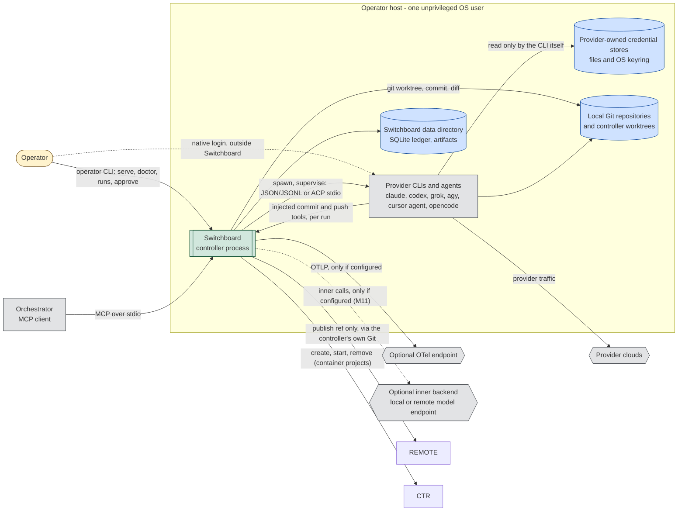
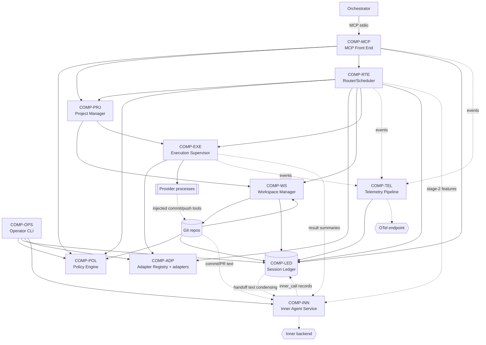
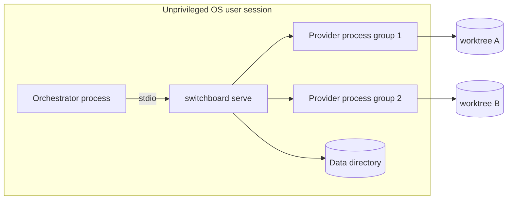
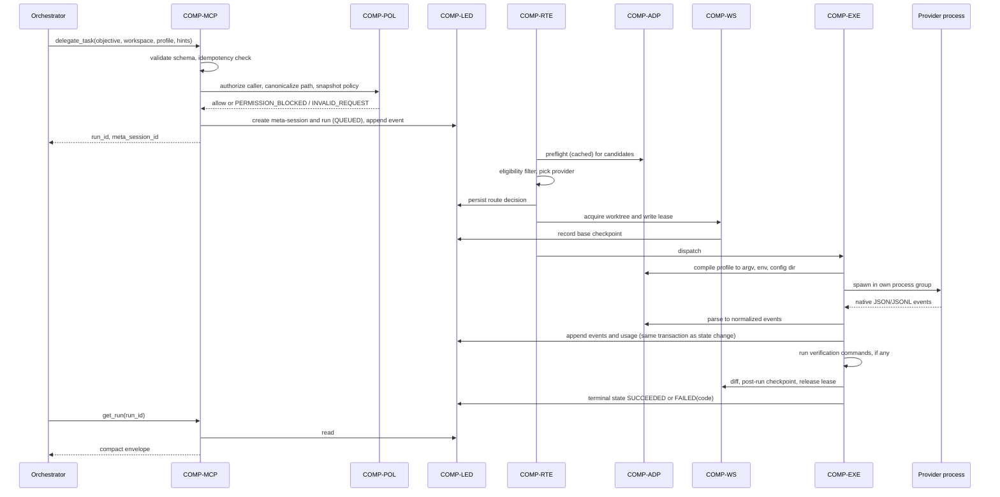
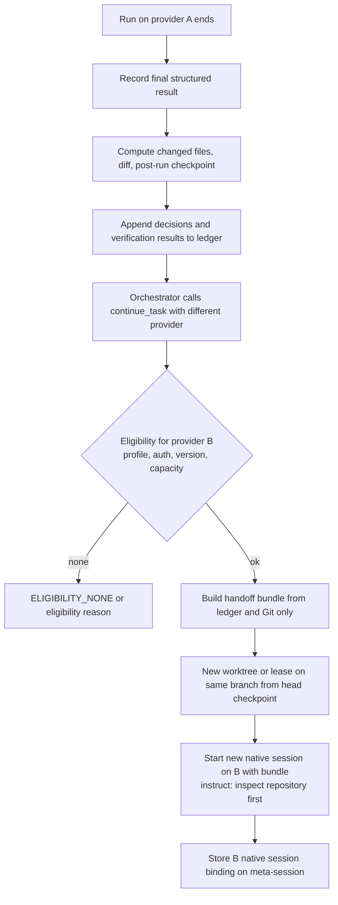
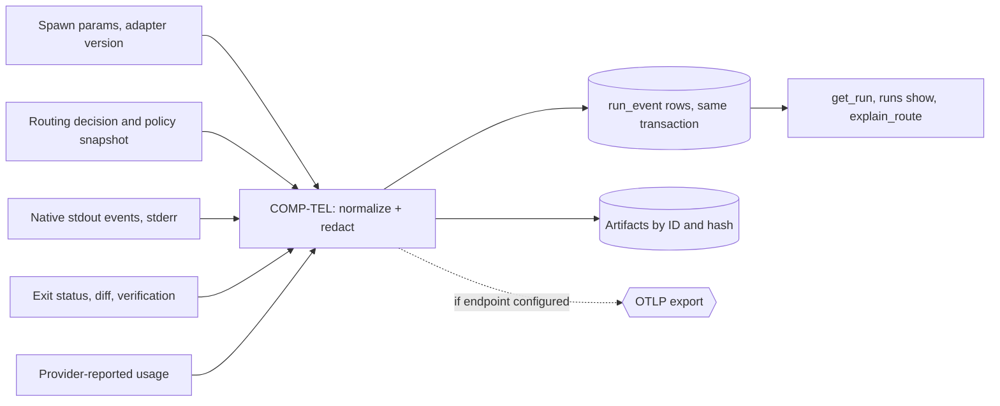
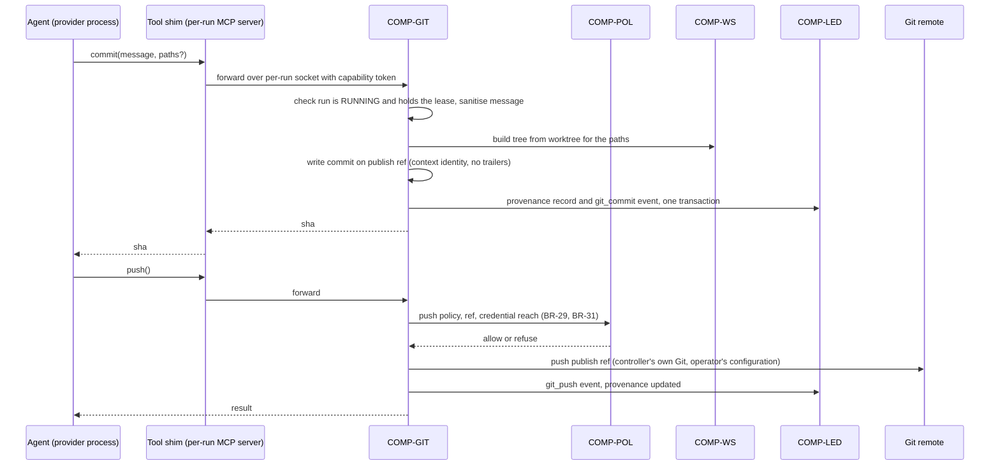

# High-Level Design (HLD)

| Field | Value |
| --- | --- |
| Status | Draft, baseline for milestone M1 |
| Owns | System boundary, components `COMP-*`, trust boundaries, integration styles, deployment topology, major data flows, threat scenarios |
| Does not own | Requirements ([SRS](../requirements/SRS.md)), workflows and state machine ([FRD](../requirements/FRD.md)), collaboration patterns and traceability ([SDD](SDD.md)), technology choices ([TDD](TDD.md)), schemas and contracts ([LLD](LLD.md)), sequencing ([ROADMAP](../ROADMAP.md)) |
| Last reconciled | 2026-10-13 |

Nothing described here is implemented. No code, tests, CI or configuration exist as of 2026-10-12. Decisions cited from
ADRs are "Delegated" (made by an agent under zemdregon's delegation) and have not been individually reviewed by zemdregon.

## 1. System context

Switchboard is a local, headless controller. A primary orchestrator (for example OpenClaw or Grok Bot) spawns it as an
MCP server over stdio and delegates coding tasks. Switchboard launches the operator's own provider CLIs, using the
logins those CLIs already hold, inside isolated Git worktrees under a per-run policy
([ADR-0002](../adr/0002-mcp-upstream-acp-downstream.md), [ADR-0003](../adr/0003-no-credential-handling.md),
[ADR-0011](../adr/0011-single-operator-local-deployment.md)).



### 1.1 System boundary

Inside the boundary (Switchboard owns): the MCP front end, policy evaluation, session ledger, workspace manager,
router/scheduler, execution supervisor, provider adapters, telemetry pipeline and operator CLI (scope per [SRS
§2](../requirements/SRS.md)).

Outside the boundary (Switchboard does not own, control or reimplement):

| Outside | Why it stays outside |
| --- | --- |
| Provider CLIs, their agent harnesses, models and clouds | Switchboard only launches the documented automation surface ([ADR-0002](../adr/0002-mcp-upstream-acp-downstream.md)); it never reimplements provider protocols (FR-AUTH-01). |
| Provider logins, tokens and credential stores | Operator logs in natively; Switchboard never reads or moves credentials ([ADR-0003](../adr/0003-no-credential-handling.md), FR-AUTH-01, NFR-SEC-01). |
| The orchestrator's own logic, memory and task decomposition | Switchboard sees only MCP tool calls. |
| Integration of result branches into the operator's branches | Results are controller-owned branches plus diffs; merging them is the orchestrator's or operator's step (FR-WS-05, [ADR-0006](../adr/0006-worktree-checkpoints-no-blind-replay.md)). |
| The remote Git host and the operator's push credentials | Switchboard pushes the publish ref only, when a context's policy enables it, using the operator's existing Git configuration; it stores no credentials and never gives them to an agent (FR-GIT-05, FR-GIT-06, [ADR-0014](../adr/0014-tool-only-commits-and-publication.md)). |
| The container runtime and images | Switchboard asks the runtime to create, start and remove containers (M10); it does not implement one, and the runtime is a Delegated, Proposed choice (rootless, [ADR-0013](../adr/0013-projects-environments-and-contexts.md)). |
| OTel collector and its storage | Switchboard only exports when the operator configures an endpoint (FR-TEL-02, NFR-PRIV-01). |
| The inner backend, its model and its host (M11) | Switchboard sends redacted, budget-limited single-turn prompts to the one backend the operator configured and treats the answer as untrusted data; it ships no default backend or model and holds no credential for it (FR-INN-01, FR-INN-03, FR-INN-16, [ADR-0016](../adr/0016-inner-agent.md)). |
| Host OS hardening (user accounts, disk quotas, firewall) | Assumption: the operator provides an unprivileged user (NFR-SEC-04); additional outer sandboxing is a TDD matter. |

### 1.2 Explicit exclusions

- Egress is limited to what the operator configures: provider CLI traffic (made by the CLIs), optional OTLP export, and,
  from M11, calls to the one optional inner backend under the locality rules of FR-INN-16 (NFR-PRIV-01,
  [ADR-0016](../adr/0016-inner-agent.md)).
- No network listener: MCP is stdio only; HTTP/SSE is deferred ([ADR-0002](../adr/0002-mcp-upstream-acp-downstream.md),
  [ADR-0011](../adr/0011-single-operator-local-deployment.md)).
- No web interface and no login commands (FR-OPS-03). A read-only usage dashboard is deferred (FR-TEL-04).
- No multi-tenant, multi-user, hosted or resale operation ([ADR-0011](../adr/0011-single-operator-local-deployment.md);
  NFR-COMP-01 requires per-provider review before such use).
- No upstream ACP server (deferred, [ADR-0002](../adr/0002-mcp-upstream-acp-downstream.md)); no Windows host
  (NFR-PORT-03).

## 2. Components



| ID | Component | Responsibilities | Primary requirements |
| --- | --- | --- | --- |
| COMP-MCP | MCP Front End | Serve MCP tools over stdio; validate inputs against JSON Schemas before side effects; authenticate the configured MCP client entry and cap its trust profile; apply idempotency keys; return compact envelopes with exactly one failure code; never return transcripts or credentials. | FR-MCP-01..09, NFR-SEC-05 |
| COMP-POL | Policy Engine | Define the five trust profiles; evaluate caller authorization, workspace-root rules and compliance manifests; produce the per-run policy snapshot; gate bypass flags to approved `privileged` runs; fail closed on unknown state. | FR-POL-01..10, FR-MCP-06, NFR-SEC-06 |
| COMP-LED | Session Ledger | Own canonical state: meta-sessions, runs, append-only events, decisions, artifacts (SQLite plus content-addressed files), checkpoints, usage, health, route decisions, approvals; provide transactional state transitions; enforce retention. | FR-SES-01..05, FR-TEL-01, NFR-REL-01, NFR-DATA-01 |
| COMP-WS | Workspace Manager | Canonicalize paths against allowed roots; create worktrees and controller branches from recorded checkpoints; grant exclusive write leases; record diffs and post-run checkpoints (internal, never published); roll back; garbage-collect. Never touch the operator's checked-out branch; never push. | FR-WS-01..07, FR-POL-10, FR-GIT-08 |
| COMP-PRJ | Project Manager | Resolve a project reference to its repository context, base ref, environment and ceilings; enforce the lower of client and project ceilings; list projects for a client; for `container` environments (M10) create, start, limit and remove the container and clean up orphans at startup. Holds no state of its own: definitions come from configuration and are snapshotted per run. | FR-PRJ-01..09 |
| COMP-GIT | Git Publisher | Serve the per-run injected `commit` and `push` tools from outside the agent's process tree; build commits on the publish ref with the context identity and sanitised message; check refs before and after runs for violations; push the publish ref under policy; write provenance records; hold the only path to push credentials. Optionally obtain a draft message from COMP-INN when the commit-message task is enabled, and run it through the same sanitiser (FR-INN-10). | FR-GIT-01..09, FR-INN-10 |
| COMP-RTE | Router/Scheduler | Hard eligibility filter, later weighted scoring and classifier; capacity estimator; bounded priority queue; per-provider concurrency and circuit breakers; retry and failover decisions; persist route decisions. May take stage-2 features from COMP-INN, labelled by source, never for eligibility (FR-INN-12). | FR-RTE-01..05, FR-CAP-01..07, FR-INN-12 |
| COMP-EXE | Execution Supervisor | Spawn provider processes (on the host or inside the project's container) in their own process group with allowlisted environment; subprocess JSON/JSONL and (M4) ACP client transports; timeouts, cancellation, grace-then-kill; capture stdout events and stderr separately; run verification commands; startup reconciliation of orphaned runs. | FR-EXE-01..08, FR-EXE-07, NFR-REL-02 |
| COMP-ADP | Adapter Registry and provider adapters | Per provider: probe, version gate, auth preflight, compile trust profile to native controls, parse native structured output, resume, cancel; model registry; compliance manifests; conformance suites. | FR-ADP-01..11, FR-AUTH-02, NFR-MAINT-01 |
| COMP-TEL | Telemetry Pipeline | Turn lifecycle observations into run events and OTel spans; redact prompts, environment and full shell output; export only to an operator-configured endpoint. | FR-TEL-01..03, NFR-OBS-01, NFR-PRIV-01 |
| COMP-OPS | Operator CLI | `serve`, `doctor`, `runs list/show`, `approve`, `adapters validate`, `projects list/show/validate`, `inner status`, `inner test <task>`; the only path to privileged approval and version acceptance. | FR-OPS-01..03, FR-POL-09, FR-ADP-03, FR-PRJ-08, FR-INN-17 |
| COMP-INN | Inner Agent Service (M11) | Optional, advisory text service behind one backend port (`http` or `cli` kind). Runs the per-task pipeline: deterministic redaction, input budget, call with per-call timeout and circuit breaker, parse and validate against the task schema, at most one re-ask, then accept or deterministic fallback. Applies locality gating (`local` or `remote`, `allow_remote`, `allow_source_content`, project `inner_agent` setting), tracks per-task rejection rate and suspends a task, and writes `inner_call` records (sizes and hashes only, never bodies) through COMP-LED. Holds **no policy authority**: its output reaches no decision in COMP-POL, eligibility, approvals, ceilings, push policy, sanitiser rules, redaction or failure classification, and it cannot change a run's status. Callers: COMP-GIT (commit and PR text), COMP-RTE (stage-2 route features), the handoff builder over COMP-LED and COMP-WS data, COMP-EXE (result and log summaries), COMP-OPS (`doctor`, `inner` commands). | FR-INN-01..17, FR-INN-06, NFR-PRIV-01 |

Collaboration per workflow, call direction and error propagation are in the [SDD](SDD.md); schemas and contracts are in
the [LLD](LLD.md).

## 3. Trust boundaries

Controls cite requirements and ADRs; a control is a design intent until its verification (all currently *planned*) is
performed.

| # | Boundary | Threat across it | Controls | Cites |
| --- | --- | --- | --- | --- |
| TB-1 | Orchestrator → controller (MCP stdio) | Orchestrator is an LLM agent and may be manipulated; may request excessive profile, paths or provider | Schema validation before side effects; per-client maximum trust profile; `privileged` never grantable via MCP; routing hints only narrow; path canonicalization to allowed roots; idempotency keys; compact envelopes only | FR-MCP-05, 06, 08, 09, FR-POL-09, FR-POL-10, NFR-SEC-05 |
| TB-2 | Controller → provider process | Provider CLI inherits controller secrets; runaway or hung process; weakened flags | Explicit environment allowlist; own process group, wall-clock timeout, group kill; per-run flags and config dirs, never global provider config; no bypass flags outside an approved `privileged` scope that sets bypass ([ADR-0017](../adr/0017-approved-privileged-scope-bypass.md)); version gate | FR-EXE-01, 07, FR-POL-02, 03, 08, FR-ADP-03, NFR-SEC-02, [ADR-0004](../adr/0004-trust-profiles-no-bypass-flags.md), [ADR-0009](../adr/0009-version-gated-adapters.md) |
| TB-3 | Provider process → credential store | Same-user agent shell reads plaintext tokens or keyring; controller mishandles tokens | Controller never reads or copies credentials; auth state only via provider status or harmless call; untrusted profiles disable arbitrary shell on adapters that cannot confine commands from the credential store; no credential values in DB, logs, telemetry, MCP output | FR-AUTH-01, 02, FR-POL-06, NFR-SEC-01, FR-TEL-03, [ADR-0003](../adr/0003-no-credential-handling.md) |
| TB-4 | Agent-executed commands → host and network | Writes outside workspace, network exfiltration, destructive commands | Profile compiled into native permission rules and native sandbox controls as separate dimensions; worktree per write-capable run; network off for untrusted profiles; denial ends run instead of hanging; Git write operations denied by profile (FR-GIT-01); operator branch untouched | FR-POL-01, 02, 05, FR-WS-01, 05, FR-GIT-01, NFR-SEC-03, [ADR-0004](../adr/0004-trust-profiles-no-bypass-flags.md), [ADR-0006](../adr/0006-worktree-checkpoints-no-blind-replay.md) |
| TB-5 | Repository content → agent (untrusted input) | Prompt injection in files; repo hooks, MCP definitions, `CLAUDE.md`/`AGENTS.md` instructions | Repo-supplied agent config not loaded under untrusted and `test-sandboxed` profiles (native switches such as Claude `--bare`); malicious-fixture suite; handoff tells next agent to inspect repo rather than trusting prior text | FR-POL-04, NFR-SEC-03, FR-SES-04 |
| TB-6 | Controller → telemetry endpoint | Leakage of prompts, env, output | Redaction; large output kept as local artifacts by ID and hash; export only when configured | FR-TEL-03, NFR-PRIV-01, [ADR-0012](../adr/0012-telemetry-at-wrapper-boundary.md) |
| TB-7 | Agent → injected tool channel and Git state | An injected-prompt agent commits or pushes on its own, forges tool calls, abuses `commit` to write attribution or sensitive paths, or reaches push credentials from a same-user shell | Git writes denied in the compiled profile (in a `container` environment, no Git client in the image and no Git directory mounted); per-run channel with a capability token, served from the controller outside the agent's process tree; sanitiser and path checks on every call; ref snapshots before and after the run; push default `none`, publish ref only, never forced; credentials never in the agent's environment and push withheld where the agent could read them (BR-31) | FR-GIT-01..06, FR-EXE-07, FR-POL-06, [ADR-0014](../adr/0014-tool-only-commits-and-publication.md) |
| TB-8 | Controller → container runtime and container → host | A container with too many mounts or a runtime socket becomes a host escape; orphaned containers outlive the controller; provider logins get copied in | Mount only the run worktree and declared read-only contexts; never the home directory, data directory, push credentials or runtime socket; limits and network policy per run; removal at run end and at startup reconciliation; no controller copying of credentials (FR-AUTH-01) | FR-PRJ-05, 07, FR-AUTH-01, [ADR-0013](../adr/0013-projects-environments-and-contexts.md) |
| TB-9 | Orchestrator (MCP client) → project definitions | A compromised or prompt-injected orchestrator creates a project that mounts or targets paths, providers, ceilings, push rights or containers beyond its own; or edits operator projects | `manage_projects` off by default; dynamic projects only, never configured ones; repository paths under allowed roots; ceiling, providers and push policy no wider than the client's entry; `container`, any push and any widening wait for operator approval on the CLI; creator-only visibility; every call recorded | FR-PRJ-10, FR-POL-10, FR-MCP-06, [ADR-0013](../adr/0013-projects-environments-and-contexts.md) |
| TB-10 | Controller → inner backend (M11) | Data egress: repository content, diffs or log excerpts sent to a remote model; prompt injection through repository content, diffs or logs that steers the model; hostile, malformed or low-quality output reaching published history, routing or handoffs; consumption of a shared provider subscription or an unbounded call rate | One optional backend, no default; `local` versus `remote` classification with `allow_remote` and per-task `allow_source_content`, and project or context `inner_agent` off or `local_only`; deterministic redaction before every call and an input budget; stateless single-turn call with no tools; no credential in configuration; output parsed, bounded and stripped, at most one re-ask, commit and PR text through the FR-GIT-04 sanitiser, deterministic fallback on any failure; no inner output reaches policy, retry, push or run status, enforced by structure and an import-boundary test; `inner_call` records apart from provider usage, with a doctor warning for `shares_subscription_with`; no prompt or response bodies logged; per-call timeout and circuit breaker | FR-INN-02, 03, 06, 07, 08, 10, 15, 16, NFR-PRIV-01, NFR-SEC-01, [ADR-0016](../adr/0016-inner-agent.md) |

Residual limitation (from [R2] credential boundary): a dedicated OS user limits host blast radius but does not isolate a
credential from an agent running as the same user. Hence FR-POL-06 makes eligibility, not an outer wrapper, the control.
The same limit applies to Git push credentials in a `host` environment: FR-GIT-06 and BR-31 withhold the `push` tool
unless the agent cannot run commands that could read them. A `container` environment (M10) is the stronger answer,
because the credentials are never mounted into it, and its image has no Git client, so Git-write denial (FR-GIT-01)
holds there by construction rather than through provider deny rules, including in approved bypass runs ([ROADMAP owner
decision 24](../ROADMAP.md#42-owner-decisions)). `host` and `container` environments are both supported, chosen per
project by the deployer.

## 4. Integrations

Each adapter chooses the transport the provider documents ([R2] adapter matrix;
[ADR-0002](../adr/0002-mcp-upstream-acp-downstream.md)). The normalized contract is in [LLD
§2](LLD.md#2-adapter-contract); per-provider strategy in [TDD §4](TDD.md#4-provider-adapter-strategy).

| Provider | Initial transport | Later or alternate transport | Milestone | Notes |
| --- | --- | --- | --- | --- |
| Claude Code | Subprocess `claude -p`, JSON/stream-JSON | None planned | M2 | First adapter (FR-ADP-06). |
| Codex | Subprocess `codex exec --json`, JSONL | None planned | M2 | Native events; no custom wrapper. |
| Grok Build | Subprocess `grok -p`, JSON/streaming-JSON | ACP stdio (`grok agent stdio`) | M4 | ACP via FR-EXE-03 (Should). |
| Antigravity | Subprocess `agy -p`, JSON/stream-JSON | None planned | M4 | Fails fast when unauthenticated. |
| Cursor CLI | Subprocess `agent -p`, JSON/stream-JSON | ACP stdio (`agent acp`) | M4 | Trust, MCP approval, force and sandbox decided independently. |
| OpenCode | Subprocess `opencode run` | Persistent local service `serve`/`attach` (deferred, FR-EXE-04) | M4 (Should) | Record harness and backing provider (FR-ADP-10). |
| Kimi Code | Undetermined | Undetermined | Blocked | Disabled until the CLI contract is pinned (FR-ADP-09). |
| Muse Code | Subprocess `muse exec --json`, JSONL | None planned | M4 (Should) | Unverified (R-33); FR-ADP-12. |

Other interfaces: MCP stdio upstream (COMP-MCP); Git CLI against local repositories (COMP-WS, COMP-GIT) and, under push
policy, a remote; the per-run injected-tool channel from agent to COMP-GIT; container runtime (COMP-PRJ, M10); OTLP export
(COMP-TEL, M8); operator CLI (COMP-OPS).

## 5. Deployment topology

One controller process per operator, on a host the operator controls, running as an unprivileged user alongside the
already-installed and logged-in provider CLIs (NFR-SEC-04, [ADR-0011](../adr/0011-single-operator-local-deployment.md)).
The orchestrator spawns `switchboard serve`; stdio ties the lifetime of the MCP session to that process. Linux (x86-64,
arm64) first (NFR-PORT-01); macOS in M8.



Data directory layout. **Proposed**; paths, names and the config format are not decided (see [TDD](TDD.md) and
[LLD](LLD.md)):

| Path (proposed) | Contents |
| --- | --- |
| `<data>/ledger.db` (+ WAL files) | SQLite ledger ([ADR-0005](../adr/0005-sqlite-ledger.md)) |
| `<data>/artifacts/ab/cd/<sha256>` (first two byte pairs of the hash, per [LLD §1](LLD.md#1-data-model)) | Content-addressed diffs, stdout events, stderr, verification output |
| `<data>/worktrees/<meta_session_id>/<run_id>/` | Controller-created Git worktrees (could alternatively live beside the source repo; open question) |
| `<data>/runs/<run_id>/tools.sock` (Proposed) | Per-run socket for the injected tools; removed with the run; mode `0600` |
| `<config>/` | Operator configuration: allowed roots, projects (environment, contexts, push policy, commit identity, sanitiser patterns), MCP client entries with maximum profiles and project lists, tier priors, routing weights, retention, compliance manifests |
| `<data>/logs/` | Structured controller logs, free of secrets and prompts (FR-TEL-03) |

`<data>` and `<config>` are assumed to resolve to per-user directories chosen by the operator. Disk growth is bounded by
retention and GC (FR-WS-07, NFR-DATA-01).

## 6. Major data flows

### 6.1 Delegate run end to end (WF-1)



State names follow the [FRD](../requirements/FRD.md) state machine. Ledger-before-side-effect ordering is detailed in
[SDD](SDD.md).

### 6.2 Cross-provider handoff (WF-3)



The controller never reads provider transcript files (FR-SES-04,
[ADR-0001](../adr/0001-controller-owned-canonical-state.md)).

### 6.3 Telemetry flow



All signals come from the wrapper boundary; no provider hooks are installed into global config
([ADR-0012](../adr/0012-telemetry-at-wrapper-boundary.md), FR-POL-08). Span structure: [LLD
§7](LLD.md#7-telemetry-spans).

### 6.4 Commit and publish through the injected tools (WF-11, WF-12)



The agent never holds a credential or runs Git for these steps. After the run, COMP-GIT compares refs with the snapshot
taken at lease time and reports anything the controller did not create (FR-GIT-03). Internal checkpoint commits and run
branches are not part of this flow and are never pushed (FR-GIT-08).

### 6.5 Inner task call, including commit-message drafting (WF-13, WF-11)

```mermaid
sequenceDiagram
    participant A as Agent (provider process)
    participant G as COMP-GIT
    participant N as COMP-INN
    participant B as Inner backend
    participant L as COMP-LED
    A->>G: commit(paths, message omitted)
    G->>G: run holds lease; task enabled and mode permits drafting
    G->>N: task commit_message, diff of the committed paths
    N->>N: locality gate, redact, input budget
    N->>B: single-turn prompt (no tools, per-call timeout)
    B-->>N: text
    N->>N: parse and validate against task schema, one re-ask at most
    N->>L: inner_call record (task, outcome, sizes, hashes, latency)
    N-->>G: validated draft, or unavailable
    G->>G: sanitise (FR-GIT-04); empty or unavailable gives MESSAGE_REQUIRED
    G->>L: provenance and git_commit event, one transaction
    G-->>A: sha, or tool error MESSAGE_REQUIRED
```

1. A caller (COMP-GIT, COMP-RTE, handoff builder, COMP-EXE or COMP-OPS) asks COMP-INN for one task with controller-owned
   inputs only.
2. COMP-INN refuses at once if the task is off, suspended, the project says `off`, the backend is `remote` without
   `allow_remote`, or source content would go to a `remote` backend without `allow_source_content`; the caller then uses
   its deterministic fallback.
3. Otherwise COMP-INN redacts, applies the input budget, calls the backend, validates the output, and records an
   `inner_call` row through COMP-LED. Failure of any step returns "unavailable" to the caller, never an error that fails
   a run (FR-INN-08).
4. The caller decides what to do with the validated text. Commit and PR text goes through the sanitiser; route features
   are stored with source, model and template version; condensed text is labelled and points to the raw artifact.

The agent's own message always wins unless the operator chose mode `always`. No branch of this flow reaches COMP-POL,
the retry logic or the push path (FR-INN-06). Contracts: [LLD §13](LLD.md#13-inner-agent).

## 7. Threat scenarios

Scenarios are design-time analysis, not test results. Residual risk is the drafter's assessment of what remains after
the cited controls.

| Scenario | Mitigations | Residual risk |
| --- | --- | --- |
| Prompt injection in repository files | Untrusted profiles: read-only or isolated worktree, no or narrow shell, network off; repo agent config not loaded (FR-POL-04); no push, branch isolation (FR-WS-05); results are branches to be reviewed | Agent may still produce misleading edits or summaries inside its limits; reviewer must treat output as untrusted |
| Malicious repo MCP definitions or hooks | Not loaded under untrusted profiles; `--approve-mcps` never added outside approved `privileged` (FR-POL-03, 04); malicious-fixture suite (NFR-SEC-03) | Depends on each provider honouring its disable switch; trusted profiles accept allowlisted config by design |
| Credential exfiltration | Controller never touches tokens (FR-AUTH-01); env allowlist (FR-EXE-07); shell disabled where confinement from credential store is not possible (FR-POL-06); network off for untrusted profiles; no secrets in logs/telemetry (NFR-SEC-01, FR-TEL-03) | Same-user credential files remain readable by an unconfined agent shell under `trusted-development`/`privileged`; mitigated only by adapter eligibility and operator choice |
| Sandbox escape | Native sandbox plus permission rules compiled per adapter; denial surfaces as `SANDBOX_VIOLATION`/`PERMISSION_BLOCKED`; fixtures per adapter; additional outer sandbox is a TDD option ([ADR-0004](../adr/0004-trust-profiles-no-bypass-flags.md)) | Provider sandbox bugs are outside Switchboard's control; Linux sandbox strength differs per provider |
| Orchestrator requests excessive profile | Per-client maximum profile; `privileged` needs operator `approve` (FR-MCP-06, FR-POL-09); `require_provider` cannot bypass checks (FR-MCP-05) | A mis-configured client maximum is an operator error; approval fatigue is a human factor |
| CLI update weakens flags or breaks parsing | Version-gated adapters; unverified versions ineligible until `adapters validate` after conformance (FR-ADP-02, 03, 11, [ADR-0009](../adr/0009-version-gated-adapters.md)); native structured output only (FR-ADP-04) | Version range may be too coarse to catch a behavioural change in a patch release; version canaries come in M8 |
| Runaway processes or disk exhaustion | Process-group timeout and kill (FR-EXE-01); bounded queue and concurrency limits (FR-CAP-04, NFR-PERF-03); retention and GC (FR-WS-07, NFR-DATA-01); reconciliation after restart (FR-EXE-06) | No disk or CPU quota enforcement is specified; a single run can still fill the disk before GC runs |
| Malformed or hostile provider output | Schema-validated parsing, `OUTPUT_PROTOCOL_ERROR`, fail closed (NFR-SEC-06, NFR-REL-02) | Parser bugs |
| Agent commits or pushes by itself (provider built-in or shell) | Git writes denied in the compiled profile (FR-GIT-01); no push credentials in the agent's environment (FR-GIT-06); ref snapshot comparison with commits kept out of the published history (FR-GIT-03) | An unconfined `host` shell can still reach ambient credentials, and a push that succeeds cannot be undone from here; mitigated by withholding push in that case (BR-31) and by container environments (M10) |
| Attribution reaches published history (trailer, footer, session ID) | Only the commit tool publishes; sanitiser with built-in and operator patterns (FR-GIT-04); fixtures for typical trailers; checkpoint history never published (FR-GIT-08) | The sanitiser is pattern-based, so unusual wording can slip through, and an agent can write attribution into file contents (R-14) |
| Audit trail lost or unusable | Append-only provenance in the ledger with SHA, tree hash and patch ID (FR-GIT-07) | An operator rebase or squash changes SHAs; the tree hash and patch ID are best-effort links (R-17) |
| Container escape or orphaned container | Minimal mounts, no runtime socket, limits, removal and orphan sweep (FR-PRJ-05, 07) | Depends on the chosen runtime's isolation; the rootless runtime is Proposed and unverified |
| Orchestrator names a project or provider it should not use | Per-client project list and the lower-of-two ceiling (FR-PRJ-06) | Misconfigured entries are an operator error |
| Data leaves the host through the inner backend (M11) | Backend `local` or `remote` classification; `allow_remote` and per-task `allow_source_content`; project `inner_agent` off or `local_only`; deterministic redaction and input budget before every call; no bodies logged (FR-INN-16, FR-TEL-03, NFR-PRIV-01) | Pattern-based redaction misses unusual secrets or proprietary code; an operator who enables `remote` plus source content accepts that exposure; the backend operator's own retention is outside Switchboard's control |
| Poisoned inner output reaches published history or handoffs (M11) | Output treated as untrusted data: schema, length bound, control-character stripping, one re-ask (FR-INN-07); commit and PR text through the FR-GIT-04 sanitiser and an empty result is a tool error, never an invented message (FR-INN-10, FR-INN-11); condensed handoff text is labelled and keeps a pointer to the raw artifact (FR-INN-13) | Misleading but well-formed prose can pass validation and the pattern-based sanitiser; reviewers must treat drafts as untrusted suggestions (R-14 applies) |
| Inner agent low-quality or unavailable (M11) | Failure never fails a run; deterministic fallback per task; per-call timeout and circuit breaker; per-call outcomes recorded and automatic task suspension on a high rejection rate; `doctor` shows degraded state (FR-INN-08, FR-INN-09, FR-INN-17) | Plausible but poor output below the rejection threshold; suspension thresholds are proposed targets and untuned |
| Inner agent used to weaken policy (M11) | No inner output is an input to profiles, eligibility, approvals, ceilings, push policy, sanitiser rules, redaction, retry or any run status (FR-INN-06); COMP-INN is not injectable into those components and an import-boundary test fails the build otherwise; routing features are scoring inputs only and cannot override `require_provider` (FR-INN-12) | A future change that adds a dependency edge must be caught by the boundary test and code review; the test covers imports, not data smuggled through a permitted caller |

## 8. Open items for downstream documents

- Data directory layout and worktree location: TDD/LLD to settle (this document proposes only).
- Per-run disk and resource quotas: not specified in the SRS for `host`; container projects get limits (FR-PRJ-05), which
  partly answers risk R-8. TDD to decide whether `host` needs any.
- Container runtime and provider logins inside containers: Proposed in
  [ADR-0013](../adr/0013-projects-environments-and-contexts.md), unverified until the M10 spike. Orchestrator-created
  projects: allowed by zemdregon (Q-7) with the gates in FR-PRJ-10.
- Inner agent (M11, [ADR-0016](../adr/0016-inner-agent.md)): HTTP client choice and the backend port are settled in
  [TDD §3.12](TDD.md#312-inner-agent); prompt templates, schemas, budgets and the `inner_call` table in [LLD
  §13](LLD.md#13-inner-agent). Open: whether the `cli` kind can be shown tool-free (Q-26), locality classification of
  names that resolve to loopback, and rejection-rate thresholds (proposed targets, unmeasured).
