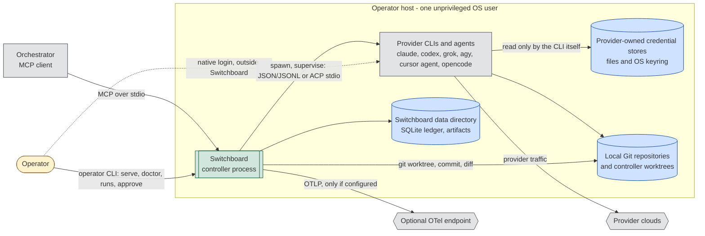
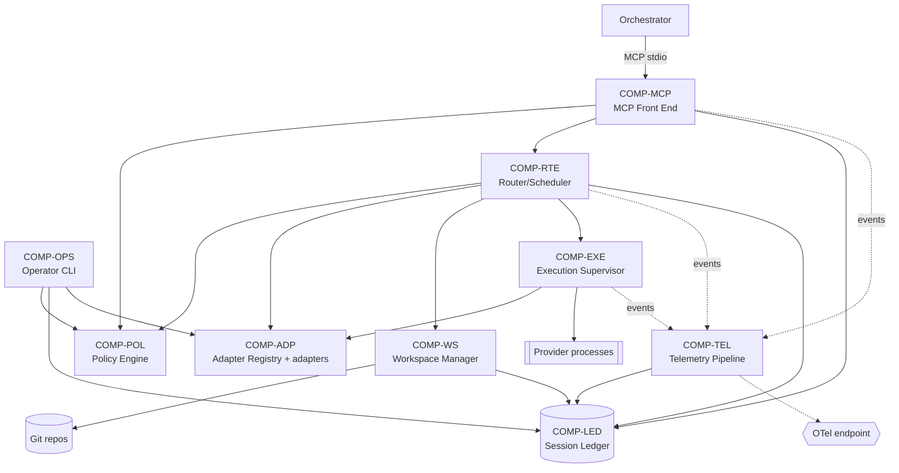
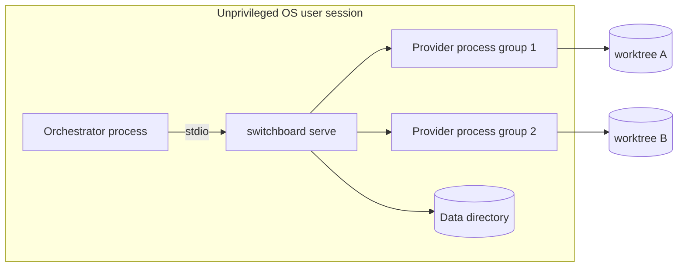
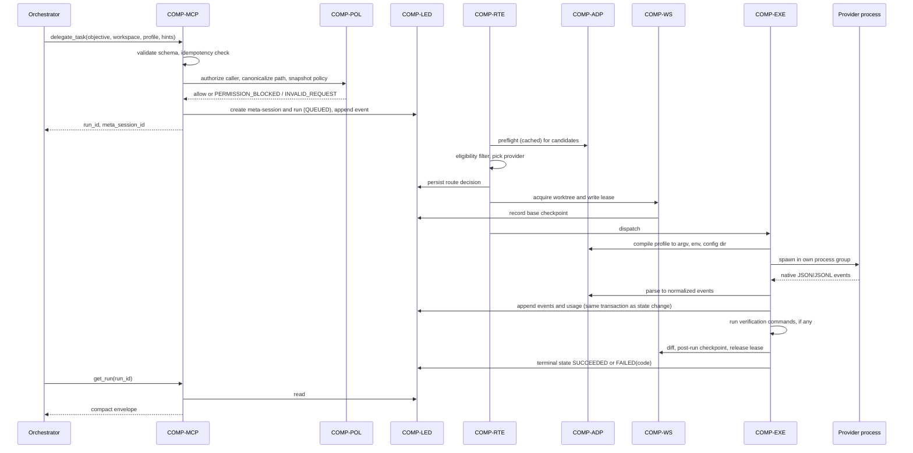
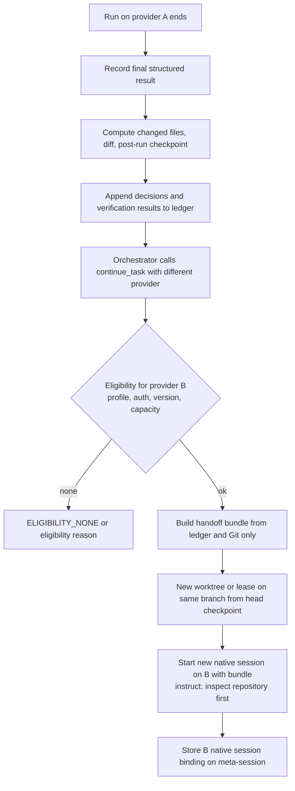
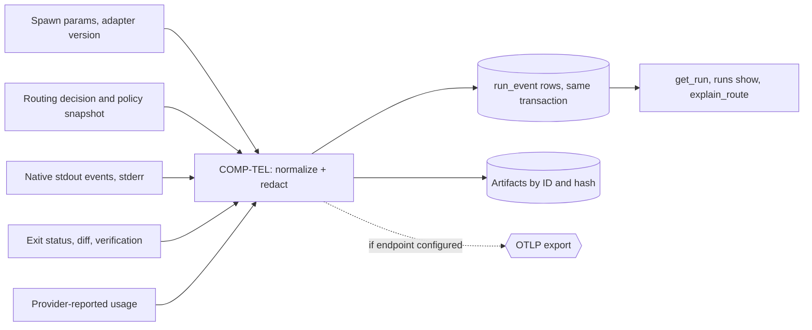

# High-Level Design (HLD)

| Field | Value |
| --- | --- |
| Status | Draft, baseline for milestone M1 |
| Owns | System boundary, components `COMP-*`, trust boundaries, integration styles, deployment topology, major data flows, threat scenarios |
| Does not own | Requirements ([SRS](../requirements/SRS.md)), workflows and state machine ([FRD](../requirements/FRD.md)), collaboration patterns and traceability ([SDD](SDD.md)), technology choices ([TDD](TDD.md)), schemas and contracts ([LLD](LLD.md)), sequencing ([ROADMAP](../ROADMAP.md)) |
| Last reconciled | 2026-10-12 |

Nothing described here is implemented. No code, tests, CI or configuration exist as of 2026-10-12. Decisions cited from
ADRs are "Delegated" (made by an agent under Ender's delegation) and have not been individually reviewed by Ender.

## 1. System context

Switchboard is a local, headless controller. A primary orchestrator (for example OpenClaw or Grok Bot) spawns it as an
MCP server over stdio and delegates coding tasks. Switchboard launches the operator's own provider CLIs, using the
logins those CLIs already hold, inside isolated Git worktrees under a per-run policy
([ADR-0002](../adr/0002-mcp-upstream-acp-downstream.md), [ADR-0003](../adr/0003-no-credential-handling.md),
[ADR-0011](../adr/0011-single-operator-local-deployment.md)).

### 1.1 System boundary

Inside the boundary (Switchboard owns): the MCP front end, policy evaluation, session ledger, workspace manager,
router/scheduler, execution supervisor, provider adapters, telemetry pipeline and operator CLI (scope per [SRS
§2](../requirements/SRS.md)).

Outside the boundary (Switchboard does not own, control or reimplement):

| Outside | Why it stays outside |
| --- | --- |
| Provider CLIs, their agent harnesses, models and clouds | Switchboard only launches the documented automation surface ([ADR-0002](../adr/0002-mcp-upstream-acp-downstream.md)); it never reimplements provider protocols (FR-AUTH-01). |
| Provider logins, tokens and credential stores | Operator logs in natively; Switchboard never reads or moves credentials ([ADR-0003](../adr/0003-no-credential-handling.md), FR-AUTH-01, NFR-SEC-01). |
| The orchestrator's own logic, memory and task decomposition | Switchboard sees only MCP tool calls. |
| Integration of result branches, pushes to remotes | Results are controller-owned branches plus diffs; integration is the orchestrator's or operator's step (FR-WS-05, [ADR-0006](../adr/0006-worktree-checkpoints-no-blind-replay.md)). |
| OTel collector and its storage | Switchboard only exports when the operator configures an endpoint (FR-TEL-02, NFR-PRIV-01). |
| Host OS hardening (user accounts, disk quotas, firewall) | Assumption: the operator provides an unprivileged user (NFR-SEC-04); additional outer sandboxing is a TDD matter. |

### 1.2 Explicit exclusions

- No network listener: MCP is stdio only; HTTP/SSE is deferred ([ADR-0002](../adr/0002-mcp-upstream-acp-downstream.md),
  [ADR-0011](../adr/0011-single-operator-local-deployment.md)).
- No web interface and no login commands (FR-OPS-03). A read-only usage dashboard is deferred (FR-TEL-04).
- No multi-tenant, multi-user, hosted or resale operation ([ADR-0011](../adr/0011-single-operator-local-deployment.md);
  NFR-COMP-01 requires per-provider review before such use).
- No upstream ACP server (deferred, [ADR-0002](../adr/0002-mcp-upstream-acp-downstream.md)); no Windows host
  (NFR-PORT-03).

## 2. Components

| ID | Component | Responsibilities | Primary requirements |
| --- | --- | --- | --- |
| COMP-MCP | MCP Front End | Serve MCP tools over stdio; validate inputs against JSON Schemas before side effects; authenticate the configured MCP client entry and cap its trust profile; apply idempotency keys; return compact envelopes with exactly one failure code; never return transcripts or credentials. | FR-MCP-01..09, NFR-SEC-05 |
| COMP-POL | Policy Engine | Define the five trust profiles; evaluate caller authorization, workspace-root rules and compliance manifests; produce the per-run policy snapshot; gate bypass flags to approved `privileged` runs; fail closed on unknown state. | FR-POL-01..10, FR-MCP-06, NFR-SEC-06 |
| COMP-LED | Session Ledger | Own canonical state: meta-sessions, runs, append-only events, decisions, artifacts (SQLite plus content-addressed files), checkpoints, usage, health, route decisions, approvals; provide transactional state transitions; enforce retention. | FR-SES-01..05, FR-TEL-01, NFR-REL-01, NFR-DATA-01 |
| COMP-WS | Workspace Manager | Canonicalize paths against allowed roots; create worktrees and controller branches from recorded checkpoints; grant exclusive write leases; record diffs and post-run checkpoints; roll back; garbage-collect. Never push or touch the operator's checked-out branch. | FR-WS-01..07, FR-POL-10 |
| COMP-RTE | Router/Scheduler | Hard eligibility filter, later weighted scoring and classifier; capacity estimator; bounded priority queue; per-provider concurrency and circuit breakers; retry and failover decisions; persist route decisions. | FR-RTE-01..05, FR-CAP-01..07 |
| COMP-EXE | Execution Supervisor | Spawn provider processes in their own process group with allowlisted environment; subprocess JSON/JSONL and (M4) ACP client transports; timeouts, cancellation, grace-then-kill; capture stdout events and stderr separately; run verification commands; startup reconciliation of orphaned runs. | FR-EXE-01..08, FR-EXE-07, NFR-REL-02 |
| COMP-ADP | Adapter Registry and provider adapters | Per provider: probe, version gate, auth preflight, compile trust profile to native controls, parse native structured output, resume, cancel; model registry; compliance manifests; conformance suites. | FR-ADP-01..11, FR-AUTH-02, NFR-MAINT-01 |
| COMP-TEL | Telemetry Pipeline | Turn lifecycle observations into run events and OTel spans; redact prompts, environment and full shell output; export only to an operator-configured endpoint. | FR-TEL-01..03, NFR-OBS-01, NFR-PRIV-01 |
| COMP-OPS | Operator CLI | `serve`, `doctor`, `runs list/show`, `approve`, `adapters validate`; the only path to privileged approval and version acceptance. | FR-OPS-01..03, FR-POL-09, FR-ADP-03 |

Collaboration per workflow, call direction and error propagation are in the [SDD](SDD.md); schemas and contracts are in
the [LLD](LLD.md).

## 3. Trust boundaries

Controls cite requirements and ADRs; a control is a design intent until its verification (all currently *planned*) is
performed.

| # | Boundary | Threat across it | Controls | Cites |
| --- | --- | --- | --- | --- |
| TB-1 | Orchestrator → controller (MCP stdio) | Orchestrator is an LLM agent and may be manipulated; may request excessive profile, paths or provider | Schema validation before side effects; per-client maximum trust profile; `privileged` never grantable via MCP; routing hints only narrow; path canonicalization to allowed roots; idempotency keys; compact envelopes only | FR-MCP-05, 06, 08, 09, FR-POL-09, FR-POL-10, NFR-SEC-05 |
| TB-2 | Controller → provider process | Provider CLI inherits controller secrets; runaway or hung process; weakened flags | Explicit environment allowlist; own process group, wall-clock timeout, group kill; per-run flags and config dirs, never global provider config; no bypass flags outside approved `privileged`; version gate | FR-EXE-01, 07, FR-POL-02, 03, 08, FR-ADP-03, NFR-SEC-02, [ADR-0004](../adr/0004-trust-profiles-no-bypass-flags.md), [ADR-0009](../adr/0009-version-gated-adapters.md) |
| TB-3 | Provider process → credential store | Same-user agent shell reads plaintext tokens or keyring; controller mishandles tokens | Controller never reads or copies credentials; auth state only via provider status or harmless call; untrusted profiles disable arbitrary shell on adapters that cannot confine commands from the credential store; no credential values in DB, logs, telemetry, MCP output | FR-AUTH-01, 02, FR-POL-06, NFR-SEC-01, FR-TEL-03, [ADR-0003](../adr/0003-no-credential-handling.md) |
| TB-4 | Agent-executed commands → host and network | Writes outside workspace, network exfiltration, destructive commands | Profile compiled into native permission rules and native sandbox controls as separate dimensions; worktree per write-capable run; network off for untrusted profiles; denial ends run instead of hanging; no push, operator branch untouched | FR-POL-01, 02, 05, FR-WS-01, 05, NFR-SEC-03, [ADR-0004](../adr/0004-trust-profiles-no-bypass-flags.md), [ADR-0006](../adr/0006-worktree-checkpoints-no-blind-replay.md) |
| TB-5 | Repository content → agent (untrusted input) | Prompt injection in files; repo hooks, MCP definitions, `CLAUDE.md`/`AGENTS.md` instructions | Repo-supplied agent config not loaded under untrusted and `test-sandboxed` profiles (native switches such as Claude `--bare`); malicious-fixture suite; handoff tells next agent to inspect repo rather than trusting prior text | FR-POL-04, NFR-SEC-03, FR-SES-04 |
| TB-6 | Controller → telemetry endpoint | Leakage of prompts, env, output | Redaction; large output kept as local artifacts by ID and hash; export only when configured | FR-TEL-03, NFR-PRIV-01, [ADR-0012](../adr/0012-telemetry-at-wrapper-boundary.md) |

Residual limitation (from [R2] credential boundary): a dedicated OS user limits host blast radius but does not isolate a
credential from an agent running as the same user. Hence FR-POL-06 makes eligibility, not an outer wrapper, the control.

## 4. Integrations

Each adapter chooses the transport the provider documents ([R2] adapter matrix;
[ADR-0002](../adr/0002-mcp-upstream-acp-downstream.md)). The normalized contract is in [LLD
§2](LLD.md#2-adapter-contract); per-provider strategy in [TDD §4](TDD.md#4-provider-adapter-strategy).

| Provider | Initial transport | Later or alternate transport | Milestone | Notes |
| --- | --- | --- | --- | --- |
| Claude Code | Subprocess `claude -p`, JSON/stream-JSON | None planned | M2 | First adapter (FR-ADP-06). |
| Codex | Subprocess `codex exec --json`, JSONL | None planned | M2 | Native events; no custom wrapper. |
| Grok Build | Subprocess `grok -p`, JSON/streaming-JSON | ACP stdio (`grok agent stdio`) | M4 | ACP via FR-EXE-03 (Should). |
| Antigravity | Subprocess `agy -p`, JSON/stream-JSON | None planned | M4 | Fails fast when unauthenticated. |
| Cursor CLI | Subprocess `agent -p`, JSON/stream-JSON | ACP stdio (`agent acp`) | M4 | Trust, MCP approval, force and sandbox decided independently. |
| OpenCode | Subprocess `opencode run` | Persistent local service `serve`/`attach` (deferred, FR-EXE-04) | M4 (Should) | Record harness and backing provider (FR-ADP-10). |
| Kimi Code | Undetermined | Undetermined | Deferred | Disabled until the new CLI contract is pinned (FR-ADP-09, deferred by owner decision 6). |

Other interfaces: MCP stdio upstream (COMP-MCP); Git CLI against local repositories (COMP-WS); OTLP export (COMP-TEL,
M8); operator CLI (COMP-OPS).

## 5. Deployment topology

One controller process per operator, on a host the operator controls, running as an unprivileged user alongside the
already-installed and logged-in provider CLIs (NFR-SEC-04, [ADR-0011](../adr/0011-single-operator-local-deployment.md)).
The orchestrator spawns `switchboard serve`; stdio ties the lifetime of the MCP session to that process. Linux (x86-64,
arm64) first (NFR-PORT-01); macOS in M8.

Data directory layout. **Proposed**; paths, names and the config format are not decided (see [TDD](TDD.md) and
[LLD](LLD.md)):

| Path (proposed) | Contents |
| --- | --- |
| `<data>/ledger.db` (+ WAL files) | SQLite ledger ([ADR-0005](../adr/0005-sqlite-ledger.md)) |
| `<data>/artifacts/<sha256-prefix>/<sha256>` | Content-addressed diffs, stdout events, stderr, verification output |
| `<data>/worktrees/<meta_session_id>/<run_id>/` | Controller-created Git worktrees (could alternatively live beside the source repo; open question) |
| `<config>/` | Operator configuration: allowed roots, MCP client entries and maximum profiles, tier priors, routing weights, retention, compliance manifests |
| `<data>/logs/` | Structured controller logs, free of secrets and prompts (FR-TEL-03) |

`<data>` and `<config>` are assumed to resolve to per-user directories chosen by the operator. Disk growth is bounded by
retention and GC (FR-WS-07, NFR-DATA-01).

## 6. Major data flows

### 6.1 Delegate run end to end (WF-1)

State names follow the [FRD](../requirements/FRD.md) state machine. Ledger-before-side-effect ordering is detailed in
[SDD](SDD.md).

### 6.2 Cross-provider handoff (WF-3)

The controller never reads provider transcript files (FR-SES-04,
[ADR-0001](../adr/0001-controller-owned-canonical-state.md)).

### 6.3 Telemetry flow

All signals come from the wrapper boundary; no provider hooks are installed into global config
([ADR-0012](../adr/0012-telemetry-at-wrapper-boundary.md), FR-POL-08). Span structure: [LLD
§7](LLD.md#7-telemetry-spans).

## 7. Threat scenarios

Scenarios are design-time analysis, not test results. Residual risk is the drafter's assessment of what remains after
the cited controls.

| Scenario | Mitigations | Residual risk |
| --- | --- | --- |
| Prompt injection in repository files | Untrusted profiles: read-only or isolated worktree, no or narrow shell, network off; repo agent config not loaded (FR-POL-04); no push, branch isolation (FR-WS-05); results are branches to be reviewed | Agent may still produce misleading edits or summaries inside its limits; reviewer must treat output as untrusted |
| Malicious repo MCP definitions or hooks | Not loaded under untrusted profiles; `--approve-mcps` never added outside approved `privileged` (FR-POL-03, 04); malicious-fixture suite (NFR-SEC-03) | Depends on each provider honouring its disable switch; trusted profiles accept allowlisted config by design |
| Credential exfiltration | Controller never touches tokens (FR-AUTH-01); env allowlist (FR-EXE-07); shell disabled where confinement from credential store is not possible (FR-POL-06); network off for untrusted profiles; no secrets in logs/telemetry (NFR-SEC-01, FR-TEL-03) | Same-user credential files remain readable by an unconfined agent shell under `trusted-development`/`privileged`; mitigated only by adapter eligibility and operator choice |
| Sandbox escape | Native sandbox plus permission rules compiled per adapter; denial surfaces as `SANDBOX_VIOLATION`/`PERMISSION_BLOCKED`; fixtures per adapter; additional outer sandbox is a TDD option ([ADR-0004](../adr/0004-trust-profiles-no-bypass-flags.md)) | Provider sandbox bugs are outside Switchboard's control; Linux sandbox strength differs per provider |
| Orchestrator requests excessive profile | Per-client maximum profile; `privileged` needs operator `approve` (FR-MCP-06, FR-POL-09); `require_provider` cannot bypass checks (FR-MCP-05) | A mis-configured client maximum is an operator error; approval fatigue is a human factor |
| CLI update weakens flags or breaks parsing | Version-gated adapters; unverified versions ineligible until `adapters validate` after conformance (FR-ADP-02, 03, 11, [ADR-0009](../adr/0009-version-gated-adapters.md)); native structured output only (FR-ADP-04) | Version range may be too coarse to catch a behavioural change in a patch release; version canaries come in M8 |
| Runaway processes or disk exhaustion | Process-group timeout and kill (FR-EXE-01); bounded queue and concurrency limits (FR-CAP-04, NFR-PERF-03); retention and GC (FR-WS-07, NFR-DATA-01); reconciliation after restart (FR-EXE-06) | No disk or CPU quota enforcement is specified; a single run can still fill the disk before GC runs |
| Malformed or hostile provider output | Schema-validated parsing, `OUTPUT_PROTOCOL_ERROR`, fail closed (NFR-SEC-06, NFR-REL-02) | Parser bugs |

## 8. Open items for downstream documents

- Data directory layout and worktree location: TDD/LLD to settle (this document proposes only).
- Per-run disk and resource quotas: not specified in the SRS; TDD to decide whether to address.
