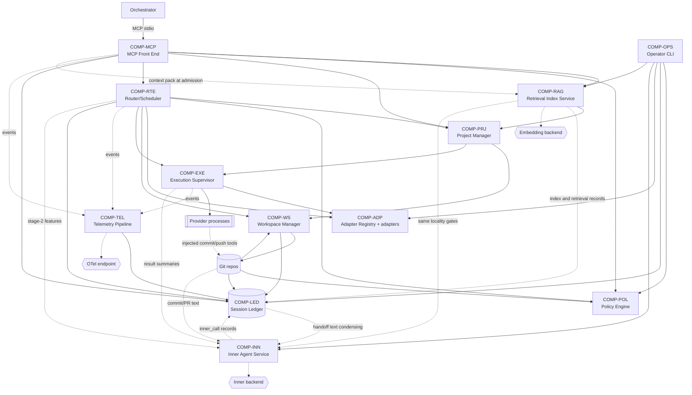
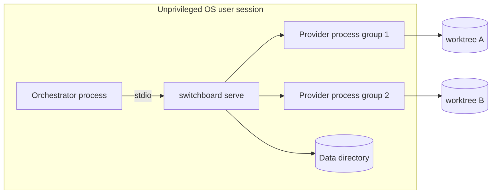
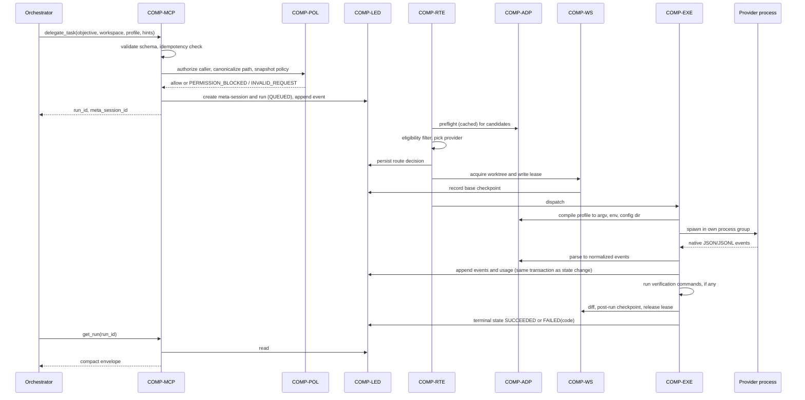
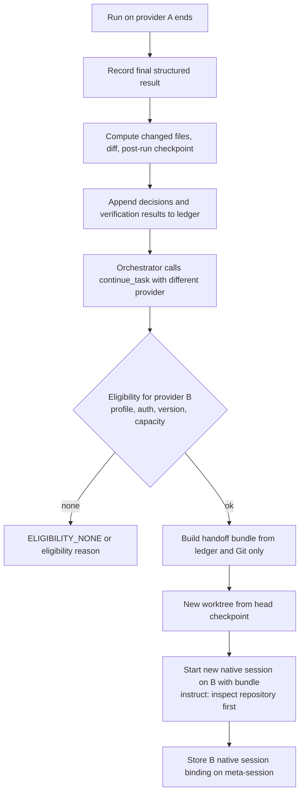
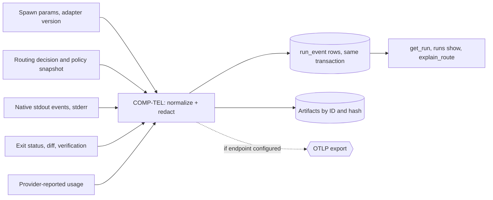
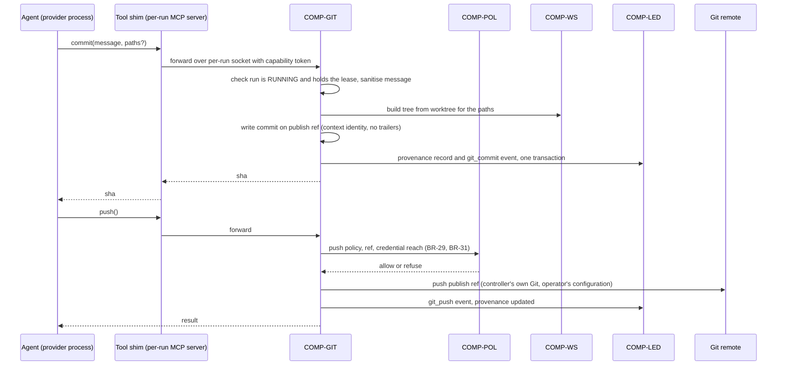

# High-Level Design (HLD)

| Field | Value |
| --- | --- |
| Status | Draft, baseline for milestone M1 |
| Owns | System boundary, components `COMP-*`, trust boundaries, integration styles, deployment topology, major data flows, threat scenarios |
| Does not own | Requirements ([SRS](../requirements/SRS.md)), workflows and state machine ([FRD](../requirements/FRD.md)), collaboration patterns and traceability ([SDD](SDD.md)), technology choices ([TDD](TDD.md)), schemas and contracts ([LLD](LLD.md)), sequencing ([ROADMAP](../ROADMAP.md)) |
| Last reconciled | 2026-10-15 |

Implementation status is owned by [ROADMAP §6](../ROADMAP.md#6-milestones). No code, tests, CI or configuration existed
as of 2026-10-12; the design below is now partly implemented (M1, and parts of M2, M3 and M9). Decisions cited from
ADRs are "Delegated" (made by an agent under zemdregon's delegation) and have not been individually reviewed by zemdregon.

## 1. System context

Switchboard is a local, headless controller. A primary orchestrator (for example OpenClaw or Grok Bot) spawns it as an
MCP server over stdio and delegates coding tasks. Switchboard launches the operator's own provider CLIs, using the
logins those CLIs already hold, inside isolated Git worktrees under a per-run policy
([ADR-0002](../adr/0002-mcp-upstream-acp-downstream.md), [ADR-0003](../adr/0003-no-credential-handling.md),
[ADR-0011](../adr/0011-single-operator-local-deployment.md)).


### 1.1 System boundary

Inside the boundary (Switchboard owns): the MCP front end, policy evaluation, session ledger, workspace manager,
router/scheduler, execution supervisor, provider adapters, telemetry pipeline and operator CLI (scope per [SRS
§2](../requirements/SRS.md)).

Outside the boundary (Switchboard does not own, control or reimplement):

| Outside | Why it stays outside |
| --- | --- |
| Provider CLIs, their agent harnesses, models and clouds | Switchboard only launches the documented automation surface ([ADR-0002](../adr/0002-mcp-upstream-acp-downstream.md)); it never reimplements provider protocols (FR-AUTH-01). |
| Provider logins, tokens and credential stores | Operator logs in natively; Switchboard never reads or moves credentials ([ADR-0003](../adr/0003-no-credential-handling.md), FR-AUTH-01, NFR-SEC-01). |
| The orchestrator's own logic, memory and task decomposition | Switchboard sees only MCP tool calls. |
| Integration of result branches into the operator's branches | Results are controller-owned branches plus diffs; merging them is the orchestrator's or operator's step (FR-WS-05, [ADR-0006](../adr/0006-worktree-checkpoints-no-blind-replay.md)). |
| The remote Git host and the operator's push credentials | Switchboard pushes the publish ref only, when a context's policy enables it, using the operator's existing Git configuration; it stores no credentials and never gives them to an agent (FR-GIT-05, FR-GIT-06, [ADR-0014](../adr/0014-tool-only-commits-and-publication.md)). |
| The container runtime and images | Switchboard asks the runtime to create, start and remove containers (M10); it does not implement one, and the runtime is a Delegated, Proposed choice (rootless, [ADR-0013](../adr/0013-projects-environments-and-contexts.md)). |
| OTel collector and its storage | Switchboard only exports when the operator configures an endpoint (FR-TEL-02, NFR-PRIV-01). |
| The inner backend, its model and its host (M11) | Switchboard sends redacted, budget-limited single-turn prompts to the one backend the operator configured and treats the answer as untrusted data; it ships no default backend or model and holds no credential for it (FR-INN-01, FR-INN-03, FR-INN-16, [ADR-0016](../adr/0016-inner-agent.md)). |
| Host OS hardening (user accounts, disk quotas, firewall) | Assumption: the operator provides an unprivileged user (NFR-SEC-04); additional outer sandboxing is a TDD matter. |

### 1.2 Explicit exclusions

- Egress is limited to what the operator configures: provider CLI traffic (made by the CLIs), optional OTLP export, and,
  from M11, calls to the one optional inner backend under the locality rules of FR-INN-16 (NFR-PRIV-01,
  [ADR-0016](../adr/0016-inner-agent.md)).
- No network listener: MCP is stdio only; HTTP/SSE is deferred ([ADR-0002](../adr/0002-mcp-upstream-acp-downstream.md),
  [ADR-0011](../adr/0011-single-operator-local-deployment.md)).
- No web interface and no login commands (FR-OPS-03). A read-only usage dashboard is deferred (FR-TEL-04).
- No multi-tenant, multi-user, hosted or resale operation ([ADR-0011](../adr/0011-single-operator-local-deployment.md);
  NFR-COMP-01 requires per-provider review before such use).
- No upstream ACP server (deferred, [ADR-0002](../adr/0002-mcp-upstream-acp-downstream.md)); no Windows host
  (NFR-PORT-03).

## 2. Components



| ID | Component | Responsibilities | Primary requirements |
| --- | --- | --- | --- |
| COMP-MCP | MCP Front End | Serve MCP tools over stdio (and Streamable HTTP when enabled); validate inputs against JSON Schemas before side effects; authenticate the configured MCP client entry and cap its trust profile; apply idempotency keys and per-client `tool_profile`; return compact envelopes with exactly one failure code; expose control-plane read and steer tools (`list_runs`, `get_digest`, pause, `steer_run`) and, for clients marked `approval_proxy`, list-and-decide approval tools under ADR-0047; never return transcripts or credentials. | FR-MCP-01..09, FR-CTL-01..11, NFR-SEC-05 |
| COMP-POL | Policy Engine | Define the five trust profiles; evaluate caller authorization, workspace-root rules and compliance manifests; produce the per-run policy snapshot; gate bypass flags to approved `privileged` runs; fail closed on unknown state. | FR-POL-01..10, FR-MCP-06, NFR-SEC-06 |
| COMP-LED | Session Ledger | Own canonical state: meta-sessions, runs, append-only events, decisions, artifacts (SQLite plus content-addressed files), checkpoints, usage, health, route decisions, approvals; provide transactional state transitions; enforce retention. | FR-SES-01..05, FR-TEL-01, NFR-REL-01, NFR-DATA-01 |
| COMP-WS | Workspace Manager | Canonicalize paths against allowed roots; create worktrees and controller branches from recorded checkpoints; grant exclusive write leases; record diffs and post-run checkpoints (internal, never published); roll back; garbage-collect. Never touch the operator's checked-out branch; never push. | FR-WS-01..07, FR-POL-10, FR-GIT-08 |
| COMP-PRJ | Project Manager | Resolve a project reference to its repository context, base ref, environment and ceilings; enforce the lower of client and project ceilings; list projects for a client; for `container` environments (M10) create, start, limit and remove the container and clean up orphans at startup. Definitions come from configuration and are snapshotted per run; M15 adds resolving which publish refs count as "published" for CI triggers (FR-QUE-03). | FR-PRJ-01..09, FR-QUE-03 |
| COMP-GIT | Git Publisher | Serve the per-run injected `commit` and `push` tools from outside the agent's process tree; build commits on the publish ref with the context identity and sanitised message; check refs before and after runs for violations; push the publish ref under policy; write provenance records; hold the only path to push credentials. Optionally obtain a draft message from COMP-INN when the commit-message task is enabled, and run it through the same sanitiser (FR-INN-10). | FR-GIT-01..09, FR-INN-10 |
| COMP-RTE | Router/Scheduler | Hard eligibility filter, then weighted scoring and a heuristic classifier (M7); capacity estimator; bounded priority queue for run admission (FR-CAP-04); per-provider concurrency and circuit breakers; retry and failover decisions; persist route decisions. Keeps a project on its last provider and model (affinity, M7) and moves it only for a reason from the closed list of FR-RTE-07; records cache and switch observations (FR-CAP-08). Proposed (owner decision 57, [ADR-0055](../adr/0055-model-groups-and-usage-pacing.md); built on fakes, T6.8, T6.13 to T6.16 and T7.13 to T7.16, 2026-10-17): routes a request for an operator-configured model group over its members, and paces dispatch per subscription window against operator-declared windows and budgets, from Switchboard-observed usage (a lower bound) or a provider-reported figure where a sourced key is declared (none is today, T6.15), with a pacing gate that defers or redirects rather than refuses and never creates a run (FR-RTE-10, 11, FR-CAP-09 to 11). M15 (Proposed): scheduler tick for per-project work queues, cron schedules and CI trigger polls, dequeuing through the creating client's ceiling ([LLD §18](LLD.md#18-project-queue-schedules-and-ci-triggers-m15-proposed-t150)). May take stage-2 features from COMP-INN, labelled by source, never for eligibility (FR-INN-12). | FR-RTE-01..11, FR-CAP-01..11, FR-INN-12, FR-QUE-01..02 |
| COMP-EXE | Execution Supervisor | Spawn provider processes (on the host or inside the project's container) in their own process group with allowlisted environment; subprocess JSON/JSONL and (M4) ACP client transports; timeouts, cancellation, grace-then-kill; capture stdout events and stderr separately; run verification commands; startup reconciliation of orphaned runs. | FR-EXE-01..08, FR-EXE-07, NFR-REL-02 |
| COMP-ADP | Adapter Registry and provider adapters | Per provider: probe, version gate, auth preflight, compile trust profile to native controls, parse native structured output, resume, cancel; model registry; compliance manifests; conformance suites. | FR-ADP-01..11, FR-AUTH-02, NFR-MAINT-01 |
| COMP-TEL | Telemetry Pipeline | Turn lifecycle observations into run events and OTel spans; redact prompts, environment and full shell output; export to an operator-configured OTLP endpoint; when configured, deliver closed metadata-only notification payloads to generic webhook and ntfy sinks off the run path (ADR-0048, Proposed). | FR-TEL-01..03, FR-CTL-10, NFR-OBS-01, NFR-PRIV-01 |
| COMP-OPS | Operator CLI | `serve`, `doctor`, `runs list/show/cancel`, `gc`, `approve`, `deny`, `git push`, `projects list/show/approve/validate` (implemented), plus `adapters validate` (M4), `capacity` (M6), `affinity list` and `affinity reset` (M7), `inner status`/`inner test <task>`/`inner resume <task>` (M11, implemented on fakes; `inner resume` named by FR-INN-17) and `index status\|rebuild\|clear` (M12); the only path to privileged approval and version acceptance. | FR-OPS-01..03, FR-POL-09, FR-ADP-03, FR-PRJ-08, FR-INN-17, FR-RAG-11, FR-RAG-14, FR-RTE-07 |
| COMP-INN | Inner Agent Service (M11) | Optional, advisory text service behind one backend port (`http` or `cli` kind). Runs the per-task pipeline: deterministic redaction, input budget, call with per-call timeout and circuit breaker, parse and validate against the task schema, at most one re-ask, then accept or deterministic fallback. Applies locality gating (`local` or `remote`, `allow_remote`, `allow_source_content`, project `inner_agent` setting), tracks per-task rejection rate and suspends a task, and writes `inner_call` records (sizes and hashes only, never bodies) through COMP-LED. Holds **no policy authority**: its output reaches no decision in COMP-POL, eligibility, approvals, ceilings, push policy, sanitiser rules, redaction or failure classification, and it cannot change a run's status. Callers: COMP-GIT (commit and PR text), COMP-RTE (stage-2 route features), the handoff builder over COMP-LED and COMP-WS data, COMP-EXE (result and log summaries), COMP-OPS (`doctor`, `inner` commands). | FR-INN-01..17, FR-INN-06, NFR-PRIV-01 |
| COMP-RAG | Retrieval Index Service (M12, Proposed) | Optional. Per project, builds and incrementally maintains an index of the project's readable contexts in the data directory (never in the repository), and optionally a separate deployment-wide index. Scans with exclusions and a secret denylist, redacts, chunks, embeds through one backend port (kinds `local` and `http`, same locality gates as COMP-INN), stores chunk text and vectors, and answers bounded top-k queries. Callers: admission (context pack prepended to the delegated prompt within a token budget), COMP-MCP (`search_project_context`, read-only), COMP-OPS (`index` commands, `doctor`), and later the per-run tool channel (FR-RAG-13). Building runs in the `serve` daemon and never blocks admission. Retrieved content is untrusted data and has **no policy authority**: it reaches no decision in COMP-POL, eligibility, approvals, ceilings, push or commit. Any failure falls back to no retrieval and never fails a run. Records counts and durations through COMP-LED, never content, and never as provider usage. | FR-RAG-01..14, FR-RAG-07, NFR-PRIV-01 |
| COMP-SKL | Skill Store (M16, Partial: validator, canonicaliser, content store, ledger tables and state derivation built by T16.1; configuration keys and loader built by T16.3; operator CLI built by T16.2; read-only MCP tools `list_skills` and `get_skill` built by T16.9; admission resolution built by T16.4 (Done 2026-10-17, Delegated, not owner-approved); prompt-prefix delivery built by T16.5 (Done 2026-10-17, Delegated, not owner-approved); native-delivery framework and leak prevention built by T16.6 (Done 2026-10-17, Delegated, not owner-approved); per-provider native declarations Proposed (T16.7, T16.8)) | Optional. Validates, canonicalises and stores operator-defined skills as immutable content-addressed versions in the data directory, with append-only operator audit; resolves and pins a run's skills at admission (global, role, project and request order) under the trust gate; renders the prompt-prefix block; hands native files to COMP-WS for writing, exclusion and cleanup. Never read by COMP-POL or COMP-RTE ([ADR-0056](../adr/0056-switchboard-controlled-skills.md)) | FR-SKL-01–10 |

Collaboration per workflow, call direction and error propagation are in the [SDD](SDD.md); schemas and contracts are in
the [LLD](LLD.md).

### 2.1 COMP-RAG implementation evidence (M12, T12.1–T12.3)

Configuration shape, store schema, scanner and chunking rules, the embedding port and locality gates are in [TDD
§3.13](TDD.md#313-retrieval-index) and [LLD §14](LLD.md#14-retrieval-index). Requirement-to-component traceability is in
[SDD §4.1](SDD.md#41-comp-rag-implementation-evidence-m12-t121t123). The pointers below are HLD-level evidence only.

**T12.5 (WF-14 admission context pack).** Placement, freshness, pack labelling, ledger fields and the import boundary are
specified in [LLD §14.11](LLD.md#1411-admission-context-pack-t125),
[TDD §3.13.8](TDD.md#3138-t125-admission-time-context-pack-2026-10-14) and
[SDD §4.1 (T12.5)](SDD.md#41-comp-rag-implementation-evidence-m12-t121t123), and built by T12.5 on fakes (differences
from the design are listed at the end of LLD §14.11). The sequence is in [§6.6](#66-retrieval-for-a-run-wf-14-m12-proposed).
Operator `index` commands and `doctor` retrieval reporting are built by T12.4; MCP `search_project_context` (T12.6) and
the deployment-wide index (T12.7) remain future runtime tasks; their contracts are already cited from LLD §14 where
applicable.

#### T12.1 — configuration and per-project store

**Evidence (implemented).** FR-RAG-01, FR-RAG-03, FR-RAG-09 (global `sources` under an allowed root only; the global
store and sharing rules are T12.7), FR-RAG-11 (caps in configuration only; background build, `index` commands and
`rag_record` ledger rows are T12.4).

- **Tests:** `src/config/rag.test.ts`, `src/retrieval/store.test.ts`, `src/mcp/project-tools.test.ts`
- **Modules:** `src/config/rag.ts`, `src/retrieval/store.ts`; store prune at `serve` start (`src/cli/serve.ts`)

#### T12.2 — scanner, exclusions, redaction and chunker

**Evidence (implemented).** FR-RAG-02 (deterministic redaction before chunk output, same pipeline as FR-INN-16).

- **Tests:** `src/retrieval/scan.test.ts`, `src/retrieval/chunk.test.ts`, `src/retrieval/options.test.ts`
- **Modules:** `src/retrieval/scan.ts`, `src/retrieval/chunk.ts`, `src/retrieval/denylist.ts`,
  `src/retrieval/options.ts`

#### T12.3 — embedding backend port and locality gates

**Evidence (implemented).** FR-RAG-04; FR-RAG-12 for the port layer (records without text; no embedding row in
`usage_observation` or capacity). Reuses COMP-INN locality classification and gates (FR-INN-16, T11.3).

- **Tests:** `src/retrieval/http-embedder.test.ts`, `src/retrieval/embedding.test.ts`
- **Modules:** `src/retrieval/embedding.ts`, `src/retrieval/http-embedder.ts`, `src/retrieval/fake-embedder.ts`;
  `createPinnedHttpTransport` in `src/inner/http-backend.ts`

#### T12.5 — admission context pack (WF-14)

**Evidence (implemented).** FR-RAG-05, FR-RAG-07 and FR-RAG-08 at `delegate_task` admission: original request text
stored unchanged; stale or deleted-source snippets dropped; any retrieval failure yields no pack and never fails the run;
retrieved text has no policy authority (BR-46).

- **Specification:** [LLD §14.11](LLD.md#1411-admission-context-pack-t125), [TDD §3.13.8](TDD.md#3138-t125-admission-time-context-pack-2026-10-14),
  [SDD §4.1 (T12.5)](SDD.md#41-comp-rag-implementation-evidence-m12-t121t123); depends on T12.4 background build and
  `rag_record` shapes in LLD §14.5 and §14.10.
- **Tests:** `src/retrieval/admission.test.ts`, `src/lifecycle/context-pack.test.ts`, `src/retrieval/import-boundary.test.ts`
- **Modules:** `src/retrieval/admission.ts`; the retrieval port in `src/lifecycle/lifecycle.ts`, wired by
  `src/cli/serve.ts`

### 2.2 COMP-ADP Antigravity implementation evidence (M4, T4.32, T4.33)

The Antigravity compile matrix, probe steps and stream-json event vocabulary are in [TDD
§4.4](TDD.md#44-antigravity-agy-m4) and the adapter contract in [LLD §2](LLD.md#2-adapter-contract) (provider registry
row for `antigravity`). Milestone status and task boundaries are in [ROADMAP
§6.8](../ROADMAP.md#68-m4-adapter-expansion-tasks). As-built parser, result and resume detail is in [LLD
§2.0](LLD.md#20-antigravity-adapter-implementation-evidence-m4-t432-t433-t437) and [TDD
§4.4.7](TDD.md#447-antigravity-parser-implementation-evidence-m4-t433). Requirement-to-component traceability for the
shared adapter port is in [SDD §5](SDD.md#5-requirements-to-design-traceability) (`FR-ADP-*`, `FR-AUTH-02`, `FR-SES-03`,
`FR-CAP-01`).

#### T4.32 — module, manifest, probe, registry entry and compile matrix

**Evidence (implemented on `origin/main`).** FR-ADP-07, FR-ADP-01, FR-ADP-02 (five-step probe on synthetic
`--version`/`--help` shapes only; no `agy` in CI), FR-ADP-03 (manifest range admits no version until operator
`adapters validate`), FR-POL-02, FR-POL-03, FR-POL-08; Git behaviour is declared (`gitWriteControl`
`none-documented`, `commitChannel` `finalize-only`, `resumeCwd` `bound`) per TDD §4.4, not exercised here.

- **Tests:** `src/adapters/antigravity/antigravity.test.ts` ("antigravity compile matrix (T4.32)", "antigravity
  bypass-class declarations (ADR-0035, ADR-0045)", "antigravity probe and auth placeholder (fail closed until T4.34)",
  "antigravity registry entry and manifest gate (T4.32)"); `src/adapters/providers.test.ts` (refused bypass-flag
  shapes)
- **Modules:** `src/adapters/antigravity/adapter.ts`, `src/adapters/antigravity/protocol.ts`,
  `src/adapters/manifests/antigravity.json`; registry entry in `src/adapters/providers.ts`

Outside an approved `privileged` scope with `bypass`, every profile is `Ineligible` (`PROFILE_UNSUPPORTED`) because
`toolPermission` is a settings value, not a per-run control ([TDD
§4.4.2](TDD.md#442-antigravity-native-controls-per-profile-and-platform-t430)). Only the approved bypass cell compiles
on synthetic fixtures; argv spellings and `--prompt=` are cited in source to TDD §4.4 or marked Assumption until
operator live capture (T4.38).

#### T4.33 — parser, result, failure classification and resume (`Partial`)

**Evidence (`Partial`, synthetic lines in the shapes of the T4.31 live check).** FR-ADP-04, FR-CAP-01 (envelope
run-total usage recorded `provider_reported` once), FR-SES-03 (resume not compiled: `resumeArgs` is `Ineligible` for
every profile and binding).

- **Tests:** `src/adapters/antigravity/antigravity.test.ts` ("antigravity parser and result (T4.33)", "antigravity
  parser hardening (T4.33, synthetic shapes)")
- **Modules:** `parseEvent`, `extractResult`, `classifyFailure` and `resumeArgs` in `src/adapters/antigravity/adapter.ts`;
  event names and error prefixes in `src/adapters/antigravity/protocol.ts`; failure codes per [LLD
  §4](LLD.md#4-failure-taxonomy)
- **Hardening (2026-10-14, [#227](https://github.com/zemdregon/switchboard/pull/227); Delegated, not owner-approved;
  synthetic shapes).** A second `result` line ends `OUTPUT_PROTOCOL_ERROR` and records no second `usage` row (FR-CAP-01).
  A `step_update` whose `conversation_id` differs from the bound id ends `OUTPUT_PROTOCOL_ERROR` while its tool call still
  reaches the ADR-0039 guard; a step never binds the session. Classification precedence is pinned (cancel and timeout over
  a denial, denial over envelope error and non-zero exit, guard over all). Sourcing: [TDD
  §4.4.7](TDD.md#447-antigravity-parser-implementation-evidence-m4-t433).

**Gaps (remain `Partial`, not `Done`).** Resume is not compiled (Q-86). Rate-limit and sandbox-violation shapes were not
observed in the live check, so those failures end `TOOL_FAILURE` rather than dedicated taxonomy codes. The stderr
`AGY_ERROR` shape has since been observed for real (seven quota stops at exit 3, T6.11
[limit captures](../research/limit-captures-2026-10-17.md)) and mapped in `classifyFailure` to `QUOTA_EXHAUSTED` (T6.15,
[ROADMAP T6.15](../ROADMAP.md#611-m6-capacity-and-resilience-tasks)); the `extractResult` path still ends `TOOL_FAILURE`
because the adapter contract gives it no stderr (pinned in `src/adapters/antigravity/limit-signals.test.ts`). Tool-step
parameter key names (`command`, path fields) are Assumptions where the capture
did not record them. Operator extension of T4.31 is still needed for resume with a known conversation id, rate limits
and full tool-parameter shapes.

#### T4.34 — auth preflight (placeholder)

**Evidence (not implemented).** FR-AUTH-02: `authPreflight` returns `UNKNOWN` until T4.34 implements a status command
or the documented auth-error exit of a harmless headless call; this subsection does not describe `agy` login behaviour
beyond that fail-closed placeholder (NFR-SEC-06).

- **Tests:** `src/adapters/antigravity/antigravity.test.ts` ("auth is UNKNOWN until T4.34")
- **Modules:** `authPreflight` in `src/adapters/antigravity/adapter.ts`

#### T4.37 — Git declaration (FR-GIT-01, FR-GIT-02, FR-GIT-09)

**Evidence (implemented on `origin/main`, pull request [224](https://github.com/zemdregon/switchboard/pull/224);
Delegated agent work, not owner-approved; fixtures only, no `agy` was run).** FR-GIT-01, FR-GIT-02, FR-GIT-09, owner
decision 36. The sourcing and the per-obligation detail are in [TDD
§4.4.6](TDD.md#446-antigravity-git-declaration-implementation-evidence-m4-t437); this subsection records only the
component-level outcome. Mirrors the Grok Build declaration ([TDD
§4.3.4](TDD.md#434-grok-build-git-declaration-implementation-evidence-m4-t427)).

- **Declaration.** `gitWriteControl` is `none-documented`, because Antigravity documents Git deny rules only in
  `settings.json` or the `/permissions` scopes, none per run, and the adapter writes no provider configuration; the
  remaining controls are the controller's worktree, the tool-call guard
  ([ADR-0039](../adr/0039-switchboard-side-tool-call-guard.md)), FR-GIT-03 and FR-GIT-06. `gitCapabilities.commitChannel`
  is `finalize-only`: MCP servers load only from `mcp_config.json` files, so the per-run tool channel
  ([ADR-0026](../adr/0026-per-run-tool-channel-socket-and-token.md)) cannot be injected and the controller commits at
  FINALIZING when the project opts in. Both are reported through `list_capabilities`.
- **Compile guard.** Before any other check, a shell allowlist entry that could write Git (`gitWriteRisks`) makes the
  profile `Ineligible` `PROFILE_UNSUPPORTED` citing FR-GIT-01, including on an approved `privileged` scope with `bypass`
  ([ADR-0017](../adr/0017-approved-privileged-scope-bypass.md)); read-only entries do not trigger it.
- **Tests:** `src/adapters/antigravity/antigravity.test.ts` ("antigravity Git declaration (T4.37, FR-GIT-01, FR-GIT-02,
  FR-GIT-09)": declaration constants, `list_capabilities` over MCP, the FR-GIT-01 argv test with the prompt in the one
  `--prompt=` word and no `git` or `gh` in argv, policy flags or environment, Git-write shell allowlist entries refused,
  and a replayed write run in a finalize-only project committed by the controller at FINALIZING)
- **Modules:** `ANTIGRAVITY_GIT_WRITE_CONTROL`, `ANTIGRAVITY_GIT_CAPABILITIES` and the compile-matrix check in
  `src/adapters/antigravity/adapter.ts`; `GIT_WRITE_CONTROL_DETAIL` in `src/adapters/antigravity/protocol.ts`;
  `gitWriteRisks` in `src/adapters/git-write.ts`

**Not shown by this evidence.** Whether settings deny rules hold under `--dangerously-skip-permissions` was not
observed (T4.31 C8; operator task T4.38). T4.36 recorded a finding that `extractResult` returned `ok` for a clean
`SUCCESS` envelope without reading a guard `violation` on a Git write, although ADR-0039 ends such a run
`PERMISSION_BLOCKED`; that gap is now fixed (`extractResult` treats a flagged `tool_call` as not clean) and the former
known-gap test passes as a plain test, as recorded in the [ROADMAP §6.8](../ROADMAP.md#68-m4-adapter-expansion-tasks)
T4.36 row. It was not closed by T4.37.

### 2.3 COMP-ADP Cursor implementation evidence (M4, T4.42, T4.43)

Compile matrix and transport are in [TDD §4.5](TDD.md#45-cursor-cli-m4); parser as-built detail is in [LLD
§2.0.1](LLD.md#201-cursor-adapter-implementation-evidence-m4-t442-t443) and [TDD
§4.5.5](TDD.md#455-cursor-parser-implementation-evidence-m4-t443). Task status: [ROADMAP
§6.8](../ROADMAP.md#68-m4-adapter-expansion-tasks) (`T4.42`, `T4.43`).

#### T4.43 — parser, result, failure classification and resume (`Partial`)

**Evidence (`Partial`, synthetic lines in the shapes of the T4.41 live check).** FR-ADP-04, FR-SES-03 (`--resume` through
the compile matrix), FR-ADP-10 (`backingProvider` unset: no vendor field was recorded).

- **Tests:** `src/adapters/cursor/cursor.test.ts` ("cursor parser and result (T4.43)", "cursor parser hardening (T4.43,
  synthetic shapes)")
- **Modules:** `parseEvent`, `extractResult`, `classifyFailure` and `resumeArgs` in `src/adapters/cursor/adapter.ts`;
  event fields in `src/adapters/cursor/protocol.ts`
- **Hardening (2026-10-14, [#228](https://github.com/zemdregon/switchboard/pull/228); Delegated, not owner-approved).**
  Second `result` line and mid-run session id change end `OUTPUT_PROTOCOL_ERROR`; non-`login` `apiKeySource` is
  `AUTH_REQUIRED`; usage drops non-finite values; multi-key `tool_call` objects report each key; unrecorded rate-limit,
  quota and sandbox text ends `TOOL_FAILURE`. Sourcing: [TDD §4.5.5](TDD.md#455-cursor-parser-implementation-evidence-m4-t443).
- **ADR-0039 guard verdict (2026-10-15, [#238](https://github.com/zemdregon/switchboard/pull/238); Delegated, not
  owner-approved).** `extractResult` treats a `tool_call` carrying a guard `violation` as not clean, so a `success`
  `result` at exit 0 still ends `PERMISSION_BLOCKED` for `git_write` and `SANDBOX_VIOLATION` for `provider_state`
  (tests in "cursor parser hardening (T4.43, synthetic shapes)").
- **Residual parser pins (2026-10-15, [#360](https://github.com/zemdregon/switchboard/pull/360); synthetic lines only,
  parser unchanged).** `src/adapters/cursor/parser-residual.test.ts` and `idless_guard.jsonl` (supervisor replay) extend
  the T4.43 evidence listed in [TDD §4.5.5](TDD.md#455-cursor-parser-implementation-evidence-m4-t443).

**Gaps (remain `Partial`, not `Done`).** No recorded rate-limit or sandbox stream shape; T4.6 backing-vendor fixture cannot
be written without a vendor field (Q-65). Operator capture: T4.48 / T4.41 extension.

### 2.4 COMP-ADP OpenCode implementation evidence (M4, T4.52, T4.53)

Compile matrix and transport are in [TDD §4.6](TDD.md#46-opencode-m4); parser as-built detail is in [LLD
§2.0.2](LLD.md#202-opencode-adapter-implementation-evidence-m4-t452-t453) and [TDD
§4.6.5](TDD.md#465-opencode-parser-implementation-evidence-m4-t453). Task status: [ROADMAP
§6.8](../ROADMAP.md#68-m4-adapter-expansion-tasks) (`T4.52`, `T4.53`).

#### T4.53 — parser, result, failure classification and resume (`Partial`)

**Evidence (`Partial`, synthetic lines in the shapes of the T4.51 live check).** FR-ADP-04, FR-SES-03 (`--session`
through the compile matrix), FR-ADP-10 (`backingProvider` unset: events name no vendor).

- **Tests:** `src/adapters/opencode/opencode.test.ts` ("opencode parser and result (T4.53)", including nested
  "cases with no recorded native shape (live check rows 7, 11, 14c)")
- **Modules:** `parseEvent`, `extractResult`, `classifyFailure` and `resumeArgs` in `src/adapters/opencode/adapter.ts`;
  event fields in `src/adapters/opencode/protocol.ts`
- **Hardening (2026-10-14, [#229](https://github.com/zemdregon/switchboard/pull/229); Delegated, not owner-approved).**
  Finite non-negative usage only; unknown line `type` clipped to 64 characters; mid-run `sessionID` change ends
  `OUTPUT_PROTOCOL_ERROR`; non-object roots and unstructured errors fail closed; nested tests pin row 11 (denial not
  detected), row 14c (rate limit `TOOL_FAILURE`) and missing tool input keys. Sourcing: [TDD
  §4.6.5](TDD.md#465-opencode-parser-implementation-evidence-m4-t453).

**Gaps (remain `Partial`, not `Done`).** No permission-denial or rate-limit event shape recorded; tool input key names
are Assumptions; T4.6 backing-vendor fixture cannot be written. Operator capture: T4.58 / T4.51 extension.

### 2.5 COMP-INN implementation evidence (M11, T11.1–T11.12, Done on fakes)

Schemas, pipeline, privacy gates and task contracts are in [LLD §13](LLD.md#13-inner-agent); the as-built testing
notes are in [TDD §3.12](TDD.md#312-inner-agent). Requirement-to-test traceability is in
[SDD §4.3](SDD.md#43-comp-inn-implementation-evidence-m11-t111t1112-done-on-fakes). Task status and clause-by-clause
Done-when evidence: [ROADMAP §6.6](../ROADMAP.md#66-m11-inner-agent-tasks). The pointers below are HLD-level evidence
only (written 2026-10-15, T11.14, Delegated). No live inner backend, provider CLI or network host has been used: every
backend in the tests is the scripted in-process fake or a fake HTTP server bound to a loopback address (one exception,
2026-10-15 post-#383: `src/inner/http-peer-check.test.ts` binds a listener on a non-loopback interface of the test host
itself, never a remote host, to exercise the socket peer re-check).

**Boundary evidence (TB-10, FR-INN-06, FR-INN-16).** `src/inner/import-boundary.test.ts` fails the build when COMP-POL,
a profile compiler, the retry logic, the push path, `src/git/commit.ts`, `src/usage/`, `src/ledger/` or the MCP
envelope imports `src/inner/` (direct, type-only, re-export and dynamic forms; deliberately not transitive, the gap is
stated in the file). Locality classification, the pinned connection and the refusal of a `remote` backend or of source
content without the opt-ins: `src/inner/http-backend.test.ts`, `src/inner/pipeline.test.ts` (the seven-row gate table).
Planted secrets, home paths, controller and native session IDs and provider names never reach a captured prompt, a
ledger row, a run event or a log line: `src/inner/pipeline.test.ts`, `src/inner/http-backend.test.ts` and every task
test below.

**Callers wired into a production `serve` run path.** COMP-GIT asks COMP-INN for a commit draft through the injected
`CommitMessageTask` (`src/git/commit.ts`, wired by `src/cli/serve.ts`; `src/git/commit-message.test.ts` over the real
tool socket). COMP-RTE asks for stage-2 route features through `RunLifecycleOptions.classifyRouteFeatures` on admission,
continuation and quota failover (`src/cli/serve.test.ts`, `src/mcp/inner-route-features.test.ts`); the features are
record-only (Q-82). The PR-draft, verification-summary, handoff-condensation and run-title callers named in the COMP-INN
row exist as service functions with their contracts and tests, and no run path, hook or `inner` command calls them yet
(ROADMAP T11.8, T11.9, T11.10, T11.12 "Not covered"); `src/inner/run-path-reach.test.ts` pins this statically (the
commit-message task referenced only from `src/git/channel.ts`, the routing hook only from `src/cli/serve.ts`, the four
modules from nowhere outside `src/inner/`, and not imported by the `inner test` fixtures).

- **Service, pipeline and backend (T11.1–T11.3).** Tests: `src/inner/inner.test.ts`, `src/inner/pipeline.test.ts`,
  `src/inner/http-backend.test.ts`, `src/inner/http-peer-check.test.ts` (the `LOCALITY_CHANGED` peer re-check),
  `src/inner/log-line.test.ts` (the `inner.call` log line), `src/config/config.test.ts` ("inner_agent"). Modules:
  `src/config/inner-agent.ts`,
  `src/inner/index.ts`, `src/inner/port.ts`, `src/inner/fake-backend.ts`, `src/inner/pipeline.ts`,
  `src/inner/breaker.ts`, `src/inner/truncate.ts`, `src/inner/http-backend.ts`, `src/projects/inner-setting.ts`.
- **Task contracts (T11.4, T11.8–T11.12).** Tests: `src/git/commit-message.test.ts`, `src/inner/pr-draft.test.ts`,
  `src/inner/log-summary.test.ts`, `src/inner/handoff-condense.test.ts`, `src/inner/route-features.test.ts`,
  `src/inner/run-title.test.ts`. Modules: `src/inner/commit-message.ts`, `src/inner/pr-draft.ts`,
  `src/inner/log-summary.ts`, `src/inner/handoff-condense.ts`, `src/inner/route-features.ts`, `src/inner/run-title.ts`.
- **Accounting, suspension and operator surfaces (T11.5–T11.7).** Tests: `src/inner/usage.test.ts`,
  `src/inner/usage-surfaces.test.ts`, `src/inner/usage-channels.test.ts` (the `commit` tool channel and the MCP
  admission harness themselves), `src/capacity/capacity.test.ts` (inner calls leave the projection byte-identical),
  `src/inner/suspension.test.ts`, `src/cli/inner.test.ts`, `src/inner/cli-run-isolation.test.ts` (`doctor` and the
  `inner` commands leave every non-inner table unchanged). Modules: `src/ledger/repo.ts` (`recordInnerCall`),
  `src/cli/inner.ts`, `src/cli/doctor.ts`.

**Gaps (M11 stays `Partial`).** The `cli` backend kind is reported `Ineligible` and never started (T11.0, T11.13); the
`inner.call` span of [LLD §7](LLD.md#7-telemetry-spans) and [LLD §13.8](LLD.md#138-telemetry-and-events) is not
emitted (the M8 OTLP transport and export-time key filter exist, but the inner pipeline builds no span; it writes a
structured log line of the same name without bodies); the Unix-socket form of `base_url` is not built; no opt-in
live inner run exists (TDD §3.12 as-built note); and the four callers above are not on a run path.

## 3. Trust boundaries

Controls cite requirements and ADRs; a control is a design intent until its verification (all currently *planned*) is
performed.

| # | Boundary | Threat across it | Controls | Cites |
| --- | --- | --- | --- | --- |
| TB-1 | Orchestrator → controller (MCP stdio or HTTP) | Orchestrator is an LLM agent and may be manipulated; may request excessive profile, paths or provider; a marked `approval_proxy` client may approve pending scopes if digest-bound | Schema validation before side effects; per-client maximum trust profile; `privileged` never grantable via MCP alone; routing hints only narrow; path canonicalization to allowed roots; idempotency keys; compact envelopes only; approval proxy off by default, listed targets only, exact `approval_id` and `approval_digest`, controller-generated listing text only, `decided_by` records `mcp_proxy:<client>` (ADR-0047, Proposed, [LLD §3.4.8](LLD.md#348-approval-proxy-tools-fr-ctl-08-adr-0047)) | FR-MCP-05, 06, 08, 09, FR-POL-09, FR-CTL-08, FR-POL-10, NFR-SEC-05 |
| TB-2 | Controller → provider process | Provider CLI inherits controller secrets; runaway or hung process; weakened flags | Explicit environment allowlist; own process group, wall-clock timeout, group kill; per-run flags and config dirs, never global provider config; no bypass flags outside an approved `privileged` scope that sets bypass ([ADR-0017](../adr/0017-approved-privileged-scope-bypass.md)); version gate | FR-EXE-01, 07, FR-POL-02, 03, 08, FR-ADP-03, NFR-SEC-02, [ADR-0004](../adr/0004-trust-profiles-no-bypass-flags.md), [ADR-0009](../adr/0009-version-gated-adapters.md) |
| TB-3 | Provider process → credential store | Same-user agent shell reads plaintext tokens or keyring; controller mishandles tokens | Controller never reads or copies credentials; auth state only via provider status or harmless call; untrusted profiles disable arbitrary shell on adapters that cannot confine commands from the credential store; no credential values in DB, logs, telemetry, MCP output | FR-AUTH-01, 02, FR-POL-06, NFR-SEC-01, FR-TEL-03, [ADR-0003](../adr/0003-no-credential-handling.md) |
| TB-4 | Agent-executed commands → host and network | Writes outside workspace, network exfiltration, destructive commands | Profile compiled into native permission rules and native sandbox controls as separate dimensions; worktree per write-capable run; network off for untrusted profiles; denial ends run instead of hanging; Git write operations denied by profile (FR-GIT-01); operator branch untouched | FR-POL-01, 02, 05, FR-WS-01, 05, FR-GIT-01, NFR-SEC-03, [ADR-0004](../adr/0004-trust-profiles-no-bypass-flags.md), [ADR-0006](../adr/0006-worktree-checkpoints-no-blind-replay.md) |
| TB-5 | Repository content → agent (untrusted input) | Prompt injection in files; repo hooks, MCP definitions, `CLAUDE.md`/`AGENTS.md` instructions | Repo-supplied agent config not loaded under untrusted and `test-sandboxed` profiles (native switches: Claude Code's `--safe-mode`, `--restricted` and `--strict-mcp-config`; `--bare` is not usable because it disables the login the adapter relies on, [ADR-0015](../adr/0015-claude-untrusted-isolation-flags.md)); malicious-fixture suite; handoff tells next agent to inspect repo rather than trusting prior text | FR-POL-04, NFR-SEC-03, FR-SES-04 |
| TB-6 | Controller → telemetry endpoint | Leakage of prompts, env, output, credentials | Attribute allowlist and drop-before-export (as built: typed builders plus an exact-key, scalar-value filter before queuing, T8.2 and T8.4; the forbidden-category scan is a CI test oracle over exported spans, not an export-time value check, T8.3); large output kept as local artifacts by ID and hash; OTLP export only when `telemetry.otlp_endpoint` is set (lazy OTel load, no listener); trace and span ids derived one-way from the run id carry nothing else | FR-TEL-02, FR-TEL-03, NFR-SEC-01, NFR-PRIV-01, [ADR-0012](../adr/0012-telemetry-at-wrapper-boundary.md), [LLD §7](LLD.md#7-telemetry-spans) |
| TB-7 | Agent → injected tool channel and Git state | An injected-prompt agent commits or pushes on its own, forges tool calls, abuses `commit` to write attribution or sensitive paths, or reaches push credentials from a same-user shell | Git writes denied in the compiled profile (in a `container` environment, no Git client in the image and no Git directory mounted); per-run channel with a capability token, served from the controller outside the agent's process tree; sanitiser and path checks on every call; ref snapshots before and after the run; push default `none`, publish ref only, never forced; credentials never in the agent's environment and push withheld where the agent could read them (BR-31) | FR-GIT-01..06, FR-EXE-07, FR-POL-06, [ADR-0014](../adr/0014-tool-only-commits-and-publication.md), [ADR-0026](../adr/0026-per-run-tool-channel-socket-and-token.md) (channel as built, T9.4) |
| TB-8 | Controller → container runtime and container → host | A container with too many mounts or a runtime socket becomes a host escape; orphaned containers outlive the controller; provider logins get copied in | Mount only the run worktree and declared read-only contexts; never the home directory, data directory, push credentials or runtime socket; limits and network policy per run; removal at run end and at startup reconciliation; no controller copying of credentials (FR-AUTH-01) | FR-PRJ-05, 07, FR-AUTH-01, [ADR-0013](../adr/0013-projects-environments-and-contexts.md) |
| TB-9 | Orchestrator (MCP client) → project definitions | A compromised or prompt-injected orchestrator creates a project that mounts or targets paths, providers, ceilings, push rights or containers beyond its own; or edits operator projects | `manage_projects` off by default; dynamic projects only, never configured ones; repository paths under allowed roots; ceiling, providers and push policy no wider than the client's entry; `container`, any push and any widening wait for operator approval on the CLI; creator-only visibility; every call recorded | FR-PRJ-10, FR-POL-10, FR-MCP-06, [ADR-0013](../adr/0013-projects-environments-and-contexts.md) |
| TB-10 | Controller → inner backend (M11) | Data egress: repository content, diffs or log excerpts sent to a remote model; prompt injection through repository content, diffs or logs that steers the model; hostile, malformed or low-quality output reaching published history, routing or handoffs; consumption of a shared provider subscription or an unbounded call rate | One optional backend, no default; `local` versus `remote` classification with `allow_remote` and per-task `allow_source_content`, and project or context `inner_agent` off or `local_only`; deterministic redaction before every call and an input budget; stateless single-turn call with no tools; no credential in configuration; output parsed, bounded and stripped, at most one re-ask, commit and PR text through the FR-GIT-04 sanitiser, deterministic fallback on any failure; no inner output reaches policy, retry, push or run status, enforced by structure and an import-boundary test; `inner_call` records apart from provider usage, with a doctor warning for `shares_subscription_with`; no prompt or response bodies logged; per-call timeout and circuit breaker | FR-INN-02, 03, 06, 07, 08, 10, 15, 16, NFR-PRIV-01, NFR-SEC-01, [ADR-0016](../adr/0016-inner-agent.md) |
| TB-11 | Controller → embedding backend, and project index → other projects (M12, Proposed) | Data egress: repository content sent to a remote embedding service; secrets or sensitive files indexed and stored unencrypted; prompt injection through indexed content steering a run; one project's content reaching another project's run through the deployment-wide index; stale or wrong snippets presented as current | One optional backend, no default, no credential handled (`local` or `http` kind, same classification as TB-10: `remote` sees source content only with `allow_remote` and `allow_source_content`); scanner limited to context roots with exclusions, built-in secret denylist and FR-INN-16 redaction before embedding and storage; one store per project, deleted with the project; the global index off by default, read only by a project with `use_global`, contributed to only by a project with `contribute_to_global`, snippets labelled with origin project; retrieved text labelled untrusted reference data and never an input to policy (import-boundary test as for TB-10); revision and file hash on every result, stale snippets dropped, failure falls back to no retrieval; operator `index clear` | FR-RAG-02..04, 07..10, 14, FR-INN-03, 16, NFR-PRIV-01, [ADR-0031](../adr/0031-retrieval-index.md) |
| TB-12 | Remote MCP client (network) → controller over Streamable HTTP, and the operator's browser → the embedded authorization server (M13, built; reviewed under T13.6) | Caller reached over the internet or a relay; stolen, forged or replayed token; token issued for another resource (audience confusion); token in a URL; DNS rebinding from a browser; session hijack or another client's run reached by id; a remote client raising its trust profile or claiming `privileged`; flooding of client registrations or of the MCP endpoint; authorization-code interception or reuse; refresh-token theft; open redirect through a self-registered redirect URI; CSRF or clickjacking on the consent page; guessing the consent passphrase or a pairing code; tokens, codes or prompts leaking into logs | Off by default, loopback bind unless explicit, `https` issuer only; `Origin` validation before routing; OAuth 2.1 resource server with RFC 9728 metadata and RFC 8707 audience check, opaque hashed tokens, header-only bearer (one credential), one identical 401 per refusal; tokens never forwarded; subject-to-client mapping capped by the configured maximum profile, a target that skips privileged approval refused at load, no scope grants `privileged`, the client re-checked as approved on every request; stateless mount, a presented session ID refused, meta-sessions and runs bound to the OAuth subject and client with "unknown id" answers (Q-78); per-client and total in-flight caps, body caps, pending-registration cap; DCR for public `https` clients only, each pending until the operator approves it; PKCE `S256` only, single-use 60-second codes, rotating refresh tokens, reuse revokes the client's tokens; errors redirect only for approved clients; consent page script-free with CSP `frame-ancestors 'none'`, `X-Frame-Options: DENY`, CSRF token in form and `__Host-` cookie, same-origin checks; scrypt passphrase with lockout, single-use hashed pairing codes with a separate throttle; secret redactor on admission, MCP results and every log line. Tests: `test/malicious/controller.test.ts` (the controller-invariant suite over HTTP, and "T13.6 hostile requests on the HTTP path"), `src/mcp/http.test.ts`, `src/mcp/oauth-tokens.test.ts`, `src/mcp/oauth-clients.test.ts`, `src/mcp/oauth-server.test.ts`, `src/mcp/mcp.test.ts` (T13.4, T13.5, and T13.9 from registration and PKCE to a tool call), `src/config/config.test.ts`, `src/cli/serve.test.ts` | FR-MCP-12..17, FR-OPS-03, NFR-SEC-01, NFR-SEC-03, FR-TEL-03, [ADR-0041](../adr/0041-http-transport-with-oauth-2-1.md), ROADMAP Q-73 to Q-78 |
| TB-13 | Controller → notification sink (webhook or ntfy, M14 Proposed) | New egress: metadata about runs and approvals reaches a third-party URL the operator chose; webhook URL, webhook authorization value, or topic token leakage through logs; sink outage blocks or delays runs | Off by default; operator-configured sinks only; closed `notification_payload` built from fields (project, event kind, reason code, run id, link), never code, prompts, diffs or agent text; per-sink event filter and rate limit; HTTPS with verification; URL, webhook authorization value (FR-CTL-12) and ntfy token redacted from logs and ledger; delivery best-effort with bounded timeout off the admission and execution path; failures counted, never fail a run ([ADR-0048](../adr/0048-notification-sinks.md), [LLD §3.4.9](LLD.md#349-notification-sinks-fr-ctl-10-adr-0048)) | FR-CTL-10, FR-CTL-12, NFR-PRIV-01, NFR-SEC-01, FR-TEL-03 |
| TB-14 | Approval proxy MCP client → pending approvals (M14 Proposed) | Stolen token or prompt-injected proxy client approves bypass or widening without the operator at a terminal | `approval_proxy` off by default and config-only; listed target clients only; decide only with exact `approval_id` and `approval_digest` from listing; listing shows controller-generated fields only; every decision recorded and announced to sinks; does not widen scope, Git-write denial or worktree isolation ([ADR-0047](../adr/0047-approval-proxy-over-mcp.md), R-65, [LLD §3.4.8](LLD.md#348-approval-proxy-tools-fr-ctl-08-adr-0047)) | FR-CTL-08, FR-MCP-06, FR-POL-09, NFR-SEC-01 |
| TB-15 | Controller → host CI facts via `gh` (M15 Proposed) | Forged or prompt-injected CI notification text steers admission; stolen GitHub token in Switchboard config; arbitrary `gh` API exfiltration | No credential in the controller ([ADR-0003](../adr/0003-no-credential-handling.md)); allowlisted `gh` argv only, JSON fields parsed with a closed schema; optional notification text stored length-capped and labelled untrusted, never authorises admission without a failed conclusion from `gh` on a published ref; tests use `CiStatusPort` fakes ([ADR-0050](../adr/0050-ci-status-via-operator-gh-cli.md), [LLD §18.6](LLD.md#186-ci-failure-trigger-fr-que-03-adr-0050)) | FR-QUE-03, NFR-SEC-01, NFR-PRIV-01 |

Residual limitation (from [R2] credential boundary): a dedicated OS user limits host blast radius but does not isolate a
credential from an agent running as the same user. Hence FR-POL-06 makes eligibility, not an outer wrapper, the control.
The same limit applies to Git push credentials in a `host` environment: FR-GIT-06 and BR-31 withhold the `push` tool
unless the agent cannot run commands that could read them. A `container` environment (M10) is the stronger answer,
because the credentials are never mounted into it, and its image has no Git client, so Git-write denial (FR-GIT-01)
holds there by construction rather than through provider deny rules, including in approved bypass runs ([ROADMAP owner
decision 24](../ROADMAP.md#42-owner-decisions)). `host` and `container` environments are both supported, chosen per
project by the deployer.

Residual risks at TB-12 (T13.6 review, Delegated): TLS is the operator's terminator in front of the loopback listener, so
a misconfigured proxy, not Switchboard, decides whether traffic is encrypted; a stolen access token works until it
expires (15 minutes) or the operator revokes the client; someone who knows the consent passphrase can keep passphrase
approval locked out (the pairing code still works, Q-76); OAuth clients mapped to one MCP client entry share its dynamic
projects (Q-78); and a refused cross-subject lookup writes no audit event, because it is answered like a typo.

## 4. Integrations

Each adapter chooses the transport the provider documents ([R2] adapter matrix;
[ADR-0002](../adr/0002-mcp-upstream-acp-downstream.md)). The normalized contract is in [LLD
§2](LLD.md#2-adapter-contract); per-provider strategy in [TDD §4](TDD.md#4-provider-adapter-strategy).

| Provider | Initial transport | Later or alternate transport | Milestone | Notes |
| --- | --- | --- | --- | --- |
| Claude Code | Subprocess `claude -p`, JSON/stream-JSON | None planned | M2 | First adapter (FR-ADP-06). |
| Codex | Subprocess `codex exec --json`, JSONL | None planned | M2 | Native events; no custom wrapper. |
| Grok Build | Subprocess `grok -p`, JSON/streaming-JSON | ACP stdio (`grok agent stdio`) | M4 | ACP via FR-EXE-03 (Should). |
| Antigravity | Subprocess `agy -p`, JSON/stream-JSON | None planned | M4 | Fails fast when unauthenticated. |
| Cursor CLI | Subprocess `agent -p`, JSON/stream-JSON | ACP stdio (`agent acp`) | M4 | Trust, MCP approval, force and sandbox decided independently. |
| OpenCode | Subprocess `opencode run` | Persistent local service `serve`/`attach` (deferred, FR-EXE-04) | M4 | Record harness and backing provider (FR-ADP-10). |
| Kimi Code | Undetermined | Undetermined | Blocked | Disabled until the CLI contract is pinned (FR-ADP-09). |
| Muse Code | Subprocess `muse exec --json`, JSONL | None planned | M4 (Should) | Unverified (R-33); FR-ADP-12. |

Other interfaces: MCP stdio upstream (COMP-MCP); Git CLI against local repositories (COMP-WS, COMP-GIT) and, under push
policy, a remote; the per-run injected-tool channel from agent to COMP-GIT; container runtime (COMP-PRJ, M10); OTLP export
and optional notification sinks (COMP-TEL, M8, M14 Proposed); operator CLI (COMP-OPS).

## 5. Deployment topology

One controller process per operator, on a host the operator controls, running as an unprivileged user alongside the
already-installed and logged-in provider CLIs (NFR-SEC-04, [ADR-0011](../adr/0011-single-operator-local-deployment.md)).
The orchestrator spawns `switchboard serve`; stdio ties the lifetime of the MCP session to that process. Linux (x86-64,
arm64) first (NFR-PORT-01); macOS in M4 (NFR-PORT-02).



Data directory layout. *Implemented (2026-10-13) for the ledger, artifacts and worktrees (paths below), and
(2026-10-17, T16.1) for the skill content store; the config
format is decided in [TDD §3.1](TDD.md#31-configuration) and [LLD §11.1](LLD.md#111-configuration-shape):*

| Path (proposed) | Contents |
| --- | --- |
| `<data>/ledger.sqlite` (+ WAL files) | SQLite ledger ([ADR-0005](../adr/0005-sqlite-ledger.md)); `LEDGER_FILE_NAME` in `src/ledger/db.ts` |
| `<data>/artifacts/ab/cd/<sha256>` (first two byte pairs of the hash, per [LLD §1](LLD.md#1-data-model)) | Content-addressed diffs, stdout events, stderr, verification output. *Hardening (2026-10-16, [#616](https://github.com/zemdregon/switchboard/pull/616); Delegated, not owner-approved):* `ArtifactStore` in `src/artifacts/index.ts` creates and `chmod`s the root and each shard directory `0700` level by level, so a restrictive process umask (`0177`) cannot leave a non-traversable `0600` directory that makes the next `put` fail `EACCES`; files stay `0600` (test "succeeds and creates traversable directories under a hostile umask" in `src/artifacts/artifacts.test.ts`) |
| `<data>/skills/<sha256>.md` (M16, T16.1) | Content-addressed skill versions: the canonical front matter plus body, written once through a temporary file, `fsync` and rename; file `0600`, directory `0700` (`src/skills/store.ts`, migration `0021`) |
| `<data>/worktrees/<meta_session_id>/<run_id>/` | Controller-created Git worktrees (could alternatively live beside the source repo; open question) |
| `<data>/runs/<run_id>/tools.sock` | Per-run socket for the injected tools (directory `0700`, socket `0600`); removed when the provider process exits, or by the start-up sweep after a crash. When this path would exceed 100 bytes, a private `sb-git-XXXXXX` directory under `$XDG_RUNTIME_DIR` or the OS temporary directory holds it instead ([ADR-0026](../adr/0026-per-run-tool-channel-socket-and-token.md), T9.4) |
| `<config>/` | Operator configuration: allowed roots, projects (environment, contexts, push policy, commit identity, sanitiser patterns), MCP client entries with maximum profiles and project lists, tier priors, routing weights, retention, compliance manifests |
| `<data>/rag/projects/<project>/index.db` and `<data>/rag/global/index.db` (M12) | Per-project and optional deployment-wide retrieval stores (chunk text and vectors); deleted with the project or by `index clear` (FR-RAG-03, FR-RAG-14) |
| `<data>/logs/` | Structured controller logs, free of secrets and prompts (FR-TEL-03) |

`<data>` and `<config>` are assumed to resolve to per-user directories chosen by the operator. Disk growth is bounded by
retention and GC (FR-WS-07, NFR-DATA-01).

## 6. Major data flows

### 6.1 Delegate run end to end (WF-1)



State names follow the [FRD](../requirements/FRD.md) state machine. Ledger-before-side-effect ordering is detailed in
[SDD](SDD.md).

**Affinity in the routing step (M7, FR-RTE-06..08, BR-44, BR-45).** "Eligibility filter, pick provider" above is: filter
(FR-RTE-01), then, if the project has an affinity record and its provider is still eligible and not capacity-limited,
choose it; only when a reason from the closed list of FR-RTE-07 applies (`user_request`, `capacity_exhausted`,
`ineligible`, `failed_after_retry`) is the weighted score of FR-RTE-02 used, over the remaining eligible providers, and
the new provider becomes the project's affinity. The route decision records which case held (FR-RTE-03). A score never
moves a project by itself. Algorithm and table: [LLD §3.2](LLD.md#32-provider-and-model-affinity-m7).

### 6.2 Cross-provider handoff (WF-3)



The controller never reads provider transcript files (FR-SES-04,
[ADR-0001](../adr/0001-controller-owned-canonical-state.md)). The bundle is built from ledger rows, controller events,
controller artifacts and Git plumbing at a recorded `as_of`, rendered by one provider-neutral renderer that puts
provider-reported and repository text in labelled untrusted blocks, and stored as the `handoff_view` artifact
([ADR-0038](../adr/0038-handoff-bundle-and-continuity.md), [LLD §15](LLD.md#15-continuity-and-the-handoff-bundle-m5)).
A same-provider resume (WF-2) instead reuses the worktree path that created the native session.

### 6.3 Telemetry flow



All signals come from the wrapper boundary; no provider hooks are installed into global config
([ADR-0012](../adr/0012-telemetry-at-wrapper-boundary.md), FR-POL-08). Span structure: [LLD
§7](LLD.md#7-telemetry-spans).

*As built (M8, T8.1 to T8.4, 2026-10-16, Delegated).* OTLP spans are not derived from `run_event` rows: `RunLifecycle`
builds them from the facts it observes at admission, at the spawn callback, at process exit and at the terminal
transition (`src/telemetry/spans.ts`), so only `controller.delegate` and `provider.spawn` are emitted today. Every span
passes the exact-key filter (`src/telemetry/allowlist.ts`) before it is queued; parent links are derived one-way from
the run id (`src/telemetry/links.ts`); the transport in `src/telemetry/index.ts` loads OTel lazily on the first span when
`telemetry.otlp_endpoint` is set and drops spans silently on any failure, so export never blocks or fails a run. Details
and tests: [LLD §7](LLD.md#7-telemetry-spans); evidence table: [SDD
§4.4](SDD.md#44-comp-tel-and-version-canary-implementation-evidence-m8-t81t86).

### 6.4 Commit and publish through the injected tools (WF-11, WF-12)



The agent never holds a credential or runs Git for these steps. After the run, COMP-GIT compares refs with the snapshot
taken at lease time and reports anything the controller did not create (FR-GIT-03). Internal checkpoint commits and run
branches are not part of this flow and are never pushed (FR-GIT-08).

### 6.5 Inner task call, including commit-message drafting (WF-13, WF-11)

```mermaid
sequenceDiagram
    participant A as Agent (provider process)
    participant G as COMP-GIT
    participant N as COMP-INN
    participant B as Inner backend
    participant L as COMP-LED
    A->>G: commit(paths, message omitted)
    G->>G: run holds lease; task enabled and mode permits drafting
    G->>N: task commit_message, diff of the committed paths
    N->>N: locality gate, redact, input budget
    N->>B: single-turn prompt (no tools, per-call timeout)
    B-->>N: text
    N->>N: parse and validate against task schema, one re-ask at most
    N->>L: inner_call record (task, outcome, sizes, hashes, latency)
    N-->>G: validated draft, or unavailable
    G->>G: sanitise (FR-GIT-04); empty or unavailable gives MESSAGE_REQUIRED
    G->>L: provenance and git_commit event, one transaction
    G-->>A: sha, or tool error MESSAGE_REQUIRED
```

1. A caller (COMP-GIT, COMP-RTE, handoff builder, COMP-EXE or COMP-OPS) asks COMP-INN for one task with controller-owned
   inputs only.
2. COMP-INN refuses at once if the task is off, suspended, the project says `off`, the backend is `remote` without
   `allow_remote`, or source content would go to a `remote` backend without `allow_source_content`; the caller then uses
   its deterministic fallback.
3. Otherwise COMP-INN redacts, applies the input budget, calls the backend, validates the output, and records an
   `inner_call` row through COMP-LED. Failure of any step returns "unavailable" to the caller, never an error that fails
   a run (FR-INN-08).
4. The caller decides what to do with the validated text. Commit and PR text goes through the sanitiser; route features
   are stored with source, model and template version; condensed text is labelled and points to the raw artifact.

The agent's own message always wins unless the operator chose mode `always`. No branch of this flow reaches COMP-POL,
the retry logic or the push path (FR-INN-06). Contracts: [LLD §13](LLD.md#13-inner-agent).

### 6.6 Retrieval for a run (WF-14, M12, Proposed)

```mermaid
sequenceDiagram
    participant M as COMP-MCP
    participant R as COMP-RAG
    participant B as Embedding backend
    participant S as Project index (and global, if enabled)
    participant L as COMP-LED
    participant E as COMP-EXE
    Note over R,S: background in serve: scan, exclude, redact, chunk, embed changed files
    R->>B: embed chunk batch (locality gate first)
    B-->>R: vectors
    R->>S: upsert chunks, set revision
    R->>L: rag_index_built record (counts, durations, no content)
    M->>R: admission: objective and project (context pack requested)
    R->>R: gates, index fresh enough?
    R->>B: embed query
    R->>S: top-k within the project (plus global if use_global)
    R->>R: drop stale snippets, fit token budget, label as untrusted
    R-->>M: pack (snippet ids, hashes) or nothing
    M->>L: run with original request text; rag_retrieval record (ids, hashes)
    M->>E: dispatch, pack prepended after stable content (FR-RTE-09)
```

1. Index refresh is a background job in the `serve` daemon and never blocks admission (FR-RAG-11); a partial index is
   marked incomplete.
2. At admission COMP-RAG applies the mode, the locality gate and the freshness check (FR-RAG-08). A disabled feature, no
   backend, an empty result, a stale index or any failure gives "no pack", and the run proceeds unchanged.
3. The original request text is stored unchanged. The ledger holds snippet IDs and hashes, never copies (FR-RAG-05).
4. The pack is untrusted reference data and reaches no decision in COMP-POL, routing eligibility, approvals, ceilings,
   push or commit (FR-RAG-07). Another project's content appears only through the global index, with the origin label,
and only when the contributing project allows it and the reading project asks for it (FR-RAG-09, FR-RAG-10, BR-46,
BR-47).

Contracts: [LLD §14](LLD.md#14-retrieval-index). Admission detail is in
[LLD §14.11](LLD.md#1411-admission-context-pack-t125) and
[TDD §3.13.8](TDD.md#3138-t125-admission-time-context-pack-2026-10-14); built by T12.5 on fakes (ROADMAP §6.7).

## 7. Threat scenarios

Scenarios are design-time analysis, not test results. Residual risk is the drafter's assessment of what remains after
the cited controls.

| Scenario | Mitigations | Residual risk |
| --- | --- | --- |
| Prompt injection in repository files | Untrusted profiles: read-only or isolated worktree, no or narrow shell, network off; repo agent config not loaded (FR-POL-04); no push, branch isolation (FR-WS-05); results are branches to be reviewed | Agent may still produce misleading edits or summaries inside its limits; reviewer must treat output as untrusted |
| Malicious repo MCP definitions or hooks | Not loaded under untrusted profiles; `--approve-mcps` never added outside approved `privileged` (FR-POL-03, 04); malicious-fixture suite (NFR-SEC-03) | Depends on each provider honouring its disable switch; trusted profiles accept allowlisted config by design |
| Credential exfiltration | Controller never touches tokens (FR-AUTH-01); env allowlist (FR-EXE-07); shell disabled where confinement from credential store is not possible (FR-POL-06); network off for untrusted profiles; no secrets in logs/telemetry (NFR-SEC-01, FR-TEL-03) | Same-user credential files remain readable by an unconfined agent shell under `trusted-development`/`privileged`; mitigated only by adapter eligibility and operator choice |
| Sandbox escape | Native sandbox plus permission rules compiled per adapter; denial surfaces as `SANDBOX_VIOLATION`/`PERMISSION_BLOCKED`; fixtures per adapter; additional outer sandbox is a TDD option ([ADR-0004](../adr/0004-trust-profiles-no-bypass-flags.md)) | Provider sandbox bugs are outside Switchboard's control; Linux sandbox strength differs per provider |
| Orchestrator requests excessive profile | Per-client maximum profile; `privileged` needs operator `approve` (FR-MCP-06, FR-POL-09); `require_provider` cannot bypass checks (FR-MCP-05) | A mis-configured client maximum is an operator error; approval fatigue is a human factor |
| CLI update weakens flags or breaks parsing | Version-gated adapters; unverified versions ineligible until `adapters validate` after conformance (FR-ADP-02, 03, 11, [ADR-0009](../adr/0009-version-gated-adapters.md)); native structured output only (FR-ADP-04) | Version range may be too coarse to catch a behavioural change in a patch release; version canaries come in M8 |
| Runaway processes or disk exhaustion | Process-group timeout and kill (FR-EXE-01); bounded queue and concurrency limits (FR-CAP-04, NFR-PERF-03); retention and GC (FR-WS-07, NFR-DATA-01); reconciliation after restart (FR-EXE-06) | No disk or CPU quota enforcement is specified; a single run can still fill the disk before GC runs |
| Malformed or hostile provider output | Schema-validated parsing, `OUTPUT_PROTOCOL_ERROR`, fail closed (NFR-SEC-06, NFR-REL-02) | Parser bugs |
| Agent commits or pushes by itself (provider built-in or shell) | Git writes denied in the compiled profile (FR-GIT-01); no push credentials in the agent's environment (FR-GIT-06); ref snapshot comparison with commits kept out of the published history (FR-GIT-03) | An unconfined `host` shell can still reach ambient credentials, and a push that succeeds cannot be undone from here; mitigated by withholding push in that case (BR-31) and by container environments (M10) |
| Attribution reaches published history (trailer, footer, session ID) | Only the commit tool publishes; sanitiser with built-in and operator patterns (FR-GIT-04); fixtures for typical trailers; checkpoint history never published (FR-GIT-08) | The sanitiser is pattern-based, so unusual wording can slip through, and an agent can write attribution into file contents (R-14) |
| Audit trail lost or unusable | Append-only provenance in the ledger with SHA, tree hash and patch ID (FR-GIT-07) | An operator rebase or squash changes SHAs; the tree hash and patch ID are best-effort links (R-17) |
| Container escape or orphaned container | Minimal mounts, no runtime socket, limits, removal and orphan sweep (FR-PRJ-05, 07) | Depends on the chosen runtime's isolation; the rootless runtime is Proposed and unverified |
| Orchestrator names a project or provider it should not use | Per-client project list and the lower-of-two ceiling (FR-PRJ-06) | Misconfigured entries are an operator error |
| Data leaves the host through the inner backend (M11) | Backend `local` or `remote` classification; `allow_remote` and per-task `allow_source_content`; project `inner_agent` off or `local_only`; deterministic redaction and input budget before every call; no bodies logged (FR-INN-16, FR-TEL-03, NFR-PRIV-01) | Pattern-based redaction misses unusual secrets or proprietary code; an operator who enables `remote` plus source content accepts that exposure; the backend operator's own retention is outside Switchboard's control |
| Poisoned inner output reaches published history or handoffs (M11) | Output treated as untrusted data: schema, length bound, control-character stripping, one re-ask (FR-INN-07); commit and PR text through the FR-GIT-04 sanitiser and an empty result is a tool error, never an invented message (FR-INN-10, FR-INN-11); condensed handoff text is labelled and keeps a pointer to the raw artifact (FR-INN-13) | Misleading but well-formed prose can pass validation and the pattern-based sanitiser; reviewers must treat drafts as untrusted suggestions (R-14 applies) |
| Inner agent low-quality or unavailable (M11) | Failure never fails a run; deterministic fallback per task; per-call timeout and circuit breaker; per-call outcomes recorded and automatic task suspension on a high rejection rate; `doctor` shows degraded state (FR-INN-08, FR-INN-09, FR-INN-17) | Plausible but poor output below the rejection threshold; suspension thresholds are proposed targets and untuned |
| Inner agent used to weaken policy (M11) | No inner output is an input to profiles, eligibility, approvals, ceilings, push policy, sanitiser rules, redaction, retry or any run status (FR-INN-06); COMP-INN is not injectable into those components and an import-boundary test fails the build otherwise; routing features are scoring inputs only and cannot override `require_provider` (FR-INN-12) | A future change that adds a dependency edge must be caught by the boundary test and code review; the test covers imports, not data smuggled through a permitted caller |
| Prompt injection through indexed content, own or another project's (M12) | Retrieved snippets carry an untrusted-data label and path, revision and origin; they are never an input to profile choice, policy snapshot, eligibility, approvals, ceilings, push or commit (FR-RAG-07); the global index is off by default and read only on `use_global` (FR-RAG-09, FR-RAG-10); the run keeps its profile, so an injected instruction has the same reach as any repository text (TB-5) | An agent may still follow injected text within its profile (R-55); labels do not stop that, the profile does |
| Secrets or sensitive files indexed or embedded remotely (M12) | Context-root scope, symlink and nested-repository exclusions, built-in secret denylist plus operator `exclude`, FR-INN-16 redaction before embedding and storage, `remote` backend only with `allow_remote` and `allow_source_content`, `index clear`, `doctor` reports size and locality (FR-RAG-02, 04, 14) | The denylist and redaction are pattern-based and best effort; vectors and chunk text sit unencrypted in the data directory (R-56) |
| Stale or misleading retrieval (M12) | Revision and file hash on each result, stale snippets dropped or re-read, base-ref mismatch flagged, empty or too-stale packs omitted, failure falls back to no retrieval (FR-RAG-05, 08) | Plausible but irrelevant snippets can still mislead; the token saving is unmeasured (R-57) |
| Affinity concentrates a project on one provider (M7) | Closed list of switch reasons including capacity exhaustion and ineligibility, so a hard failure or a spent quota still moves the project (FR-RTE-07); `affinity reset` and `require_provider` on request; switch counts exposed (FR-CAP-08) | Quota of the affine provider is spent first, and "maxed out" is a confidence estimate, so the switch can fire late or early (R-58, ADR-0007) |

## 8. Open items for downstream documents

- Data directory layout and worktree location: TDD/LLD to settle (this document proposes only).
- Per-run disk and resource quotas: not specified in the SRS for `host`; container projects get limits (FR-PRJ-05), which
  partly answers risk R-8. TDD to decide whether `host` needs any.
- Container runtime and provider logins inside containers: Proposed in
  [ADR-0013](../adr/0013-projects-environments-and-contexts.md), unverified until the M10 spike. Orchestrator-created
  projects: allowed by zemdregon (Q-7) with the gates in FR-PRJ-10.
- Inner agent (M11, [ADR-0016](../adr/0016-inner-agent.md)): HTTP client choice and the backend port are settled in
  [TDD §3.12](TDD.md#312-inner-agent); prompt templates, schemas, budgets and the `inner_call` table in [LLD
  §13](LLD.md#13-inner-agent). Open: whether the `cli` kind can be shown tool-free (Q-26), locality classification of
  names that resolve to loopback, and rejection-rate thresholds (proposed targets, unmeasured).
- Retrieval index (M12, Proposed, [ADR-0031](../adr/0031-retrieval-index.md)): storage and embedding backend are open
  until the T12.0 spike (Q-48), in [TDD §3.13](TDD.md#313-retrieval-index); config, tables, tool contract and algorithms
in [LLD §14](LLD.md#14-retrieval-index). Provider and model affinity (M7,
[ADR-0032](../adr/0032-provider-model-affinity.md)): table, algorithm and keys in [LLD
§3.2](LLD.md#32-provider-and-model-affinity-m7); idle expiry and the return after a capacity switch are open (Q-51,
Q-52).
