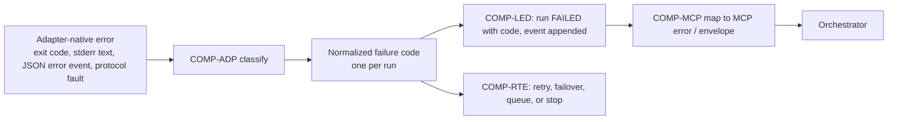

# Software Design Document (SDD)

| Field | Value |
| --- | --- |
| Status | Draft, baseline for milestone M1 |
| Owns | How components collaborate per workflow, shared design patterns, interface responsibilities, error propagation, configuration model overview, requirement-to-design traceability |
| Does not own | Components and boundaries ([HLD](HLD.md)), workflows and business rules ([FRD](../requirements/FRD.md)), requirements ([SRS](../requirements/SRS.md)), technology choices ([TDD](TDD.md)), schemas and contracts ([LLD](LLD.md)) |
| Last reconciled | 2026-10-15 |

Implementation status is owned by [ROADMAP §6](../ROADMAP.md#6-milestones); no code, tests or configuration existed as
of 2026-10-12, and parts of this design are now implemented. Component IDs (`COMP-*`) are
defined in [HLD §2](HLD.md#2-components). Patterns marked **Proposed** are design choices made while planning and are
not owner-approved; ADRs cited are "Delegated" decisions.

## 1. Shared design patterns

| Pattern | Where it applies | Rule | Cites |
| --- | --- | --- | --- |
| Ports and adapters | COMP-ADP, COMP-EXE | Core components depend on one adapter port and one transport interface; provider-specific argv, flags, parsing and resume rules live only in adapters. A new provider touches its adapter, manifest, fixtures and registry entry. | [ADR-0002](../adr/0002-mcp-upstream-acp-downstream.md), [ADR-0009](../adr/0009-version-gated-adapters.md), NFR-MAINT-01 |
| Append-only event log plus materialized state | COMP-LED | `run_event` and `decision` rows are never updated. Current-state tables (`run`, `meta_session`, `provider_health`, capacity) are updated in the same transaction as the event that causes the change. Handoff views and explanations are projections that can be rebuilt. | [ADR-0005](../adr/0005-sqlite-ledger.md), FR-SES-05, FR-TEL-01 |
| Ledger-first ordering (outbox-style) | COMP-LED with COMP-WS, COMP-EXE | Intent is committed to the ledger before the side effect (worktree creation, process spawn, branch commit) and the outcome is committed after it. A crash between the two leaves a non-terminal run with a recorded intent, which startup reconciliation resolves by inspecting the real state (process table, Git). Side effects are therefore re-derivable; they are never blindly repeated. | NFR-REL-01, FR-EXE-06, [ADR-0006](../adr/0006-worktree-checkpoints-no-blind-replay.md) |
| Fail-closed policy evaluation | COMP-POL, COMP-RTE, COMP-ADP, COMP-EXE | Unknown profile, unknown version, missing manifest, unparseable output or an adapter that cannot compile a profile yields deny / ineligible / error, never a fallback to a weaker setting. | NFR-SEC-06, FR-POL-02, [ADR-0004](../adr/0004-trust-profiles-no-bypass-flags.md) |
| Policy snapshot per run | COMP-POL, COMP-LED | At admission the effective policy (profile, per-client cap, config overrides, manifest version, adapter version, approval) is frozen and stored with the run. Later config edits do not change an in-flight run, and `get_run` can show what governed it. | FR-POL-01, NFR-OBS-01 |
| Idempotency keys | COMP-MCP, COMP-LED | Client keys deduplicate `delegate_task`; internal operation ids (run id, lease id) make retries of ledger writes and cleanup safe. | FR-MCP-08 |
| Process-group supervision | COMP-EXE | Each provider process is a group leader with a wall-clock timer; cancel and timeout signal the whole group, then force-kill after a grace period. A crashing child cannot take down the controller. | FR-EXE-01, NFR-REL-02 |
| Circuit breaker | COMP-RTE | Per-provider breaker opens on repeated transient failures or crashes and removes the provider from eligibility until a probe succeeds (thresholds are configuration, see §4). | FR-CAP-04, [ADR-0007](../adr/0007-capacity-as-confidence-estimate.md) |
| Bounded priority queue | COMP-RTE | Ingress is bounded; when full, admission returns a retryable error instead of growing without limit. Priority and age ordering are configuration. | FR-CAP-04, NFR-PERF-03 |
| Two-stage selection | COMP-RTE | Hard eligibility first (also a security control, ships in M2), then scoring (M7). Every decision is persisted. | [ADR-0008](../adr/0008-two-stage-routing.md), FR-RTE-01..03 |
| Estimate, not authority | COMP-RTE, COMP-MCP | Reported usage and controller estimates are stored and exposed as different fields with provenance. | FR-CAP-01..03, [ADR-0007](../adr/0007-capacity-as-confidence-estimate.md) |
| Tool-only mutation of history | COMP-GIT, COMP-ADP, COMP-WS | Agents never write to Git. Commits reach the publish ref only through the controller-side `commit` tool (or the finalize-only commit), and pushes only through the `push` tool or an operator command. Internal checkpoint commits and run branches are a separate, never-published history. | FR-GIT-01, 02, 08, [ADR-0014](../adr/0014-tool-only-commits-and-publication.md) |
| Prevent, then detect | COMP-ADP, COMP-GIT | Prevention (profile deny rules, no credentials in the agent environment) is the control; the before/after ref comparison is a backstop that keeps anything the agent managed to commit out of published history and reports it. Neither depends on a provider-specific attribution switch. | FR-GIT-01, 03, 06 |
| Sanitise, never add | COMP-GIT | The commit message is the agent's text minus attribution patterns; the controller appends nothing. Evidence of who made the commit goes to the ledger, not into Git. | FR-GIT-04, 07 |
| Advisory output, deterministic fallback | COMP-INN and its callers | An inner-agent result is an optional improvement over a deterministic default. Every caller has a fallback that needs no model (truncation, heuristic classifier, agent-supplied message), and an unavailable, invalid or suspended inner agent selects it. Failure is recorded as an `inner_call` and a run event, never as a run failure. | FR-INN-01, 07, 08, [ADR-0016](../adr/0016-inner-agent.md) |
| Structural authority boundary | COMP-INN, COMP-POL, COMP-ADP, COMP-RTE, COMP-GIT | The inner-agent service is not injectable into COMP-POL, the profile compilers, the retry logic or the push path: those modules have no dependency edge to it, and an import-boundary test fails the build if one appears. Callers receive validated text or "unavailable" and use it only for the advisory purpose of their task. | FR-INN-06, NFR-SEC-06, [ADR-0016](../adr/0016-inner-agent.md) |
| Affinity before score | COMP-RTE, COMP-LED | After the hard filter, a project with a recorded provider and model stays on it; the weighted score ranks candidates only when the project has no affinity or a reason from the closed list of FR-RTE-07 applies. Each decision records whether affinity held and the enumerated reason, so a replay can prove no switch happened without one. | FR-RTE-06, 07, [ADR-0032](../adr/0032-provider-model-affinity.md) |
| Untrusted retrieval, structural authority boundary | COMP-RAG, COMP-POL, COMP-ADP, COMP-RTE, COMP-GIT | Retrieved snippets are labelled untrusted reference data. COMP-RAG has no dependency edge from COMP-POL, the profile compilers, eligibility, approvals, retry or the push path, enforced by an import-boundary test as for COMP-INN. Any retrieval failure yields "no pack" and an unchanged run. | FR-RAG-07, 08, NFR-SEC-06, [ADR-0031](../adr/0031-retrieval-index.md) |
| Definitions in config, snapshot per run | COMP-PRJ, COMP-POL, COMP-LED | Projects live in the schema-validated configuration. At admission the resolved project, environment, ceilings, push policy and identity are frozen into the policy snapshot, so later edits do not change an in-flight run. | FR-PRJ-01, 04, 06, FR-POL-01 |

## 2. Component collaboration per workflow

Workflow IDs refer to the [FRD](../requirements/FRD.md); step-level behaviour and business rules are defined there. This
section states only which components collaborate and what crosses each call. Run states are those of the FRD state
machine: QUEUED, PREFLIGHT, LEASED, RUNNING, VERIFYING, FINALIZING, then SUCCEEDED, FAILED or CANCELLED, with
AWAITING_APPROVAL and WAITING_CAPACITY as side states.

| WF | Collaboration | Notes |
| --- | --- | --- |
| WF-1 Delegate task | COMP-MCP validates and asks COMP-POL to authorize and snapshot; COMP-LED records the run; COMP-RTE filters providers using COMP-ADP preflight state and COMP-POL manifests, persists the route decision, reserves capacity; COMP-WS creates the worktree and lease; COMP-EXE spawns via COMP-ADP compile, streams events through COMP-ADP parse into COMP-LED; COMP-EXE runs verification; COMP-WS records diff and checkpoint; COMP-LED commits the terminal state. | Sequence in [HLD §6.1](HLD.md#61-delegate-run-end-to-end-wf-1). The MCP call returns after the QUEUED insert. With the routing task enabled (M11), COMP-RTE may ask COMP-INN for stage-2 features; they are stored with source, model and template version in the route decision and never feed eligibility (FR-INN-12). |
| WF-2 Continue same provider | COMP-MCP resolves the meta-session in COMP-LED; COMP-RTE checks the bound provider is still eligible; COMP-ADP builds a native resume invocation from the stored native session id; the rest follows WF-1 on the existing worktree head. | If the native session is gone or resume fails, the outcome is a failure code, not a silent fresh start (Proposed; confirm in FRD). *M5 (Proposed, [ADR-0038](../adr/0038-handoff-bundle-and-continuity.md)):* COMP-WS runs the resume in the worktree path that created the native session unless the adapter is verified directory-independent; an unusable path becomes a recorded handoff before spawn ([LLD §15.6](LLD.md#156-working-directory-of-a-native-resume)). |
| WF-3 Cross-provider handoff | COMP-RTE selects a different provider; COMP-LED and COMP-WS supply the handoff inputs (decisions, Git base/head, changed files, diff excerpts, diagnostics); one provider-neutral renderer in the lifecycle turns the bundle and the instruction into the prompt, which COMP-ADP compiles as it compiles any objective (*2026-10-14, [ADR-0038](../adr/0038-handoff-bundle-and-continuity.md), replacing "COMP-ADP renders them"*); a new binding is stored. | Inputs only from the ledger and Git (FR-SES-04). With the condensing task enabled (M11), the handoff builder may pass text fields through COMP-INN; the result is labelled, keeps a pointer to the raw artifact, and falls back to deterministic truncation (FR-INN-13). |
| WF-4 Cancel run | COMP-MCP asks COMP-LED for the run state, COMP-EXE signals the process group, COMP-WS decides rollback or keeps checkpoint, COMP-LED commits CANCELLED. A run still queued is cancelled without a process. | Cancellation races with completion are resolved by the first terminal-state commit. |
| WF-5 Failure handling and retry | COMP-EXE and COMP-ADP produce a normalized failure code; COMP-RTE decides retry, failover or queue from the code and COMP-WS's unchanged-workspace check; COMP-LED records every attempt as a separate run linked to the same meta-session. | Retry set and backoff: FR-CAP-05, FR-CAP-06. |
| WF-6 Adapter preflight and doctor | COMP-OPS (or COMP-RTE on a stale cache) calls COMP-ADP probe; COMP-POL checks the manifest covers the version; COMP-LED stores `provider_health` and `adapter_version`. | Preflight performs no login (FR-AUTH-02). |
| WF-7 Privileged approval | COMP-MCP admits a `privileged` `delegate_task` as AWAITING_APPROVAL; COMP-OPS `approve` writes an `approval` row via COMP-POL; COMP-RTE only then dispatches. A `privileged` `continue_task` is admitted to QUEUED only when COMP-LED finds an `APPROVED` row for the meta-session and client (owner decision 17). For a client the operator configured `privileged_approval: "not_required"`, COMP-MCP admits the `delegate_task` to QUEUED and COMP-LED writes the row decided `APPROVED` by client policy in the same transaction ([ADR-0019](../adr/0019-per-client-privileged-approval.md)). | MCP can never grant the approval (FR-MCP-06). |
| WF-8 Startup reconciliation | COMP-EXE and COMP-LED scan non-terminal runs, check for live processes, mark orphans `PROCESS_CRASH` with cause `controller_restart`; COMP-WS assesses worktree mutation and releases or retains leases; COMP-RTE re-queues only unchanged, retry-eligible runs. | Runs before the MCP server accepts calls (Proposed). |
| WF-9 Adapter version revalidation | COMP-OPS `adapters validate` triggers the COMP-ADP conformance suite against the installed version; on pass COMP-LED records the accepted version and COMP-RTE restores eligibility. | Maps to UJ-7. |
| WF-10 Delegate to a project | COMP-MCP validates `project` (V12) and asks COMP-POL for the lower of client and project ceilings; COMP-PRJ resolves the repository context, base ref and environment; COMP-WS creates the worktree from the project's repository; COMP-EXE spawns the provider through the environment (host, or container in M10); COMP-LED records project, environment and image digest in the snapshot. | Otherwise WF-1. COMP-PRJ owns the container lifecycle and its orphan cleanup (FR-PRJ-07). |
| WF-11 Commit through the injected tool | The agent calls the shim, which forwards over the per-run socket to COMP-GIT; COMP-GIT checks run state with COMP-LED, builds the tree through COMP-WS, writes the commit on the publish ref, and records provenance and a `git_commit` event in one COMP-LED transaction. | Violations found at FINALIZING are reported as `git_policy_violation` events (BR-27). When the commit-message task is enabled and the agent gave no message, COMP-GIT asks COMP-INN for a draft of the committed paths' diff and sanitises it like any message; empty or unavailable returns a tool error (FR-INN-10). |
| WF-12 Publish | COMP-GIT asks COMP-POL for the push decision (policy, ref, credential reach), pushes from the controller process, and records a `git_push` event and provenance update through COMP-LED. | Agent-originated and operator-originated pushes take the same path. |
| WF-13 Inner task execution | A caller (COMP-GIT, COMP-RTE, handoff builder, COMP-EXE or COMP-OPS) asks COMP-INN for a task with controller-owned inputs; COMP-INN applies locality gating, redaction and budget, calls the backend port, validates, and writes an `inner_call` record through COMP-LED; the caller receives validated text or "unavailable" and applies its fallback. | Defined in the [FRD](../requirements/FRD.md) as WF-13; sequence in [HLD §6.5](HLD.md#65-inner-task-call-including-commit-message-drafting-wf-13-wf-11). No branch reaches COMP-POL, retry or push (FR-INN-06). |
| WF-14 Retrieval for a run | In the `serve` daemon COMP-RAG scans the project's contexts (paths from COMP-PRJ), applies exclusions and redaction, embeds through the backend port under the inner-agent locality gates, and stores chunks in the project index; at admission COMP-MCP asks COMP-RAG for a context pack within the token budget; COMP-RAG returns snippets or nothing; COMP-LED records the run with the original text unchanged plus snippet ids and hashes, and index and retrieval records without content. | Defined in the [FRD](../requirements/FRD.md) as WF-14; sequence in [HLD §6.6](HLD.md#66-retrieval-for-a-run-wf-14-m12-proposed). Admission pack mechanism: [LLD §14.11](LLD.md#1411-admission-context-pack-t125), [TDD §3.13.8](TDD.md#3138-t125-admission-time-context-pack-2026-10-14) (built by T12.5 on fakes; retrieval runs at dispatch through a lifecycle port, LLD §14.11 as-built note). Nothing reaches COMP-POL, eligibility, retry or push (FR-RAG-07, BR-46). Failure at any step gives no pack (FR-RAG-08). The pack is placed after stable prompt content (FR-RTE-09). |

Routing note for WF-1, WF-2, WF-3 and WF-5 (M7): COMP-RTE reads the project's `project_affinity` row from COMP-LED after
the eligibility filter and before scoring. WF-2 stays on the bound provider as before (FR-SES-03); the affinity only
decides the provider of a new meta-session in the same project. A cross-provider handoff (WF-3) requested by the
orchestrator is a `user_request` switch; one forced by `QUOTA_EXHAUSTED` in WF-5 is a `capacity_exhausted` switch that
re-bases affinity (FR-CAP-06). COMP-RTE writes the new affinity and the decision in one COMP-LED transaction.

## 3. Interface responsibilities and error propagation

### 3.1 Who calls whom

| Caller | Callee | Style | Data crossing | Responsibility boundary |
| --- | --- | --- | --- | --- |
| Orchestrator | COMP-MCP | Sync request/response over stdio; long work async via polling | Validated tool arguments in, compact envelope out | COMP-MCP owns validation and shaping; it holds no domain logic beyond that. |
| COMP-MCP | COMP-POL | Sync, in-process | Caller identity, requested profile, canonical path | Returns allow/deny plus a frozen policy snapshot. |
| COMP-MCP, COMP-RTE, COMP-WS, COMP-EXE | COMP-LED | Sync transactions | Rows and events | Only COMP-LED writes the database (single-writer, [ADR-0005](../adr/0005-sqlite-ledger.md)). |
| COMP-RTE | COMP-ADP | Sync (cached) probe and capability queries | Adapter state, supported profiles, version | Adapters report facts; COMP-RTE decides. |
| COMP-RTE | COMP-WS | Sync | Workspace path, profile, base ref | Returns a worktree and lease or an error. |
| COMP-RTE | COMP-EXE | Async dispatch | Run id, compiled invocation | Execution is a background job with a completion event, not a blocking call. |
| COMP-EXE | COMP-ADP | Sync pure functions around async I/O | compile: request and policy to argv/env/config; parse: bytes to normalized events | Adapters do not spawn processes or touch the ledger. |
| COMP-EXE, COMP-RTE, COMP-MCP | COMP-TEL | Async, fire-and-forget into the ledger transaction | Lifecycle observations | COMP-TEL redacts; exporter failure never fails a run. |
| COMP-OPS | COMP-POL, COMP-LED, COMP-ADP | Sync | Approvals, queries, validation requests | CLI is a thin client; no logic duplicated from other components. |
| Agent (provider process) | COMP-GIT (via the per-run shim and socket) | Sync request/response over a per-run local socket, capability token per run | `commit` and `push` calls in; SHA or tool error out | COMP-GIT trusts nothing in the call except what it validates (BR-25, BR-29); the channel is closed when the run ends. |
| COMP-GIT | COMP-POL, COMP-WS, COMP-LED | Sync, in-process | Push decision; tree for paths; provenance and events | COMP-GIT never writes the database itself (single writer). |
| COMP-MCP, COMP-RTE | COMP-PRJ | Sync, in-process | Project reference in; repository context, environment, ceilings out | COMP-PRJ resolves; COMP-POL still decides. |
| COMP-GIT, COMP-RTE, handoff builder, COMP-EXE, COMP-OPS | COMP-INN | Async call with per-call timeout, in-process | Task name and controller-owned input in; validated text or "unavailable" out | COMP-INN gives advice only; the caller applies its own sanitiser, storage and fallback. COMP-POL, the profile compilers and the retry and push code do not call it (FR-INN-06). |
| COMP-INN | Inner backend (M11) | Single-turn request over the `http` or `cli` port, redacted and budgeted | Prompt out, text in | Stateless, no tools offered, no credential in configuration; locality gate before sending (FR-INN-02, 03, 16). |
| COMP-INN | COMP-LED | Sync transaction | `inner_call` records, run events | Records hold task, outcome, sizes, hashes and latency, never bodies (FR-INN-15, 16). |
| Admission (COMP-MCP), COMP-OPS | COMP-RAG | Sync with a hard time bound for the context pack, background for index builds | Project reference and objective in; snippets (ids, hashes, labels) or nothing out; `index` commands and `doctor` queries | COMP-RAG gives reference data only; COMP-POL, the profile compilers, eligibility, retry and push do not call it (FR-RAG-07). Failure returns "no pack". |
| COMP-RAG | Embedding backend (M12) | Batched requests over the `local` or `http` port, after redaction and the locality gate | Chunk text out, vectors in | No credential in configuration; `remote` only with `allow_remote` and `allow_source_content` (FR-RAG-04). |
| COMP-RAG | COMP-LED | Sync transaction | `rag_index_built`, `rag_retrieval` records and run events | Counts, durations, backend id, snippet ids and hashes; never content, never `usage_observation` (FR-RAG-12). |
| COMP-PRJ | Container runtime (M10) | Sync commands behind a small port | create, start, stop, remove; label lookup for orphans | Runtime is rootless (ADR-0013, mechanism Accepted 2026-10-18; Docker per ADR-0052); the port keeps it replaceable. |

COMP-OPS commands run in their own short-lived process, write only operator records (approvals, denials, cancel
requests) to the shared ledger, and leave all side effects to the `serve` daemon
([ADR-0005](../adr/0005-sqlite-ledger.md), [TDD §3](TDD.md)).

### 3.2 Error propagation

- Classification happens once, in COMP-ADP, using structured fields first; free-text matching is a last resort and only
  to refine a structured error (FR-ADP-04). Anything unclassifiable becomes `OUTPUT_PROTOCOL_ERROR` or `PROCESS_CRASH`,
  never success (NFR-SEC-06).
- Controller-originated failures (`INVALID_REQUEST`, `PERMISSION_BLOCKED` from caller caps, `ELIGIBILITY_NONE`,
  `ADAPTER_VERSION_UNVERIFIED`) are produced by COMP-MCP, COMP-POL or COMP-RTE directly, using the same codes.
  `ELIGIBILITY_NONE` and `INVALID_REQUEST` were added during planning and are not in the original taxonomy list.
- Each run ends in exactly one terminal state with at most one failure code; each tool error carries exactly one code
  plus a message (FR-MCP-07). Retries create new run records, so the history stays append-only.
- Messages returned upstream are redacted summaries; stderr and raw events stay in artifacts (FR-MCP-04, FR-TEL-03).
- Taxonomy, retryability and mapping table: [LLD §4](LLD.md#4-failure-taxonomy).
- Retrieval failures (backend unreachable, index missing, incomplete or stale, gate refusal) are not run failure codes.
  COMP-RAG returns "no pack", the failure becomes a `rag_retrieval` outcome and a run event, and `doctor` shows the
  state (FR-RAG-08, FR-RAG-14). Affinity never produces a failure code: when no provider passes the filter the result is
  `ELIGIBILITY_NONE` as before, with `affinity_switch_reason` `ineligible` recorded.
- Inner-agent failures (unreachable, timeout, error, invalid output, open circuit, suspended task) are not run failure
  codes and never enter the classification above. COMP-INN returns "unavailable"; the caller takes its fallback; the
  failure becomes an `inner_call` outcome and a run event, and `doctor` shows the degraded state (FR-INN-08, FR-INN-06).
  The one caller-visible effect is the `commit` tool error `MESSAGE_REQUIRED` when no message exists (FR-INN-10).

### 3.3 Concurrency and ordering rules (Proposed)

- Single writer: only COMP-LED writes the SQLite database; other components submit operations to it. Provider-process
  output handling is per-run and isolated, so one run's parser failure cannot corrupt another's (NFR-REL-02).
- Per-run state transitions are compare-and-set on the previous state inside one transaction, so a cancel and a
  completion racing resolve to whichever commits first; the loser observes a terminal state and does nothing further.
- A write lease is a ledger row plus the worktree on disk. Acquire: insert lease row, then create worktree. Release:
  finish Git work, then delete the lease row. Reconciliation (WF-8) treats any lease without a live run as stale and
  checks the worktree before reuse or removal.
- Dispatch order for a run: policy snapshot, route decision, lease, spawn. Each step is recorded before the next begins,
  so any prefix of the sequence can be recovered from the ledger.
- Capacity reservations (per-provider concurrency slots) are held for the duration of RUNNING and released in the same
  transaction that records a terminal state; reconciliation releases slots held by dead runs.
- Verification commands (FR-EXE-08) run under the same process-group, environment-allowlist and timeout rules as the
  agent itself, after the agent process has exited. They run on the host, not inside the provider's sandbox (owner
  decision 11; T3.10, [LLD §8.1](LLD.md#81-verification-stage-m3-t310)).

## 4. Configuration model overview

Detail (format, keys, validation schema) is owned by [TDD](TDD.md) and [LLD](LLD.md); this section only fixes the shape.
All configuration is schema-validated at load and invalid configuration prevents start (NFR-SEC-05, NFR-SEC-06).

| Group | Content (Proposed) | Consumed by |
| --- | --- | --- |
| Roots and paths | Allowed workspace roots, data directory, worktree location | COMP-POL, COMP-WS, COMP-LED |
| MCP clients | Named client entries with maximum trust profile | COMP-MCP, COMP-POL |
| Profiles | Overrides to profile defaults (recorded in the policy snapshot; cannot go below the SRS defaults without that record, FR-POL-01) | COMP-POL |
| Providers | Enable flag, binary path, tier and relative weight prior, concurrency, allowed auth mode, manifest reference | COMP-ADP, COMP-RTE |
| Models | Model registry entries and aliases | COMP-ADP |
| Routing | Scoring weights, classifier switches, failover and queue-horizon settings | COMP-RTE |
| Limits | Global and per-provider concurrency, queue bound, timeouts, grace period, breaker thresholds, backoff | COMP-RTE, COMP-EXE |
| Retention | Artifact, event and worktree retention | COMP-LED, COMP-WS |
| Telemetry | OTLP endpoint (absent by default), redaction rules | COMP-TEL |
| Inner agent | Optional single backend (kind, locality, `allow_remote`, model, no credential), per-task enable flags and modes, budgets, timeout, breaker and suspension thresholds, project `inner_agent` setting (none enabled by default; Proposed) | COMP-INN, COMP-GIT, COMP-RTE, COMP-OPS |
| Affinity | `routing.affinity`: `enabled`, `low_water_mark`, `min_confidence`, `idle_ttl` (Proposed; values chosen in M6/M7) | COMP-RTE |
| Retrieval | `rag` (per-project override, `global` section): mode, backend, caps, token budget, exclusions, `contribute_to_global`, `use_global` (off unless an embedding backend is configured; Proposed) | COMP-RAG, COMP-OPS, COMP-MCP |

Defaults for numeric values are *(proposed target)* until measured, as in the SRS. Environment variables and global
provider config are never an input path for policy (FR-POL-08).

### 4.1 COMP-RAG implementation evidence (M12 T12.1–T12.3)

Milestone status and task boundaries: [ROADMAP §6.7](../ROADMAP.md#67-m12-retrieval-index-tasks). Schemas, algorithms
and the test strategy are in [TDD §3.13](TDD.md#313-retrieval-index) and [LLD §14](LLD.md#14-retrieval-index); the
subsection below is SDD traceability only.

#### T12.1 — `rag` configuration and per-project store

**Evidence (implemented).** FR-RAG-01, FR-RAG-03, FR-RAG-09 (global `sources` under an allowed root only; the global
store and sharing rules are T12.7), FR-RAG-11 (caps in configuration only; background build, `index` commands and
`rag_record` ledger rows are T12.4).

- **Tests:** `src/config/rag.test.ts`, `src/retrieval/store.test.ts`, `src/mcp/project-tools.test.ts`
- **Modules:** `src/config/rag.ts`, `src/retrieval/store.ts`; store prune at `serve` start (`src/cli/serve.ts`)

#### T12.2 — scanner, exclusions, redaction and chunker

**Evidence (implemented).** FR-RAG-02 (deterministic redaction before chunk output, same pipeline as FR-INN-16).

- **Tests:** `src/retrieval/scan.test.ts`, `src/retrieval/chunk.test.ts`, `src/retrieval/options.test.ts`
- **Modules:** `src/retrieval/scan.ts`, `src/retrieval/chunk.ts`, `src/retrieval/denylist.ts`,
  `src/retrieval/options.ts`

#### T12.3 — embedding backend port and locality gates

**Evidence (implemented).** FR-RAG-04; FR-RAG-12 for the port layer (records without text; no embedding row in
`usage_observation` or capacity). Reuses COMP-INN locality classification and gates (FR-INN-16, T11.3).

- **Tests:** `src/retrieval/http-embedder.test.ts`, `src/retrieval/embedding.test.ts`
- **Modules:** `src/retrieval/embedding.ts`, `src/retrieval/http-embedder.ts`, `src/retrieval/fake-embedder.ts`;
  `createPinnedHttpTransport` in `src/inner/http-backend.ts`

#### T12.5 — admission context pack (design intent)

**Design evidence (on `main`).** FR-RAG-05, FR-RAG-07 and FR-RAG-08 (WF-14 admission context pack; BR-46) are specified
in [LLD §14.11](LLD.md#1411-admission-context-pack-t125) (with [§14.6](LLD.md#146-selection-and-token-budget),
[§14.8](LLD.md#148-freshness-and-fallback) and [§14.10](LLD.md#1410-events-and-records)) and the engineering test plan
in [TDD §3.13.8](TDD.md#3138-t125-admission-time-context-pack-2026-10-14); authority-boundary scenarios in [TDD
§3.13.3](TDD.md#3133-testing-affinity-and-retrieval).

**Runtime (implemented, T12.5).** Tests: `src/retrieval/admission.test.ts`, `src/lifecycle/context-pack.test.ts`,
`src/retrieval/import-boundary.test.ts`; module `src/retrieval/admission.ts`, reached from the lifecycle only through a
structurally typed port. Differences from the design (retrieval at dispatch rather than inside the admission
transaction; no hostile-pack behavioural test and no `rag.retrieve` span) are listed in the LLD §14.11 as-built note.

**Runtime (implemented, T12.6 and T12.7 Done on fakes; ROADMAP §6.7).**
T12.7 Done (2026-10-19, Delegated agent work, not owner-approved; it was Partial earlier that day while `global`/`both`
scope answered only `GLOBAL_NOT_AVAILABLE`).
`search_project_context` (FR-RAG-06, T12.6;
`src/mcp/search-context.test.ts`) and global build, contribution copy, admission merge, `index rebuild global`,
`index clear global`, `index status global` and the `doctor` global check (FR-RAG-09, FR-RAG-10, T12.7;
`src/retrieval/global.test.ts`, `src/cli/rag-index.test.ts`). The tool's `global` scope reads only the global store and
`both` merges project and global hits by score under one limit, with each global hit labelled `origin_project` or
`source`
(`src/mcp/search-context.ts`, wired in `src/cli/serve.ts`); `GLOBAL_NOT_AVAILABLE` remains the fail-closed answer when
the global index is unavailable.

### 4.2 COMP-ADP M4 parser implementation evidence (Done against its Done-when)

Milestone boundaries and Done-when gaps: [ROADMAP §6.8](../ROADMAP.md#68-m4-adapter-expansion-tasks) (`T4.23`, `T4.33`,
`T4.43`, `T4.53`). Mechanism and failure taxonomy: [LLD §2](LLD.md#2-adapter-contract), [LLD §4](LLD.md#4-failure-taxonomy);
provider-specific as-built detail in [LLD §2.0](LLD.md#20-antigravity-adapter-implementation-evidence-m4-t432-t433-t437),
[§2.0.1](LLD.md#201-cursor-adapter-implementation-evidence-m4-t442-t443) and
[§2.0.2](LLD.md#202-opencode-adapter-implementation-evidence-m4-t452-t453); sourcing in [TDD
§4.4.7](TDD.md#447-antigravity-parser-implementation-evidence-m4-t433), [§4.5.5](TDD.md#455-cursor-parser-implementation-evidence-m4-t443)
and [§4.6.5](TDD.md#465-opencode-parser-implementation-evidence-m4-t453). HLD component evidence: [§2.2
T4.33](HLD.md#t433--parser-result-failure-classification-and-resume-done-against-its-done-when), [§2.3
T4.43](HLD.md#t443--parser-result-failure-classification-and-resume-done-against-its-done-when), [§2.4
T4.53](HLD.md#t453--parser-result-failure-classification-and-resume-done-against-its-done-when).

| Task | Requirements (primary) | Tests (parser suites) |
| --- | --- | --- |
| T4.23 Grok Build (Done against its Done-when, owner decision 65 (a)) | FR-ADP-04, FR-SES-03, FR-EXE-03 | `src/adapters/grok/grok.test.ts` (`grok parser to resume round trip (T4.23 residual; SYNTHETIC lines, parser unchanged)`); `src/adapters/grok/protocol.ts` EVENT comment ([#384](https://github.com/zemdregon/switchboard/pull/384)); [ROADMAP T4.23](../ROADMAP.md#68-m4-adapter-expansion-tasks) ([#385](https://github.com/zemdregon/switchboard/pull/385)) |
| T4.33 Antigravity (Done against its Done-when, owner decision 65 (a)) | FR-ADP-04, FR-CAP-01, FR-SES-03 | `src/adapters/antigravity/antigravity.test.ts` (`antigravity parser and result (T4.33)`, `antigravity parser hardening (T4.33, synthetic shapes)`, `antigravity cases with no recorded native shape (T4.33, synthetic shapes)`, `antigravity parser fallbacks and exact matching (T4.33, synthetic shapes)`); `src/adapters/antigravity/parser-residual.test.ts` |
| T4.43 Cursor (Done against its Done-when, owner decision 65 (a)) | FR-ADP-04, FR-SES-03, FR-ADP-10 | `src/adapters/cursor/cursor.test.ts` (`cursor parser and result (T4.43)`, `cursor parser hardening (T4.43, synthetic shapes)`, `cursor parser residual branches (T4.43, synthetic)`); `src/adapters/cursor/parser-residual.test.ts` and `fixtures/idless_guard.jsonl` ([#360](https://github.com/zemdregon/switchboard/pull/360)) |
| T4.53 OpenCode (Done against its Done-when, owner decision 65 (a)) | FR-ADP-04, FR-SES-03, FR-ADP-10 | `src/adapters/opencode/opencode.test.ts` (`opencode parser and result (T4.53)`, nested `cases with no recorded native shape (live check rows 7, 11, 14c)`) |

Grok T4.23: parser-to-resume and session-id/`resumeArgs` boundary pins landed in
[#384](https://github.com/zemdregon/switchboard/pull/384); Done against its Done-when under owner decision 65 (a):
unrecorded native `tool_call` parameter shapes and operator capture gaps remain open under (ROADMAP T4.28).

Cursor T4.43: ADR-0039 `extractResult` guard over a flagged `tool_call` landed in
[#238](https://github.com/zemdregon/switchboard/pull/238); Done against its Done-when under owner decision 65 (a):
the recorded `stream-json` quota-stop and sandbox shapes and any native backing-vendor field remain open under
(ROADMAP T4.48 Done 2026-10-19 per owner decision 77 without capturing these shapes; now a T4.41 extension or owner decision).

OpenCode T4.53: Done against its Done-when under owner decision 65 (a): the recorded permission-denial and
rate-limit event shapes, the `tool_use` input key names and any native backing-vendor field remain open
(ROADMAP T4.58 Done 2026-10-19 without capturing these shapes; now a T4.51 extension or owner decision — see T4.56).

### 4.3 COMP-INN implementation evidence (M11, T11.1–T11.13, Done on fakes)

Task status and clause-by-clause Done-when evidence: [ROADMAP §6.6](../ROADMAP.md#66-m11-inner-agent-tasks).
Schemas, pipeline, gates and contracts: [LLD §13](LLD.md#13-inner-agent); as-built testing notes: [TDD
§3.12](TDD.md#312-inner-agent); component evidence: [HLD
§2.5](HLD.md#25-comp-inn-implementation-evidence-m11-t111t1113-done-on-fakes). The table below is SDD traceability only
(written 2026-10-15, T11.14, Delegated). Every test runs on the scripted in-process fake backend or a fake HTTP server on
a loopback address; no live inner backend, provider CLI or network host has been used, so M11 stays `Partial`.

| Task | Requirements (primary) | Tests |
| --- | --- | --- |
| T11.1 config, port, fake backend, `inner_call`, import boundary | FR-INN-01, 02, 05, 06 | `src/config/config.test.ts` ("inner_agent"), `src/inner/inner.test.ts`, `src/inner/import-boundary.test.ts`, `src/ledger/ledger.test.ts` (migration 0005) |
| T11.2 call pipeline | FR-INN-07, 08, 16 | `src/inner/pipeline.test.ts` (fallbacks within the bound, re-ask, breaker, slot, planted secrets, seven-row gate table), `src/inner/log-line.test.ts` (the `inner.call` log line's key set, one line per outcome, no body or token count) |
| T11.3 `http` backend, locality, project override | FR-INN-03, 16 | `src/inner/http-backend.test.ts`, `src/inner/http-peer-check.test.ts` (the `LOCALITY_CHANGED` socket peer re-check: refused before a byte is written, fixed code only), `src/config/config.test.ts` |
| T11.4 commit-message task (on the `serve` path through the `commit` tool) | FR-INN-10, FR-GIT-04 | `src/git/commit-message.test.ts` (real tool socket; hostile drafts, `MESSAGE_REQUIRED`, modes, gates, `innerSettingResolver`), `src/ledger/ledger.test.ts` (migration 0007) |
| T11.5 usage accounting | FR-INN-15, BR-41 | `src/inner/usage.test.ts`, `src/inner/usage-surfaces.test.ts`, `src/inner/usage-channels.test.ts` (the `commit` tool channel and the MCP admission harness), `src/capacity/capacity.test.ts` ("inner-agent calls change nothing"), `src/cli/cli.test.ts` (`inner_shared_subscription`), `src/ledger/ledger.test.ts` (migration 0006) |
| T11.6 quality monitoring and suspension | FR-INN-09 | `src/inner/suspension.test.ts`, `src/ledger/ledger.test.ts` (migration 0008) |
| T11.7 `doctor`, `inner status`, `inner test`, `inner resume` | FR-INN-17 | `src/cli/inner.test.ts`, `src/inner/cli-run-isolation.test.ts` |
| T11.8 PR-draft task (service function, not on a run path) | FR-INN-11, BR-38 | `src/inner/pr-draft.test.ts` (sanitiser, gates, no pull-request API client in `src/` or `package.json`) |
| T11.9 verification-output summary (service function, not on a run path) | FR-INN-13, FR-EXE-08 | `src/inner/log-summary.test.ts` (statuses and counts from records only; hostile success claim) |
| T11.10 handoff condensation (service function, not on a run path) | FR-INN-13, FR-SES-04 | `src/inner/handoff-condense.test.ts` (handoff view byte-identical; labelled fields; deterministic truncation) |
| T11.11 routing classification (on the `serve` path at admission, continuation and quota failover; record-only, Q-82) | FR-INN-12, FR-RTE-04 | `src/inner/route-features.test.ts`, `src/mcp/inner-route-features.test.ts`, `src/cli/serve.test.ts` ("T11.11") |
| T11.12 run title (service function, display-only, not on a run path) | FR-INN-14 | `src/inner/run-title.test.ts` |
| T11.13 `cli` backend gate (shipped `Ineligible`) | FR-INN-04, FR-ADP-08, FR-ADP-03 | `src/inner/cli-backend.test.ts` (every gate reason spawns nothing; an eligible gate spawns only the tool-free argv; a tool call in the stream is refused), `src/inner/cli-doctor-surfaces.test.ts`, `src/cli/inner.test.ts` (shipped surfaces stay `no_backend`/`Ineligible` with no process) |

Not built, so no row claims it: a verified tool-free `cli` invocation (the gate itself is built, T11.13; the shipped
kind stays `Ineligible` since no OpenCode release through v2.0.32 offers the control), the
`inner.call` span (LLD §13.8 as-built note), the Unix-socket form of `base_url`, a live-inner opt-in in
`scripts/live-smoke.mjs`, and a run path, hook or `inner` command that calls the T11.8, T11.9, T11.10 or T11.12
service functions. FR-INN-18 is deferred by the SRS.

### 4.4 COMP-TEL and version-canary implementation evidence (M8, T8.1–T8.6)

Task status and evidence: [ROADMAP §6.15](../ROADMAP.md#615-m8-hardening-tasks). Span contract, allowlist, parent
links and collector harness: [LLD §7](LLD.md#7-telemetry-spans); data flow: [HLD §6.3](HLD.md#63-telemetry-flow);
testing layers: [TDD §3.6](TDD.md#36-testing-strategy). The table below is SDD traceability only (written 2026-10-16,
T8.7 design-doc slice, Delegated). Every test runs on the fake adapter, injected version strings or an in-process
loopback collector; no provider CLI or external collector is used.

| Task | Requirements (primary) | Code | Tests |
| --- | --- | --- | --- |
| T8.1 config and lazy OTLP transport | FR-TEL-02, NFR-PRIV-01 | `src/config/load.ts`, `src/telemetry/index.ts` | `src/config/config.test.ts`, `src/telemetry/index.test.ts`, `src/cli/serve.test.ts` |
| T8.2 wrapper-boundary span builders | FR-TEL-02, FR-TEL-03, ADR-0012 | `src/telemetry/spans.ts`, `src/lifecycle/lifecycle.ts` | `src/telemetry/spans.test.ts` |
| T8.3 parent links and collector test | FR-TEL-02, FR-TEL-03, NFR-SEC-01 | `src/telemetry/links.ts`, `src/telemetry/fixtures/collector.ts` | `src/telemetry/collector-lifecycle.test.ts`, `src/telemetry/collector.test.ts` |
| T8.4 export-time key filter | FR-TEL-03 | `src/telemetry/allowlist.ts` | `src/telemetry/allowlist.test.ts` |
| T8.5 version canary (operator-scheduled) | FR-ADP-03, FR-OPS-02, NFR-PERF-02 | `src/adapters/version-canary.ts`, `src/cli/adapters-version-canary.ts`, `src/cli/doctor.ts`, `src/cli/serve.ts` (read-only on routing), `src/cli/adapters-validate.ts` (records the baseline) | `src/adapters/version-canary.test.ts` |
| T8.6 version-bump test | FR-ADP-03, NFR-PERF-02 | (test only) | `src/adapters/version-bump-preflight.test.ts` |

Not built, so no row claims it: spans other than `controller.delegate` and `provider.spawn` (the remaining LLD §7 rows,
including `inner.call`), value inspection at export time (the forbidden-category scan is a test oracle only), and an
operator dry run of the scheduled canary on a real CLI upgrade (T8.5 operator-only proof).

## 5. Requirements to design traceability

Every `FR-*` and `NFR-*` ID in the [SRS](../requirements/SRS.md) has one row. Priority and milestone remain in the SRS;
"Deferred" requirements are listed with the extension point that keeps them possible. Components use the HLD IDs.
"Detail" links point to the LLD or TDD section that will specify the mechanism; where no section anchor is assigned yet
the cell says so.

M12 retrieval through T12.3 (FR-RAG-01–04 on fakes) lists primary tests and modules under [TDD
§3.13.5](TDD.md#3135-t121-config-and-store-2026-10-14)–[§3.13.7](TDD.md#3137-t123-embedding-port-and-locality-gates-2026-10-14).
T12.5 admission pack design for FR-RAG-05, FR-RAG-07 and FR-RAG-08 is in [LLD
§14.11](LLD.md#1411-admission-context-pack-t125) and [TDD §3.13.8](TDD.md#3138-t125-admission-time-context-pack-2026-10-14);
implementation evidence is in [§4.1](#t125--admission-context-pack-design-intent). M4 adapter parser hardening on
synthetic fixtures (Grok Build, Antigravity, Cursor, OpenCode;
T4.23, T4.33, T4.43 and T4.53 are Done against their Done-when under owner decision 65 (a))
is summarized in [§4.2](#42-comp-adp-m4-parser-implementation-evidence-done-against-its-done-when).

| ID | Component(s) | Design element / mechanism | ADR(s) | Detail |
| --- | --- | --- | --- | --- |
| FR-MCP-01 | COMP-MCP | Tool registry on an MCP stdio server; handlers delegate to other components | [ADR-0002](../adr/0002-mcp-upstream-acp-downstream.md) | [LLD §3](LLD.md#3-mcp-tool-contracts) |
| FR-MCP-02 | COMP-MCP, COMP-RTE | Read-only tools over capacity estimates and persisted route decisions | [ADR-0007](../adr/0007-capacity-as-confidence-estimate.md), [ADR-0008](../adr/0008-two-stage-routing.md), [ADR-0043](../adr/0043-capacity-estimate-breaker-and-retry.md) | [LLD §3](LLD.md#3-mcp-tool-contracts), [LLD §16](LLD.md#16-capacity-and-resilience-m6), [LLD §17.5](LLD.md#175-explain_route) |
| FR-MCP-03 | COMP-MCP, COMP-LED, COMP-RTE | Async-first: insert meta-session/run in ledger, return ids, optional bounded wait by polling ledger state | [ADR-0002](../adr/0002-mcp-upstream-acp-downstream.md) | [LLD §3](LLD.md#3-mcp-tool-contracts), [LLD §1](LLD.md#1-data-model) |
| FR-MCP-04 | COMP-MCP, COMP-TEL | Envelope projection from an explicit field allowlist over ledger rows; transcripts never loaded | [ADR-0001](../adr/0001-controller-owned-canonical-state.md) | [LLD §3](LLD.md#3-mcp-tool-contracts) |
| FR-MCP-05 | COMP-MCP, COMP-RTE | Hints are inputs to the eligibility filter only; require_provider cannot skip any check | [ADR-0008](../adr/0008-two-stage-routing.md) | [LLD §3](LLD.md#3-mcp-tool-contracts) |
| FR-MCP-06 | COMP-MCP, COMP-POL | Caller authorization: per-client maximum profile; privileged routed to approval flow, never granted via MCP | [ADR-0004](../adr/0004-trust-profiles-no-bypass-flags.md) | [LLD §3](LLD.md#3-mcp-tool-contracts), [LLD §6](LLD.md#6-compliance-manifest) |
| FR-MCP-07 | COMP-MCP | Single error mapper from normalized failure code to MCP error | — | [LLD §4](LLD.md#4-failure-taxonomy), [LLD §3](LLD.md#3-mcp-tool-contracts) |
| FR-MCP-08 | COMP-MCP, COMP-LED | Idempotency key plus parameter hash with unique constraint; replay returns original run | — | [LLD §1](LLD.md#1-data-model), [LLD §3](LLD.md#3-mcp-tool-contracts) |
| FR-MCP-09 | COMP-MCP | JSON Schema validation at ingress before any ledger or filesystem side effect | [ADR-0002](../adr/0002-mcp-upstream-acp-downstream.md) | [LLD §3](LLD.md#3-mcp-tool-contracts) |
| FR-MCP-10 | COMP-RTE, COMP-LED, COMP-MCP | Retry and failover insert a successor run with `retry_of`; `get_run` follows the chain | [ADR-0006](../adr/0006-worktree-checkpoints-no-blind-replay.md), [ADR-0043](../adr/0043-capacity-estimate-breaker-and-retry.md) | [LLD §1](LLD.md#1-data-model), [LLD §9](LLD.md#9-retryback-off-algorithm), [LLD §16](LLD.md#16-capacity-and-resilience-m6) |
| FR-MCP-11 | COMP-MCP, COMP-OPS | Stdio-only transport; client trust from the launch binding and config entry; no auth flow code path | [ADR-0040](../adr/0040-mcp-caller-authentication-no-oauth-on-stdio.md) | [LLD §3](LLD.md#3-mcp-tool-contracts) |
| FR-MCP-12 | COMP-MCP, COMP-OPS | Streamable HTTP listener started only by config; loopback default; Origin check before routing | [ADR-0041](../adr/0041-http-transport-with-oauth-2-1.md) | [LLD §3.3](LLD.md#33-network-mcp-transport-m13) |
| FR-MCP-13 | COMP-MCP | Resource-server verifier with protected-resource metadata and audience check; no passthrough | [ADR-0041](../adr/0041-http-transport-with-oauth-2-1.md) | [LLD §3.3](LLD.md#33-network-mcp-transport-m13) |
| FR-MCP-14 | COMP-MCP, COMP-POL | Subject-to-client mapping in config; maximum profile frozen into the policy snapshot | [ADR-0041](../adr/0041-http-transport-with-oauth-2-1.md), [ADR-0019](../adr/0019-per-client-privileged-approval.md) | [LLD §3.3](LLD.md#33-network-mcp-transport-m13) |
| FR-MCP-15 | COMP-MCP, COMP-LED | Session table keyed by subject and client; redaction at the telemetry boundary | [ADR-0041](../adr/0041-http-transport-with-oauth-2-1.md) | [LLD §3.3](LLD.md#33-network-mcp-transport-m13) |
| FR-MCP-16 | COMP-MCP, COMP-LED | Open RFC 7591 registration endpoint; pending client rows in the ledger; operator approval gates every grant | [ADR-0041](../adr/0041-http-transport-with-oauth-2-1.md) | [LLD §3.3](LLD.md#33-network-mcp-transport-m13) |
| FR-MCP-17 | COMP-MCP, COMP-LED, COMP-OPS | Authorization endpoint with the operator consent page; token endpoint issuing hashed opaque tokens with rotation; pairing codes hashed in the ledger and created by the operator CLI | [ADR-0041](../adr/0041-http-transport-with-oauth-2-1.md) | [LLD §3.3](LLD.md#33-network-mcp-transport-m13) |
| FR-MCP-18 | COMP-MCP | Move to the MCP SDK v2 packages serving both protocol eras on HTTP; stdio unchanged (Done 2026-10-19, ROADMAP T13.10, Delegated: `src/mcp/http.ts` classifies each admitted request with the SDK's `isLegacyRequest` and serves it per request in either era from one factory; `src/mcp/server.ts` keeps the low-level `Server`; `src/mcp/http-eras.test.ts`) | [ADR-0062](../adr/0062-mcp-sdk-v2-dual-era-http.md) (supersedes [ADR-0041](../adr/0041-http-transport-with-oauth-2-1.md) in part) | [LLD §20.11](LLD.md#2011-mcp-sdk-v2-and-client-id-metadata-documents-fr-mcp-18-fr-mcp-19-t1310-t1311) |
| FR-MCP-19 | COMP-MCP, COMP-LED | Client ID Metadata Documents beside DCR with a bounded, SSRF-limited fetch (Proposed 2026-10-19, ROADMAP T13.11) | [ADR-0041](../adr/0041-http-transport-with-oauth-2-1.md) | [LLD §20.11](LLD.md#2011-mcp-sdk-v2-and-client-id-metadata-documents-fr-mcp-18-fr-mcp-19-t1310-t1311) |
| FR-ADP-01 | COMP-ADP | Ports-and-adapters: one adapter port, per-provider implementations behind a registry | [ADR-0009](../adr/0009-version-gated-adapters.md) | [LLD §2](LLD.md#2-adapter-contract) |
| FR-ADP-02 | COMP-ADP, COMP-EXE | Ordered preflight pipeline with cached result per adapter | [ADR-0009](../adr/0009-version-gated-adapters.md) | [LLD §2](LLD.md#2-adapter-contract) |
| FR-ADP-03 | COMP-ADP, COMP-RTE, COMP-OPS | Adapter state machine with ADAPTER_VERSION_UNVERIFIED; eligibility filter reads it; operator acceptance via adapters validate; operator-scheduled version canary (T8.5, [§4.4](#44-comp-tel-and-version-canary-implementation-evidence-m8-t81t86)) | [ADR-0009](../adr/0009-version-gated-adapters.md) | [LLD §2](LLD.md#2-adapter-contract), [LLD §1](LLD.md#1-data-model) |
| FR-ADP-04 | COMP-ADP | Parsers consume native JSON/JSONL/ACP messages only; no free-text inference of ids, status or usage | [ADR-0002](../adr/0002-mcp-upstream-acp-downstream.md) | [LLD §2](LLD.md#2-adapter-contract), M4 parser evidence [§4.2](SDD.md#42-comp-adp-m4-parser-implementation-evidence-done-against-its-done-when) |
| FR-ADP-05 | COMP-ADP | Refreshable model registry (operator config plus provider listing commands), outside adapter source | — | [TDD §4](TDD.md#4-provider-adapter-strategy), [LLD §2](LLD.md#2-adapter-contract) |
| FR-ADP-06 | COMP-ADP | Claude Code adapter is the first real adapter behind the port | [ADR-0009](../adr/0009-version-gated-adapters.md) | [TDD §4](TDD.md#4-provider-adapter-strategy) |
| FR-ADP-07 | COMP-ADP | Codex, Grok Build, Antigravity, Cursor adapters behind the same port | [ADR-0009](../adr/0009-version-gated-adapters.md) | [TDD §4](TDD.md#4-provider-adapter-strategy) |
| FR-ADP-08 | COMP-ADP | OpenCode adapter via opencode run | [ADR-0002](../adr/0002-mcp-upstream-acp-downstream.md) | [TDD §4](TDD.md#4-provider-adapter-strategy) |
| FR-ADP-09 | COMP-ADP, COMP-POL | Kimi adapter disabled by default; enabled only after manifest and conformance pass | [ADR-0009](../adr/0009-version-gated-adapters.md) | [TDD §4](TDD.md#4-provider-adapter-strategy), [LLD §6](LLD.md#6-compliance-manifest) |
| FR-ADP-10 | COMP-ADP, COMP-LED | usage_observation stores harness and backing provider/model separately | [ADR-0007](../adr/0007-capacity-as-confidence-estimate.md) | [LLD §1](LLD.md#1-data-model), [LLD §2](LLD.md#2-adapter-contract) |
| FR-ADP-11 | COMP-ADP | Shared conformance suite over recorded fixtures with fake provider process | [ADR-0009](../adr/0009-version-gated-adapters.md) | [LLD §2](LLD.md#2-adapter-contract), [TDD §4](TDD.md#4-provider-adapter-strategy) |
| FR-ADP-12 | COMP-ADP, COMP-POL | Muse Code adapter over `muse exec --json`; approvals and sandbox left on, `-w off`, no bypass flag, native login only; version-gated | [ADR-0009](../adr/0009-version-gated-adapters.md), [ADR-0004](../adr/0004-trust-profiles-no-bypass-flags.md) | [TDD §4.8](TDD.md#48-muse-code-m4) |
| FR-POL-01 | COMP-POL | Profile definitions in policy engine; weakening only via config recorded in the policy snapshot | [ADR-0004](../adr/0004-trust-profiles-no-bypass-flags.md) | [LLD §6](LLD.md#6-compliance-manifest), [LLD §1](LLD.md#1-data-model) |
| FR-POL-02 | COMP-POL, COMP-ADP, COMP-RTE | Adapter compile step returns compiled controls or "unsatisfiable"; unsatisfiable means ineligible, never downgrade | [ADR-0004](../adr/0004-trust-profiles-no-bypass-flags.md) | [LLD §2](LLD.md#2-adapter-contract) |
| FR-POL-03 | COMP-POL, COMP-ADP | Bypass-flag gate: compile may emit them only when the run is `privileged`, its approval is `APPROVED` with a scope hash matching the policy snapshot, and the approved scope sets `bypass`; the argv audit re-checks before spawn. `bypassApproved` reaches the compile only from the dispatch-time approval verdict (T3.18); an approved Claude bypass run omits `--restricted`; the audit refuses the shared `BYPASS_FLAGS` plus each adapter's declared bypass-class flags (T4.1) | [ADR-0004](../adr/0004-trust-profiles-no-bypass-flags.md), [ADR-0017](../adr/0017-approved-privileged-scope-bypass.md), [ADR-0018](../adr/0018-claude-bypass-omits-restricted.md), [ADR-0035](../adr/0035-provider-registry-table-and-declared-bypass-flags.md) | [LLD §2](LLD.md#2-adapter-contract), [LLD §1](LLD.md#1-data-model), [LLD §3.1](LLD.md#31-privileged-scope-m3) |
| FR-POL-04 | COMP-POL, COMP-ADP | Compile step disables repo-supplied config using native switches under untrusted and test-sandboxed profiles | [ADR-0004](../adr/0004-trust-profiles-no-bypass-flags.md) | [LLD §2](LLD.md#2-adapter-contract) |
| FR-POL-05 | COMP-EXE, COMP-ADP | Non-interactive mode plus denial detection mapped to PERMISSION_BLOCKED or SANDBOX_VIOLATION; no stdin prompts | [ADR-0004](../adr/0004-trust-profiles-no-bypass-flags.md) | [LLD §4](LLD.md#4-failure-taxonomy), [LLD §2](LLD.md#2-adapter-contract) |
| FR-POL-06 | COMP-POL, COMP-ADP, COMP-RTE | Adapter declares credential-confinement capability; policy disables shell and filter removes providers otherwise | [ADR-0003](../adr/0003-no-credential-handling.md) | [LLD §2](LLD.md#2-adapter-contract), [LLD §6](LLD.md#6-compliance-manifest) |
| FR-POL-07 | COMP-POL, COMP-ADP, COMP-RTE | Versioned compliance manifest per provider; eligibility requires coverage of installed version | [ADR-0003](../adr/0003-no-credential-handling.md) | [LLD §6](LLD.md#6-compliance-manifest) |
| FR-POL-08 | COMP-ADP, COMP-EXE | Per-run argv/env/dedicated config dirs only; no writes to global provider config | [ADR-0012](../adr/0012-telemetry-at-wrapper-boundary.md) | [LLD §2](LLD.md#2-adapter-contract) |
| FR-POL-09 | COMP-POL, COMP-OPS, COMP-LED | `PENDING` approval record (requested `privileged_scope` and its hash over client, meta-session and scope) created at the meta-session's first `privileged` admission; decided (timestamp, operator) via operator CLI, or, since 2026-10-15, through MCP by a client marked `approval_proxy` ([ADR-0047](../adr/0047-approval-proxy-over-mcp.md), Proposed; FR-CTL-08); run waits in AWAITING_APPROVAL; later runs of that meta-session and scope are looked up against the same row. For a client configured `privileged_approval: "not_required"` the row is decided `APPROVED` by `client_policy:<client_id>` in the admission transaction and the run is QUEUED (2026-10-13) | [ADR-0004](../adr/0004-trust-profiles-no-bypass-flags.md), [ADR-0017](../adr/0017-approved-privileged-scope-bypass.md), [ADR-0019](../adr/0019-per-client-privileged-approval.md), [ADR-0047](../adr/0047-approval-proxy-over-mcp.md) | [LLD §1](LLD.md#1-data-model), [LLD §3.1](LLD.md#31-privileged-scope-m3) |
| FR-POL-10 | COMP-POL, COMP-WS | Canonicalize (resolve symlinks) then check against configured allowed roots | — | [LLD §5](LLD.md#5-workspace-and-lease-algorithm) |
| FR-POL-11 | COMP-POL, COMP-WS | Repository-configuration preflight recorded in the policy snapshot; warning in bypass (ROADMAP T3.25 Done 2026-10-19, Delegated; `src/policy/repo-config-preflight.ts`, `recordRepoConfigSeen` in `src/ledger/repo.ts`, wired in `src/lifecycle/lifecycle.ts`) | — | [LLD §20.10](LLD.md#2010-repository-configuration-preflight-fr-pol-11-t325) |
| FR-AUTH-01 | COMP-ADP, COMP-POL | Architectural prohibition: no code path touches credentials; enforced by code review gate and adapter contract shape | [ADR-0003](../adr/0003-no-credential-handling.md) | [LLD §2](LLD.md#2-adapter-contract) |
| FR-AUTH-02 | COMP-ADP, COMP-MCP | Auth preflight via provider status command or harmless call; AUTH_REQUIRED carries provider and native login command | [ADR-0003](../adr/0003-no-credential-handling.md) | [LLD §2](LLD.md#2-adapter-contract), [LLD §4](LLD.md#4-failure-taxonomy) |
| FR-WS-01 | COMP-WS | Worktree per write-capable run from recorded base checkpoint | [ADR-0006](../adr/0006-worktree-checkpoints-no-blind-replay.md) | [LLD §5](LLD.md#5-workspace-and-lease-algorithm) |
| FR-WS-02 | COMP-WS, COMP-LED | Exclusive write lease row per worktree, acquired transactionally | [ADR-0006](../adr/0006-worktree-checkpoints-no-blind-replay.md) | [LLD §5](LLD.md#5-workspace-and-lease-algorithm), [LLD §1](LLD.md#1-data-model) |
| FR-WS-03 | COMP-WS, COMP-LED | Post-run: changed-file list, diff artifact, checkpoint commit on controller-owned branch | [ADR-0006](../adr/0006-worktree-checkpoints-no-blind-replay.md) | [LLD §5](LLD.md#5-workspace-and-lease-algorithm), [LLD §1](LLD.md#1-data-model) |
| FR-WS-04 | COMP-WS, COMP-RTE | Pre/post checkpoint comparison drives rollback or native resume; replay never offered | [ADR-0006](../adr/0006-worktree-checkpoints-no-blind-replay.md) | [LLD §5](LLD.md#5-workspace-and-lease-algorithm) |
| FR-WS-05 | COMP-WS, COMP-GIT | No remote operations and no writes to the operator checkout in the workspace API; the only push path is COMP-GIT's policy-gated publication | [ADR-0006](../adr/0006-worktree-checkpoints-no-blind-replay.md), [ADR-0014](../adr/0014-tool-only-commits-and-publication.md) | [LLD §5](LLD.md#5-workspace-and-lease-algorithm), [LLD §12](LLD.md#12-injected-git-tools-commits-and-publication) |
| FR-WS-06 | COMP-WS, COMP-POL | Git-repository check at admission; read-only non-Git allowed only for inspect-untrusted | [ADR-0006](../adr/0006-worktree-checkpoints-no-blind-replay.md) | [LLD §5](LLD.md#5-workspace-and-lease-algorithm) |
| FR-WS-07 | COMP-WS, COMP-LED | Retention-driven GC removing artifacts, worktrees and branches together | [ADR-0006](../adr/0006-worktree-checkpoints-no-blind-replay.md) | [LLD §5](LLD.md#5-workspace-and-lease-algorithm), [LLD §1](LLD.md#1-data-model) |
| FR-WS-08 | COMP-WS, COMP-LED | One worktree and one write-lease row per concurrent run of a project; the lease is never shared across meta-sessions | [ADR-0006](../adr/0006-worktree-checkpoints-no-blind-replay.md) | [LLD §5](LLD.md#5-workspace-and-lease-algorithm) |
| FR-WS-09 | COMP-WS, COMP-LED | Removal of a concurrent run's worktree on merge or abandon (Proposed; not accepted); branches and artifacts stay to retention GC | [ADR-0006](../adr/0006-worktree-checkpoints-no-blind-replay.md) | [LLD §5](LLD.md#5-workspace-and-lease-algorithm) |
| FR-WS-10 | COMP-WS, COMP-PRJ, COMP-EXE | Dependency seeds per project: content-hash store, copy-on-write or private-copy population, degrade on failure (Proposed; designed in ROADMAP T9.12 Done 2026-10-17, implemented by T9.13) | [ADR-0006](../adr/0006-worktree-checkpoints-no-blind-replay.md), [ADR-0057](../adr/0057-dependency-seed-store.md) | [LLD §5](LLD.md#5-workspace-and-lease-algorithm), [LLD §5.1](LLD.md#51-dependency-seeds-fr-ws-10-proposed-t912) |
| FR-WS-11 | COMP-WS, COMP-RTE, COMP-OPS | Free-disk floor: dispatch hold in `QUEUED` (`disk_hold`), early GC sweep as an ordered reclaimer list, `doctor` line (T3.23, Delegated; `src/workspace/disk.ts`, `src/workspace/gc.ts`, `src/lifecycle/lifecycle.ts`, `src/cli/doctor.ts`) | [ADR-0054](../adr/0054-orphan-gc-mark-first-ledger-table.md) | [LLD §5](LLD.md#5-workspace-and-lease-algorithm) |
| FR-SES-01 | COMP-LED | Opaque ids; provider_binding rows map meta-session to native sessions | [ADR-0001](../adr/0001-controller-owned-canonical-state.md) | [LLD §1](LLD.md#1-data-model) |
| FR-SES-02 | COMP-LED | Canonical meta-session state record plus append-only decisions | [ADR-0001](../adr/0001-controller-owned-canonical-state.md) | [LLD §1](LLD.md#1-data-model) |
| FR-SES-03 | COMP-RTE, COMP-ADP, COMP-EXE | Same-provider continue resolves stored native id and calls adapter resume | [ADR-0001](../adr/0001-controller-owned-canonical-state.md) | [LLD §2](LLD.md#2-adapter-contract), [LLD §1](LLD.md#1-data-model) |
| FR-SES-04 | COMP-RTE, COMP-LED, COMP-WS | Handoff bundle builder reads only ledger and Git; new agent instructed to inspect the repository; text fields may be condensed by the inner agent only as FR-INN-13 allows | [ADR-0001](../adr/0001-controller-owned-canonical-state.md), [ADR-0038](../adr/0038-handoff-bundle-and-continuity.md) | [LLD §1](LLD.md#1-data-model), [LLD §2](LLD.md#2-adapter-contract), [LLD §15](LLD.md#15-continuity-and-the-handoff-bundle-m5) |
| FR-SES-05 | COMP-LED | Append-only events and decisions; handoff view is a regenerable projection | [ADR-0001](../adr/0001-controller-owned-canonical-state.md), [ADR-0005](../adr/0005-sqlite-ledger.md), [ADR-0038](../adr/0038-handoff-bundle-and-continuity.md) | [LLD §1](LLD.md#1-data-model), [LLD §15.2](LLD.md#152-as_of-and-regeneration) |
| FR-SES-06 | COMP-WS, COMP-LED | Write lease held on `meta_session`; admission rejects a second non-terminal run | [ADR-0006](../adr/0006-worktree-checkpoints-no-blind-replay.md) | [LLD §5](LLD.md#5-workspace-and-lease-algorithm) |
| FR-SES-07 | COMP-PRJ, COMP-WS | Operator project brief prepended as a labelled block; listed by hash in the handoff (built 2026-10-19 by ROADMAP T5.14, Delegated: read at config load and admission, hash frozen in the run's project snapshot, block before the retrieval pack inside its budget, handoff bundle version 3 `brief`) | [ADR-0038](../adr/0038-handoff-bundle-and-continuity.md) | [LLD §20.13](LLD.md#2013-tamper-evident-ledger-provider-telemetry-evaluation-brief-and-critic-t813-t815-t814-t514-t1417) |
| FR-RTE-01 | COMP-RTE, COMP-POL, COMP-ADP | Stage 1 eligibility filter over hard constraints; fail-closed on unknown state | [ADR-0008](../adr/0008-two-stage-routing.md) | [LLD §1](LLD.md#1-data-model), [LLD §2](LLD.md#2-adapter-contract) |
| FR-RTE-02 | COMP-RTE | Stage 2 weighted scoring with static operator weights | [ADR-0008](../adr/0008-two-stage-routing.md) | [LLD §1](LLD.md#1-data-model), [LLD §17](LLD.md#17-routing-m7) |
| FR-RTE-03 | COMP-RTE, COMP-LED | route_decision persisted with features, weights, scores, outcome | [ADR-0008](../adr/0008-two-stage-routing.md) | [LLD §1](LLD.md#1-data-model), [LLD §17](LLD.md#17-routing-m7) |
| FR-RTE-04 | COMP-RTE | Heuristic classifier producing feature vector for scoring; baseline and fallback for the optional inner-agent source (FR-INN-12) | [ADR-0008](../adr/0008-two-stage-routing.md) | [LLD §17.2](LLD.md#172-heuristic-features-fr-rte-04) |
| FR-RTE-06 | COMP-RTE, COMP-LED | `project_affinity` row per project key; chosen before scoring when its provider passes the filter and is not capacity-limited; no round-robin or load spreading for one project | [ADR-0032](../adr/0032-provider-model-affinity.md), [ADR-0008](../adr/0008-two-stage-routing.md) | [LLD §3.2](LLD.md#32-provider-and-model-affinity-m7), [LLD §1](LLD.md#1-data-model), [LLD §17.6](LLD.md#176-affinity-details-fills-32) |
| FR-RTE-07 | COMP-RTE, COMP-LED, COMP-OPS | Closed enumeration `affinity_switch_reason` (`user_request`, `capacity_exhausted`, `ineligible`, `failed_after_retry`) in the route decision; `affinity reset` operator command; no automatic return | [ADR-0032](../adr/0032-provider-model-affinity.md) | [LLD §3.2](LLD.md#32-provider-and-model-affinity-m7), [LLD §17.6](LLD.md#176-affinity-details-fills-32) |
| FR-RTE-08 | COMP-RTE | Model taken from the project's last model for the chosen provider, else the adapter default; changed only for `user_request` or `ineligible`. As built (T7.5): the model is remembered but not yet passed to the adapter, so a held run uses the adapter default (Q-90; pinning is ROADMAP T7.12) | [ADR-0032](../adr/0032-provider-model-affinity.md) | [LLD §3.2](LLD.md#32-provider-and-model-affinity-m7), [LLD §17.6](LLD.md#176-affinity-details-fills-32) |
| FR-RTE-09 | COMP-RTE, COMP-ADP | Prompt assembly order: stable content first, volatile content (task text, retrieved snippets) last, order fixed per project | [ADR-0032](../adr/0032-provider-model-affinity.md) | [LLD §3.2](LLD.md#32-provider-and-model-affinity-m7) |
| FR-RTE-10 | COMP-RTE | `model_groups.<name>.members` (ordered provider and model pairs) validated at startup against configured provider ids (plus the test-only `fake` adapter id when registered; T7.13 fix, 2026-10-18); names and members are configuration only. As built (T7.13, Done 2026-10-17): the schema, the resolved groups, `routing.weights.pacing`, and the `doctor` listing of each member's resolution | [ADR-0055](../adr/0055-model-groups-and-usage-pacing.md), [ADR-0008](../adr/0008-two-stage-routing.md) | [LLD §17.7](LLD.md#177-model-groups-fr-rte-10-fr-rte-11), [LLD §2.1](LLD.md#21-model-registry-m4-t45) |
| FR-RTE-11 | COMP-MCP, COMP-RTE, COMP-LED | `routing.model_group` or `routing.model` on `delegate_task` and `enqueue_work`; members as stage-1 candidates; stage 2 with the `pacing` term; affinity reasons for a group that excludes the affine pair and for a pacing deferral; version 3 route decision replayed exactly (request fields built T7.14, group-aware selection, pacing term and version 3 replay built T7.15, Done 2026-10-17) | [ADR-0055](../adr/0055-model-groups-and-usage-pacing.md), [ADR-0044](../adr/0044-deterministic-route-scoring-and-replayable-decisions.md), [ADR-0032](../adr/0032-provider-model-affinity.md) | [LLD §17.7](LLD.md#177-model-groups-fr-rte-10-fr-rte-11), [LLD §17.4](LLD.md#174-decision-record-fr-rte-03) |
| FR-RTE-05 | COMP-RTE | Deferred; scoring interface kept pluggable so learned weights can be added by a later ADR | [ADR-0008](../adr/0008-two-stage-routing.md) | [LLD §1](LLD.md#1-data-model) |
| FR-CAP-01 | COMP-LED, COMP-ADP, COMP-RTE | usage_observation rows labelled by source; estimates stored separately | [ADR-0007](../adr/0007-capacity-as-confidence-estimate.md), [ADR-0043](../adr/0043-capacity-estimate-breaker-and-retry.md) | [LLD §1](LLD.md#1-data-model), [LLD §2](LLD.md#2-adapter-contract), [LLD §16](LLD.md#16-capacity-and-resilience-m6) |
| FR-CAP-02 | COMP-RTE, COMP-LED | Capacity estimator producing the named fields from observations and operator tier priors | [ADR-0007](../adr/0007-capacity-as-confidence-estimate.md), [ADR-0043](../adr/0043-capacity-estimate-breaker-and-retry.md) | [LLD §1](LLD.md#1-data-model), [LLD §16](LLD.md#16-capacity-and-resilience-m6) |
| FR-CAP-03 | COMP-MCP, COMP-TEL, COMP-RTE | Output types distinguish explicit_remaining from estimate; estimate never labelled authoritative | [ADR-0007](../adr/0007-capacity-as-confidence-estimate.md), [ADR-0043](../adr/0043-capacity-estimate-breaker-and-retry.md) | [LLD §3](LLD.md#3-mcp-tool-contracts), [LLD §1](LLD.md#1-data-model), [LLD §16](LLD.md#16-capacity-and-resilience-m6) |
| FR-CAP-04 | COMP-RTE | Bounded priority queue, per-provider semaphore, circuit breaker | [ADR-0007](../adr/0007-capacity-as-confidence-estimate.md), [ADR-0043](../adr/0043-capacity-estimate-breaker-and-retry.md) | [LLD §1](LLD.md#1-data-model), [LLD §4](LLD.md#4-failure-taxonomy), [LLD §16](LLD.md#16-capacity-and-resilience-m6) |
| FR-CAP-05 | COMP-RTE, COMP-WS | Retry policy keyed on failure code and workspace-unchanged check; capped exponential backoff with jitter | [ADR-0006](../adr/0006-worktree-checkpoints-no-blind-replay.md), [ADR-0007](../adr/0007-capacity-as-confidence-estimate.md), [ADR-0043](../adr/0043-capacity-estimate-breaker-and-retry.md) | [LLD §4](LLD.md#4-failure-taxonomy), [LLD §5](LLD.md#5-workspace-and-lease-algorithm), [LLD §16](LLD.md#16-capacity-and-resilience-m6) |
| FR-CAP-06 | COMP-RTE, COMP-LED | QUOTA_EXHAUSTED handler: failover, WAITING_CAPACITY if reset known within horizon, else fail | [ADR-0007](../adr/0007-capacity-as-confidence-estimate.md), [ADR-0043](../adr/0043-capacity-estimate-breaker-and-retry.md) | [LLD §4](LLD.md#4-failure-taxonomy), [LLD §1](LLD.md#1-data-model), [LLD §16](LLD.md#16-capacity-and-resilience-m6) |
| FR-CAP-07 | COMP-RTE | No token-bucket gate exists, because no limit is published for the logins in use; the gate is realised as the FR-CAP-10 pacing gate from observed usage (amended 2026-10-17) | [ADR-0007](../adr/0007-capacity-as-confidence-estimate.md), [ADR-0043](../adr/0043-capacity-estimate-breaker-and-retry.md), [ADR-0055](../adr/0055-model-groups-and-usage-pacing.md) | [LLD §16.7](LLD.md#167-rate-gate-fr-cap-07), [LLD §16.9](LLD.md#169-usage-windows-and-pacing-fr-cap-09-fr-cap-10) |
| FR-CAP-08 | COMP-LED, COMP-ADP, COMP-RTE, COMP-OPS | Cache read and creation tokens recorded as labelled `usage_observation` fields where a CLI reports them; per-project counts of runs that kept versus switched provider and model, by reason, from `route_decision`; evidence only | [ADR-0032](../adr/0032-provider-model-affinity.md), [ADR-0007](../adr/0007-capacity-as-confidence-estimate.md), [ADR-0043](../adr/0043-capacity-estimate-breaker-and-retry.md) | [LLD §3.2](LLD.md#32-provider-and-model-affinity-m7), [LLD §1](LLD.md#1-data-model), [LLD §16](LLD.md#16-capacity-and-resilience-m6) |
| FR-CAP-09 | COMP-RTE, COMP-MCP, COMP-OPS | `capacity.subscriptions` windows; used share, reset and time left computed on read from declared provider-reported keys (`USAGE_KEYS`, empty until sourced), else operator-declared budgets against observed usage labelled `controller_estimated`, else unknown (model built T6.13, `Done` 2026-10-17); `pacing` block in the one capacity projection (built T6.14, Done 2026-10-17) | [ADR-0055](../adr/0055-model-groups-and-usage-pacing.md), [ADR-0043](../adr/0043-capacity-estimate-breaker-and-retry.md) | [LLD §16.9](LLD.md#169-usage-windows-and-pacing-fr-cap-09-fr-cap-10), [LLD §16.3](LLD.md#163-get_capacity-and-switchboard-capacity) |
| FR-CAP-10 | COMP-RTE, COMP-EXE, COMP-LED | Allowance per binding window as the `pacing` score term; pacing gate (`PACING_DEFERRED` per candidate, `pacing_hold` in `QUEUED` until the gate-open time); never refuses or fails a run (gate built T6.8, 2026-10-17, Delegated: `src/capacity/pacing-gate.ts`, `src/routing/eligibility.ts` `pacingAdmission`, `src/lifecycle/lifecycle.ts` `pump()`; the score term built T7.15, Done 2026-10-17, Delegated: `src/routing/score.ts`, `src/routing/groups.ts`) | [ADR-0055](../adr/0055-model-groups-and-usage-pacing.md), [ADR-0007](../adr/0007-capacity-as-confidence-estimate.md) | [LLD §16.9](LLD.md#169-usage-windows-and-pacing-fr-cap-09-fr-cap-10) |
| FR-CAP-11 | COMP-ADP, COMP-OPS | Operator capture of limit, overload, quota and usage output for every provider through the live-run channel and existing logs; mapping to taxonomy codes from structured output only, except structured-enough captured distinctive signatures ([ADR-0058](../adr/0058-captured-limit-signatures.md)); sourced keys added to `USAGE_KEYS` by their own task (T6.11 and T6.15 `Done` 2026-10-17, with a 2026-10-18 follow-up naming Grok Build `http_status` 402 as an unwired T6.15 candidate: Antigravity's structured `AGY_ERROR` line maps to `QUOTA_EXHAUSTED`; no capture carries a used or remaining share, so `USAGE_KEYS` stays empty. *Update 2026-10-18 (owner decision 64, [ADR-0058](../adr/0058-captured-limit-signatures.md), ROADMAP T6.15):* `cursorQuotaClassification` (`src/adapters/cursor/adapter.ts`) and `kimiQuotaClassification` (`src/adapters/kimi/adapter.ts`) map the recorded Cursor out-of-usage and Kimi Code 5-hour-limit stderr lines to `QUOTA_EXHAUSTED` in `classifyFailure` as structured-enough captured distinctive signatures; still no sourced key, so `USAGE_KEYS` stays empty. History in `docs/_doc-alignment-notes.md` §24 (resolved)) | [ADR-0055](../adr/0055-model-groups-and-usage-pacing.md), [ADR-0058](../adr/0058-captured-limit-signatures.md), [ADR-0009](../adr/0009-version-gated-adapters.md) | [LLD §4](LLD.md#4-failure-taxonomy), [LLD §16.9](LLD.md#169-usage-windows-and-pacing-fr-cap-09-fr-cap-10) |
| FR-CAP-12 | COMP-RTE, COMP-OPS | Host load-average hold with hysteresis at dispatch, `held_load` reason, light items exempt (ROADMAP T3.24 Done 2026-10-19, Delegated; `src/capacity/host-load.ts`, `src/lifecycle/lifecycle.ts` hold in `pump()`, `src/mcp/envelope.ts` and `src/mcp/digest.ts` hold surface, `src/cli/doctor.ts` line) | — | [LLD §20.2](LLD.md#202-host-load-hold-fr-cap-12-t324) |
| FR-EXE-01 | COMP-EXE | Own process group, wall-clock timer, SIGTERM then SIGKILL after grace to the whole group | — | [LLD §5](LLD.md#5-workspace-and-lease-algorithm), [LLD §4](LLD.md#4-failure-taxonomy) |
| FR-EXE-02 | COMP-EXE, COMP-ADP | Subprocess transport that streams stdout lines to the adapter parser | [ADR-0002](../adr/0002-mcp-upstream-acp-downstream.md) | [LLD §2](LLD.md#2-adapter-contract) |
| FR-EXE-03 | COMP-EXE, COMP-ADP | ACP stdio client transport behind the same transport interface | [ADR-0002](../adr/0002-mcp-upstream-acp-downstream.md) | [TDD §4](TDD.md#4-provider-adapter-strategy) |
| FR-EXE-04 | COMP-EXE | Deferred; transport interface leaves room for a local-service transport | [ADR-0002](../adr/0002-mcp-upstream-acp-downstream.md) | [TDD §4](TDD.md#4-provider-adapter-strategy) |
| FR-EXE-05 | COMP-EXE, COMP-LED | stdout events and stderr captured on separate streams, stored as artifacts | — | [LLD §1](LLD.md#1-data-model), [LLD §7](LLD.md#7-telemetry-spans) |
| FR-EXE-06 | COMP-EXE, COMP-LED, COMP-WS | Startup reconciliation scan over non-terminal runs, then workspace mutation assessment | [ADR-0005](../adr/0005-sqlite-ledger.md), [ADR-0006](../adr/0006-worktree-checkpoints-no-blind-replay.md) | [LLD §1](LLD.md#1-data-model), [LLD §5](LLD.md#5-workspace-and-lease-algorithm) |
| FR-EXE-07 | COMP-EXE, COMP-ADP | Environment built from explicit allowlist plus adapter-declared variables | — | [LLD §2](LLD.md#2-adapter-contract) |
| FR-EXE-08 | COMP-EXE, COMP-WS, COMP-POL | Verification commands run in the run worktree under the run policy snapshot, results recorded | [ADR-0004](../adr/0004-trust-profiles-no-bypass-flags.md) | [LLD §3](LLD.md#3-mcp-tool-contracts), [LLD §5](LLD.md#5-workspace-and-lease-algorithm), [LLD §8.1](LLD.md#81-verification-stage-m3-t310) |
| FR-EXE-09 | COMP-EXE, COMP-WS | Host-wide verification slots, lower priority, declared parallelism variables (ROADMAP T3.22 Done 2026-10-17) | — | [LLD §8.1](LLD.md#81-verification-stage-m3-t310) |
| FR-EXE-10 | COMP-EXE, COMP-GIT, COMP-MCP | Verification results pinned to head SHA and tree hash; `verified_at_sha` and staleness on `get_run` (Proposed 2026-10-19, ROADMAP T8.10) | [ADR-0060](../adr/0060-opt-in-head-pinned-merge-policy.md) | [LLD §20.6](LLD.md#206-head-pinned-verification-evidence-and-the-docs-alignment-skill-fr-exe-10-fr-skl-11-t810) |
| FR-TEL-01 | COMP-TEL, COMP-LED | Every lifecycle step appends a run_event in the same transaction as the state change | [ADR-0005](../adr/0005-sqlite-ledger.md), [ADR-0012](../adr/0012-telemetry-at-wrapper-boundary.md) | [LLD §1](LLD.md#1-data-model), [LLD §7](LLD.md#7-telemetry-spans) |
| FR-TEL-02 | COMP-TEL | Span emitter and optional OTLP export via `telemetry.otlp_endpoint` (absent by default, lazy load); as built, `controller.delegate` and `provider.spawn` only ([§4.4](#44-comp-tel-and-version-canary-implementation-evidence-m8-t81t86)) | [ADR-0012](../adr/0012-telemetry-at-wrapper-boundary.md) | [LLD §7](LLD.md#7-telemetry-spans), [TDD §3.1](TDD.md#31-configuration) |
| FR-TEL-03 | COMP-TEL | Redaction layer; large outputs stored as artifacts and referenced by id and hash | [ADR-0012](../adr/0012-telemetry-at-wrapper-boundary.md) | [LLD §7](LLD.md#7-telemetry-spans), [LLD §1](LLD.md#1-data-model) |
| FR-TEL-04 | COMP-TEL | Deferred; ledger queries are structured so a read-only view could be added later | — | [LLD §1](LLD.md#1-data-model) |
| FR-TEL-05 | COMP-LED, COMP-OPS | Hash-chained `run_event` and approval rows checked by `doctor` (Proposed 2026-10-19, ROADMAP T8.13; ADR first) | — | [LLD §20.13](LLD.md#2013-tamper-evident-ledger-provider-telemetry-evaluation-brief-and-critic-t813-t815-t814-t514-t1417) |
| FR-TEL-06 | COMP-TEL, COMP-ADP, COMP-RTE | Loopback OTLP receiver per run for provider-exported usage metrics (Proposed 2026-10-19, ROADMAP T8.15; ADR first) | — | [LLD §20.13](LLD.md#2013-tamper-evident-ledger-provider-telemetry-evaluation-brief-and-critic-t813-t815-t814-t514-t1417) |
| FR-OPS-01 | COMP-OPS | serve, doctor, runs list/show as thin clients over the same component APIs | [ADR-0002](../adr/0002-mcp-upstream-acp-downstream.md) | [LLD §3](LLD.md#3-mcp-tool-contracts), [TDD §2](TDD.md#2-technology-choices) |
| FR-OPS-02 | COMP-OPS, COMP-POL, COMP-ADP | approve/deny write the approval record; adapters validate runs preflight and live conformance checks, then records adapter_version | [ADR-0009](../adr/0009-version-gated-adapters.md) | [LLD §1](LLD.md#1-data-model), [LLD §2](LLD.md#2-adapter-contract) |
| FR-OPS-03 | COMP-OPS, COMP-MCP | No HTTP surface and no login subcommand in the CLI | [ADR-0011](../adr/0011-single-operator-local-deployment.md) | [TDD §2](TDD.md#2-technology-choices) |
| FR-OPS-04 | COMP-OPS, COMP-POL | Schema-validated config file; `serve --client <id>` binds the stdio session to a client entry | [ADR-0011](../adr/0011-single-operator-local-deployment.md) | [TDD §3](TDD.md) |
| FR-OPS-05 | COMP-OPS, COMP-RTE | `capacity` reads the same estimator projection as `get_capacity` | [ADR-0007](../adr/0007-capacity-as-confidence-estimate.md), [ADR-0043](../adr/0043-capacity-estimate-breaker-and-retry.md) | [LLD §3](LLD.md#3-mcp-tool-contracts), [LLD §16](LLD.md#16-capacity-and-resilience-m6) |
| FR-OPS-06 | COMP-OPS, COMP-PRJ, COMP-LED | Opt-in own-repository evaluation with a hidden-test grader container (ROADMAP T8.14; as built 2026-10-19: `switchboard eval`, `src/eval/`, `eval_result` migration 0025, grader through the ADR-0052 driver with `--network none`) | [ADR-0052](../adr/0052-container-environment-docker-backend.md) | [LLD §20.13](LLD.md#2013-tamper-evident-ledger-provider-telemetry-evaluation-brief-and-critic-t813-t815-t814-t514-t1417) |
| FR-PRJ-01 | COMP-PRJ, COMP-POL | Project definitions in configuration; snapshotted into the run policy snapshot | [ADR-0013](../adr/0013-projects-environments-and-contexts.md) | [LLD §11](LLD.md#11-projects-contexts-and-environments) |
| FR-PRJ-02 | COMP-PRJ, COMP-WS | `repository` context with canonical path, base ref, push policy and identity; unknown kinds fail validation | [ADR-0013](../adr/0013-projects-environments-and-contexts.md) | [LLD §11](LLD.md#11-projects-contexts-and-environments) |
| FR-PRJ-03 | COMP-MCP, COMP-PRJ, COMP-LED | `project` input and `list_projects`; `project_id` on meta-session and run | [ADR-0013](../adr/0013-projects-environments-and-contexts.md) | [LLD §3](LLD.md#3-mcp-tool-contracts), [LLD §11](LLD.md#11-projects-contexts-and-environments) |
| FR-PRJ-04 | COMP-PRJ, COMP-POL, COMP-EXE | Environment kind (`host`, `container`) in the policy snapshot; execution goes through an environment port | [ADR-0013](../adr/0013-projects-environments-and-contexts.md) | [LLD §11](LLD.md#11-projects-contexts-and-environments) |
| FR-PRJ-05 | COMP-PRJ, COMP-EXE | Container with only the run worktree and read-only contexts mounted, an image with no Git client (owner decision 24), limits, removal at run end | [ADR-0013](../adr/0013-projects-environments-and-contexts.md) | [LLD §11](LLD.md#11-projects-contexts-and-environments), [TDD §3.11](TDD.md#311-container-environments) |
| FR-PRJ-06 | COMP-POL, COMP-MCP, COMP-PRJ | Lower-of-two ceiling and per-client project list | [ADR-0004](../adr/0004-trust-profiles-no-bypass-flags.md), [ADR-0013](../adr/0013-projects-environments-and-contexts.md) | [LLD §11](LLD.md#11-projects-contexts-and-environments) |
| FR-PRJ-07 | COMP-PRJ, COMP-EXE, COMP-LED | Lifecycle events; container label sweep during startup reconciliation | [ADR-0013](../adr/0013-projects-environments-and-contexts.md) | [LLD §11](LLD.md#11-projects-contexts-and-environments) |
| FR-PRJ-08 | COMP-OPS, COMP-PRJ | `projects list`, `projects show` and `projects validate` as thin clients over COMP-PRJ | [ADR-0013](../adr/0013-projects-environments-and-contexts.md) | [LLD §11](LLD.md#11-projects-contexts-and-environments) |
| FR-PRJ-10 | COMP-MCP, COMP-PRJ, COMP-POL, COMP-LED, COMP-OPS | `create_project`, `update_project`, `delete_project` for clients with `manage_projects`; ledger `project_revision` rows; operator `projects approve` for revisions that need it | [ADR-0013](../adr/0013-projects-environments-and-contexts.md) | [LLD §3](LLD.md#3-mcp-tool-contracts), [LLD §11](LLD.md#11-projects-contexts-and-environments) |
| FR-PRJ-09 | COMP-LED, COMP-WS, COMP-PRJ | History kept on project removal; retention GC extended to containers and volumes | [ADR-0013](../adr/0013-projects-environments-and-contexts.md) | [LLD §5](LLD.md#5-workspace-and-lease-algorithm), [LLD §11](LLD.md#11-projects-contexts-and-environments) |
| FR-GIT-01 | COMP-ADP, COMP-POL | Compile step denies Git writes through documented provider controls and declares gaps | [ADR-0014](../adr/0014-tool-only-commits-and-publication.md) | [TDD §3.10](TDD.md#310-git-commits-attribution-and-publication), [LLD §2](LLD.md#2-adapter-contract) |
| FR-GIT-02 | COMP-GIT, COMP-ADP, COMP-EXE | Per-run MCP definition for a shim that forwards to COMP-GIT; adapter declares channel support | [ADR-0014](../adr/0014-tool-only-commits-and-publication.md), [ADR-0026](../adr/0026-per-run-tool-channel-socket-and-token.md) | [LLD §12](LLD.md#12-injected-git-tools-commits-and-publication) |
| FR-GIT-03 | COMP-GIT, COMP-WS, COMP-LED | Ref snapshots at lease and finalize; violations kept out of published history; the controller restores only its own refs and reports the rest (as built, T9.5) | [ADR-0014](../adr/0014-tool-only-commits-and-publication.md), [ADR-0027](../adr/0027-ref-snapshots-and-violation-handling.md) | [LLD §12.5](LLD.md#125-ref-snapshot-and-violation-handling) |
| FR-GIT-04 | COMP-GIT | Context identity, sanitiser with built-in and operator patterns, nothing appended; a message drafted by the inner agent passes the same sanitiser (FR-INN-10) | [ADR-0014](../adr/0014-tool-only-commits-and-publication.md) | [LLD §12](LLD.md#12-injected-git-tools-commits-and-publication) |
| FR-GIT-05 | COMP-GIT, COMP-POL | Push policy `none` or `branch`; publish ref only; never forced | [ADR-0014](../adr/0014-tool-only-commits-and-publication.md) | [LLD §12](LLD.md#12-injected-git-tools-commits-and-publication) |
| FR-GIT-06 | COMP-GIT, COMP-EXE, COMP-POL | Credentials used only in the controller process; `push` withheld when the agent could reach them | [ADR-0003](../adr/0003-no-credential-handling.md), [ADR-0014](../adr/0014-tool-only-commits-and-publication.md) | [TDD §3.10](TDD.md#310-git-commits-attribution-and-publication) |
| FR-GIT-07 | COMP-GIT, COMP-LED | Append-only `git_commit` provenance table written with the creating event | [ADR-0014](../adr/0014-tool-only-commits-and-publication.md) | [LLD §1](LLD.md#1-data-model), [LLD §12](LLD.md#12-injected-git-tools-commits-and-publication) |
| FR-GIT-08 | COMP-GIT, COMP-WS | Separate publish ref per meta-session; run branches and checkpoints never pushed | [ADR-0014](../adr/0014-tool-only-commits-and-publication.md) | [LLD §5](LLD.md#5-workspace-and-lease-algorithm), [LLD §12](LLD.md#12-injected-git-tools-commits-and-publication) |
| FR-GIT-10 | COMP-GIT, COMP-POL | Optional controller-side signing with the operator's existing Git configuration; no fallback to unsigned | [ADR-0014](../adr/0014-tool-only-commits-and-publication.md), [ADR-0034](../adr/0034-controller-side-commit-signing.md) | [LLD §12.3.1](LLD.md#1231-signing-fr-git-10) |
| FR-GIT-11 | COMP-GIT, COMP-POL, COMP-LED | Deterministic secret scan of the published diff refuses the push in every profile (push side built, T9.14 Partial 2026-10-19); commit-time scan warns (Proposed 2026-10-19, ROADMAP T9.14) | [ADR-0061](../adr/0061-pre-push-secret-scan-blocks-every-run.md) | [LLD §20.9](LLD.md#209-pre-push-secret-scan-fr-git-11-t914-adr-0061) |
| FR-GIT-09 | COMP-GIT, COMP-EXE | Controller commit at FINALIZING for adapters in finalize-only mode | [ADR-0014](../adr/0014-tool-only-commits-and-publication.md) | [LLD §12](LLD.md#12-injected-git-tools-commits-and-publication) |
| FR-INN-01 | COMP-INN, COMP-OPS | Optional service with no default backend or model; absence selects every task's fallback | [ADR-0016](../adr/0016-inner-agent.md) | [LLD §13](LLD.md#13-inner-agent), [TDD §3.12](TDD.md#312-inner-agent), [§4.3](#43-comp-inn-implementation-evidence-m11-t111t1113-done-on-fakes) |
| FR-INN-02 | COMP-INN | Stateless single-turn backend port; no tools offered; controller performs all actions | [ADR-0016](../adr/0016-inner-agent.md) | [LLD §13](LLD.md#13-inner-agent), [TDD §3.12](TDD.md#312-inner-agent), [§4.3](#43-comp-inn-implementation-evidence-m11-t111t1113-done-on-fakes) |
| FR-INN-03 | COMP-INN | `http` backend kind over a chat-completion endpoint from configuration; no credential value, keys via an operator-run gateway | [ADR-0016](../adr/0016-inner-agent.md) | [LLD §13](LLD.md#13-inner-agent), [TDD §3.12](TDD.md#312-inner-agent), [§4.3](#43-comp-inn-implementation-evidence-m11-t111t1113-done-on-fakes) |
| FR-INN-04 | COMP-INN, COMP-EXE, COMP-ADP | `cli` backend kind (first `opencode run`) in an empty directory with minimal environment; ineligible unless tool-free is shown (Proposed) | [ADR-0016](../adr/0016-inner-agent.md) | [LLD §13](LLD.md#13-inner-agent), [TDD §3.12](TDD.md#312-inner-agent), [§4.3](#43-comp-inn-implementation-evidence-m11-t111t1113-done-on-fakes) |
| FR-INN-05 | COMP-INN | Task registry with per-task enable flag, versioned template, budget, schema, validator and fallback | [ADR-0016](../adr/0016-inner-agent.md) | [LLD §13](LLD.md#13-inner-agent), [TDD §3.12](TDD.md#312-inner-agent), [§4.3](#43-comp-inn-implementation-evidence-m11-t111t1113-done-on-fakes) |
| FR-INN-06 | COMP-INN, COMP-POL, COMP-ADP, COMP-RTE, COMP-GIT | Structural authority boundary: no dependency edge from policy, compile, retry or push code; import-boundary test | [ADR-0016](../adr/0016-inner-agent.md) | [LLD §13](LLD.md#13-inner-agent), [TDD §3.12](TDD.md#312-inner-agent), [§4.3](#43-comp-inn-implementation-evidence-m11-t111t1113-done-on-fakes) |
| FR-INN-07 | COMP-INN | Untrusted-output pipeline: schema parse, length bound, control-character strip, at most one re-ask | [ADR-0016](../adr/0016-inner-agent.md) | [LLD §13](LLD.md#13-inner-agent), [TDD §3.12](TDD.md#312-inner-agent), [§4.3](#43-comp-inn-implementation-evidence-m11-t111t1113-done-on-fakes) |
| FR-INN-08 | COMP-INN, COMP-LED, COMP-OPS | Advisory output with deterministic fallback; per-call timeout; per-backend circuit breaker; degraded state in `doctor` | [ADR-0016](../adr/0016-inner-agent.md) | [LLD §13](LLD.md#13-inner-agent), [TDD §3.12](TDD.md#312-inner-agent), [§4.3](#43-comp-inn-implementation-evidence-m11-t111t1113-done-on-fakes) |
| FR-INN-09 | COMP-INN, COMP-LED | Per-call outcome recording and rolling rejection-rate suspension per task (thresholds proposed) | [ADR-0016](../adr/0016-inner-agent.md) | [LLD §13](LLD.md#13-inner-agent), [TDD §3.12](TDD.md#312-inner-agent), [§4.3](#43-comp-inn-implementation-evidence-m11-t111t1113-done-on-fakes) |
| FR-INN-10 | COMP-GIT, COMP-INN | `commit` asks COMP-INN for a draft in modes `draft_if_missing`, `always`, `never`; FR-GIT-04 sanitiser applies; `MESSAGE_REQUIRED` when empty | [ADR-0016](../adr/0016-inner-agent.md) | [LLD §13](LLD.md#13-inner-agent), [TDD §3.12](TDD.md#312-inner-agent), [§4.3](#43-comp-inn-implementation-evidence-m11-t111t1113-done-on-fakes) |
| FR-INN-11 | COMP-INN, COMP-GIT, COMP-LED | `pr_draft` artifact through the same sanitiser; no pull request is opened | [ADR-0016](../adr/0016-inner-agent.md) | [LLD §13](LLD.md#13-inner-agent), [TDD §3.12](TDD.md#312-inner-agent), [§4.3](#43-comp-inn-implementation-evidence-m11-t111t1113-done-on-fakes) |
| FR-INN-12 | COMP-RTE, COMP-INN, COMP-LED | Stage-2 features from the inner agent stored with source, model and template version; replay reads the stored value | [ADR-0016](../adr/0016-inner-agent.md) | [LLD §13](LLD.md#13-inner-agent), [TDD §3.12](TDD.md#312-inner-agent), [§4.3](#43-comp-inn-implementation-evidence-m11-t111t1113-done-on-fakes) |
| FR-INN-13 | COMP-INN, COMP-LED, COMP-WS, COMP-EXE | Labelled condensing of handoff and log text with raw-artifact pointer; statuses and counts from records only | [ADR-0016](../adr/0016-inner-agent.md) | [LLD §13](LLD.md#13-inner-agent), [TDD §3.12](TDD.md#312-inner-agent), [§4.3](#43-comp-inn-implementation-evidence-m11-t111t1113-done-on-fakes) |
| FR-INN-14 | COMP-INN, COMP-LED | Run title and one-line summary task (Could) | [ADR-0016](../adr/0016-inner-agent.md) | [LLD §13](LLD.md#13-inner-agent), [TDD §3.12](TDD.md#312-inner-agent), [§4.3](#43-comp-inn-implementation-evidence-m11-t111t1113-done-on-fakes) |
| FR-INN-15 | COMP-INN, COMP-LED | `inner_call` table apart from `usage_observation`; one `inner_agent` observation only under `shares_subscription_with` | [ADR-0016](../adr/0016-inner-agent.md) | [LLD §13](LLD.md#13-inner-agent), [TDD §3.12](TDD.md#312-inner-agent), [§4.3](#43-comp-inn-implementation-evidence-m11-t111t1113-done-on-fakes) |
| FR-INN-16 | COMP-INN, COMP-POL, COMP-PRJ, COMP-TEL | Locality gate (`allow_remote`, `allow_source_content`, project `inner_agent`), deterministic redaction before each call, no bodies stored | [ADR-0016](../adr/0016-inner-agent.md) | [LLD §13](LLD.md#13-inner-agent), [TDD §3.12](TDD.md#312-inner-agent), [§4.3](#43-comp-inn-implementation-evidence-m11-t111t1113-done-on-fakes) |
| FR-INN-17 | COMP-OPS, COMP-INN | `doctor` inner section, `inner status`, `inner test <task>` on a built-in fixture | [ADR-0016](../adr/0016-inner-agent.md) | [LLD §13](LLD.md#13-inner-agent), [TDD §3.12](TDD.md#312-inner-agent), [§4.3](#43-comp-inn-implementation-evidence-m11-t111t1113-done-on-fakes) |
| FR-INN-18 | COMP-INN, COMP-TEL | Deferred; extra add-only redaction pass can be added behind the same pipeline, never removing a deterministic redaction | [ADR-0016](../adr/0016-inner-agent.md) | [LLD §13](LLD.md#13-inner-agent), [TDD §3.12](TDD.md#312-inner-agent), [§4.3](#43-comp-inn-implementation-evidence-m11-t111t1113-done-on-fakes) |
| FR-RAG-01 | COMP-RAG, COMP-PRJ | Per-project index built and maintained in the data directory; mode `auto` (on only with a configured backend), `off`, `on` | [ADR-0031](../adr/0031-retrieval-index.md) | [LLD §14.1](LLD.md#141-configuration-shape), [TDD §3.13](TDD.md#313-retrieval-index) |
| FR-RAG-02 | COMP-RAG, COMP-PRJ | Scanner limited to context roots; exclusions, secret denylist, FR-INN-16 redaction before embedding and storage | [ADR-0031](../adr/0031-retrieval-index.md) | [LLD §14.3](LLD.md#143-scanner-chunking-and-redaction) |
| FR-RAG-03 | COMP-RAG, COMP-PRJ | One store file per project; store deleted with the project; no cross-project read except the global path | [ADR-0031](../adr/0031-retrieval-index.md) | [LLD §14.2](LLD.md#142-stores-and-tables) |
| FR-RAG-04 | COMP-RAG | Embedding backend port (`local`, `http`) with the inner-agent locality classification and gates; no credential; inert without a backend | [ADR-0031](../adr/0031-retrieval-index.md), [ADR-0016](../adr/0016-inner-agent.md) | [LLD §14.4](LLD.md#144-embedding-backend-port-and-privacy-gates) |
| FR-RAG-05 | COMP-RAG, COMP-MCP, COMP-LED | Context pack at admission within `max_context_tokens`, labelled snippets, original request text stored unchanged, ids and hashes recorded | [ADR-0031](../adr/0031-retrieval-index.md) | [LLD §14.11](LLD.md#1411-admission-context-pack-t125), [LLD §14.6](LLD.md#146-selection-and-token-budget), [TDD §3.13.8](TDD.md#3138-t125-admission-time-context-pack-2026-10-14) |
| FR-RAG-06 | COMP-MCP, COMP-RAG, COMP-PRJ | Read-only tool `search_project_context`, client sees only its projects, bounded count and size | [ADR-0031](../adr/0031-retrieval-index.md) | [LLD §14.7](LLD.md#147-tool-contract-search_project_context) |
| FR-RAG-07 | COMP-RAG, COMP-POL, COMP-ADP, COMP-RTE, COMP-GIT | Structural authority boundary: no dependency edge from policy, compile, eligibility, retry or push code; import-boundary test | [ADR-0031](../adr/0031-retrieval-index.md) | [LLD §14.11](LLD.md#14116-import-boundary-fr-rag-07), [TDD §3.13.3](TDD.md#3133-testing-affinity-and-retrieval), [TDD §3.13.8](TDD.md#3138-t125-admission-time-context-pack-2026-10-14) |
| FR-RAG-08 | COMP-RAG, COMP-WS | Index revision and file hash on results; stale snippets dropped or re-read; base-ref mismatch flagged; any failure gives no pack | [ADR-0031](../adr/0031-retrieval-index.md) | [LLD §14.11](LLD.md#1411-admission-context-pack-t125), [LLD §14.8](LLD.md#148-freshness-and-fallback), [TDD §3.13.8](TDD.md#3138-t125-admission-time-context-pack-2026-10-14) |
| FR-RAG-09 | COMP-RAG, COMP-OPS | Optional separate global store (default off) holding operator-added sources and opt-in project contributions | [ADR-0031](../adr/0031-retrieval-index.md) | [LLD §14.2](LLD.md#142-stores-and-tables), [LLD §14.9](LLD.md#149-global-index-and-sharing) |
| FR-RAG-10 | COMP-RAG, COMP-PRJ | Global read only with `use_global`; snippets labelled with origin project; same gates and profile | [ADR-0031](../adr/0031-retrieval-index.md) | [LLD §14.9](LLD.md#149-global-index-and-sharing) |
| FR-RAG-11 | COMP-RAG, COMP-OPS | Caps on files, chunks, bytes and build time; background build in `serve`; incomplete marker; `index status`, `index rebuild`, `index clear` write operator records only | [ADR-0031](../adr/0031-retrieval-index.md) | [LLD §14.5](LLD.md#145-incremental-build), [LLD §14.1](LLD.md#141-configuration-shape) |
| FR-RAG-12 | COMP-RAG, COMP-LED | `rag_index_built` and `rag_retrieval` records (counts, durations, backend id) apart from `usage_observation` and capacity | [ADR-0031](../adr/0031-retrieval-index.md) | [LLD §14.10](LLD.md#1410-events-and-records) |
| FR-RAG-13 | COMP-RAG, COMP-GIT, COMP-EXE | Read-only search through the per-run tool channel once an adapter has an injected channel (Could) | [ADR-0031](../adr/0031-retrieval-index.md), [ADR-0026](../adr/0026-per-run-tool-channel-socket-and-token.md) | [LLD §14.7](LLD.md#147-tool-contract-search_project_context) |
| FR-RAG-14 | COMP-RAG, COMP-OPS, COMP-LED | `index clear` deletes vectors and chunk text, ledger keeps counts; `doctor` reports backend, locality, size, revision, staleness | [ADR-0031](../adr/0031-retrieval-index.md) | [LLD §14.5](LLD.md#145-incremental-build), [LLD §14.10](LLD.md#1410-events-and-records) |
| FR-SUB-01 | COMP-PRJ, COMP-GIT, COMP-LED, COMP-OPS | Un-deferred 2026-10-19 (owner decision 76): ref events for published refs read by the CI poller, delivered through `get_digest` and sinks; no inbound webhook (Proposed 2026-10-19, ROADMAP T15.8) | [ADR-0050](../adr/0050-ci-status-via-operator-gh-cli.md), [ADR-0060](../adr/0060-opt-in-head-pinned-merge-policy.md) | [LLD §20.7](LLD.md#207-opt-in-merge-policy-and-ref-events-fr-sub-01-fr-sub-02-t158-adr-0060) |
| FR-SUB-02 | COMP-PRJ, COMP-GIT, COMP-LED | Opt-in per-project merge policy: required checks green, mergeable, verified at the current head, head-pinned `gh pr merge` (Proposed 2026-10-19, ROADMAP T15.8) | [ADR-0060](../adr/0060-opt-in-head-pinned-merge-policy.md) | [LLD §20.7](LLD.md#207-opt-in-merge-policy-and-ref-events-fr-sub-01-fr-sub-02-t158-adr-0060) |
| FR-CTL-01 | COMP-MCP, COMP-LED | `list_runs` filters by project, status and time; returns FR-MCP-04 envelopes scoped like `get_run` | — | [LLD §3.4.2](LLD.md#342-list_runs-fr-ctl-01); [SRS §3.17](../requirements/SRS.md#317-control-plane-fr-ctl) |
| FR-CTL-02 | COMP-MCP, COMP-LED | `get_digest` scans `run_event` after an `evt_*` cursor; per-project inbox sections; agent summaries as `untrusted_text` | — | [LLD §3.4.3](LLD.md#343-get_digest-fr-ctl-02); [SRS §3.17](../requirements/SRS.md#317-control-plane-fr-ctl) |
| FR-CTL-03 | COMP-LED, COMP-MCP | `needs_attention` derived on read; closed reasons (eight values; `ci_fix_stuck` added by T15.5, `skill_cleanup_failed` by T16.6, `secret_scan_blocked` by T9.14); no run-state migration | — | [LLD §3.4.5](LLD.md#345-needs-attention-derivation-fr-ctl-03); [FRD §4](../requirements/FRD.md#4-canonical-run-state-machine) |
| FR-CTL-04 | COMP-MCP, COMP-EXE, COMP-ADP | `steer_run` records a controller event; live input or boundary resume per §2 | — | [LLD §3.4.4](LLD.md#344-steer_run-pause-and-resume-fr-ctl-04-fr-ctl-05); [LLD §2](LLD.md#2-adapter-contract) |
| FR-CTL-05 | COMP-RTE, COMP-MCP, COMP-OPS | Per-project MCP pause and global operator pause hold admission only | — | [LLD §3.4.4](LLD.md#344-steer_run-pause-and-resume-fr-ctl-04-fr-ctl-05), [LLD §3.4.7](LLD.md#347-pause-and-budget-persistence-proposed) |
| FR-CTL-06 | COMP-RTE, COMP-LED, COMP-OPS | Operator budget caps at admission; `budget_exhausted` attention reason | [ADR-0007](../adr/0007-capacity-as-confidence-estimate.md) | [LLD §3.4.6](LLD.md#346-budgets-and-loop-breaker-fr-ctl-06-fr-ctl-07) |
| FR-CTL-07 | COMP-RTE, COMP-EXE, COMP-LED | Loop breaker parks meta-sessions; stall flag from event age; successor cap | [ADR-0043](../adr/0043-capacity-estimate-breaker-and-retry.md) | [LLD §3.4.6](LLD.md#346-budgets-and-loop-breaker-fr-ctl-06-fr-ctl-07) |
| FR-CTL-08 | COMP-MCP, COMP-POL, COMP-LED | `list_pending_approvals` and `decide_approval` for `approval_proxy` clients; digest binding; `decided_by` `mcp_proxy:<client>` | [ADR-0047](../adr/0047-approval-proxy-over-mcp.md) | [LLD §3.4.8](LLD.md#348-approval-proxy-tools-fr-ctl-08-adr-0047) |
| FR-CTL-09 | COMP-MCP, COMP-OPS | Single-use, expiring consent-page link (secondary); opaque in-memory handle; FR-MCP-17 sign-in before any approval is shown; `decided_by` `consent_page` | [ADR-0047](../adr/0047-approval-proxy-over-mcp.md), [ADR-0041](../adr/0041-http-transport-with-oauth-2-1.md) | [LLD §3.3](LLD.md#33-network-mcp-transport-m13) (consent page); [LLD §3.4.11](LLD.md#3411-consent-page-approval-link-fr-ctl-09-adr-0047) |
| FR-CTL-10 | COMP-TEL, COMP-OPS | Webhook and ntfy sinks; closed payload; filter and rate limit; off run path | [ADR-0048](../adr/0048-notification-sinks.md) | [LLD §3.4.9](LLD.md#349-notification-sinks-fr-ctl-10-adr-0048); [TDD §3.1](TDD.md#31-configuration) |
| FR-CTL-11 | COMP-MCP, COMP-OPS | `tool_profile` `orchestrator` vs `console` at `tools/list` | — | [LLD §3.4.10](LLD.md#3410-tool_profile-fr-ctl-11) |
| FR-CTL-12 | COMP-OPS | Optional `authorization` header on webhook sinks, never logged or returned (ROADMAP T14.14, Done 2026-10-17, Delegated, not owner-approved) | [ADR-0048](../adr/0048-notification-sinks.md) | [LLD §3.4.9](LLD.md#349-notification-sinks-fr-ctl-10-adr-0048) |
| FR-CTL-13 | COMP-MCP, COMP-PRJ, COMP-LED, COMP-OPS | Decision requests park a work item and resume or enqueue on `decide` exactly once (Proposed 2026-10-19, ROADMAP T14.15) | [ADR-0048](../adr/0048-notification-sinks.md) | [LLD §20.3](LLD.md#203-decision-requests-fr-ctl-13-t1415) |
| FR-CTL-14 | COMP-OPS, COMP-RTE, COMP-LED | Scheduled metadata-only digest push and derived `stalled_progress` (ROADMAP T14.16 Done 2026-10-19, Delegated, not owner-approved) | [ADR-0048](../adr/0048-notification-sinks.md) (amended 2026-10-19 for `counts`) | [LLD §20.5](LLD.md#205-scheduled-digest-and-progress-stall-fr-ctl-14-t1416) |
| FR-CTL-15 | COMP-RTE, COMP-MCP | Advisory critic run on another provider for large diffs; findings untrusted (ROADMAP T14.17 Done 2026-10-19, Delegated, not owner-approved) | — | [LLD §20.13](LLD.md#2013-tamper-evident-ledger-provider-telemetry-evaluation-brief-and-critic-t813-t815-t814-t514-t1417) |
| FR-QUE-01 | COMP-PRJ, COMP-RTE, COMP-LED, COMP-MCP | Durable `project_work_item` queue per project; priority and dependency edges; dequeue admits through the creating client's ceiling only | — | [LLD §18.2–18.4](LLD.md#182-queue-work-item-record-fr-que-01), [SRS §3.18](../requirements/SRS.md#318-project-queue-and-triggers-fr-que) |
| FR-QUE-02 | COMP-RTE, COMP-OPS, COMP-LED | Cron-style `project_schedule` rows, off by default; each fire enqueues one FR-QUE-01 item; operator list and disable | — | [LLD §18.5](LLD.md#185-schedules-fr-que-02) |
| FR-QUE-03 | COMP-PRJ, COMP-RTE, COMP-GIT, COMP-LED | CI failure on published publish refs; `CiStatusPort` via allowlisted `gh` subprocess; untrusted optional summary; dedup by external id | [ADR-0050](../adr/0050-ci-status-via-operator-gh-cli.md) | [LLD §18.6](LLD.md#186-ci-failure-trigger-fr-que-03-adr-0050); [HLD TB-15](HLD.md#3-trust-boundaries) |
| FR-QUE-04 | COMP-PRJ, COMP-OPS, COMP-LED | Edge-triggered `queue_low` sink event at a per-project low-water mark (ROADMAP T15.4 Done 2026-10-17, Delegated, not owner-approved) | [ADR-0048](../adr/0048-notification-sinks.md) | [LLD §18.8](LLD.md#188-queue-low-water-event-fr-que-04-t154) |
| FR-QUE-05 | COMP-PRJ, COMP-GIT, COMP-LED | Cap on consecutive CI fix-up items per published ref, needs-attention on the cap (ROADMAP T15.5 Done 2026-10-17, Delegated, not owner-approved) | [ADR-0050](../adr/0050-ci-status-via-operator-gh-cli.md) | [LLD §18.6](LLD.md#186-ci-failure-trigger-fr-que-03-adr-0050) (extended by T15.5: migration 0023, `ci_fix_stuck`) |
| FR-QUE-06 | COMP-PRJ, COMP-RTE, COMP-LED | `CI_INFRA` class, rerun-once per (ref, head SHA, job), optional stale-queued cancel (built 2026-10-19, ROADMAP T15.6; migration 0024) | [ADR-0050](../adr/0050-ci-status-via-operator-gh-cli.md) (amendment 1) | [LLD §20.1](LLD.md#201-ci-transient-handling-fr-que-06-t156) |
| FR-QUE-07 | COMP-PRJ, COMP-RTE, COMP-GIT, COMP-LED | Conflict rebase item, re-implementation and `superseded` at the cap, `dedupe_key`, `hot_paths` (Proposed 2026-10-19, ROADMAP T15.7) | [ADR-0050](../adr/0050-ci-status-via-operator-gh-cli.md) (amendment 1) | [LLD §20.4](LLD.md#204-published-ref-conflicts-and-supersede-fr-que-07-t157) |
| FR-QUE-08 | COMP-MCP | Work-queue tools listed on the network transport under the same ceiling (ROADMAP T15.9 Done 2026-10-19, Delegated, not owner-approved) | [ADR-0041](../adr/0041-http-transport-with-oauth-2-1.md) | [LLD §20.8](LLD.md#208-work-queue-over-http-fr-que-08-t159) |
| FR-SKL-01 | COMP-SKL, COMP-OPS, COMP-LED | Closed-front-matter Markdown source, canonical bytes, SHA-256-addressed immutable versions under the data directory (store, migration 0021 and state derivation T16.1 Done; CLI T16.2 Done; admission T16.4 Done) | [ADR-0056](../adr/0056-switchboard-controlled-skills.md) | [LLD §19.1](LLD.md#191-skill-source-format-fr-skl-01-fr-skl-02), [§19.2](LLD.md#192-store-and-ledger-tables-fr-skl-01-fr-skl-07-fr-skl-10) |
| FR-SKL-02 | COMP-SKL | Refusal table at `add` (size, encoding, keys, prompt markers, secret patterns, repository source; T16.1 Done), limit ranges (Delegated; T16.3 Done) and per-run caps (T16.4 Done) | [ADR-0056](../adr/0056-switchboard-controlled-skills.md) | [LLD §19.1](LLD.md#191-skill-source-format-fr-skl-01-fr-skl-02) |
| FR-SKL-03 | COMP-MCP, COMP-SKL, COMP-LED | Configuration keys (`skills.*`, `projects[].skills`; T16.3 Done); `skills`, `role`, `skill_defaults` request fields, ordered resolution and pinning in the admission transaction, reuse on `continue_task` (T16.4 Done) | [ADR-0056](../adr/0056-switchboard-controlled-skills.md) | [LLD §19.4](LLD.md#194-request-fields-fr-skl-03), [§19.5](LLD.md#195-resolution-at-admission-fr-skl-03-fr-skl-04) |
| FR-SKL-04 | COMP-SKL, COMP-POL | Configuration keys and `skills.enabled` default `false` (T16.3 Done); approval and origin gate per profile, import-boundary test keeps skills out of policy and routing, argv and environment identical with and without skills when none resolve (T16.4 Done); with skills the prompt-carrying word alone gains the block, flags, environment and policy flags byte-identical per the LLD §19.7 Delegated reading (T16.5 Done 2026-10-17, Delegated, not owner-approved; T16.11 Done 2026-10-17, Delegated, not owner-approved) | [ADR-0056](../adr/0056-switchboard-controlled-skills.md) | [LLD §19.5](LLD.md#195-resolution-at-admission-fr-skl-03-fr-skl-04) |
| FR-SKL-05 | COMP-ADP, COMP-WS, COMP-SKL | Per-cell `skillDelivery` declaration (default prompt prefix; native only with live evidence); fresh-path exclusive writes in the worktree; labelled stable-prefix block (prompt prefix T16.5 Done 2026-10-17, Delegated, not owner-approved; native framework T16.6 Done 2026-10-17, Delegated, not owner-approved; adapter declarations T16.7 Done 2026-10-17, Delegated, not owner-approved; handoff and native-resume runs re-deliver the same versions in the receiving provider's way (T16.10 Done 2026-10-17, Delegated, not owner-approved); per-provider native T16.8 Done 2026-10-19, decision 70: Claude Code `NOT_LOADED`, others `NOT_CHECKED`, no native cells) | [ADR-0056](../adr/0056-switchboard-controlled-skills.md) | [LLD §19.6](LLD.md#196-delivery-at-dispatch-fr-skl-05), [§19.7](LLD.md#197-prompt-prefix-rendering-fr-skl-05), [TDD §3.16.1](TDD.md#3161-per-provider-delivery-table) |
| FR-SKL-06 | COMP-WS, COMP-GIT, COMP-LED | Recorded-path exclusion in commit tool, checkpoints, artifacts and handoff diff; publication refusal; removal before `VERIFYING`, at terminal states, reconciliation and GC (T16.6 Done 2026-10-17, Delegated, not owner-approved) | [ADR-0056](../adr/0056-switchboard-controlled-skills.md) | [LLD §19.8](LLD.md#198-exclusion-and-cleanup-fr-skl-06) |
| FR-SKL-07 | COMP-LED, COMP-MCP, COMP-OPS | `run_skill` rows; skill metadata in `runs show` (T16.2 Done 2026-10-17, Delegated, not owner-approved) and in `get_run` (T16.4 Done), never text | [ADR-0056](../adr/0056-switchboard-controlled-skills.md) | [LLD §19.2](LLD.md#192-store-and-ledger-tables-fr-skl-01-fr-skl-07-fr-skl-10) |
| FR-SKL-08 | COMP-MCP, COMP-SKL | Per-client visibility keys (`mcp_clients[].skills`; T16.3 Done); read-only `list_skills` and `get_skill` for the orchestrator profile (T16.9 Done) | [ADR-0056](../adr/0056-switchboard-controlled-skills.md) | [LLD §19.9](LLD.md#199-mcp-tools-fr-skl-08) |
| FR-SKL-09 | COMP-OPS | `skills list\|show\|add\|approve\|revoke\|retire\|unretire\|diff`; `doctor` line (T16.2 Done 2026-10-17, Delegated, not owner-approved) | [ADR-0056](../adr/0056-switchboard-controlled-skills.md) | [LLD §19.10](LLD.md#1910-operator-cli-fr-skl-09) |
| FR-SKL-10 | COMP-LED, COMP-TEL | Append-only `skill_event` (T16.1 Done); `skill_resolved` (T16.4 Done); `skill_delivered` with `run_skill.delivery` and `delivered_at` (T16.5 Done 2026-10-17, Delegated, not owner-approved); `skill_removed`, `skill_tampered` and `skill_cleanup_failed` (T16.6 Done 2026-10-17, Delegated, not owner-approved); no skill text in events, spans, logs, artifacts or sinks (T16.11 Done 2026-10-17, Delegated, not owner-approved) | [ADR-0056](../adr/0056-switchboard-controlled-skills.md) | [LLD §19.11](LLD.md#1911-run-events-and-telemetry-fr-skl-10) |
| FR-SKL-11 | COMP-SKL | Example `docs-alignment` skill reporting `aligned` or `conflict` per head SHA (Proposed 2026-10-19, ROADMAP T8.10) | [ADR-0056](../adr/0056-switchboard-controlled-skills.md) | [LLD §20.6](LLD.md#206-head-pinned-verification-evidence-and-the-docs-alignment-skill-fr-exe-10-fr-skl-11-t810) |
| NFR-SEC-01 | COMP-LED, COMP-TEL, COMP-MCP, COMP-EXE | Data-flow rule: credentials never enter the process; secret-pattern scan over fixtures and outputs | [ADR-0003](../adr/0003-no-credential-handling.md) | [LLD §7](LLD.md#7-telemetry-spans), [LLD §1](LLD.md#1-data-model) |
| NFR-SEC-02 | COMP-EXE, COMP-ADP | Per-adapter reviewed env allowlist | — | [LLD §2](LLD.md#2-adapter-contract) |
| NFR-SEC-03 | COMP-POL, COMP-ADP, COMP-WS | Malicious-fixture suite run per enabled adapter and profile | [ADR-0004](../adr/0004-trust-profiles-no-bypass-flags.md) | [TDD §4](TDD.md#4-provider-adapter-strategy) |
| NFR-SEC-04 | COMP-OPS, COMP-WS | Unprivileged process; no operation requires root; checked at startup | [ADR-0011](../adr/0011-single-operator-local-deployment.md) | TDD cross-cutting section (anchor not yet fixed) |
| NFR-SEC-05 | COMP-MCP, COMP-POL, COMP-WS | Schema validation of MCP inputs and config; path canonicalization | — | [LLD §3](LLD.md#3-mcp-tool-contracts), [LLD §5](LLD.md#5-workspace-and-lease-algorithm) |
| NFR-SEC-06 | COMP-POL, COMP-RTE, COMP-EXE, COMP-ADP | Fail-closed default in every decision point | [ADR-0004](../adr/0004-trust-profiles-no-bypass-flags.md) | [LLD §4](LLD.md#4-failure-taxonomy), [LLD §2](LLD.md#2-adapter-contract) |
| NFR-REL-01 | COMP-LED, COMP-EXE, COMP-WS | Transactional state transitions, WAL, startup reconciliation, fault-injection test | [ADR-0005](../adr/0005-sqlite-ledger.md), [ADR-0006](../adr/0006-worktree-checkpoints-no-blind-replay.md) | [LLD §1](LLD.md#1-data-model), [LLD §5](LLD.md#5-workspace-and-lease-algorithm) |
| NFR-REL-02 | COMP-EXE, COMP-ADP | Provider processes are isolated children; parser errors become OUTPUT_PROTOCOL_ERROR; per-run error containment | — | [LLD §4](LLD.md#4-failure-taxonomy), [LLD §2](LLD.md#2-adapter-contract) |
| NFR-PERF-01 | COMP-MCP, COMP-RTE, COMP-EXE | Cached preflight and no synchronous heavy work between admission and spawn; benchmark in M2 | — | TDD cross-cutting section (anchor not yet fixed) |
| NFR-PERF-02 | COMP-ADP | Preflight cache keyed on binary version plus TTL | [ADR-0009](../adr/0009-version-gated-adapters.md) | [LLD §2](LLD.md#2-adapter-contract) |
| NFR-PERF-03 | COMP-RTE | Configurable global and per-provider concurrency limits | [ADR-0007](../adr/0007-capacity-as-confidence-estimate.md), [ADR-0043](../adr/0043-capacity-estimate-breaker-and-retry.md) | [LLD §1](LLD.md#1-data-model), [LLD §16](LLD.md#16-capacity-and-resilience-m6) |
| NFR-PORT-01 | COMP-EXE, COMP-WS, COMP-OPS | Linux-first process-group and sandbox assumptions; CI on Linux x86-64 and arm64 | [ADR-0011](../adr/0011-single-operator-local-deployment.md), [ADR-0010](../adr/0010-typescript-node-stack.md) | [TDD §2](TDD.md#2-technology-choices) |
| NFR-PORT-02 | COMP-EXE, COMP-ADP | Platform abstraction around process control and sandbox flags; macOS added in M4 | [ADR-0011](../adr/0011-single-operator-local-deployment.md) | [TDD §2](TDD.md#2-technology-choices) |
| NFR-PORT-03 | — | Deferred; no Windows design element | [ADR-0011](../adr/0011-single-operator-local-deployment.md) | — |
| NFR-MAINT-01 | COMP-ADP | Adapter port plus registry entry plus manifest plus fixtures are the only per-provider artifacts; provider ids, config ids, the id mapping, the config schema's provider parts and the `serve`/`doctor` registrations derive from the one registry table (T4.1) | [ADR-0009](../adr/0009-version-gated-adapters.md), [ADR-0035](../adr/0035-provider-registry-table-and-declared-bypass-flags.md) | [LLD §2](LLD.md#2-adapter-contract), [LLD §6](LLD.md#6-compliance-manifest) |
| NFR-MAINT-02 | COMP-OPS | Documentation consistency check script run in CI | — | [TDD §3.6](TDD.md#36-testing-strategy) docs check |
| NFR-MAINT-04 | COMP-OPS | Roadmap task status markers checked by `scripts/check-docs.mjs` (Done 2026-10-18; ROADMAP T8.8) | — | [TDD §3.6](TDD.md#36-testing-strategy) task status markers |
| NFR-MAINT-05 | COMP-OPS | Operator budget guard for the opt-in live tests (Done 2026-10-17; ROADMAP T8.9) | — | [TDD §3.6](TDD.md#36-testing-strategy) live-test budget guard; `test/live-budget.test.ts` |
| NFR-MAINT-06 | COMP-OPS | Property-based tests for the security parsers and CI coverage reporting (Proposed 2026-10-19, ROADMAP T8.11) | — | [LLD §20.12](LLD.md#2012-property-tests-and-coverage-nfr-maint-06-t811); [TDD §3.6](TDD.md#36-testing-strategy) |
| NFR-MAINT-07 | COMP-OPS | Quickstart-first README, client snippets, bug-report form, code of conduct; no tagged release (owner decision 77) (ROADMAP T8.12 Done 2026-10-19, Delegated; README Quickstart, status log in ROADMAP §11, `examples/mcp-clients/`, `.github/ISSUE_TEMPLATE/bug_report.yml`, `CODE_OF_CONDUCT.md`) | — | README |
| NFR-MAINT-03 | COMP-OPS | README and user guide generated from the same config schema and `doctor` messages, so user docs cannot drift from behaviour (Proposed) | [ADR-0011](../adr/0011-single-operator-local-deployment.md) | [TDD §3.7](TDD.md#37-packaging-and-release) |
| NFR-OBS-01 | COMP-MCP, COMP-LED, COMP-OPS | get_run and runs show read the persisted route decision, policy snapshot, adapter version and outcome | [ADR-0005](../adr/0005-sqlite-ledger.md), [ADR-0012](../adr/0012-telemetry-at-wrapper-boundary.md) | [LLD §3](LLD.md#3-mcp-tool-contracts), [LLD §1](LLD.md#1-data-model) |
| NFR-PRIV-01 | COMP-TEL, COMP-OPS, COMP-INN, COMP-RAG | No network listener; only provider CLI traffic, configured OTLP and calls to the configured inner backend under FR-INN-16 (and, in M12, to the configured embedding backend under FR-RAG-04) leave the host | [ADR-0011](../adr/0011-single-operator-local-deployment.md), [ADR-0012](../adr/0012-telemetry-at-wrapper-boundary.md) | [LLD §7](LLD.md#7-telemetry-spans) |
| NFR-PRIV-02 | COMP-TEL, COMP-ADP | Adapters surface observable events only; reasoning text dropped at parse | [ADR-0001](../adr/0001-controller-owned-canonical-state.md), [ADR-0012](../adr/0012-telemetry-at-wrapper-boundary.md) | [LLD §2](LLD.md#2-adapter-contract), [LLD §7](LLD.md#7-telemetry-spans) |
| NFR-DATA-01 | COMP-LED, COMP-WS | Configurable retention with combined deletion of artifacts, worktrees and branches | [ADR-0006](../adr/0006-worktree-checkpoints-no-blind-replay.md) | [LLD §1](LLD.md#1-data-model), [LLD §5](LLD.md#5-workspace-and-lease-algorithm) |
| NFR-COMP-01 | COMP-POL, COMP-MCP, COMP-OPS | Compliance manifest fields; output wording rules in tool descriptions and CLI text | [ADR-0003](../adr/0003-no-credential-handling.md) | [LLD §6](LLD.md#6-compliance-manifest) |

## 6. Design questions settled during reconciliation

| Question | Resolution |
| --- | --- |
| Does the operator CLI act in-process or through `serve`? | Own short-lived process writing operator records only; the daemon performs side effects ([ADR-0005](../adr/0005-sqlite-ledger.md), [TDD §3.5](TDD.md#35-concurrency-model)). |
| Where do worktrees live? | `<data_dir>/worktrees/<sess>/<run>` ([LLD §5](LLD.md#5-workspace-and-lease-algorithm)); a native resume reuses the path of the run that created its native session unless the adapter declares `resumeCwd: 'independent'` ([LLD §15.6](LLD.md#156-working-directory-of-a-native-resume), T5.7). |
| Is reconciliation finished before MCP serves? | Yes (FR-EXE-06). |
| What if a native session can no longer be resumed? | The run fails with the adapter's classified code; no silent fallback to handoff (Proposed, [FRD WF-2](../requirements/FRD.md#wf-2-continue-on-the-same-provider)). |
| Per-run disk or CPU limits? | Not required for M1–M2; retention, timeouts and concurrency limits only. Tracked as risk R-8 in [ROADMAP §7](../ROADMAP.md#7-risks-blockers-and-open-questions). |
| How do projects relate to worktrees, trust profiles and meta-sessions? | The workspace manager still creates one worktree per write-capable run and owns the lease; the project supplies repository, base ref and environment. Profiles are unchanged; the project only lowers the ceiling. A meta-session keeps one project for life ([ADR-0013](../adr/0013-projects-environments-and-contexts.md), Proposed). |
| Where do commits made by agents live, and what happens to checkpoint commits? | On a separate publish ref per meta-session, created only by the commit tool. Checkpoint commits and run branches stay internal and unpublished ([ADR-0014](../adr/0014-tool-only-commits-and-publication.md), Proposed). |
| Can the inner agent influence policy, eligibility, retry or what is pushed? | No. COMP-INN has no dependency edge from COMP-POL, the profile compilers, the retry logic or the push path, enforced by an import-boundary test; its output is untrusted advisory text with a deterministic fallback, and routing features are scoring inputs only (FR-INN-06, FR-INN-12, [ADR-0016](../adr/0016-inner-agent.md), Delegated). |
| Does retrieval or affinity influence policy? | No. Retrieved snippets are untrusted data with no dependency edge into policy, eligibility, approvals, retry or push (FR-RAG-07, [ADR-0031](../adr/0031-retrieval-index.md), Delegated). Affinity only chooses among providers that already passed the hard filter and records why it moved (FR-RTE-06, 07, [ADR-0032](../adr/0032-provider-model-affinity.md), Delegated). |
