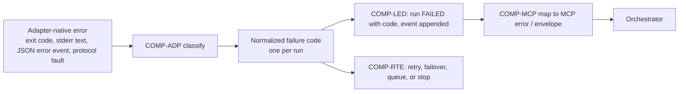

# Software Design Document (SDD)

| Field | Value |
| --- | --- |
| Status | Draft, baseline for milestone M1 |
| Owns | How components collaborate per workflow, shared design patterns, interface responsibilities, error propagation, configuration model overview, requirement-to-design traceability |
| Does not own | Components and boundaries ([HLD](HLD.md)), workflows and business rules ([FRD](../requirements/FRD.md)), requirements ([SRS](../requirements/SRS.md)), technology choices ([TDD](TDD.md)), schemas and contracts ([LLD](LLD.md)) |
| Last reconciled | 2026-10-13 |

Nothing here is implemented; no code, tests or configuration exist as of 2026-10-12. Component IDs (`COMP-*`) are
defined in [HLD §2](HLD.md#2-components). Patterns marked **Proposed** are design choices made while planning and are
not owner-approved; ADRs cited are "Delegated" decisions.

## 1. Shared design patterns

| Pattern | Where it applies | Rule | Cites |
| --- | --- | --- | --- |
| Ports and adapters | COMP-ADP, COMP-EXE | Core components depend on one adapter port and one transport interface; provider-specific argv, flags, parsing and resume rules live only in adapters. A new provider touches its adapter, manifest, fixtures and registry entry. | [ADR-0002](../adr/0002-mcp-upstream-acp-downstream.md), [ADR-0009](../adr/0009-version-gated-adapters.md), NFR-MAINT-01 |
| Append-only event log plus materialized state | COMP-LED | `run_event` and `decision` rows are never updated. Current-state tables (`run`, `meta_session`, `provider_health`, capacity) are updated in the same transaction as the event that causes the change. Handoff views and explanations are projections that can be rebuilt. | [ADR-0005](../adr/0005-sqlite-ledger.md), FR-SES-05, FR-TEL-01 |
| Ledger-first ordering (outbox-style) | COMP-LED with COMP-WS, COMP-EXE | Intent is committed to the ledger before the side effect (worktree creation, process spawn, branch commit) and the outcome is committed after it. A crash between the two leaves a non-terminal run with a recorded intent, which startup reconciliation resolves by inspecting the real state (process table, Git). Side effects are therefore re-derivable; they are never blindly repeated. | NFR-REL-01, FR-EXE-06, [ADR-0006](../adr/0006-worktree-checkpoints-no-blind-replay.md) |
| Fail-closed policy evaluation | COMP-POL, COMP-RTE, COMP-ADP, COMP-EXE | Unknown profile, unknown version, missing manifest, unparseable output or an adapter that cannot compile a profile yields deny / ineligible / error, never a fallback to a weaker setting. | NFR-SEC-06, FR-POL-02, [ADR-0004](../adr/0004-trust-profiles-no-bypass-flags.md) |
| Policy snapshot per run | COMP-POL, COMP-LED | At admission the effective policy (profile, per-client cap, config overrides, manifest version, adapter version, approval) is frozen and stored with the run. Later config edits do not change an in-flight run, and `get_run` can show what governed it. | FR-POL-01, NFR-OBS-01 |
| Idempotency keys | COMP-MCP, COMP-LED | Client keys deduplicate `delegate_task`; internal operation ids (run id, lease id) make retries of ledger writes and cleanup safe. | FR-MCP-08 |
| Process-group supervision | COMP-EXE | Each provider process is a group leader with a wall-clock timer; cancel and timeout signal the whole group, then force-kill after a grace period. A crashing child cannot take down the controller. | FR-EXE-01, NFR-REL-02 |
| Circuit breaker | COMP-RTE | Per-provider breaker opens on repeated transient failures or crashes and removes the provider from eligibility until a probe succeeds (thresholds are configuration, see §4). | FR-CAP-04, [ADR-0007](../adr/0007-capacity-as-confidence-estimate.md) |
| Bounded priority queue | COMP-RTE | Ingress is bounded; when full, admission returns a retryable error instead of growing without limit. Priority and age ordering are configuration. | FR-CAP-04, NFR-PERF-03 |
| Two-stage selection | COMP-RTE | Hard eligibility first (also a security control, ships in M2), scoring later (M7). Every decision is persisted. | [ADR-0008](../adr/0008-two-stage-routing.md), FR-RTE-01..03 |
| Estimate, not authority | COMP-RTE, COMP-MCP | Reported usage and controller estimates are stored and exposed as different fields with provenance. | FR-CAP-01..03, [ADR-0007](../adr/0007-capacity-as-confidence-estimate.md) |
| Tool-only mutation of history | COMP-GIT, COMP-ADP, COMP-WS | Agents never write to Git. Commits reach the publish ref only through the controller-side `commit` tool (or the finalize-only commit), and pushes only through the `push` tool or an operator command. Internal checkpoint commits and run branches are a separate, never-published history. | FR-GIT-01, 02, 08, [ADR-0014](../adr/0014-tool-only-commits-and-publication.md) |
| Prevent, then detect | COMP-ADP, COMP-GIT | Prevention (profile deny rules, no credentials in the agent environment) is the control; the before/after ref comparison is a backstop that keeps anything the agent managed to commit out of published history and reports it. Neither depends on a provider-specific attribution switch. | FR-GIT-01, 03, 06 |
| Sanitise, never add | COMP-GIT | The commit message is the agent's text minus attribution patterns; the controller appends nothing. Evidence of who made the commit goes to the ledger, not into Git. | FR-GIT-04, 07 |
| Advisory output, deterministic fallback | COMP-INN and its callers | An inner-agent result is an optional improvement over a deterministic default. Every caller has a fallback that needs no model (truncation, heuristic classifier, agent-supplied message), and an unavailable, invalid or suspended inner agent selects it. Failure is recorded as an `inner_call` and a run event, never as a run failure. | FR-INN-01, 07, 08, [ADR-0016](../adr/0016-inner-agent.md) |
| Structural authority boundary | COMP-INN, COMP-POL, COMP-ADP, COMP-RTE, COMP-GIT | The inner-agent service is not injectable into COMP-POL, the profile compilers, the retry logic or the push path: those modules have no dependency edge to it, and an import-boundary test fails the build if one appears. Callers receive validated text or "unavailable" and use it only for the advisory purpose of their task. | FR-INN-06, NFR-SEC-06, [ADR-0016](../adr/0016-inner-agent.md) |
| Definitions in config, snapshot per run | COMP-PRJ, COMP-POL, COMP-LED | Projects live in the schema-validated configuration. At admission the resolved project, environment, ceilings, push policy and identity are frozen into the policy snapshot, so later edits do not change an in-flight run. | FR-PRJ-01, 04, 06, FR-POL-01 |

## 2. Component collaboration per workflow

Workflow IDs refer to the [FRD](../requirements/FRD.md); step-level behaviour and business rules are defined there. This
section states only which components collaborate and what crosses each call. Run states are those of the FRD state
machine: QUEUED, PREFLIGHT, LEASED, RUNNING, VERIFYING, FINALIZING, then SUCCEEDED, FAILED or CANCELLED, with
AWAITING_APPROVAL and WAITING_CAPACITY as side states.

| WF | Collaboration | Notes |
| --- | --- | --- |
| WF-1 Delegate task | COMP-MCP validates and asks COMP-POL to authorize and snapshot; COMP-LED records the run; COMP-RTE filters providers using COMP-ADP preflight state and COMP-POL manifests, persists the route decision, reserves capacity; COMP-WS creates the worktree and lease; COMP-EXE spawns via COMP-ADP compile, streams events through COMP-ADP parse into COMP-LED; COMP-EXE runs verification; COMP-WS records diff and checkpoint; COMP-LED commits the terminal state. | Sequence in [HLD §6.1](HLD.md#61-delegate-run-end-to-end-wf-1). The MCP call returns after the QUEUED insert. With the routing task enabled (M11), COMP-RTE may ask COMP-INN for stage-2 features; they are stored with source, model and template version in the route decision and never feed eligibility (FR-INN-12). |
| WF-2 Continue same provider | COMP-MCP resolves the meta-session in COMP-LED; COMP-RTE checks the bound provider is still eligible; COMP-ADP builds a native resume invocation from the stored native session id; the rest follows WF-1 on the existing worktree head. | If the native session is gone or resume fails, the outcome is a failure code, not a silent fresh start (Proposed; confirm in FRD). |
| WF-3 Cross-provider handoff | COMP-RTE selects a different provider; COMP-LED and COMP-WS supply the handoff inputs (decisions, Git base/head, changed files, diff excerpts, diagnostics); COMP-ADP renders them as the new session prompt; a new binding is stored. | Inputs only from the ledger and Git (FR-SES-04). With the condensing task enabled (M11), the handoff builder may pass text fields through COMP-INN; the result is labelled, keeps a pointer to the raw artifact, and falls back to deterministic truncation (FR-INN-13). |
| WF-4 Cancel run | COMP-MCP asks COMP-LED for the run state, COMP-EXE signals the process group, COMP-WS decides rollback or keeps checkpoint, COMP-LED commits CANCELLED. A run still queued is cancelled without a process. | Cancellation races with completion are resolved by the first terminal-state commit. |
| WF-5 Failure handling and retry | COMP-EXE and COMP-ADP produce a normalized failure code; COMP-RTE decides retry, failover or queue from the code and COMP-WS's unchanged-workspace check; COMP-LED records every attempt as a separate run linked to the same meta-session. | Retry set and backoff: FR-CAP-05, FR-CAP-06. |
| WF-6 Adapter preflight and doctor | COMP-OPS (or COMP-RTE on a stale cache) calls COMP-ADP probe; COMP-POL checks the manifest covers the version; COMP-LED stores `provider_health` and `adapter_version`. | Preflight performs no login (FR-AUTH-02). |
| WF-7 Privileged approval | COMP-MCP admits a `privileged` `delegate_task` as AWAITING_APPROVAL; COMP-OPS `approve` writes an `approval` row via COMP-POL; COMP-RTE only then dispatches. A `privileged` `continue_task` is admitted to QUEUED only when COMP-LED finds an `APPROVED` row for the meta-session and client (owner decision 17). | MCP can never grant the approval (FR-MCP-06). |
| WF-8 Startup reconciliation | COMP-EXE and COMP-LED scan non-terminal runs, check for live processes, mark orphans `PROCESS_CRASH` with cause `controller_restart`; COMP-WS assesses worktree mutation and releases or retains leases; COMP-RTE re-queues only unchanged, retry-eligible runs. | Runs before the MCP server accepts calls (Proposed). |
| WF-9 Adapter version revalidation | COMP-OPS `adapters validate` triggers the COMP-ADP conformance suite against the installed version; on pass COMP-LED records the accepted version and COMP-RTE restores eligibility. | Maps to UJ-7. |
| WF-10 Delegate to a project | COMP-MCP validates `project` (V12) and asks COMP-POL for the lower of client and project ceilings; COMP-PRJ resolves the repository context, base ref and environment; COMP-WS creates the worktree from the project's repository; COMP-EXE spawns the provider through the environment (host, or container in M10); COMP-LED records project, environment and image digest in the snapshot. | Otherwise WF-1. COMP-PRJ owns the container lifecycle and its orphan cleanup (FR-PRJ-07). |
| WF-11 Commit through the injected tool | The agent calls the shim, which forwards over the per-run socket to COMP-GIT; COMP-GIT checks run state with COMP-LED, builds the tree through COMP-WS, writes the commit on the publish ref, and records provenance and a `git_commit` event in one COMP-LED transaction. | Violations found at FINALIZING are reported as `git_policy_violation` events (BR-27). When the commit-message task is enabled and the agent gave no message, COMP-GIT asks COMP-INN for a draft of the committed paths' diff and sanitises it like any message; empty or unavailable returns a tool error (FR-INN-10). |
| WF-12 Publish | COMP-GIT asks COMP-POL for the push decision (policy, ref, credential reach), pushes from the controller process, and records a `git_push` event and provenance update through COMP-LED. | Agent-originated and operator-originated pushes take the same path. |
| WF-13 Inner task execution | A caller (COMP-GIT, COMP-RTE, handoff builder, COMP-EXE or COMP-OPS) asks COMP-INN for a task with controller-owned inputs; COMP-INN applies locality gating, redaction and budget, calls the backend port, validates, and writes an `inner_call` record through COMP-LED; the caller receives validated text or "unavailable" and applies its fallback. | Defined in the [FRD](../requirements/FRD.md) as WF-13; sequence in [HLD §6.5](HLD.md#65-inner-task-call-including-commit-message-drafting-wf-13-wf-11). No branch reaches COMP-POL, retry or push (FR-INN-06). |

## 3. Interface responsibilities and error propagation

### 3.1 Who calls whom

| Caller | Callee | Style | Data crossing | Responsibility boundary |
| --- | --- | --- | --- | --- |
| Orchestrator | COMP-MCP | Sync request/response over stdio; long work async via polling | Validated tool arguments in, compact envelope out | COMP-MCP owns validation and shaping; it holds no domain logic beyond that. |
| COMP-MCP | COMP-POL | Sync, in-process | Caller identity, requested profile, canonical path | Returns allow/deny plus a frozen policy snapshot. |
| COMP-MCP, COMP-RTE, COMP-WS, COMP-EXE | COMP-LED | Sync transactions | Rows and events | Only COMP-LED writes the database (single-writer, [ADR-0005](../adr/0005-sqlite-ledger.md)). |
| COMP-RTE | COMP-ADP | Sync (cached) probe and capability queries | Adapter state, supported profiles, version | Adapters report facts; COMP-RTE decides. |
| COMP-RTE | COMP-WS | Sync | Workspace path, profile, base ref | Returns a worktree and lease or an error. |
| COMP-RTE | COMP-EXE | Async dispatch | Run id, compiled invocation | Execution is a background job with a completion event, not a blocking call. |
| COMP-EXE | COMP-ADP | Sync pure functions around async I/O | compile: request and policy to argv/env/config; parse: bytes to normalized events | Adapters do not spawn processes or touch the ledger. |
| COMP-EXE, COMP-RTE, COMP-MCP | COMP-TEL | Async, fire-and-forget into the ledger transaction | Lifecycle observations | COMP-TEL redacts; exporter failure never fails a run. |
| COMP-OPS | COMP-POL, COMP-LED, COMP-ADP | Sync | Approvals, queries, validation requests | CLI is a thin client; no logic duplicated from other components. |
| Agent (provider process) | COMP-GIT (via the per-run shim and socket) | Sync request/response over a per-run local socket, capability token per run | `commit` and `push` calls in; SHA or tool error out | COMP-GIT trusts nothing in the call except what it validates (BR-25, BR-29); the channel is closed when the run ends. |
| COMP-GIT | COMP-POL, COMP-WS, COMP-LED | Sync, in-process | Push decision; tree for paths; provenance and events | COMP-GIT never writes the database itself (single writer). |
| COMP-MCP, COMP-RTE | COMP-PRJ | Sync, in-process | Project reference in; repository context, environment, ceilings out | COMP-PRJ resolves; COMP-POL still decides. |
| COMP-GIT, COMP-RTE, handoff builder, COMP-EXE, COMP-OPS | COMP-INN | Async call with per-call timeout, in-process | Task name and controller-owned input in; validated text or "unavailable" out | COMP-INN gives advice only; the caller applies its own sanitiser, storage and fallback. COMP-POL, the profile compilers and the retry and push code do not call it (FR-INN-06). |
| COMP-INN | Inner backend (M11) | Single-turn request over the `http` or `cli` port, redacted and budgeted | Prompt out, text in | Stateless, no tools offered, no credential in configuration; locality gate before sending (FR-INN-02, 03, 16). |
| COMP-INN | COMP-LED | Sync transaction | `inner_call` records, run events | Records hold task, outcome, sizes, hashes and latency, never bodies (FR-INN-15, 16). |
| COMP-PRJ | Container runtime (M10) | Sync commands behind a small port | create, start, stop, remove; label lookup for orphans | Runtime is Proposed in ADR-0013 (rootless); the port keeps it replaceable. |

COMP-OPS commands run in their own short-lived process, write only operator records (approvals, denials, cancel
requests) to the shared ledger, and leave all side effects to the `serve` daemon
([ADR-0005](../adr/0005-sqlite-ledger.md), [TDD §3](TDD.md)).

### 3.2 Error propagation

- Classification happens once, in COMP-ADP, using structured fields first; free-text matching is a last resort and only
  to refine a structured error (FR-ADP-04). Anything unclassifiable becomes `OUTPUT_PROTOCOL_ERROR` or `PROCESS_CRASH`,
  never success (NFR-SEC-06).
- Controller-originated failures (`INVALID_REQUEST`, `PERMISSION_BLOCKED` from caller caps, `ELIGIBILITY_NONE`,
  `ADAPTER_VERSION_UNVERIFIED`) are produced by COMP-MCP, COMP-POL or COMP-RTE directly, using the same codes.
  `ELIGIBILITY_NONE` and `INVALID_REQUEST` were added during planning and are not in the original taxonomy list.
- Each run ends in exactly one terminal state with at most one failure code; each tool error carries exactly one code
  plus a message (FR-MCP-07). Retries create new run records, so the history stays append-only.
- Messages returned upstream are redacted summaries; stderr and raw events stay in artifacts (FR-MCP-04, FR-TEL-03).
- Taxonomy, retryability and mapping table: [LLD §4](LLD.md#4-failure-taxonomy).
- Inner-agent failures (unreachable, timeout, error, invalid output, open circuit, suspended task) are not run failure
  codes and never enter the classification above. COMP-INN returns "unavailable"; the caller takes its fallback; the
  failure becomes an `inner_call` outcome and a run event, and `doctor` shows the degraded state (FR-INN-08, FR-INN-06).
  The one caller-visible effect is the `commit` tool error `MESSAGE_REQUIRED` when no message exists (FR-INN-10).

### 3.3 Concurrency and ordering rules (Proposed)

- Single writer: only COMP-LED writes the SQLite database; other components submit operations to it. Provider-process
  output handling is per-run and isolated, so one run's parser failure cannot corrupt another's (NFR-REL-02).
- Per-run state transitions are compare-and-set on the previous state inside one transaction, so a cancel and a
  completion racing resolve to whichever commits first; the loser observes a terminal state and does nothing further.
- A write lease is a ledger row plus the worktree on disk. Acquire: insert lease row, then create worktree. Release:
  finish Git work, then delete the lease row. Reconciliation (WF-8) treats any lease without a live run as stale and
  checks the worktree before reuse or removal.
- Dispatch order for a run: policy snapshot, route decision, lease, spawn. Each step is recorded before the next begins,
  so any prefix of the sequence can be recovered from the ledger.
- Capacity reservations (per-provider concurrency slots) are held for the duration of RUNNING and released in the same
  transaction that records a terminal state; reconciliation releases slots held by dead runs.
- Verification commands (FR-EXE-08) run under the same profile and process-group rules as the agent itself, after the
  agent process has exited.

## 4. Configuration model overview

Detail (format, keys, validation schema) is owned by [TDD](TDD.md) and [LLD](LLD.md); this section only fixes the shape.
All configuration is schema-validated at load and invalid configuration prevents start (NFR-SEC-05, NFR-SEC-06).

| Group | Content (Proposed) | Consumed by |
| --- | --- | --- |
| Roots and paths | Allowed workspace roots, data directory, worktree location | COMP-POL, COMP-WS, COMP-LED |
| MCP clients | Named client entries with maximum trust profile | COMP-MCP, COMP-POL |
| Profiles | Overrides to profile defaults (recorded in the policy snapshot; cannot go below the SRS defaults without that record, FR-POL-01) | COMP-POL |
| Providers | Enable flag, binary path, tier and relative weight prior, concurrency, allowed auth mode, manifest reference | COMP-ADP, COMP-RTE |
| Models | Model registry entries and aliases | COMP-ADP |
| Routing | Scoring weights, classifier switches, failover and queue-horizon settings | COMP-RTE |
| Limits | Global and per-provider concurrency, queue bound, timeouts, grace period, breaker thresholds, backoff | COMP-RTE, COMP-EXE |
| Retention | Artifact, event and worktree retention | COMP-LED, COMP-WS |
| Telemetry | OTLP endpoint (absent by default), redaction rules | COMP-TEL |
| Inner agent | Optional single backend (kind, locality, `allow_remote`, model, no credential), per-task enable flags and modes, budgets, timeout, breaker and suspension thresholds, project `inner_agent` setting (none enabled by default; Proposed) | COMP-INN, COMP-GIT, COMP-RTE, COMP-OPS |

Defaults for numeric values are *(proposed target)* until measured, as in the SRS. Environment variables and global
provider config are never an input path for policy (FR-POL-08).

## 5. Requirements to design traceability

Every `FR-*` and `NFR-*` ID in the [SRS](../requirements/SRS.md) has one row. Priority and milestone remain in the SRS;
"Deferred" requirements are listed with the extension point that keeps them possible. Components use the HLD IDs.
"Detail" links point to the LLD or TDD section that will specify the mechanism; where no section anchor is assigned yet
the cell says so.

| ID | Component(s) | Design element / mechanism | ADR(s) | Detail |
| --- | --- | --- | --- | --- |
| FR-MCP-01 | COMP-MCP | Tool registry on an MCP stdio server; handlers delegate to other components | [ADR-0002](../adr/0002-mcp-upstream-acp-downstream.md) | [LLD §3](LLD.md#3-mcp-tool-contracts) |
| FR-MCP-02 | COMP-MCP, COMP-RTE | Read-only tools over capacity estimates and persisted route decisions | [ADR-0007](../adr/0007-capacity-as-confidence-estimate.md), [ADR-0008](../adr/0008-two-stage-routing.md) | [LLD §3](LLD.md#3-mcp-tool-contracts) |
| FR-MCP-03 | COMP-MCP, COMP-LED, COMP-RTE | Async-first: insert meta-session/run in ledger, return ids, optional bounded wait by polling ledger state | [ADR-0002](../adr/0002-mcp-upstream-acp-downstream.md) | [LLD §3](LLD.md#3-mcp-tool-contracts), [LLD §1](LLD.md#1-data-model) |
| FR-MCP-04 | COMP-MCP, COMP-TEL | Envelope projection from an explicit field allowlist over ledger rows; transcripts never loaded | [ADR-0001](../adr/0001-controller-owned-canonical-state.md) | [LLD §3](LLD.md#3-mcp-tool-contracts) |
| FR-MCP-05 | COMP-MCP, COMP-RTE | Hints are inputs to the eligibility filter only; require_provider cannot skip any check | [ADR-0008](../adr/0008-two-stage-routing.md) | [LLD §3](LLD.md#3-mcp-tool-contracts) |
| FR-MCP-06 | COMP-MCP, COMP-POL | Caller authorization: per-client maximum profile; privileged routed to approval flow, never granted via MCP | [ADR-0004](../adr/0004-trust-profiles-no-bypass-flags.md) | [LLD §3](LLD.md#3-mcp-tool-contracts), [LLD §6](LLD.md#6-compliance-manifest) |
| FR-MCP-07 | COMP-MCP | Single error mapper from normalized failure code to MCP error | — | [LLD §4](LLD.md#4-failure-taxonomy), [LLD §3](LLD.md#3-mcp-tool-contracts) |
| FR-MCP-08 | COMP-MCP, COMP-LED | Idempotency key plus parameter hash with unique constraint; replay returns original run | — | [LLD §1](LLD.md#1-data-model), [LLD §3](LLD.md#3-mcp-tool-contracts) |
| FR-MCP-09 | COMP-MCP | JSON Schema validation at ingress before any ledger or filesystem side effect | [ADR-0002](../adr/0002-mcp-upstream-acp-downstream.md) | [LLD §3](LLD.md#3-mcp-tool-contracts) |
| FR-MCP-10 | COMP-RTE, COMP-LED, COMP-MCP | Retry and failover insert a successor run with `retry_of`; `get_run` follows the chain | [ADR-0006](../adr/0006-worktree-checkpoints-no-blind-replay.md) | [LLD §1](LLD.md#1-data-model), [LLD §9](LLD.md#9-retryback-off-algorithm) |
| FR-ADP-01 | COMP-ADP | Ports-and-adapters: one adapter port, per-provider implementations behind a registry | [ADR-0009](../adr/0009-version-gated-adapters.md) | [LLD §2](LLD.md#2-adapter-contract) |
| FR-ADP-02 | COMP-ADP, COMP-EXE | Ordered preflight pipeline with cached result per adapter | [ADR-0009](../adr/0009-version-gated-adapters.md) | [LLD §2](LLD.md#2-adapter-contract) |
| FR-ADP-03 | COMP-ADP, COMP-RTE, COMP-OPS | Adapter state machine with ADAPTER_VERSION_UNVERIFIED; eligibility filter reads it; operator acceptance via adapters validate | [ADR-0009](../adr/0009-version-gated-adapters.md) | [LLD §2](LLD.md#2-adapter-contract), [LLD §1](LLD.md#1-data-model) |
| FR-ADP-04 | COMP-ADP | Parsers consume native JSON/JSONL/ACP messages only; no free-text inference of ids, status or usage | [ADR-0002](../adr/0002-mcp-upstream-acp-downstream.md) | [LLD §2](LLD.md#2-adapter-contract) |
| FR-ADP-05 | COMP-ADP | Refreshable model registry (operator config plus provider listing commands), outside adapter source | — | [TDD §4](TDD.md#4-provider-adapter-strategy), [LLD §2](LLD.md#2-adapter-contract) |
| FR-ADP-06 | COMP-ADP | Claude Code adapter is the first real adapter behind the port | [ADR-0009](../adr/0009-version-gated-adapters.md) | [TDD §4](TDD.md#4-provider-adapter-strategy) |
| FR-ADP-07 | COMP-ADP | Codex, Grok Build, Antigravity, Cursor adapters behind the same port | [ADR-0009](../adr/0009-version-gated-adapters.md) | [TDD §4](TDD.md#4-provider-adapter-strategy) |
| FR-ADP-08 | COMP-ADP | OpenCode adapter via opencode run | [ADR-0002](../adr/0002-mcp-upstream-acp-downstream.md) | [TDD §4](TDD.md#4-provider-adapter-strategy) |
| FR-ADP-09 | COMP-ADP, COMP-POL | Kimi adapter disabled by default; enabled only after manifest and conformance pass | [ADR-0009](../adr/0009-version-gated-adapters.md) | [TDD §4](TDD.md#4-provider-adapter-strategy), [LLD §6](LLD.md#6-compliance-manifest) |
| FR-ADP-10 | COMP-ADP, COMP-LED | usage_observation stores harness and backing provider/model separately | [ADR-0007](../adr/0007-capacity-as-confidence-estimate.md) | [LLD §1](LLD.md#1-data-model), [LLD §2](LLD.md#2-adapter-contract) |
| FR-ADP-11 | COMP-ADP | Shared conformance suite over recorded fixtures with fake provider process | [ADR-0009](../adr/0009-version-gated-adapters.md) | [LLD §2](LLD.md#2-adapter-contract), [TDD §4](TDD.md#4-provider-adapter-strategy) |
| FR-ADP-12 | COMP-ADP, COMP-POL | Muse Code adapter over `muse exec --json`; approvals and sandbox left on, `-w off`, no bypass flag, native login only; version-gated | [ADR-0009](../adr/0009-version-gated-adapters.md), [ADR-0004](../adr/0004-trust-profiles-no-bypass-flags.md) | [TDD §4.8](TDD.md#48-muse-code-m4) |
| FR-POL-01 | COMP-POL | Profile definitions in policy engine; weakening only via config recorded in the policy snapshot | [ADR-0004](../adr/0004-trust-profiles-no-bypass-flags.md) | [LLD §6](LLD.md#6-compliance-manifest), [LLD §1](LLD.md#1-data-model) |
| FR-POL-02 | COMP-POL, COMP-ADP, COMP-RTE | Adapter compile step returns compiled controls or "unsatisfiable"; unsatisfiable means ineligible, never downgrade | [ADR-0004](../adr/0004-trust-profiles-no-bypass-flags.md) | [LLD §2](LLD.md#2-adapter-contract) |
| FR-POL-03 | COMP-POL, COMP-ADP | Bypass-flag gate: compile may emit them only when the run is `privileged`, its approval is `APPROVED` with a scope hash matching the policy snapshot, and the approved scope sets `bypass`; the argv audit re-checks before spawn | [ADR-0004](../adr/0004-trust-profiles-no-bypass-flags.md), [ADR-0017](../adr/0017-approved-privileged-scope-bypass.md) | [LLD §2](LLD.md#2-adapter-contract), [LLD §1](LLD.md#1-data-model), [LLD §3.1](LLD.md#31-privileged-scope-m3) |
| FR-POL-04 | COMP-POL, COMP-ADP | Compile step disables repo-supplied config using native switches under untrusted and test-sandboxed profiles | [ADR-0004](../adr/0004-trust-profiles-no-bypass-flags.md) | [LLD §2](LLD.md#2-adapter-contract) |
| FR-POL-05 | COMP-EXE, COMP-ADP | Non-interactive mode plus denial detection mapped to PERMISSION_BLOCKED or SANDBOX_VIOLATION; no stdin prompts | [ADR-0004](../adr/0004-trust-profiles-no-bypass-flags.md) | [LLD §4](LLD.md#4-failure-taxonomy), [LLD §2](LLD.md#2-adapter-contract) |
| FR-POL-06 | COMP-POL, COMP-ADP, COMP-RTE | Adapter declares credential-confinement capability; policy disables shell and filter removes providers otherwise | [ADR-0003](../adr/0003-no-credential-handling.md) | [LLD §2](LLD.md#2-adapter-contract), [LLD §6](LLD.md#6-compliance-manifest) |
| FR-POL-07 | COMP-POL, COMP-ADP, COMP-RTE | Versioned compliance manifest per provider; eligibility requires coverage of installed version | [ADR-0003](../adr/0003-no-credential-handling.md) | [LLD §6](LLD.md#6-compliance-manifest) |
| FR-POL-08 | COMP-ADP, COMP-EXE | Per-run argv/env/dedicated config dirs only; no writes to global provider config | [ADR-0012](../adr/0012-telemetry-at-wrapper-boundary.md) | [LLD §2](LLD.md#2-adapter-contract) |
| FR-POL-09 | COMP-POL, COMP-OPS, COMP-LED | `PENDING` approval record (requested `privileged_scope` and its hash over client, meta-session and scope) created at the meta-session's first `privileged` admission; decided (timestamp, operator) only via operator CLI; run waits in AWAITING_APPROVAL; later runs of that meta-session and scope are looked up against the same row | [ADR-0004](../adr/0004-trust-profiles-no-bypass-flags.md), [ADR-0017](../adr/0017-approved-privileged-scope-bypass.md) | [LLD §1](LLD.md#1-data-model), [LLD §3.1](LLD.md#31-privileged-scope-m3) |
| FR-POL-10 | COMP-POL, COMP-WS | Canonicalize (resolve symlinks) then check against configured allowed roots | — | [LLD §5](LLD.md#5-workspace-and-lease-algorithm) |
| FR-AUTH-01 | COMP-ADP, COMP-POL | Architectural prohibition: no code path touches credentials; enforced by code review gate and adapter contract shape | [ADR-0003](../adr/0003-no-credential-handling.md) | [LLD §2](LLD.md#2-adapter-contract) |
| FR-AUTH-02 | COMP-ADP, COMP-MCP | Auth preflight via provider status command or harmless call; AUTH_REQUIRED carries provider and native login command | [ADR-0003](../adr/0003-no-credential-handling.md) | [LLD §2](LLD.md#2-adapter-contract), [LLD §4](LLD.md#4-failure-taxonomy) |
| FR-WS-01 | COMP-WS | Worktree per write-capable run from recorded base checkpoint | [ADR-0006](../adr/0006-worktree-checkpoints-no-blind-replay.md) | [LLD §5](LLD.md#5-workspace-and-lease-algorithm) |
| FR-WS-02 | COMP-WS, COMP-LED | Exclusive write lease row per worktree, acquired transactionally | [ADR-0006](../adr/0006-worktree-checkpoints-no-blind-replay.md) | [LLD §5](LLD.md#5-workspace-and-lease-algorithm), [LLD §1](LLD.md#1-data-model) |
| FR-WS-03 | COMP-WS, COMP-LED | Post-run: changed-file list, diff artifact, checkpoint commit on controller-owned branch | [ADR-0006](../adr/0006-worktree-checkpoints-no-blind-replay.md) | [LLD §5](LLD.md#5-workspace-and-lease-algorithm), [LLD §1](LLD.md#1-data-model) |
| FR-WS-04 | COMP-WS, COMP-RTE | Pre/post checkpoint comparison drives rollback or native resume; replay never offered | [ADR-0006](../adr/0006-worktree-checkpoints-no-blind-replay.md) | [LLD §5](LLD.md#5-workspace-and-lease-algorithm) |
| FR-WS-05 | COMP-WS, COMP-GIT | No remote operations and no writes to the operator checkout in the workspace API; the only push path is COMP-GIT's policy-gated publication | [ADR-0006](../adr/0006-worktree-checkpoints-no-blind-replay.md), [ADR-0014](../adr/0014-tool-only-commits-and-publication.md) | [LLD §5](LLD.md#5-workspace-and-lease-algorithm), [LLD §12](LLD.md#12-injected-git-tools-commits-and-publication) |
| FR-WS-06 | COMP-WS, COMP-POL | Git-repository check at admission; read-only non-Git allowed only for inspect-untrusted | [ADR-0006](../adr/0006-worktree-checkpoints-no-blind-replay.md) | [LLD §5](LLD.md#5-workspace-and-lease-algorithm) |
| FR-WS-07 | COMP-WS, COMP-LED | Retention-driven GC removing artifacts, worktrees and branches together | [ADR-0006](../adr/0006-worktree-checkpoints-no-blind-replay.md) | [LLD §5](LLD.md#5-workspace-and-lease-algorithm), [LLD §1](LLD.md#1-data-model) |
| FR-SES-01 | COMP-LED | Opaque ids; provider_binding rows map meta-session to native sessions | [ADR-0001](../adr/0001-controller-owned-canonical-state.md) | [LLD §1](LLD.md#1-data-model) |
| FR-SES-02 | COMP-LED | Canonical meta-session state record plus append-only decisions | [ADR-0001](../adr/0001-controller-owned-canonical-state.md) | [LLD §1](LLD.md#1-data-model) |
| FR-SES-03 | COMP-RTE, COMP-ADP, COMP-EXE | Same-provider continue resolves stored native id and calls adapter resume | [ADR-0001](../adr/0001-controller-owned-canonical-state.md) | [LLD §2](LLD.md#2-adapter-contract), [LLD §1](LLD.md#1-data-model) |
| FR-SES-04 | COMP-RTE, COMP-LED, COMP-WS | Handoff bundle builder reads only ledger and Git; new agent instructed to inspect the repository; text fields may be condensed by the inner agent only as FR-INN-13 allows | [ADR-0001](../adr/0001-controller-owned-canonical-state.md) | [LLD §1](LLD.md#1-data-model), [LLD §2](LLD.md#2-adapter-contract) |
| FR-SES-05 | COMP-LED | Append-only events and decisions; handoff view is a regenerable projection | [ADR-0001](../adr/0001-controller-owned-canonical-state.md), [ADR-0005](../adr/0005-sqlite-ledger.md) | [LLD §1](LLD.md#1-data-model) |
| FR-SES-06 | COMP-WS, COMP-LED | Write lease held on `meta_session`; admission rejects a second non-terminal run | [ADR-0006](../adr/0006-worktree-checkpoints-no-blind-replay.md) | [LLD §5](LLD.md#5-workspace-and-lease-algorithm) |
| FR-RTE-01 | COMP-RTE, COMP-POL, COMP-ADP | Stage 1 eligibility filter over hard constraints; fail-closed on unknown state | [ADR-0008](../adr/0008-two-stage-routing.md) | [LLD §1](LLD.md#1-data-model), [LLD §2](LLD.md#2-adapter-contract) |
| FR-RTE-02 | COMP-RTE | Stage 2 weighted scoring with static operator weights | [ADR-0008](../adr/0008-two-stage-routing.md) | [LLD §1](LLD.md#1-data-model) |
| FR-RTE-03 | COMP-RTE, COMP-LED | route_decision persisted with features, weights, scores, outcome | [ADR-0008](../adr/0008-two-stage-routing.md) | [LLD §1](LLD.md#1-data-model) |
| FR-RTE-04 | COMP-RTE | Heuristic classifier producing feature vector for scoring; baseline and fallback for the optional inner-agent source (FR-INN-12) | [ADR-0008](../adr/0008-two-stage-routing.md) | [TDD §4](TDD.md#4-provider-adapter-strategy) |
| FR-RTE-05 | COMP-RTE | Deferred; scoring interface kept pluggable so learned weights can be added by a later ADR | [ADR-0008](../adr/0008-two-stage-routing.md) | [LLD §1](LLD.md#1-data-model) |
| FR-CAP-01 | COMP-LED, COMP-ADP, COMP-RTE | usage_observation rows labelled by source; estimates stored separately | [ADR-0007](../adr/0007-capacity-as-confidence-estimate.md) | [LLD §1](LLD.md#1-data-model), [LLD §2](LLD.md#2-adapter-contract) |
| FR-CAP-02 | COMP-RTE, COMP-LED | Capacity estimator producing the named fields from observations and operator tier priors | [ADR-0007](../adr/0007-capacity-as-confidence-estimate.md) | [LLD §1](LLD.md#1-data-model) |
| FR-CAP-03 | COMP-MCP, COMP-TEL, COMP-RTE | Output types distinguish explicit_remaining from estimate; estimate never labelled authoritative | [ADR-0007](../adr/0007-capacity-as-confidence-estimate.md) | [LLD §3](LLD.md#3-mcp-tool-contracts), [LLD §1](LLD.md#1-data-model) |
| FR-CAP-04 | COMP-RTE | Bounded priority queue, per-provider semaphore, circuit breaker | [ADR-0007](../adr/0007-capacity-as-confidence-estimate.md) | [LLD §1](LLD.md#1-data-model), [LLD §4](LLD.md#4-failure-taxonomy) |
| FR-CAP-05 | COMP-RTE, COMP-WS | Retry policy keyed on failure code and workspace-unchanged check; capped exponential backoff with jitter | [ADR-0006](../adr/0006-worktree-checkpoints-no-blind-replay.md), [ADR-0007](../adr/0007-capacity-as-confidence-estimate.md) | [LLD §4](LLD.md#4-failure-taxonomy), [LLD §5](LLD.md#5-workspace-and-lease-algorithm) |
| FR-CAP-06 | COMP-RTE, COMP-LED | QUOTA_EXHAUSTED handler: failover, WAITING_CAPACITY if reset known within horizon, else fail | [ADR-0007](../adr/0007-capacity-as-confidence-estimate.md) | [LLD §4](LLD.md#4-failure-taxonomy), [LLD §1](LLD.md#1-data-model) |
| FR-CAP-07 | COMP-RTE | Optional token-bucket gate enabled per provider/auth mode only where limits are published | [ADR-0007](../adr/0007-capacity-as-confidence-estimate.md) | [LLD §1](LLD.md#1-data-model) |
| FR-EXE-01 | COMP-EXE | Own process group, wall-clock timer, SIGTERM then SIGKILL after grace to the whole group | — | [LLD §5](LLD.md#5-workspace-and-lease-algorithm), [LLD §4](LLD.md#4-failure-taxonomy) |
| FR-EXE-02 | COMP-EXE, COMP-ADP | Subprocess transport that streams stdout lines to the adapter parser | [ADR-0002](../adr/0002-mcp-upstream-acp-downstream.md) | [LLD §2](LLD.md#2-adapter-contract) |
| FR-EXE-03 | COMP-EXE, COMP-ADP | ACP stdio client transport behind the same transport interface | [ADR-0002](../adr/0002-mcp-upstream-acp-downstream.md) | [TDD §4](TDD.md#4-provider-adapter-strategy) |
| FR-EXE-04 | COMP-EXE | Deferred; transport interface leaves room for a local-service transport | [ADR-0002](../adr/0002-mcp-upstream-acp-downstream.md) | [TDD §4](TDD.md#4-provider-adapter-strategy) |
| FR-EXE-05 | COMP-EXE, COMP-LED | stdout events and stderr captured on separate streams, stored as artifacts | — | [LLD §1](LLD.md#1-data-model), [LLD §7](LLD.md#7-telemetry-spans) |
| FR-EXE-06 | COMP-EXE, COMP-LED, COMP-WS | Startup reconciliation scan over non-terminal runs, then workspace mutation assessment | [ADR-0005](../adr/0005-sqlite-ledger.md), [ADR-0006](../adr/0006-worktree-checkpoints-no-blind-replay.md) | [LLD §1](LLD.md#1-data-model), [LLD §5](LLD.md#5-workspace-and-lease-algorithm) |
| FR-EXE-07 | COMP-EXE, COMP-ADP | Environment built from explicit allowlist plus adapter-declared variables | — | [LLD §2](LLD.md#2-adapter-contract) |
| FR-EXE-08 | COMP-EXE, COMP-WS, COMP-POL | Verification commands run in the run worktree under the run policy snapshot, results recorded | [ADR-0004](../adr/0004-trust-profiles-no-bypass-flags.md) | [LLD §3](LLD.md#3-mcp-tool-contracts), [LLD §5](LLD.md#5-workspace-and-lease-algorithm) |
| FR-TEL-01 | COMP-TEL, COMP-LED | Every lifecycle step appends a run_event in the same transaction as the state change | [ADR-0005](../adr/0005-sqlite-ledger.md), [ADR-0012](../adr/0012-telemetry-at-wrapper-boundary.md) | [LLD §1](LLD.md#1-data-model), [LLD §7](LLD.md#7-telemetry-spans) |
| FR-TEL-02 | COMP-TEL | Span emitter and OTLP exporter configured by operator | [ADR-0012](../adr/0012-telemetry-at-wrapper-boundary.md) | [LLD §7](LLD.md#7-telemetry-spans) |
| FR-TEL-03 | COMP-TEL | Redaction layer; large outputs stored as artifacts and referenced by id and hash | [ADR-0012](../adr/0012-telemetry-at-wrapper-boundary.md) | [LLD §7](LLD.md#7-telemetry-spans), [LLD §1](LLD.md#1-data-model) |
| FR-TEL-04 | COMP-TEL | Deferred; ledger queries are structured so a read-only view could be added later | — | [LLD §1](LLD.md#1-data-model) |
| FR-OPS-01 | COMP-OPS | serve, doctor, runs list/show as thin clients over the same component APIs | [ADR-0002](../adr/0002-mcp-upstream-acp-downstream.md) | [LLD §3](LLD.md#3-mcp-tool-contracts), [TDD §2](TDD.md#2-technology-choices) |
| FR-OPS-02 | COMP-OPS, COMP-POL, COMP-ADP | approve/deny write the approval record; adapters validate runs preflight and live conformance checks, then records adapter_version | [ADR-0009](../adr/0009-version-gated-adapters.md) | [LLD §1](LLD.md#1-data-model), [LLD §2](LLD.md#2-adapter-contract) |
| FR-OPS-03 | COMP-OPS, COMP-MCP | No HTTP surface and no login subcommand in the CLI | [ADR-0011](../adr/0011-single-operator-local-deployment.md) | [TDD §2](TDD.md#2-technology-choices) |
| FR-OPS-04 | COMP-OPS, COMP-POL | Schema-validated config file; `serve --client <id>` binds the stdio session to a client entry | [ADR-0011](../adr/0011-single-operator-local-deployment.md) | [TDD §3](TDD.md) |
| FR-OPS-05 | COMP-OPS, COMP-RTE | `capacity` reads the same estimator projection as `get_capacity` | [ADR-0007](../adr/0007-capacity-as-confidence-estimate.md) | [LLD §3](LLD.md#3-mcp-tool-contracts) |
| FR-PRJ-01 | COMP-PRJ, COMP-POL | Project definitions in configuration; snapshotted into the run policy snapshot | [ADR-0013](../adr/0013-projects-environments-and-contexts.md) | [LLD §11](LLD.md#11-projects-contexts-and-environments) |
| FR-PRJ-02 | COMP-PRJ, COMP-WS | `repository` context with canonical path, base ref, push policy and identity; unknown kinds fail validation | [ADR-0013](../adr/0013-projects-environments-and-contexts.md) | [LLD §11](LLD.md#11-projects-contexts-and-environments) |
| FR-PRJ-03 | COMP-MCP, COMP-PRJ, COMP-LED | `project` input and `list_projects`; `project_id` on meta-session and run | [ADR-0013](../adr/0013-projects-environments-and-contexts.md) | [LLD §3](LLD.md#3-mcp-tool-contracts), [LLD §11](LLD.md#11-projects-contexts-and-environments) |
| FR-PRJ-04 | COMP-PRJ, COMP-POL, COMP-EXE | Environment kind (`host`, `container`) in the policy snapshot; execution goes through an environment port | [ADR-0013](../adr/0013-projects-environments-and-contexts.md) | [LLD §11](LLD.md#11-projects-contexts-and-environments) |
| FR-PRJ-05 | COMP-PRJ, COMP-EXE | Container with only the run worktree and read-only contexts mounted, limits, removal at run end | [ADR-0013](../adr/0013-projects-environments-and-contexts.md) | [LLD §11](LLD.md#11-projects-contexts-and-environments), [TDD §3.11](TDD.md#311-container-environments) |
| FR-PRJ-06 | COMP-POL, COMP-MCP, COMP-PRJ | Lower-of-two ceiling and per-client project list | [ADR-0004](../adr/0004-trust-profiles-no-bypass-flags.md), [ADR-0013](../adr/0013-projects-environments-and-contexts.md) | [LLD §11](LLD.md#11-projects-contexts-and-environments) |
| FR-PRJ-07 | COMP-PRJ, COMP-EXE, COMP-LED | Lifecycle events; container label sweep during startup reconciliation | [ADR-0013](../adr/0013-projects-environments-and-contexts.md) | [LLD §11](LLD.md#11-projects-contexts-and-environments) |
| FR-PRJ-08 | COMP-OPS, COMP-PRJ | `projects list`, `projects show` and `projects validate` as thin clients over COMP-PRJ | [ADR-0013](../adr/0013-projects-environments-and-contexts.md) | [LLD §11](LLD.md#11-projects-contexts-and-environments) |
| FR-PRJ-10 | COMP-MCP, COMP-PRJ, COMP-POL, COMP-LED, COMP-OPS | `create_project`, `update_project`, `delete_project` for clients with `manage_projects`; ledger `project_revision` rows; operator `projects approve` for revisions that need it | [ADR-0013](../adr/0013-projects-environments-and-contexts.md) | [LLD §3](LLD.md#3-mcp-tool-contracts), [LLD §11](LLD.md#11-projects-contexts-and-environments) |
| FR-PRJ-09 | COMP-LED, COMP-WS, COMP-PRJ | History kept on project removal; retention GC extended to containers and volumes | [ADR-0013](../adr/0013-projects-environments-and-contexts.md) | [LLD §5](LLD.md#5-workspace-and-lease-algorithm), [LLD §11](LLD.md#11-projects-contexts-and-environments) |
| FR-GIT-01 | COMP-ADP, COMP-POL | Compile step denies Git writes through documented provider controls and declares gaps | [ADR-0014](../adr/0014-tool-only-commits-and-publication.md) | [TDD §3.10](TDD.md#310-git-commits-attribution-and-publication), [LLD §2](LLD.md#2-adapter-contract) |
| FR-GIT-02 | COMP-GIT, COMP-ADP, COMP-EXE | Per-run MCP definition for a shim that forwards to COMP-GIT; adapter declares channel support | [ADR-0014](../adr/0014-tool-only-commits-and-publication.md) | [LLD §12](LLD.md#12-injected-git-tools-commits-and-publication) |
| FR-GIT-03 | COMP-GIT, COMP-WS, COMP-LED | Ref snapshots at lease and finalize; violations kept out of published history | [ADR-0014](../adr/0014-tool-only-commits-and-publication.md) | [LLD §12](LLD.md#12-injected-git-tools-commits-and-publication) |
| FR-GIT-04 | COMP-GIT | Context identity, sanitiser with built-in and operator patterns, nothing appended; a message drafted by the inner agent passes the same sanitiser (FR-INN-10) | [ADR-0014](../adr/0014-tool-only-commits-and-publication.md) | [LLD §12](LLD.md#12-injected-git-tools-commits-and-publication) |
| FR-GIT-05 | COMP-GIT, COMP-POL | Push policy `none` or `branch`; publish ref only; never forced | [ADR-0014](../adr/0014-tool-only-commits-and-publication.md) | [LLD §12](LLD.md#12-injected-git-tools-commits-and-publication) |
| FR-GIT-06 | COMP-GIT, COMP-EXE, COMP-POL | Credentials used only in the controller process; `push` withheld when the agent could reach them | [ADR-0003](../adr/0003-no-credential-handling.md), [ADR-0014](../adr/0014-tool-only-commits-and-publication.md) | [TDD §3.10](TDD.md#310-git-commits-attribution-and-publication) |
| FR-GIT-07 | COMP-GIT, COMP-LED | Append-only `git_commit` provenance table written with the creating event | [ADR-0014](../adr/0014-tool-only-commits-and-publication.md) | [LLD §1](LLD.md#1-data-model), [LLD §12](LLD.md#12-injected-git-tools-commits-and-publication) |
| FR-GIT-08 | COMP-GIT, COMP-WS | Separate publish ref per meta-session; run branches and checkpoints never pushed | [ADR-0014](../adr/0014-tool-only-commits-and-publication.md) | [LLD §5](LLD.md#5-workspace-and-lease-algorithm), [LLD §12](LLD.md#12-injected-git-tools-commits-and-publication) |
| FR-GIT-10 | COMP-GIT, COMP-POL | Optional controller-side signing with the operator's existing Git configuration; no fallback to unsigned | [ADR-0014](../adr/0014-tool-only-commits-and-publication.md) | [LLD §12.3.1](LLD.md#1231-signing-fr-git-10-proposed) |
| FR-GIT-09 | COMP-GIT, COMP-EXE | Controller commit at FINALIZING for adapters in finalize-only mode | [ADR-0014](../adr/0014-tool-only-commits-and-publication.md) | [LLD §12](LLD.md#12-injected-git-tools-commits-and-publication) |
| FR-INN-01 | COMP-INN, COMP-OPS | Optional service with no default backend or model; absence selects every task's fallback | [ADR-0016](../adr/0016-inner-agent.md) | [LLD §13](LLD.md#13-inner-agent), [TDD §3.12](TDD.md#312-inner-agent) |
| FR-INN-02 | COMP-INN | Stateless single-turn backend port; no tools offered; controller performs all actions | [ADR-0016](../adr/0016-inner-agent.md) | [LLD §13](LLD.md#13-inner-agent), [TDD §3.12](TDD.md#312-inner-agent) |
| FR-INN-03 | COMP-INN | `http` backend kind over a chat-completion endpoint from configuration; no credential value, keys via an operator-run gateway | [ADR-0016](../adr/0016-inner-agent.md) | [LLD §13](LLD.md#13-inner-agent), [TDD §3.12](TDD.md#312-inner-agent) |
| FR-INN-04 | COMP-INN, COMP-EXE, COMP-ADP | `cli` backend kind (first `opencode run`) in an empty directory with minimal environment; ineligible unless tool-free is shown (Proposed) | [ADR-0016](../adr/0016-inner-agent.md) | [LLD §13](LLD.md#13-inner-agent), [TDD §3.12](TDD.md#312-inner-agent) |
| FR-INN-05 | COMP-INN | Task registry with per-task enable flag, versioned template, budget, schema, validator and fallback | [ADR-0016](../adr/0016-inner-agent.md) | [LLD §13](LLD.md#13-inner-agent), [TDD §3.12](TDD.md#312-inner-agent) |
| FR-INN-06 | COMP-INN, COMP-POL, COMP-ADP, COMP-RTE, COMP-GIT | Structural authority boundary: no dependency edge from policy, compile, retry or push code; import-boundary test | [ADR-0016](../adr/0016-inner-agent.md) | [LLD §13](LLD.md#13-inner-agent), [TDD §3.12](TDD.md#312-inner-agent) |
| FR-INN-07 | COMP-INN | Untrusted-output pipeline: schema parse, length bound, control-character strip, at most one re-ask | [ADR-0016](../adr/0016-inner-agent.md) | [LLD §13](LLD.md#13-inner-agent), [TDD §3.12](TDD.md#312-inner-agent) |
| FR-INN-08 | COMP-INN, COMP-LED, COMP-OPS | Advisory output with deterministic fallback; per-call timeout; per-backend circuit breaker; degraded state in `doctor` | [ADR-0016](../adr/0016-inner-agent.md) | [LLD §13](LLD.md#13-inner-agent), [TDD §3.12](TDD.md#312-inner-agent) |
| FR-INN-09 | COMP-INN, COMP-LED | Per-call outcome recording and rolling rejection-rate suspension per task (thresholds proposed) | [ADR-0016](../adr/0016-inner-agent.md) | [LLD §13](LLD.md#13-inner-agent), [TDD §3.12](TDD.md#312-inner-agent) |
| FR-INN-10 | COMP-GIT, COMP-INN | `commit` asks COMP-INN for a draft in modes `draft_if_missing`, `always`, `never`; FR-GIT-04 sanitiser applies; `MESSAGE_REQUIRED` when empty | [ADR-0016](../adr/0016-inner-agent.md) | [LLD §13](LLD.md#13-inner-agent), [TDD §3.12](TDD.md#312-inner-agent) |
| FR-INN-11 | COMP-INN, COMP-GIT, COMP-LED | `pr_draft` artifact through the same sanitiser; no pull request is opened | [ADR-0016](../adr/0016-inner-agent.md) | [LLD §13](LLD.md#13-inner-agent), [TDD §3.12](TDD.md#312-inner-agent) |
| FR-INN-12 | COMP-RTE, COMP-INN, COMP-LED | Stage-2 features from the inner agent stored with source, model and template version; replay reads the stored value | [ADR-0016](../adr/0016-inner-agent.md) | [LLD §13](LLD.md#13-inner-agent), [TDD §3.12](TDD.md#312-inner-agent) |
| FR-INN-13 | COMP-INN, COMP-LED, COMP-WS, COMP-EXE | Labelled condensing of handoff and log text with raw-artifact pointer; statuses and counts from records only | [ADR-0016](../adr/0016-inner-agent.md) | [LLD §13](LLD.md#13-inner-agent), [TDD §3.12](TDD.md#312-inner-agent) |
| FR-INN-14 | COMP-INN, COMP-LED | Run title and one-line summary task (Could) | [ADR-0016](../adr/0016-inner-agent.md) | [LLD §13](LLD.md#13-inner-agent), [TDD §3.12](TDD.md#312-inner-agent) |
| FR-INN-15 | COMP-INN, COMP-LED | `inner_call` table apart from `usage_observation`; one `inner_agent` observation only under `shares_subscription_with` | [ADR-0016](../adr/0016-inner-agent.md) | [LLD §13](LLD.md#13-inner-agent), [TDD §3.12](TDD.md#312-inner-agent) |
| FR-INN-16 | COMP-INN, COMP-POL, COMP-PRJ, COMP-TEL | Locality gate (`allow_remote`, `allow_source_content`, project `inner_agent`), deterministic redaction before each call, no bodies stored | [ADR-0016](../adr/0016-inner-agent.md) | [LLD §13](LLD.md#13-inner-agent), [TDD §3.12](TDD.md#312-inner-agent) |
| FR-INN-17 | COMP-OPS, COMP-INN | `doctor` inner section, `inner status`, `inner test <task>` on a built-in fixture | [ADR-0016](../adr/0016-inner-agent.md) | [LLD §13](LLD.md#13-inner-agent), [TDD §3.12](TDD.md#312-inner-agent) |
| FR-INN-18 | COMP-INN, COMP-TEL | Deferred; extra add-only redaction pass can be added behind the same pipeline, never removing a deterministic redaction | [ADR-0016](../adr/0016-inner-agent.md) | [LLD §13](LLD.md#13-inner-agent), [TDD §3.12](TDD.md#312-inner-agent) |
| NFR-SEC-01 | COMP-LED, COMP-TEL, COMP-MCP, COMP-EXE | Data-flow rule: credentials never enter the process; secret-pattern scan over fixtures and outputs | [ADR-0003](../adr/0003-no-credential-handling.md) | [LLD §7](LLD.md#7-telemetry-spans), [LLD §1](LLD.md#1-data-model) |
| NFR-SEC-02 | COMP-EXE, COMP-ADP | Per-adapter reviewed env allowlist | — | [LLD §2](LLD.md#2-adapter-contract) |
| NFR-SEC-03 | COMP-POL, COMP-ADP, COMP-WS | Malicious-fixture suite run per enabled adapter and profile | [ADR-0004](../adr/0004-trust-profiles-no-bypass-flags.md) | [TDD §4](TDD.md#4-provider-adapter-strategy) |
| NFR-SEC-04 | COMP-OPS, COMP-WS | Unprivileged process; no operation requires root; checked at startup | [ADR-0011](../adr/0011-single-operator-local-deployment.md) | TDD cross-cutting section (anchor not yet fixed) |
| NFR-SEC-05 | COMP-MCP, COMP-POL, COMP-WS | Schema validation of MCP inputs and config; path canonicalization | — | [LLD §3](LLD.md#3-mcp-tool-contracts), [LLD §5](LLD.md#5-workspace-and-lease-algorithm) |
| NFR-SEC-06 | COMP-POL, COMP-RTE, COMP-EXE, COMP-ADP | Fail-closed default in every decision point | [ADR-0004](../adr/0004-trust-profiles-no-bypass-flags.md) | [LLD §4](LLD.md#4-failure-taxonomy), [LLD §2](LLD.md#2-adapter-contract) |
| NFR-REL-01 | COMP-LED, COMP-EXE, COMP-WS | Transactional state transitions, WAL, startup reconciliation, fault-injection test | [ADR-0005](../adr/0005-sqlite-ledger.md), [ADR-0006](../adr/0006-worktree-checkpoints-no-blind-replay.md) | [LLD §1](LLD.md#1-data-model), [LLD §5](LLD.md#5-workspace-and-lease-algorithm) |
| NFR-REL-02 | COMP-EXE, COMP-ADP | Provider processes are isolated children; parser errors become OUTPUT_PROTOCOL_ERROR; per-run error containment | — | [LLD §4](LLD.md#4-failure-taxonomy), [LLD §2](LLD.md#2-adapter-contract) |
| NFR-PERF-01 | COMP-MCP, COMP-RTE, COMP-EXE | Cached preflight and no synchronous heavy work between admission and spawn; benchmark in M2 | — | TDD cross-cutting section (anchor not yet fixed) |
| NFR-PERF-02 | COMP-ADP | Preflight cache keyed on binary version plus TTL | [ADR-0009](../adr/0009-version-gated-adapters.md) | [LLD §2](LLD.md#2-adapter-contract) |
| NFR-PERF-03 | COMP-RTE | Configurable global and per-provider concurrency limits | [ADR-0007](../adr/0007-capacity-as-confidence-estimate.md) | [LLD §1](LLD.md#1-data-model) |
| NFR-PORT-01 | COMP-EXE, COMP-WS, COMP-OPS | Linux-first process-group and sandbox assumptions; CI on Linux x86-64 and arm64 | [ADR-0011](../adr/0011-single-operator-local-deployment.md), [ADR-0010](../adr/0010-typescript-node-stack.md) | [TDD §2](TDD.md#2-technology-choices) |
| NFR-PORT-02 | COMP-EXE, COMP-ADP | Platform abstraction around process control and sandbox flags; macOS added in M4 | [ADR-0011](../adr/0011-single-operator-local-deployment.md) | [TDD §2](TDD.md#2-technology-choices) |
| NFR-PORT-03 | — | Deferred; no Windows design element | [ADR-0011](../adr/0011-single-operator-local-deployment.md) | — |
| NFR-MAINT-01 | COMP-ADP | Adapter port plus registry entry plus manifest plus fixtures are the only per-provider artifacts | [ADR-0009](../adr/0009-version-gated-adapters.md) | [LLD §2](LLD.md#2-adapter-contract), [LLD §6](LLD.md#6-compliance-manifest) |
| NFR-MAINT-02 | COMP-OPS | Documentation consistency check script run in CI | — | TDD cross-cutting section (anchor not yet fixed) |
| NFR-MAINT-03 | COMP-OPS | README and user guide generated from the same config schema and `doctor` messages, so user docs cannot drift from behaviour (Proposed) | [ADR-0011](../adr/0011-single-operator-local-deployment.md) | [TDD §3.7](TDD.md#37-packaging-and-release) |
| NFR-OBS-01 | COMP-MCP, COMP-LED, COMP-OPS | get_run and runs show read the persisted route decision, policy snapshot, adapter version and outcome | [ADR-0005](../adr/0005-sqlite-ledger.md), [ADR-0012](../adr/0012-telemetry-at-wrapper-boundary.md) | [LLD §3](LLD.md#3-mcp-tool-contracts), [LLD §1](LLD.md#1-data-model) |
| NFR-PRIV-01 | COMP-TEL, COMP-OPS, COMP-INN | No network listener; only provider CLI traffic, configured OTLP and calls to the configured inner backend under FR-INN-16 leave the host | [ADR-0011](../adr/0011-single-operator-local-deployment.md), [ADR-0012](../adr/0012-telemetry-at-wrapper-boundary.md) | [LLD §7](LLD.md#7-telemetry-spans) |
| NFR-PRIV-02 | COMP-TEL, COMP-ADP | Adapters surface observable events only; reasoning text dropped at parse | [ADR-0001](../adr/0001-controller-owned-canonical-state.md), [ADR-0012](../adr/0012-telemetry-at-wrapper-boundary.md) | [LLD §2](LLD.md#2-adapter-contract), [LLD §7](LLD.md#7-telemetry-spans) |
| NFR-DATA-01 | COMP-LED, COMP-WS | Configurable retention with combined deletion of artifacts, worktrees and branches | [ADR-0006](../adr/0006-worktree-checkpoints-no-blind-replay.md) | [LLD §1](LLD.md#1-data-model), [LLD §5](LLD.md#5-workspace-and-lease-algorithm) |
| NFR-COMP-01 | COMP-POL, COMP-MCP, COMP-OPS | Compliance manifest fields; output wording rules in tool descriptions and CLI text | [ADR-0003](../adr/0003-no-credential-handling.md) | [LLD §6](LLD.md#6-compliance-manifest) |

## 6. Design questions settled during reconciliation

| Question | Resolution |
| --- | --- |
| Does the operator CLI act in-process or through `serve`? | Own short-lived process writing operator records only; the daemon performs side effects ([ADR-0005](../adr/0005-sqlite-ledger.md), [TDD §3.5](TDD.md#35-concurrency-model)). |
| Where do worktrees live? | `<data_dir>/worktrees/<sess>/<run>` ([LLD §5](LLD.md#5-workspace-and-lease-algorithm)). |
| Is reconciliation finished before MCP serves? | Yes (FR-EXE-06). |
| What if a native session can no longer be resumed? | The run fails with the adapter's classified code; no silent fallback to handoff (Proposed, [FRD WF-2](../requirements/FRD.md#wf-2-continue-on-the-same-provider)). |
| Per-run disk or CPU limits? | Not required for M1–M2; retention, timeouts and concurrency limits only. Tracked as risk R-8 in [ROADMAP §7](../ROADMAP.md#7-risks-blockers-and-open-questions). |
| How do projects relate to worktrees, trust profiles and meta-sessions? | The workspace manager still creates one worktree per write-capable run and owns the lease; the project supplies repository, base ref and environment. Profiles are unchanged; the project only lowers the ceiling. A meta-session keeps one project for life ([ADR-0013](../adr/0013-projects-environments-and-contexts.md), Proposed). |
| Where do commits made by agents live, and what happens to checkpoint commits? | On a separate publish ref per meta-session, created only by the commit tool. Checkpoint commits and run branches stay internal and unpublished ([ADR-0014](../adr/0014-tool-only-commits-and-publication.md), Proposed). |
| Can the inner agent influence policy, eligibility, retry or what is pushed? | No. COMP-INN has no dependency edge from COMP-POL, the profile compilers, the retry logic or the push path, enforced by an import-boundary test; its output is untrusted advisory text with a deterministic fallback, and routing features are scoring inputs only (FR-INN-06, FR-INN-12, [ADR-0016](../adr/0016-inner-agent.md), Delegated). |
