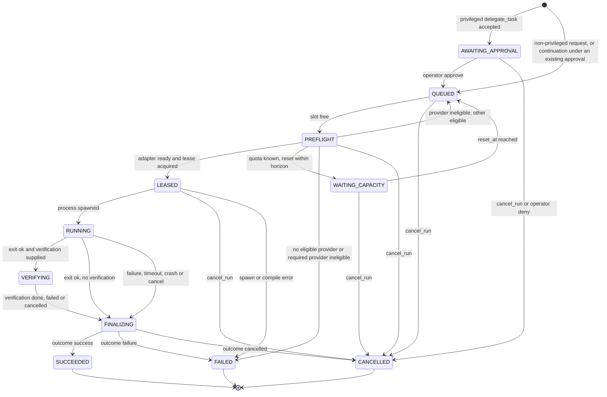
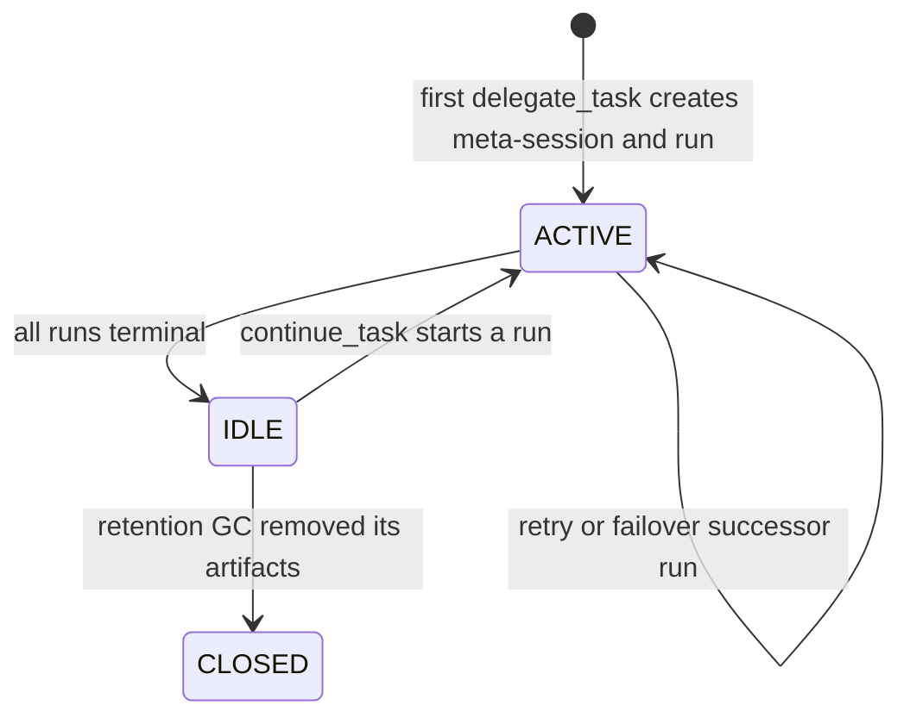
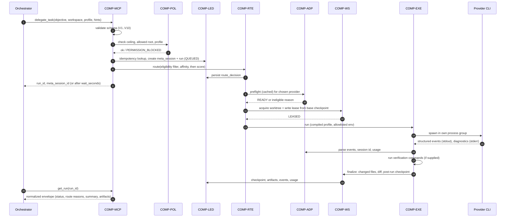

# Functional Requirements Document (FRD)

| Field | Value |
| --- | --- |
| Status | Draft, baseline for milestone M1 |
| Owns | Workflows WF-1..WF-14, business rules BR-*, actor permissions, the canonical run state machine, meta-session and adapter availability states, input validation rules, normal/alternate/failure paths |
| Does not own | Requirements and their IDs ([SRS](SRS.md)); outcomes ([BRD](BRD.md)); journeys and capabilities ([PRD](PRD.md)); components ([HLD](../design/HLD.md)); persistence and the failure taxonomy table ([LLD](../design/LLD.md)); sequencing ([ROADMAP](../ROADMAP.md)) |
| Last reconciled | 2026-10-12 |

## 1. Purpose and conventions

This document describes how Switchboard behaves, end to end, in terms of the requirements in the [SRS](SRS.md). It adds
no obligations: every business rule (BR) cites the FR/NFR it elaborates. Where the SRS leaves a choice open, the rule is
labelled **Proposed** with a one-line rationale; Proposed rules are design choices made during planning, are not
owner-approved (the ADRs are "Delegated", see [ADR index](../adr/README.md)), and can change without an SRS change.

Implementation status is owned by [ROADMAP §6](../ROADMAP.md#6-milestones). As of 2026-10-12 the repository contained
documentation and research only; parts of the behaviour described here are now implemented.

Conventions: components are `COMP-*` as named in the [HLD](../design/HLD.md#1-system-context). Failure codes are those
of the [LLD §4](../design/LLD.md#4-failure-taxonomy); `ELIGIBILITY_NONE` and `INVALID_REQUEST` were added during
planning and are marked "(planning)". Actors are defined in §2.

## 2. Actors and permissions

| Actor | Who | Channel | Identity basis |
| --- | --- | --- | --- |
| Operator | The single human who installs, logs in natively, and configures policy ([ADR-0011](../adr/0011-single-operator-local-deployment.md)) | Operator CLI (COMP-OPS) | Local OS user running the CLI |
| Orchestrator | Upstream agent (OpenClaw, Grok Bot) acting as MCP client | MCP over stdio (COMP-MCP) | Configured MCP client entry carrying a maximum trust profile (FR-MCP-06) |
| Controller | The Switchboard process and its components | Internal | n/a |
| Inner backend | The operator's optional `http` or `cli` inner-agent backend (FR-INN-03, FR-INN-04), called only by COMP-INN for stateless text completions (WF-13) | HTTP request or one-shot CLI process | Not trusted; output is untrusted data (BR-35); holds no permissions |
| Provider CLI (the agent) | Subprocess driven by an adapter | Subprocess/ACP; the injected `commit` and `push` tools (WF-11, WF-12) | Not trusted; confined by the run's trust profile; has no Git write ability of its own (FR-GIT-01) |

### 2.1 Permission matrix

| Action | Operator | Orchestrator | Controller | Governing FR |
| --- | --- | --- | --- | --- |
| Delegate / continue a task | Not via CLI (CLI has no `delegate`) | Yes, up to the client's max trust profile | Executes | FR-MCP-03, FR-MCP-06 |
| Request `privileged` profile | Approves via CLI | May request only, with a `privileged_scope` (V13); run stops in AWAITING_APPROVAL. May continue an approved meta-session under its approved scope (C7) | Blocks until approval; later runs of the same meta-session, client and scope run under the existing approval (BR-14) | FR-MCP-06, FR-POL-09 |
| Approve a privileged run | Yes (`approve <run_id>`); the approval covers later runs of that meta-session with that scope (owner decision 17) | No, never through MCP | Records timestamp and scope | FR-POL-09, FR-OPS-02 |
| Cancel a run | Yes (`runs cancel <id>`) | Yes (`cancel_run`) | Executes | FR-MCP-01, FR-OPS-01, FR-EXE-01 |
| Read run status, artifacts, route explanation, capacity | Yes (`runs list/show`) | Yes (`get_run`, `get_artifacts`, `explain_route`, `get_capacity`) | n/a | FR-MCP-01/02, FR-OPS-01 |
| List capabilities | Yes (`doctor`) | Yes (`list_capabilities`) | n/a | FR-MCP-01, FR-OPS-01 |
| Run preflight for all adapters | Yes (`doctor`) | Indirectly (cached preflight at route time) | Yes | FR-OPS-01, FR-ADP-02 |
| Accept a new provider CLI version | Yes (`adapters validate`) | No | Records `adapter_version` | FR-OPS-02, FR-ADP-03 |
| Change policy, allowed roots, client max profile, weights | Yes (config) | No | Snapshots config into each run | FR-POL-01, FR-POL-10 |
| Log in to a provider | Yes, natively, outside Switchboard | No | Never | FR-AUTH-01, FR-OPS-03 |
| Touch the operator's checked-out branch | Yes (by hand) | No | Never | FR-WS-05 |
| Create commits | Yes (by hand, in their own checkout) | No | Executes the agent's `commit` tool call, within policy (WF-11) | FR-GIT-01, 02, 04 |
| Push to remotes | Yes (by hand, or an operator command) | No | Executes the agent's `push` tool call only if the context's push policy allows it (WF-12) | FR-GIT-05, FR-WS-05 |
| Define or change projects, contexts, environments, push policy, commit identity | Yes (config) | Only dynamic projects, only if its client entry sets `manage_projects`, within the client's limits (BR-32); never configured projects | Snapshots into each run | FR-PRJ-01, 02, 03, 06, 10 |
| Approve a dynamic project that needs it (`container`, push policy other than `none`, any widening) | Yes (`projects approve`) | No, never through MCP | Records timestamp and revision | FR-PRJ-10 |
| Emit permission-bypass flags | Only by approving a `privileged` run whose scope sets `bypass` | No | Only under a recorded approval, covering the run's client, meta-session and scope, whose scope sets `bypass` and whose hash matches (BR-14) | FR-POL-03 |

The inner backend has no row: it holds no permissions, performs no action and appears in no decision (BR-35).

Rules on the matrix: a caller's maximum trust profile is a ceiling per MCP client; a request above it ends with
`PERMISSION_BLOCKED` before any side effect (BR-13). Privileged approval exists only on the operator CLI (BR-14), or,
since 2026-10-13, in the operator's configuration for a client set `privileged_approval: "not_required"` (BR-14 note,
[ADR-0019](../adr/0019-per-client-privileged-approval.md)). The orchestrator has no way to raise its own ceiling or to
change that setting.

## 3. Business rules

Each rule elaborates the cited requirement and does not add to it.

| ID | Rule | Elaborates | Status |
| --- | --- | --- | --- |
| BR-1 | Routing removes ineligible providers first (hard constraints), and only then ranks. A provider that fails any hard constraint is never chosen, regardless of hints or score. | FR-RTE-01, [ADR-0008](../adr/0008-two-stage-routing.md) | SRS |
| BR-2 | **`require_provider` semantics.** The named provider is the only candidate. It still passes every check in BR-1 (auth, sandbox, workspace, compliance manifest, version, quota, concurrency, health). If it fails, `delegate_task`/`continue_task` returns one error and starts no run on another provider. Failover is also disabled for that run. The error carries the provider's specific eligibility reason (BR-3). | FR-MCP-05 | SRS |
| BR-3 | **Eligibility reason to code mapping for `require_provider`.** `AUTH_REQUIRED` state returns `AUTH_REQUIRED`; `ADAPTER_VERSION_UNVERIFIED` returns `ADAPTER_VERSION_UNVERIFIED`; known quota exhaustion returns `QUOTA_EXHAUSTED`; profile unsupported, no manifest, disabled, circuit-open, or at concurrency returns `ELIGIBILITY_NONE` (planning) with the reason in the message. | FR-MCP-05, FR-MCP-07 | Proposed: FR-MCP-07 requires exactly one taxonomy code and the SRS names none for these reasons; mapping each to the closest existing code keeps clients' handling simple. |
| BR-4 | **`provider_preference` and `minimum_capability`.** Preference never adds a provider to the candidate set; it acts as a ranking input among eligible providers. `minimum_capability` is a hard constraint evaluated against the model registry. | FR-MCP-03, FR-MCP-05, FR-RTE-01 | SRS (hints only narrow); ranking role Proposed: SRS does not define preference's weight; scoring arrives in M7, before which M2 uses configured order as tie-break. |
| BR-5 | A profile is never silently downgraded. If an adapter cannot compile the requested profile, it is ineligible for that request. | FR-POL-02 | SRS |
| BR-6 | **Dispatch order on a retry-or-recovery decision.** Evaluate in this order: (1) is the failure automatically retryable and the workspace unchanged (BR-7); (2) for `QUOTA_EXHAUSTED`, can the request fail over (BR-8); (3) else can it queue until a known reset within the horizon (BR-9); (4) else return the failure. | FR-CAP-05, FR-CAP-06 | Proposed ordering across the two FRs: they cover disjoint codes, so the order only matters for classification; stating it makes the sequence explicit. |
| BR-7 | **Retry eligibility.** A failed attempt is retried automatically only if (a) its code is `RATE_LIMIT_TRANSIENT`, `PROVIDER_OVERLOADED`, or `PROCESS_CRASH` before any mutation, and (b) the worktree is byte-identical to the pre-run checkpoint (clean `git status` and head equals the checkpoint). Backoff is capped exponential with jitter. Any other code, or any change to the workspace, is not retried; FR-WS-04 applies (roll back or native resume, never replay). | FR-CAP-05, FR-WS-04, [ADR-0006](../adr/0006-worktree-checkpoints-no-blind-replay.md) | SRS. Backoff cap and attempt count are configuration (values (proposed target), set in M6). |
| BR-8 | **Failover.** On `QUOTA_EXHAUSTED`, the controller re-routes to another eligible provider only if the request permits it: `require_provider` is not true, and a handoff is possible from controller-owned evidence. If the workspace is unchanged the new run starts from the same checkpoint. If it changed, the changed state is first preserved as a checkpoint and diff artifact, the meta-session head returns to the pre-run checkpoint, and the new run receives a handoff bundle listing the failed attempt (FR-SES-04). The original request is never replayed against mutated state. | FR-CAP-06, FR-WS-04, FR-SES-04 | SRS for failover permission; roll back before failover Proposed: it keeps the failover deterministic and leaves the discarded edits recoverable from the diff. |
| BR-9 | **Queue on known reset.** If failover is impossible or not permitted and the provider's `reset_at` is known and within the configured horizon, the run waits in `WAITING_CAPACITY` and is re-dispatched after reset. Otherwise the run ends `FAILED` with `QUOTA_EXHAUSTED`. | FR-CAP-06, FR-CAP-02 | SRS. Horizon value is configuration (proposed target; set in M6). |
| BR-10 | **Idempotency keys** (mismatch and per-client scope now in FR-MCP-08). For `delegate_task` only: the same key with identical canonical parameters returns the original run (any state, including terminal) and starts nothing. Parameter identity is a hash of the validated request after canonicalization (workspace path canonicalized, defaults filled). The same key with different parameters returns `INVALID_REQUEST` (planning). A call without a key always starts a new run. The key is scoped to the calling MCP client and kept at least as long as the run record. | FR-MCP-08 | Mismatch error, scoping and retention Proposed: SRS defines only the identical-parameter case; failing loudly on mismatch avoids returning an unrelated run. |
| BR-11 | **Cancellation.** `cancel_run` is accepted in every non-terminal state and takes effect as in §4.3. Cancelling a terminal run is a no-op that returns the run's terminal state. Cancellation of a running process terminates its whole process group (graceful signal, then forced kill after the grace period). | FR-EXE-01, FR-MCP-01 | SRS for the group kill; no-op on terminal runs Proposed: idempotent cancel is simpler for retrying clients. |
| BR-12 | **Worktree disposition** on each terminal state is defined in §4.4. The controller never touches the operator's checked-out branch, never pushes run branches or checkpoint commits, pushes the publish ref only under BR-26, and removes worktrees only through retention GC. | FR-WS-03, FR-WS-04, FR-WS-05, FR-WS-07, FR-GIT-05, FR-GIT-08 | SRS; keep-until-GC for every terminal state Proposed: evidence for BO-5 outweighs disk cost at single-operator scale. |
| BR-13 | **Trust ceiling.** The requested profile is compared with the calling client's maximum profile before any side effect. Above it: `PERMISSION_BLOCKED`. `privileged` is above every ceiling for MCP-only authority and always enters AWAITING_APPROVAL if the client ceiling allows requesting it. | FR-MCP-06, FR-POL-09 | SRS. Treating a `privileged` request as allowed-to-request only when the client's ceiling is `privileged` is Proposed; SRS says only that approval cannot come from MCP. **Milestone note (M3, T3.3; replaces the M2 note):** a client whose ceiling is below `privileged` gets `PERMISSION_BLOCKED` (V5) before any other `privileged` check; a client whose ceiling is `privileged` may request it, and a valid request enters AWAITING_APPROVAL with a `PENDING` approval row (T2, WF-7). Approval itself is T3.4, and no `privileged` run is compiled or started before T3.5/T3.6 (`src/mcp/mcp.test.ts`, `src/lifecycle/lifecycle.test.ts`). **Note (2026-10-13, owner decision 22, [ADR-0019](../adr/0019-per-client-privileged-approval.md), mechanism Delegated):** the ceiling rule is unchanged; a client configured `privileged_approval: "not_required"` (allowed only with a `privileged` ceiling) enters QUEUED by T1 instead of AWAITING_APPROVAL, under an approval decided by client policy (BR-14). Since T3.18 an approved `privileged` run is compiled by its adapter at dispatch; the adapter's compile decides. |
| BR-14 | **Privileged approval.** The first `privileged` run of a meta-session does not dispatch until the operator approves it through the CLI. The approval stores timestamp and scope and is durable: it covers that run and every later run of the same meta-session, from the same MCP client, with the same canonical scope (a `continue_task` continuation takes the approved scope as is and cannot change it, C7), and it never expires and is never revoked automatically. A different scope, meta-session or client needs a new approval. Bypass flags (FR-POL-03) are emitted only for a run covered by an `APPROVED` approval row whose scope hash matches the hash recomputed from the run's client, meta-session and snapshot scope, and whose scope sets `bypass: true` ([LLD §3.1](../design/LLD.md#31-privileged-scope-m3)); a `privileged` run without `bypass` compiles without one. Approval is never automatic (no MCP tool, timer, configuration value or ceiling grants it). **Note (2026-10-13, owner decision 22; realisation Delegated, [ADR-0019](../adr/0019-per-client-privileged-approval.md)):** the one exception is the operator's own per-client setting `mcp_clients[].privileged_approval: "not_required"`. For such a client the first `privileged` run of a meta-session is admitted with its approval row written `APPROVED` and `decided_by = "client_policy:<client_id>"` in the admission transaction; scope validation, the scope hash, durability (owner decision 17), the bypass conditions above, Git-write denial (FR-GIT-01) and worktree isolation (FR-WS-05) all still apply. The default (`"required"`) is this rule unchanged. | FR-POL-09, FR-POL-03 | SRS; the bypass conditions are owner decision 13 and the durable meta-session approval is owner decision 17 (2026-10-13, the orchestrator's reading of "initial privileged approval lasts forever"), recorded in [ADR-0017](../adr/0017-approved-privileged-scope-bypass.md) (mechanism Delegated, Proposed). Revocation: ROADMAP Q-30 |
| BR-15 | **Fail closed.** An unknown adapter state, unparseable provider output, or unrecognized policy value denies, marks the provider ineligible, or ends the run with an error; it never proceeds. | NFR-SEC-06, FR-ADP-04 | SRS |
| BR-16 | **Verification outcome.** When verification commands are supplied and any exits non-zero (or times out), the run ends `FAILED` with `TEST_FAILURE`; results are recorded either way. The agent's own result is kept in the envelope. | FR-EXE-08, FR-MCP-04 | Mapping to `TEST_FAILURE` Proposed: the SRS requires running and recording, not the failure semantics. |
| BR-17 | **One active run per meta-session.** A meta-session has at most one non-terminal run; `continue_task` on a session with an active run is rejected with `INVALID_REQUEST`. | FR-SES-06, FR-WS-02 | SRS |
| BR-18 | **Same-provider vs cross-provider continuation.** If the caller names no provider and the provider of the latest binding is eligible, continue with native resume (FR-SES-03). If the caller names a different provider, or the bound provider is ineligible and `require_provider` is not set, route normally and build a handoff bundle (FR-SES-04). If `require_provider` names the bound provider and it is ineligible, fail per BR-2. | FR-SES-03, FR-SES-04, FR-MCP-05 | Default of preferring the bound provider Proposed: native resume is cheaper and loses less context than a handoff. |
| BR-19 | **Usage recording.** Every run records provider-reported usage with its source label, separate from controller estimates, regardless of outcome. | FR-CAP-01, FR-CAP-03 | SRS |
| BR-20 | **Version re-check at dispatch.** Every dispatch consults the preflight cache; the cache entry is invalidated by a changed binary version or TTL expiry, so a CLI updated after routing is caught at PREFLIGHT, not after spawn. | FR-ADP-03, NFR-PERF-02 | SRS |
| BR-21 | **Result envelope.** Every tool result is a compact envelope; raw transcripts, credentials and environment values never appear in it or in events. | FR-MCP-04, FR-TEL-03, NFR-SEC-01 | SRS |
| BR-22 | **`wait_seconds`.** If supplied, `delegate_task` blocks up to that bound and returns the current envelope, terminal or not; otherwise it returns immediately with `run_id` and `meta_session_id`. A timeout of the wait never cancels the run. | FR-MCP-03 | SRS; "does not cancel" Proposed: the SRS is silent on wait expiry. |
| BR-23 | **Project resolution and ceiling.** A request names a project or a workspace path, never both and never neither. For a project, the workspace is the primary repository context's canonical path (still under an allowed root); the effective maximum profile is the lower of the client's ceiling (BR-13) and the project's; a project outside the client's allowed list is refused with `PERMISSION_BLOCKED` before any side effect, and a provider outside the project's allowed set is ineligible under BR-1. A meta-session keeps its project for life. | FR-PRJ-03, FR-PRJ-06, FR-POL-10 | SRS. Treating a provider outside the project's set as an eligibility reason (BR-3 mapping) rather than a permission error is Proposed: it keeps one rule for "cannot use this provider here". |
| BR-24 | **Agents do not write to Git.** Under every write-capable profile the compiled controls deny Git write operations (BR-5 applies: an adapter that cannot declare how is flagged and relies on BR-27). The only route from agent work to a commit is the `commit` tool (BR-25) or, for an adapter in finalize-only mode, the controller's commit at FINALIZING (BR-30). | FR-GIT-01, FR-GIT-02, FR-GIT-09 | SRS |
| BR-25 | **Commit tool semantics.** A `commit` call carries a message and optionally a list of paths. The controller checks that the run holds the lease and is RUNNING, builds the commit from the worktree's current content for those paths (all changes if none given), parents it on the publish ref's head (or the run's base commit for the first one), writes it with the context's identity and the sanitised message (BR-26), advances the publish ref, and returns the new SHA. Calls outside RUNNING, a path outside the worktree, an empty change set or a message that is empty after sanitising return a tool error to the agent and change nothing; they do not fail the run. | FR-GIT-02, FR-GIT-04, FR-GIT-08 | SRS for the tool and identity; the lease and state checks, the path-subset behaviour and "errors do not fail the run" are Proposed. |
| BR-26 | **Sanitisation.** Before a message is written, the controller removes attribution trailers, "generated by"-style footers and controller, provider, run or session identifiers, using built-in patterns plus the operator's configured patterns, and then trims blank lines left behind. It adds nothing. The rules that fired are recorded by name and count in the provenance record, never the removed text. | FR-GIT-04, FR-GIT-07 | SRS. Pattern list contents Proposed (LLD §12.4). |
| BR-27 | **Violations.** If the post-run check finds a commit, ref change or tag not made by the controller (FR-GIT-03), the run does not fail for that reason alone: the changes are kept as working-tree content in the evidence checkpoint, the offending commits are never published, a `git_policy_violation` event names what was found, and `runs show` flags it. If the agent also pushed, the controller cannot detect or undo it from here; prevention (BR-29) is the control. | FR-GIT-03, FR-GIT-06 | Proposed: not failing the run keeps legitimate work. SRS requires only keeping content, not publishing and reporting. |
| BR-28 | **Provenance.** Every commit made through the commit tool, or through BR-30, gets an append-only provenance record in the same transaction as the event that created it. Records never go into the commit. | FR-GIT-07 | SRS |
| BR-29 | **Push eligibility.** A push is accepted only if the context's policy is `branch`, the target ref is the publish ref pushed to the configured remote under the configured prefix, and the run's environment keeps push credentials out of the agent's reach (BR-31). It is never forced. Every attempt, accepted or refused, is a run event. With policy `none` (the default) the `push` tool is not offered. | FR-GIT-05, FR-GIT-06 | SRS |
| BR-30 | **Finalize-only mode.** For an adapter that cannot receive the injected channel, and only if the operator enabled it for the context, FINALIZING makes one commit from the run's worktree changes with a message from the agent's structured final summary, under BR-26 and BR-28. Without the opt-in, such an adapter is ineligible for write-capable profiles on that context. | FR-GIT-09, FR-GIT-02 | FR-GIT-09 is Should; ineligible-without-opt-in is Proposed. |
| BR-31 | **Credential reach.** A context with push policy `branch` is eligible for a run only if the agent cannot run commands that could read the push credentials: a `container` environment with none mounted, or a profile without arbitrary shell, or an adapter whose manifest declares credential confinement (FR-POL-06). Otherwise the `push` tool is withheld and the reason is recorded. *Note 2026-10-13 (owner decision 37, zemdregon: "BR-31. Don't block git operations on bypass mode"; Delegated narrow reading; no ID change):* an approved bypass run (scope `bypass` and a controller-verified approval) is exempt: `push` is offered and accepted, with the reason `bypass_exempt` recorded; non-bypass runs keep this rule. | FR-GIT-06, FR-POL-06 | SRS |
| BR-32 | **Orchestrator-managed projects.** `create_project`, `update_project` and `delete_project` are offered only to a client whose entry sets `manage_projects`. They touch dynamic projects only (an ID that collides with a configured project is refused). A revision is validated like configuration (V12 rules, FR-PRJ-02); its repository path must lie under an allowed root; its trust ceiling and providers may not exceed the client's; its push policy may not exceed the client's `max_push_policy`. A revision with a `container` environment, a push policy other than `none`, or any widening of an approved revision is stored as `pending_approval` and cannot start runs until the operator approves it with `projects approve`. A project is visible to, and usable by, the creating client only. Deletion with a non-terminal run is refused. Refusals are `PERMISSION_BLOCKED` (not allowed) or `INVALID_REQUEST` (malformed); every call is an event. | FR-PRJ-10, FR-MCP-06, FR-POL-10 | Delegated: gating limits, pending-approval state and creator-only visibility are Proposed. zemdregon answered only "yes" (Q-7). |
| BR-33 | **Signing.** If a context sets `sign: true`, each published commit is signed by the controller using the operator's existing Git signing setup. A signing failure returns a tool error and creates no commit; nothing is committed unsigned as a fallback. Signing is refused where BR-31 would withhold `push`. | FR-GIT-10, FR-GIT-06 | Delegated mechanism; zemdregon asked for signing as part of Q-9 ("yes"). |
| BR-34 | **Inner agent is optional.** The inner agent is an optional, operator-configured backend with no default backend or model. Every inner task is disabled until the operator enables it individually. With no backend configured, or while it is off, unhealthy or suspended, each task uses its deterministic fallback and no other controller behaviour differs: the absence of an inner agent changes no route, eligibility result, policy decision, run status or tool contract other than as stated in BR-37. | FR-INN-01, FR-INN-05 | SRS |
| BR-35 | **Authority boundary.** Inner output is untrusted data and never an input to trust-profile choice or compilation, the policy snapshot, provider eligibility, approvals, client or project ceilings, push policy, sanitiser rules, secret redaction, failure classification (retry) or the status, exit code or pass/fail of any run or verification command. COMP-INN is not reachable from COMP-POL, the profile compilers, the retry logic or the push path; the design enforces this structurally and an import-boundary test checks it. An inner call is a stateless single-turn text completion with no tools and no loop; the controller performs every action that follows. | FR-INN-02, FR-INN-06 | SRS. The import-boundary test is a Proposed mechanism ([TDD §3.12](../design/TDD.md#312-inner-agent)). |
| BR-36 | **Validate, re-ask once, fall back.** Each inner call passes redaction, an input budget, the call under a per-call timeout and circuit breaker, then parsing against the task's schema (length-bounded, control characters stripped). An invalid result gets at most one re-ask; after that, or on any failure (unreachable, timeout, error, open circuit), the task's deterministic fallback applies and the event is recorded. A failure never fails or cancels a run and never delays a caller beyond the per-call bound; `doctor` shows the inner agent as degraded. Detail: [LLD §13](../design/LLD.md#13-inner-agent). | FR-INN-07, FR-INN-08 | SRS for the sequence; the pipeline ordering is Proposed. |
| BR-37 | **Commit-message drafting.** With the commit_message task enabled, `message` on the `commit` tool becomes optional (BR-25). Modes: `draft_if_missing` (default; the agent's own message always wins), `always` (a drafted message replaces the agent's), `never` (no drafting). The prompt is built from the diff of the paths being committed and contains no controller, provider, run or session identifier and no provider name. A drafted message goes through the BR-26 sanitiser like any other. If it is empty after sanitising, invalid or unavailable, the call returns the tool error `MESSAGE_REQUIRED` asking the agent to supply a message, creates no commit and never invents one. The provenance record (BR-28) states `message_source` (`agent` or `inner`). With the task disabled, `message` stays required. | FR-INN-10, FR-GIT-04, FR-GIT-07 | SRS for modes, sanitiser and no invention. The `MESSAGE_REQUIRED` tool-error name and `message_source` field are Proposed. |
| BR-38 | **Pull-request draft is an artifact only.** With the pr_draft task enabled, the controller may draft a title and description for a meta-session's publish ref and stores it as a `pr_draft` artifact, after the same sanitiser as commit messages. Switchboard never opens, edits or comments on a pull request; the operator or orchestrator uses the draft by their own means. | FR-INN-11 | SRS |
| BR-39 | **Inner routing classification.** The route_features task applies to routing stage 2 only: it may supply the FR-RTE-04 features as an enumerated structure and never influences stage 1. The features are stored in the route decision with their source (`inner` or `heuristic`), model and template version; replay reads the stored value and never calls the model again. They never override `require_provider` (BR-2), never add a provider to the candidate set or bypass eligibility (BR-1), and rank only as hints do (BR-4). On any inner failure the heuristic classifier supplies the features. | FR-INN-12, FR-RTE-04, FR-RTE-03 | SRS |
| BR-40 | **Summaries and condensation are additive.** The handoff_condense and log_summary tasks may condense controller-owned evidence into prose (handoff-bundle text fields, log and verification-output summaries). Structured fields, statuses, exit codes and counts come only from controller records. Each condensed field is labelled with its source and keeps a pointer to the raw artifact by ID and hash; the raw text is not discarded. On fallback the raw text is truncated deterministically. | FR-INN-13, FR-SES-04 | SRS |
| BR-41 | **Usage is not capacity.** Every inner call is recorded in its own `inner_call` record (task, backend, model, tokens as reported or unknown, latency, outcome) and never as a provider `usage_observation`, in a capacity estimate or against `capacity_score`. Exception: if the operator declares `shares_subscription_with` for a routed provider, one additional `usage_observation` with source `inner_agent` is recorded for that provider and `doctor` warns that the inner agent is consuming its capacity. | FR-INN-15 | SRS |
| BR-42 | **Inner-agent privacy gates.** A backend is `local` (loopback or Unix socket) or `remote`. A `remote` backend is unusable until `allow_remote` is set; a task that sends repository content (diffs, log excerpts) to a `remote` backend also needs that task's `allow_source_content`. A project or context may set `inner_agent` to `off` or `local_only`, which narrows what the global configuration allows and never widens it (BR-35 applies regardless). Deterministic redaction runs on the prompt before every call, and prompt and response bodies are not stored or logged beyond what the accepted result already is (sizes and hashes only). A refused call is a fallback (BR-36), not an error to the run. | FR-INN-16, FR-TEL-03 | SRS. "Narrows and never widens" is Proposed. |
| BR-43 | **Quality monitoring and suspension.** The outcome of every inner call is recorded (accepted, rejected by validator, rejected by sanitiser, fallback used). When a task's rejection rate over the configured window exceeds the configured threshold, the task is suspended automatically and uses its fallback until the operator re-enables it. Window and threshold are configuration values (proposed targets), not fixed here. `doctor`, `inner status` and `inner test <task>` (built-in fixture, no repository data) expose state to the operator. | FR-INN-09, FR-INN-17 | Proposed (FR-INN-09 is Should and its thresholds are proposed targets). |
| BR-44 | **Affinity before score.** After the hard constraints (BR-1), a project that has a recorded provider and model stays on them if that provider is eligible and not capacity-limited; the weighted score does not move a project and there is no round-robin or load spreading across providers for one project. The score ranks candidates only for a project's first run or after a switch reason (BR-45). | FR-RTE-06, FR-RTE-02, [ADR-0032](../adr/0032-provider-model-affinity.md) | Delegated, Proposed (owner decision 40) |
| BR-45 | **Closed list of switch reasons.** Affinity ends only for `user_request`, `capacity_exhausted`, `ineligible` or `failed_after_retry`, each recorded as `affinity_switch_reason` in the routing decision. A better score, lower cost or lower load is never a reason. After a switch the new provider is the project's affinity and the controller does not return on its own (Q-51). A model changes only for `user_request` or `ineligible` (FR-RTE-08). BR-8 failover re-bases affinity on the provider it lands on. | FR-RTE-07, FR-RTE-08, FR-CAP-06 | Delegated, Proposed (thresholds for `capacity_exhausted` are an Assumption chosen in M6/M7) |
| BR-46 | **Retrieved context is data.** Snippets from the retrieval index are untrusted reference data, labelled as such in the prompt, and are never an input to profile choice or compilation, the policy snapshot, eligibility, approvals, ceilings, push or commit. A retrieval failure means no retrieval; it never fails or delays a run beyond its bound. | FR-RAG-05, FR-RAG-07, FR-RAG-08 | Delegated, Proposed |
| BR-47 | **Index isolation and opt-in sharing.** Each project has its own index and nothing reads another project's. The deployment-wide index is off by default; a project's content enters it only with `contribute_to_global`, and a run reads it only if its project sets `use_global`. Content of `untrusted` contexts does not contribute by default. | FR-RAG-03, FR-RAG-09, FR-RAG-10 | Delegated, Proposed (Q-50) |
| BR-48 | **No remote embedding of source without both flags.** A `remote` embedding backend sees source content only with `allow_remote` and `allow_source_content` (the inner-agent gates of BR-42); chunk text is redacted first, and the exclusions of FR-RAG-02 apply. With no backend the feature is inert. | FR-RAG-02, FR-RAG-04 | Delegated, Proposed |

*Note 2026-10-13 (owner decision 36, Q-43; BR-30's wording above unchanged).* zemdregon chose finalize-only for adapters
with no injected channel ("Finalize-only."): such an adapter is **not** made ineligible for write-capable profiles. It runs
them, and when the project opts in to finalize-only mode the controller commits at FINALIZING under BR-26 and BR-28.
Without the opt-in its work stays in the worktree and the diff artifacts. The "ineligible without the opt-in" clause of
BR-30 is therefore not applied. zemdregon wants the opt-in enabled for his own projects. Per-project opt-in; ROADMAP T9.7.

## 4. Canonical run state machine

### 4.1 Diagram



Retry and failover are not backward edges: the failed attempt becomes terminal `FAILED`, and the controller creates a
successor run in the same meta-session that enters QUEUED or WAITING_CAPACITY (BR-6..BR-9). Successor runs carry a
`retry_of` link and `get_run` on a superseded run reports its successor, so the caller's original `run_id` stays useful
(FR-MCP-10).

Every outcome that had a leased workspace passes through FINALIZING so the post-run checkpoint, diff and lease release
happen once, in one place (FR-WS-03). **Proposed** for the same reason.

### 4.2 Transition table

| # | From | Event | Guard | To | Side effects | FR IDs |
| --- | --- | --- | --- | --- | --- | --- |
| T1 | (new) | `delegate_task` / `continue_task` accepted | Schema valid, path allowed, ceiling ok, an eligible provider exists, and either `profile != privileged`, or a `continue_task` whose meta-session has an `APPROVED` approval for the calling client (C7, BR-14), or (2026-10-13, BR-14 note) a `delegate_task` from a client configured `privileged_approval: "not_required"`, whose approval row is written and decided `APPROVED` by client policy in this transaction | QUEUED | Create run and meta-session (or attach), persist policy snapshot and route decision, append `run_event` | FR-MCP-03, 07, 09, FR-POL-10, FR-CAP-04, FR-TEL-01 |
| T2 | (new) | `delegate_task` accepted, `profile == privileged` | Client ceiling is `privileged` and the client's `privileged_approval` is `"required"` (the default; 2026-10-13, BR-14 note) | AWAITING_APPROVAL | Create approval record (pending) for the new meta-session and scope; no process, no worktree | FR-POL-09, FR-MCP-06 |
| T3 | AWAITING_APPROVAL | Operator `approve` | Run not cancelled | QUEUED | Record approval (timestamp, scope) | FR-POL-09, FR-OPS-02 |
| T4 | QUEUED | Dispatcher picks run | Global and per-provider concurrency slot free; provider breaker closed | PREFLIGHT | Reserve slot | FR-CAP-04, NFR-PERF-03 |
| T5 | PREFLIGHT | Preflight passes | Adapter READY (version, manifest, auth, smoke test via cache); lease acquired | LEASED | Create worktree from base checkpoint (write-capable) and lease; record adapter version | FR-ADP-02, 03, FR-WS-01, 02, FR-POL-07 |
| T6 | PREFLIGHT | Provider became ineligible | Not `require_provider`; another eligible provider | QUEUED | Exclude provider for this run; re-route; record reason | FR-RTE-01, FR-MCP-05 |
| T7 | PREFLIGHT | Provider quota known exhausted | Failover not possible; `reset_at` within horizon | WAITING_CAPACITY | Release slot | FR-CAP-06 |
| T8 | PREFLIGHT | No usable provider | `require_provider` ineligible, or none eligible, or reset beyond horizon; or a `privileged` run's approval check fails ([LLD §3.1](../design/LLD.md#31-privileged-scope-m3) Bypass, checked before any probe) | FAILED | Code per BR-3 (`AUTH_REQUIRED`, `ADAPTER_VERSION_UNVERIFIED`, `QUOTA_EXHAUSTED`, `ELIGIBILITY_NONE`); `PERMISSION_BLOCKED` for a failed approval check (T3.4) | FR-MCP-05, FR-AUTH-02, FR-ADP-03, FR-POL-03 |
| T9 | LEASED | Process group spawned | Env built from allowlist; profile compiled without downgrade | RUNNING | Start timeout timer; capture stdout events and stderr separately | FR-EXE-01, 05, 07, FR-POL-02 |
| T10 | LEASED | Compile/spawn error | Adapter cannot compile profile, or spawn fails | FAILED | Release lease; remove empty worktree; code per BR-3 for an adapter `Ineligible` from compile (`ELIGIBILITY_NONE` for an unsupported profile or missing capability, with the reason in the event; T3.7), `PERMISSION_BLOCKED` for a bypass flag refused by the argv audit, `PROCESS_CRASH` for a spawn failure | FR-POL-02, NFR-REL-02 |
| T11 | RUNNING | Provider exits successfully | Verification commands supplied | VERIFYING | Parse final result from structured output | FR-ADP-04, FR-EXE-08 |
| T12 | RUNNING | Provider exits successfully | No verification commands | FINALIZING (pending: success) | Parse result and usage | FR-ADP-04, FR-CAP-01 |
| T13 | RUNNING | Failure, timeout, crash, policy denial, or cancel | Any | FINALIZING (pending: failure code or cancelled) | Kill process group on timeout/cancel; classify error | FR-EXE-01, FR-POL-05, FR-MCP-07 |
| T14 | VERIFYING | Verification completes | All commands pass → pending success; else pending `TEST_FAILURE` (BR-16); cancel → pending cancelled | FINALIZING | Run in the worktree under the same profile; store results | FR-EXE-08 |
| T15 | FINALIZING | Finalization done | Pending success | SUCCEEDED | Changed-file list, diff artifact, post-run checkpoint commit on controller branch; release lease; meta-session head advanced; usage recorded | FR-WS-03, FR-CAP-01 |
| T16 | FINALIZING | Finalization done | Pending failure | FAILED (one code) | As T15 for the evidence checkpoint; BR-12 decides head; then BR-6 may create a successor run | FR-WS-03, 04, FR-CAP-05, 06, FR-MCP-07 |
| T17 | FINALIZING | Finalization done | Pending cancelled | CANCELLED | As T15 for the evidence checkpoint; head stays at pre-run checkpoint | FR-WS-03, 04 |
| T18 | WAITING_CAPACITY | `reset_at` reached | Provider still eligible, else re-route | QUEUED | Re-evaluate eligibility | FR-CAP-06, FR-RTE-01 |
| T19 | any non-terminal | `cancel_run` | Per §4.3 | CANCELLED (directly, or via FINALIZING when a process or workspace exists) | Per §4.3 | FR-EXE-01 |
| T20 | any non-terminal | Controller restart | Per WF-8 | Per WF-8 | Reconciliation | FR-EXE-06, NFR-REL-01 |

### 4.3 Cancellation in each state

| State at cancel | Effect | Result | Side effects |
| --- | --- | --- | --- |
| AWAITING_APPROVAL | Approval record closed as not granted | CANCELLED | None to workspace |
| QUEUED, WAITING_CAPACITY | Removed from queue | CANCELLED | None to workspace |
| PREFLIGHT | Probe and smoke test aborted if in flight | CANCELLED | Slot released; preflight cache unaffected |
| LEASED | Spawn prevented or process terminated if just started | CANCELLED | Lease released; worktree retained, unchanged |
| RUNNING | Process group terminated (graceful, then forced) | CANCELLED via FINALIZING | Partial changes checkpointed as evidence; head stays at pre-run checkpoint; usage recorded if reported |
| VERIFYING | Verification process group terminated; agent result kept | CANCELLED via FINALIZING | Same as RUNNING |
| FINALIZING | Finalization is allowed to finish (**Proposed:** interrupting it risks a half-written checkpoint); the recorded outcome stands | Existing pending outcome | `cancel_run` replies with the pending/terminal state |
| SUCCEEDED, FAILED, CANCELLED | No-op | Unchanged | None |

A run cancelled while a retry or failover successor is queued cancels the successor chain's active run; terminal
predecessors are unaffected (BR-11, BR-17).

### 4.4 Worktree disposition per terminal state

| Terminal state | Workspace condition | Worktree and branch | Meta-session head |
| --- | --- | --- | --- |
| SUCCEEDED | Changed or unchanged | Retained on controller-owned branch with post-run checkpoint and diff artifact until retention GC (FR-WS-07, NFR-DATA-01); lease released | Advances to post-run checkpoint |
| FAILED, unchanged | Equals pre-run checkpoint | Retained until GC (a retry successor may reuse it); lease released | Unchanged |
| FAILED, changed | Differs from pre-run checkpoint | Post-failure state committed to the controller branch as an evidence checkpoint plus diff artifact; never replayed against; lease released | Rolled back to pre-run checkpoint, unless the caller continues via native resume (FR-WS-04) |
| CANCELLED | Unchanged or changed | As FAILED, by condition | As FAILED, by condition |
| Any, `inspect-untrusted` on non-Git directory | No worktree exists (FR-WS-06) | Nothing to retain; artifacts only | Not applicable |

Garbage collection deletes artifacts, worktrees and controller branches together (NFR-DATA-01). The operator's
checked-out branch and working tree are never modified (FR-WS-05).

### 4.5 Git actions inside the run lifecycle

*Proposed placement; the state machine above is unchanged.* Commit and push tool calls (WF-11, WF-12) happen only while
the run is RUNNING and are recorded as `run_event` rows, not state changes. FINALIZING gains two steps ahead of the
existing post-run checkpoint (T15 to T17): (1) compare the repository's refs and the run branch with the snapshot taken
at LEASED, and handle anything the controller did not create under BR-27; (2) for an adapter in finalize-only mode,
make the controller's commit (BR-30). The post-run checkpoint on the internal run branch is unchanged and is never
published (FR-GIT-08). A cancelled or failed run keeps any commits already made through the tool on the publish ref;
publication is not rolled back by a later failure, but a push needs a separate accepted call (BR-29).

*Note 2026-10-13 (T9.7, Delegated; the placement above unchanged, state machine unchanged).* As built, step (2) runs
after the post-run checkpoint, still inside FINALIZING and before the terminal transition: the finalize-only commit
takes its paths from the checkpoint's changed-file list, and neither step touches the other's refs. Only a run about to
end SUCCEEDED is committed, and none after a `git_policy_violation` in the meta-session (BR-27). See [LLD
§12.3](../design/LLD.md#123-commit-algorithm-and-refs).

## 5. Meta-session lifecycle

*Proposed.* The SRS defines meta-sessions (FR-SES-01..05) but not lifecycle states; these three are a planning choice.



| State | Meaning | `continue_task` | Notes |
| --- | --- | --- | --- |
| ACTIVE | At least one non-terminal run | Rejected with `INVALID_REQUEST` (BR-17) | Holds the write lease |
| IDLE | All runs terminal; ledger, checkpoints and provider bindings intact | Accepted (WF-2, WF-3) | Event log is append-only (FR-SES-05) |
| CLOSED | Retention GC deleted artifacts, worktrees, branches (NFR-DATA-01); the ledger rows needed for audit remain | Rejected with `INVALID_REQUEST` | Closure by operator command is not in the SRS (SRS silent) |

## 6. Adapter availability states

*Defined during planning; the SRS names only `ADAPTER_VERSION_UNVERIFIED` (FR-ADP-03) and requires auth, manifest and
health checks to gate eligibility.* The state is derived from preflight (WF-6), evaluated in this precedence order so
one reason is reported:

| State | Condition | Eligible | Operator remedy | Source |
| --- | --- | --- | --- | --- |
| DISABLED | Operator config disables it, or adapter blocked (Kimi Code until contract pinned) | No | Enable in config; for Kimi, pin contract | FR-ADP-09 |
| NO_MANIFEST | No compliance manifest covers the installed version | No | Add or update manifest | FR-POL-07 |
| ADAPTER_VERSION_UNVERIFIED | Installed version outside validated range | No | `adapters validate <provider>` (WF-9) | FR-ADP-03, FR-OPS-02 |
| AUTH_REQUIRED | Provider's own status command or smoke call reports no valid login | No | Run the native login command printed by `doctor` | FR-AUTH-02 |
| DEGRADED | Per-provider circuit breaker open or smoke test failing (**Proposed** name for "circuit-open") | No until breaker half-open probe succeeds | Wait, or inspect `runs show` | FR-CAP-04 |
| READY | All checks pass | Yes, subject to profile support and quota | none | FR-ADP-02 |

Missing binary or missing automation command maps to DISABLED-by-probe in `doctor` output with its reason (**Proposed**:
SRS lists these as preflight checks without naming a state). Transitions: any state is re-derived on a cache miss,
version change or TTL expiry (NFR-PERF-02); `adapters validate` moves ADAPTER_VERSION_UNVERIFIED to READY only after the
next full preflight passes; a breaker opens on repeated classified failures (FR-CAP-04, M6) and half-opens after a
cool-down.

## 7. Input validation rules

All checks run before any side effect, in this order, and the first failure is returned as the single error (FR-MCP-07,
FR-MCP-09).

### 7.1 `delegate_task`

| # | Field / rule | Check | Failure code | FR |
| --- | --- | --- | --- | --- |
| V1 | Whole request | Validates against the published JSON Schema; unknown fields rejected (**Proposed**, fail closed) | `INVALID_REQUEST` (planning) | FR-MCP-09, NFR-SEC-05, NFR-SEC-06 |
| V2 | `objective` | Non-empty string, length bounded by config (value (proposed target)) | `INVALID_REQUEST` | FR-MCP-03, FR-MCP-09 |
| V3 | `workspace` | Absolute path; symlinks resolved; result lies under an operator-configured allowed root. Exactly one of `workspace` and `project` is present (V12) | `INVALID_REQUEST` | FR-POL-10, FR-PRJ-03 |
| V4 | `workspace` and `trust_profile` | Write-capable profile requires a Git repository; `inspect-untrusted` may use a non-Git directory | `INVALID_REQUEST` | FR-WS-06 |
| V5 | `trust_profile` | One of the five profiles; not above the calling client's ceiling | `INVALID_REQUEST` if unknown name; `PERMISSION_BLOCKED` if above ceiling | FR-MCP-06, FR-POL-01 |
| V13 | `privileged_scope` | Required when `trust_profile` is `privileged`; refused with any other profile. Shape per [LLD §3.1](../design/LLD.md#31-privileged-scope-m3): machine-readable, every dimension (files, shell, network, repository configuration) required with a closed-enum mode, command and host lists present exactly when the mode is `allowlist`, unknown keys refused; a malformed scope already fails V1. Evaluated here, after V5, so a client below the `privileged` ceiling gets `PERMISSION_BLOCKED` first (IDs are not renumbered; table order is evaluation order) | `INVALID_REQUEST` | FR-POL-09, FR-POL-03, FR-MCP-03 |
| V6 | `constraints` | Schema-defined structure; cannot loosen the profile's defaults | `INVALID_REQUEST` (or `PERMISSION_BLOCKED` for loosening) | FR-POL-01 |
| V7 | `verification_commands` | Array of command strings; **Proposed:** rejected under `inspect-untrusted` (no shell), allowed otherwise and run under the same profile | `INVALID_REQUEST` | FR-EXE-08, FR-POL-01 |
| V8 | `provider_preference`, `require_provider`, `minimum_capability` | Provider names exist in the adapter registry; `minimum_capability` is a registry value; `require_provider` must be a boolean accompanied by a provider | `INVALID_REQUEST` | FR-MCP-03, FR-MCP-05, FR-ADP-05 |
| V9 | `wait_seconds` | Integer in `[0, configured max]` | `INVALID_REQUEST` | FR-MCP-03 |
| V10 | `idempotency_key` | Bounded-length string; replay rules per BR-10 | `INVALID_REQUEST` on mismatch | FR-MCP-08 |
| V11 | Routing | At least one provider passes BR-1 (or the required one does). **Proposed (T3.3):** for `privileged` (here and for a C7 continuation), a provider excluded only because its adapter cannot compile the profile (`PROFILE_UNSUPPORTED`, `CAPABILITY_MISSING`) still counts; the compile check moves to dispatch, where `bypassApproved` is known. *Changed 2026-10-13 (T3.18):* dispatch no longer refuses every `privileged` run; the adapter's compile there decides, and an `Ineligible` ends the run with its BR-3 code ([LLD §3.1](../design/LLD.md#31-privileged-scope-m3)) | per BR-3 / `ELIGIBILITY_NONE` | FR-RTE-01, FR-MCP-05 |
| V12 | `project` | Names a project in configuration that the calling client may use; mutually exclusive with `workspace`; the project's repository context resolves under an allowed root and its base ref exists | `INVALID_REQUEST` if unknown or malformed; `PERMISSION_BLOCKED` if not in the client's list or the profile exceeds the project's ceiling (BR-23) | FR-PRJ-03, FR-PRJ-06 |

### 7.2 `continue_task`

| # | Rule | Failure code | FR |
| --- | --- | --- | --- |
| C1 | Schema validation as V1 | `INVALID_REQUEST` | FR-MCP-09 |
| C2 | `meta_session_id` exists and is IDLE (not ACTIVE or CLOSED); a project cannot be changed on continue | `INVALID_REQUEST` | FR-SES-01, BR-17, FR-PRJ-03 |
| C3 | Workspace is taken from the meta-session, then re-checked against current allowed roots (config may have changed) | `INVALID_REQUEST` | FR-POL-10 |
| C4 | Trust profile defaults to the session's profile; a higher profile is checked against the ceiling as V5 | `PERMISSION_BLOCKED` | FR-MCP-06 |
| C5 | Provider hints as V8; BR-18 selects native resume vs handoff | per BR-2/BR-3 | FR-SES-03, FR-SES-04, FR-MCP-05 |
| C6 | Idempotency key: the SRS defines it only for `delegate_task`; `continue_task` accepts none (SRS silent) | n/a | FR-MCP-08 |
| C7 | **M3 (owner decision 17; reverses the earlier Proposed refusal, ROADMAP Q-29):** `continue_task` accepts no `privileged_scope`. A continuation whose resolved profile is `privileged` (requested, or defaulted from a `privileged` run) is admitted only if the meta-session has an `APPROVED` approval for the calling client; it then takes the approved scope as is (no widening or other change) and needs no new approval ([LLD §3.1](../design/LLD.md#31-privileged-scope-m3)). An approval that is `PENDING`, `DENIED` or absent, or a different client, is refused. A different scope needs `delegate_task` and a new approval. Checked after C4 | `INVALID_REQUEST` | FR-POL-09 |

### 7.3 Other tools

`list_projects` takes no arguments and returns only the projects the calling client may use (FR-PRJ-03).
`create_project`, `update_project` and `delete_project` (M9, FR-PRJ-10) validate against the project schema and BR-32; an
unknown project ID returns `INVALID_REQUEST`. The injected
`commit` and `push` tools are validated by their own rules (BR-25, BR-29), not by §7.1. `get_run`, `get_artifacts`,
`cancel_run`, `explain_route` and `get_capacity` validate IDs against the schema (V1) and an
unknown ID returns `INVALID_REQUEST` (**Proposed**; no "not found" code exists in the taxonomy; SRS silent).

The `inner_agent` configuration (backend kind, endpoint, model, locality, per-task switches and modes, `allow_remote`,
`allow_source_content`, `shares_subscription_with`) is validated like other configuration: unknown keys are
rejected, and a value that would put a credential in the file is refused at load (FR-INN-03, NFR-SEC-05). The
optional `message` on the injected `commit` tool follows BR-37.

## 8. Workflows

### WF-1 Delegate task (run lifecycle)

- **Actors:** Orchestrator, COMP-MCP, COMP-POL, COMP-LED, COMP-RTE, COMP-ADP, COMP-WS, COMP-EXE; Operator for privileged
  runs.
- **Preconditions:** Controller running via `serve`; target workspace under an allowed root; at least one adapter READY
  (else failure below).
- **Realizes:** FR-MCP-01, 03, 04, 05, 06, 07, 08, 09; FR-POL-01, 02, 04, 05, 07, 10; FR-ADP-02, 03; FR-WS-01, 02, 03,
  06; FR-EXE-01, 02, 05, 07, 08; FR-CAP-04; FR-RTE-01, 06, 07; FR-TEL-01; NFR-OBS-01, NFR-SEC-06, NFR-REL-02, NFR-PERF-01.



- **Normal path:** validation passes (T1) → QUEUED → PREFLIGHT → LEASED → RUNNING → [VERIFYING] → FINALIZING → SUCCEEDED
  (T4..T15). Each step appends a `run_event`. The orchestrator polls `get_run` or uses `wait_seconds` (BR-22).
- **Alternate paths:** (a) `privileged` profile: T2, run waits in AWAITING_APPROVAL until WF-7 (a continuation of an
  approved meta-session is admitted by T1 under the existing approval, C7). (b) Same idempotency key
  replayed: original run returned (BR-10). (c) Preferred provider ineligible at PREFLIGHT: re-route (T6) unless
  `require_provider`. (d) Quota known exhausted: WAITING_CAPACITY (T7, BR-9). (e) Non-Git workspace with
  `inspect-untrusted`: no worktree, read-only (FR-WS-06). (f) Cancel at any point: WF-4. (g) Route
  features: when the route_features task is enabled, the inner agent may supply the stage-2 scoring features instead of
  the heuristic; the value is stored in the route decision and never affects eligibility or `require_provider` (BR-39,
  WF-13). (h) Affinity: after the hard constraints, a project with a recorded provider and model keeps them unless a
  listed switch reason applies; the score ranks only on a first run or after a switch (BR-44, BR-45, WF-14 for
  retrieval).
- **Failure paths:** invalid input → `INVALID_REQUEST` (no run created); above ceiling → `PERMISSION_BLOCKED`; no
  eligible provider → `ELIGIBILITY_NONE`; required provider ineligible → per BR-3; auth lost mid-run → `AUTH_REQUIRED`
  naming the native login command (FR-AUTH-02); denied operation → `PERMISSION_BLOCKED` or `SANDBOX_VIOLATION` without
  hanging (FR-POL-05); `PROCESS_TIMEOUT`, `PROCESS_CRASH`, `OUTPUT_PROTOCOL_ERROR`, `TOOL_FAILURE`; verification failure
  → `TEST_FAILURE`. Further handling in WF-5.
- **Postconditions:** the run is terminal or, if the caller did not wait, in a known non-terminal state; the ledger
  holds events, route decision, policy snapshot and adapter version (NFR-OBS-01); the operator's branch is untouched
  (FR-WS-05); the lease is released at FINALIZING.

### WF-2 Continue on the same provider

- **Actors:** Orchestrator, COMP-MCP, COMP-LED, COMP-WS, COMP-ADP, COMP-EXE.
- **Preconditions:** Meta-session IDLE; a provider binding with a native session ID exists for an eligible adapter
  (BR-18).
- **Realizes:** FR-SES-01, 02, 03, 05; FR-MCP-03, 05, 09; FR-ADP-04; FR-WS-01, 02, 03.
- **Normal path:** `continue_task(meta_session_id, instruction)` → validation (§7.2) → T1 → same lifecycle as WF-1 with
  the adapter's `resume` using the stored native session ID. **Proposed:** the new run takes a new lease on the
  meta-session's worktree when it exists at the head checkpoint, otherwise a fresh worktree from the head checkpoint;
  rationale: native resume may be tied to the working directory (**Assumption**, to be checked per provider in M5). The
  new native session ID, if changed, updates the binding.
- **Alternate paths:** caller names another provider or bound provider is ineligible → WF-3. Native resume rejected by
  the provider (stale or expired session) → `OUTPUT_PROTOCOL_ERROR` or the code the adapter classifies; **Proposed:**
  the controller does not auto-fall back to handoff on a rejected resume, because that would change the provider-visible
  context unnoticed (SRS silent).
- **Failure paths:** session not IDLE or CLOSED → `INVALID_REQUEST`; `require_provider` provider ineligible → BR-3 code;
  run failures as WF-5.
- **Postconditions:** an additional run in the same meta-session, head advanced on success, decision/event log appended.

### WF-3 Cross-provider handoff

- **Actors:** Orchestrator, COMP-MCP, COMP-LED, COMP-RTE, COMP-WS, COMP-ADP, COMP-EXE; target provider CLI.
- **Preconditions:** Meta-session IDLE with canonical state (objective, constraints, decisions, base/head, changed
  files, verification results, open work); a different eligible provider exists, or the caller named one.
- **Realizes:** FR-SES-02, 04, 05; FR-MCP-05; FR-RTE-01; FR-WS-01, 02, 03; FR-POL-02; FR-ADP-04, 10; BO-4.

```mermaid
sequenceDiagram
    autonumber
    participant O as Orchestrator
    participant M as COMP-MCP
    participant L as COMP-LED
    participant R as COMP-RTE
    participant W as COMP-WS
    participant A as COMP-ADP (provider B)
    participant X as COMP-EXE
    participant B as Provider B CLI
    O->>M: continue_task(session, instruction, provider B or any)
    M->>L: load canonical state, head checkpoint, bindings
    M->>R: route excluding ineligible; BR-18 decides handoff
    R-->>M: provider B (route reasons)
    M->>L: regenerate handoff view from append-only events
    L-->>M: handoff bundle (goal, constraints, decisions, base/head, changed files, diff excerpts, diagnostics, failed attempts, open tasks, paths)
    M->>W: lease worktree at head checkpoint
    W-->>M: LEASED
    M->>A: compile profile + prompt = instruction + bundle ("inspect the repository first")
    A->>X: argv, allowlisted env
    X->>B: spawn (fresh session, no transcript import)
    B-->>X: structured events, new native session id
    X->>L: new provider_binding, usage (harness and backing provider), events
    X->>W: finalize: diff, post-run checkpoint
    M-->>O: envelope (provider B, route reasons, summary)
```

- **Normal path:** as WF-1 from T1, with a handoff bundle built solely from controller-owned evidence; the agent is told
  to inspect the repository, and no provider transcript file is read (FR-SES-04). The new provider gets a fresh native
  session; a second binding is added to the meta-session.
- **Alternate paths:** (a) Failover after `QUOTA_EXHAUSTED` (BR-8) uses the same mechanism, with the failed attempt
  listed in the bundle. (a2) Condensation: when handoff_condense is enabled, text fields of the bundle may be condensed
  by the inner agent, labelled with their source and keeping a pointer to the raw artifact; statuses and counts stay
  from controller records, and on any inner failure the raw text is truncated deterministically (BR-40, WF-13).
  (b) Provider B is a multi-vendor harness (OpenCode, Cursor): the backing provider and model are
  recorded alongside the harness (FR-ADP-10). (c) Earlier work left uncommitted-then-rolled-back: the evidence diff is
  referenced in the bundle.
- **Failure paths:** target provider cannot compile the session's trust profile → ineligible (FR-POL-02, BR-5),
  `ELIGIBILITY_NONE` if none remains; `require_provider` ineligible → BR-3; bundle cannot be generated from the ledger →
  `INVALID_REQUEST` is **not** used; **Proposed:** `TOOL_FAILURE` with a message, since the fault is internal and fails
  closed.
- **Postconditions:** a second binding exists; the meta-session head reflects provider B's checkpoint; provider A's
  session is unchanged and still resumable.

### WF-4 Cancel run

- **Actors:** Orchestrator (`cancel_run`) or Operator (`runs cancel`), COMP-MCP or COMP-OPS, COMP-EXE, COMP-WS,
  COMP-LED.
- **Preconditions:** Valid `run_id`.
- **Realizes:** FR-MCP-01, FR-EXE-01, FR-WS-03, FR-WS-04, FR-TEL-01, NFR-REL-02.
- **Normal path:** `cancel_run` → effect per §4.3 table → CANCELLED, failure code `CANCELLED`, evidence checkpoint if a
  workspace changed, lease released.
- **Alternate paths:** run already terminal → no-op returning terminal state (BR-11); run in FINALIZING → outcome
  stands. If a process ignores the graceful signal, forced kill after the grace period (FR-EXE-01).
- **Failure paths:** unknown `run_id` → `INVALID_REQUEST` (SRS silent). A process that cannot be killed is a controller
  fault: the run ends `PROCESS_CRASH` and the adapter is marked DEGRADED (**Proposed**).
- **Postconditions:** no live process group for the run; slot released; worktree disposition per §4.4.

### WF-5 Failure handling and retry

- **Actors:** COMP-EXE, COMP-ADP (classifier), COMP-RTE, COMP-WS, COMP-LED.
- **Preconditions:** A run enters FINALIZING with a pending failure.
- **Realizes:** FR-MCP-07, FR-CAP-05, 06, FR-WS-04, FR-POL-05, FR-AUTH-02, FR-ADP-04, FR-CAP-04; NFR-REL-02.
- **Normal path:** the adapter classifies the error from native structured output (never free-text matching, FR-ADP-04)
  into one taxonomy code; the controller diffs the worktree against the pre-run checkpoint; then applies BR-6 order:

| Code | Workspace unchanged | Workspace changed |
| --- | --- | --- |
| `RATE_LIMIT_TRANSIENT`, `PROVIDER_OVERLOADED` | Automatic retry as a successor run with capped backoff and jitter (BR-7) | Preserve evidence, roll back head, return failure; no auto retry (FR-WS-04) |
| `PROCESS_CRASH` | Automatic retry only if before any mutation (BR-7) | As above |
| `QUOTA_EXHAUSTED` | Failover (BR-8), else WAITING_CAPACITY (BR-9), else return | Roll back head, then same ladder |
| `AUTH_REQUIRED` | Return code with provider and native login command; adapter becomes AUTH_REQUIRED | Same |
| `ADAPTER_VERSION_UNVERIFIED`, `MODEL_UNAVAILABLE` | Return code; adapter ineligible / model excluded (**Proposed** for `MODEL_UNAVAILABLE`) | Same |
| `PERMISSION_BLOCKED`, `SANDBOX_VIOLATION` | Return code; re-delegation with a broader profile is the orchestrator's decision ([ADR-0004](../adr/0004-trust-profiles-no-bypass-flags.md)) | Same |
| `PROCESS_TIMEOUT`, `OUTPUT_PROTOCOL_ERROR`, `TOOL_FAILURE`, `TEST_FAILURE` | Return code; not automatically retried (not in FR-CAP-05's list) | Same |

- **Alternate paths:** native resume of the failed session instead of rollback when the caller issues `continue_task`
  (FR-WS-04); retry attempts exhausted → return the last failure code; breaker opens after repeated failures (FR-CAP-04,
  M6).
- **Failure paths:** unclassifiable output → `OUTPUT_PROTOCOL_ERROR`, fail closed (BR-15).
- **Postconditions:** exactly one code on each FAILED run (FR-MCP-07); successor runs link to predecessors; no request
  replayed against mutated state.

### WF-6 Adapter preflight and doctor

- **Actors:** Operator (`doctor`), COMP-OPS, COMP-ADP, COMP-POL, COMP-RTE.
- **Preconditions:** Provider CLIs installed and logged in natively by the operator; manifests present for the versions
  in use.
- **Realizes:** FR-ADP-02, 03, 07, 09, FR-AUTH-01, 02, FR-POL-07, FR-OPS-01, NFR-PERF-02, UJ-1.
- **Normal path:** for each adapter, in the FR-ADP-02 order: binary present → version → automation command →
  structured-output support → required permission/sandbox flags → auth status (provider's own status command) → harmless
  structured-output smoke test. Manifest coverage and DISABLED are checked with them. `doctor` prints each adapter's
  state (§6), versions, and for AUTH_REQUIRED the native login command. Results are cached and invalidated on version
  change or TTL (NFR-PERF-02). The same preflight runs at PREFLIGHT for a run.
- **Alternate paths:** a failed step stops later steps and reports that step; the smoke test is skipped when auth is
  missing (no login is ever attempted, FR-AUTH-01).
- **Failure paths:** states other than READY, with reason. At run time they surface as BR-3 codes.
- **Postconditions:** adapter states persisted (`adapter_version`, `provider_health`); no provider config modified
  (FR-POL-08).

### WF-7 Privileged approval

- **Actors:** Orchestrator (requests), Operator (approves), COMP-POL, COMP-OPS, COMP-LED.
- **Preconditions:** The calling client's ceiling allows requesting `privileged` (BR-13).
- **Realizes:** FR-POL-03, FR-POL-09, FR-MCP-06, FR-OPS-02, UJ-6, BO-3. Contract:
  [LLD §3.1](../design/LLD.md#31-privileged-scope-m3); decision: [ADR-0017](../adr/0017-approved-privileged-scope-bypass.md).
- **Normal path:** `delegate_task` with `privileged` and a `privileged_scope` (V13) → T2, run in AWAITING_APPROVAL with
  the requested scope (files, shell, network, repository configuration, `bypass`) and its scope hash recorded in a
  `PENDING` approval row → operator runs `runs show <id>` to review the scope and hash → `approve <run_id>` (hash
  re-checked) → approval record with timestamp and scope → T3 → WF-1 continues; a bypass flag is emitted only now, only
  if the approved scope sets `bypass` and the hash still matches the run's policy snapshot (BR-14).
- **Later runs (owner decision 17):** `continue_task` on the approved meta-session, from the same client, resolves
  `privileged` with the approved scope as is (C7) → T1, QUEUED with no new approval; the bypass check runs again for
  each run against the same approval row. A new `delegate_task`, even with an identical scope, starts a new
  meta-session and a new `PENDING` approval.
- **Alternate paths:** operator runs `deny <run_id>`: denial recorded, run ends CANCELLED (FR-POL-09, FR-OPS-02).
  Operator never decides: the run stays AWAITING_APPROVAL until denied or cancelled (no expiry). Orchestrator cancels
  while waiting: CANCELLED, no side effects. *Client policy (2026-10-13, owner decision 22, BR-14 note,
  [ADR-0019](../adr/0019-per-client-privileged-approval.md)):* when the calling client is configured
  `privileged_approval: "not_required"`, the same validated and hashed scope is admitted by T1 to QUEUED, with its
  approval row written and decided `APPROVED` (`decided_by = "client_policy:<client_id>"`) in the admission
  transaction; there is no operator step, and `approve`/`deny` refuse that run. Later runs and the bypass check proceed
  as above.
- **Failure paths:** client ceiling below `privileged` → `PERMISSION_BLOCKED`; `approve` for a run not AWAITING_APPROVAL
  → CLI error (no run state change); an MCP attempt to approve does not exist as a tool (FR-MCP-06); a `privileged`
  `continue_task` on a meta-session without an `APPROVED` approval for the caller → `INVALID_REQUEST` (C7).
- **Postconditions:** an `approval` row, created by the meta-session's first `privileged` run, binds the approval to one
  client, one meta-session and one canonical scope, and covers every run of that meta-session under that scope; it is
  never expired or revoked automatically (revocation is ROADMAP Q-30).

### WF-8 Startup reconciliation

- **Actors:** Controller (COMP-LED, COMP-EXE, COMP-WS), Operator (reads result via `runs`).
- **Preconditions:** Controller starts and finds runs not in SUCCEEDED/FAILED/CANCELLED, possibly after `SIGKILL`.
- **Realizes:** FR-EXE-06, NFR-REL-01, FR-WS-02, 03, 04, FR-TEL-01, NFR-SEC-06.
- **Normal path:** before serving MCP, scan runs by state:

| State found | Action | Outcome |
| --- | --- | --- |
| AWAITING_APPROVAL, QUEUED, WAITING_CAPACITY | No process or lease exists; keep. An operator `approve` or `deny` recorded while no controller ran is applied first (T3 or T19, WF-7), then a recorded cancel | Resume in queue, order preserved; no expiry and no automatic approval |
| PREFLIGHT, LEASED (no process spawned) | Release any lease; discard empty worktree | Back to QUEUED, recorded as rule T20 with cause `controller_restart` (**Proposed**: preflight and lease are repeatable without side effects). A LEASED run whose pre checkpoint already exists is not requeued (a second `pre` row would be appended); it ends FAILED `PROCESS_CRASH` through T10 |
| RUNNING | Process group dead → FAILED `PROCESS_CRASH`, cause `controller_restart`; compare worktree with pre-run checkpoint | Unchanged: eligible for automatic retry (BR-7). Changed: evidence checkpoint, head rolled back, no retry (FR-WS-04) |
| VERIFYING | Same as RUNNING (verification may have side effects, so it is not re-run) | FAILED `PROCESS_CRASH`, cause `controller_restart`; changes preserved as evidence |
| FINALIZING | Redo finalization from worktree state (checkpoint creation is repeatable); the ref comparison (§4.5) and any finalize-only commit are repeatable, and a commit already recorded in the provenance table is not made twice | The pending outcome is applied; terminal |

- **Alternate paths:** a process group still alive after restart is terminated before the worktree is assessed, because
  the new controller cannot reattach to its streams (FR-EXE-06). Containers left by the previous controller are found
  and removed first (FR-PRJ-07, M10). Stale leases are released. An interrupted ledger
  transaction is rolled back by SQLite, leaving the last committed state.
- **Failure paths:** worktree missing or unreadable → run FAILED `TOOL_FAILURE`, meta-session left IDLE; ledger cannot
  be opened → controller refuses to serve (NFR-SEC-06).
- **Postconditions:** every run is terminal or correctly queued/resumed (NFR-REL-01); a `run_event` records each
  reconciliation action; no replay against mutated state.

### WF-9 Adapter version revalidation

- **Actors:** Operator, COMP-OPS, COMP-ADP, COMP-POL.
- **Preconditions:** Provider CLI auto-updated or was upgraded by the operator; adapter's validated range no longer
  covers it (UJ-7).
- **Realizes:** FR-ADP-03, FR-ADP-11, FR-OPS-02, FR-POL-07, NFR-PERF-02, BO-6.
- **Normal path:** the next preflight sees a new version (cache invalidated, BR-20) → ADAPTER_VERSION_UNVERIFIED,
  adapter ineligible, `doctor` highlights it → the operator runs `adapters validate <provider>` → the adapter's
  conformance suite runs (success, task failure, native resume, auth missing, malformed output, cancellation) → on pass,
  the version is recorded as accepted in `adapter_version` → next preflight → READY.
- **Alternate paths:** runs already RUNNING are not interrupted. QUEUED runs are re-evaluated at PREFLIGHT and re-routed
  (T6) or failed with `ADAPTER_VERSION_UNVERIFIED` if `require_provider`. A manifest not covering the new version yields
  NO_MANIFEST first (§6 precedence); the operator updates the manifest as part of acceptance.
- **Failure paths:** conformance fails → the version is not accepted; adapter stays ADAPTER_VERSION_UNVERIFIED and the
  failing cases are printed. No fallback to "best effort" (ADR-0009).
- **Postconditions:** acceptance is an auditable record of the version, time and suite result; routing never used the
  unverified version.

### WF-10 Delegate to a project

- **Actors:** Orchestrator, Operator (defines the project), COMP-MCP, COMP-POL, COMP-PRJ, COMP-WS, COMP-EXE.
- **Preconditions:** The project is defined in configuration and `projects validate` passes; the calling client's entry
  lists it; at least one allowed provider is READY.
- **Realizes:** FR-PRJ-01 to 04, FR-PRJ-06, 08; FR-MCP-06; FR-POL-10; FR-WS-01; UJ-8.
- **Normal path:** `list_projects` → `delegate_task` with `project` → V12 and the ceiling check (BR-23) → as WF-1, except
  that COMP-PRJ supplies the repository context's path and base ref to COMP-WS and the environment to COMP-EXE. For
  `host`, nothing changes in execution. For `container` (M10), COMP-PRJ creates and starts the container with only the
  run worktree and declared read-only contexts mounted, COMP-EXE spawns the provider process inside it, and the
  container is removed when the run ends. The run's policy snapshot records the project, environment kind and image
  digest.
- **Alternate paths:** a client with `manage_projects` calls `create_project` first (BR-32), and for a `pending_approval`
  revision the operator runs `projects approve` before the first run; the request is `continue_task` on a meta-session
  (the project is fixed, BR-23); the project is
  removed from configuration between runs (history stays, new runs for it are refused, FR-PRJ-09).
- **Failure paths:** project revision `pending_approval` → `PERMISSION_BLOCKED` with detail `approval_required`;
  unknown project or both/neither of project and workspace → `INVALID_REQUEST`; project not in the
  client's list or profile above the project's ceiling → `PERMISSION_BLOCKED`; environment cannot start (runtime
  missing, image absent) → the run ends `FAILED` with `TOOL_FAILURE` at LEASED (Proposed: no new code), and the
  worktree is retained unchanged.
- **Postconditions:** as WF-1; the run and meta-session name the project; the environment lifecycle is in `run_event`
  rows (FR-PRJ-07).

### WF-11 Commit through the injected tool

- **Actors:** Agent, injected `commit` tool, COMP-GIT, COMP-WS, COMP-LED, COMP-TEL.
- **Preconditions:** The run is RUNNING and holds the lease; the adapter received the injected channel (otherwise WF-11
  does not occur and BR-30 applies at FINALIZING); the context has a commit identity.
- **Realizes:** FR-GIT-01 to 04, 07, 08; UJ-9; BO-7.
- **Normal path:** the agent calls `commit(message, paths?)` → COMP-GIT validates (BR-25) → computes the tree from the
  worktree for the requested paths → sanitises the message (BR-26) → writes the commit with the context identity, parented
  on the publish ref → advances the publish ref → appends a provenance record and a `git_commit` run event in one
  transaction (BR-28) → returns the SHA to the agent.
- **Alternate paths:** (a) the agent tries to commit by itself: the profile's deny rules refuse it where the provider
  honours them; if one gets through, FINALIZING finds it (BR-27). (b) The message is empty after sanitising: tool error,
  no commit. (c) Several calls in one run produce a linear chain on the publish ref. (d) `message` absent: only when the
  commit_message task is enabled (BR-25, BR-37), COMP-INN may draft it from the diff of the paths being committed and
  the draft goes through BR-26; if the draft is empty, invalid or unavailable the call returns `MESSAGE_REQUIRED` and
  creates no commit. The agent's own message always wins in the default mode.
- **Failure paths:** not RUNNING, lease lost, path outside the worktree, nothing changed → tool error to the agent, run
  unaffected. A Git error inside the controller → tool error plus a `run_event`; it does not fail the run.
- **Postconditions:** the commit has the configured identity and no marker; the provenance record names project, context,
  meta-session, run, provider, model, adapter version, tool-call event and sanitiser report; the internal run branch and
  its checkpoints are untouched.

### WF-12 Publish (push)

- **Actors:** Agent (via the `push` tool) or Operator (via an operator command), COMP-GIT, COMP-POL, COMP-LED.
- **Preconditions:** The context's push policy is `branch`; the publish ref has at least one commit; BR-31 is satisfied.
- **Realizes:** FR-GIT-05, 06, 08; FR-WS-05; UJ-9.
- **Normal path:** `push()` → COMP-POL checks BR-29 and BR-31 → COMP-GIT pushes the publish ref to the configured remote
  under the configured prefix using the operator's existing Git configuration, from the controller process, never the
  agent's → the result (accepted, rejected by the remote) is appended as a `git_push` run event and recorded on each
  provenance record pushed.
- **Alternate paths:** policy `none` → the `push` tool is not offered, and an operator command is refused with a message
  naming the policy; remote unreachable → tool error, nothing recorded as pushed.
- **Failure paths:** target would be the default or checked-out branch, a run branch, a tag or a force → refused before
  any Git call; credentials needed but unavailable → tool error naming the missing operator configuration (never asking
  for or reading a credential).
- **Postconditions:** only the publish ref (commits created by WF-11 or BR-30) can have reached the remote; checkpoint
  commits and run branches never do (FR-GIT-08).

### WF-13 Inner task execution

- **Actors:** COMP-INN, the calling component (COMP-GIT, COMP-RTE, COMP-LED or the artifact writer), COMP-TEL, COMP-LED;
  the inner backend; Operator for enabling, suspension and diagnostics.
- **Preconditions:** An inner backend is configured and the task is enabled and not suspended; the backend is allowed
  by its locality (BR-42); the project or context does not set `inner_agent` to `off`. Otherwise the workflow does not
  start and the caller uses the task's fallback directly (BR-34).
- **Realizes:** FR-INN-01 to 17; UJ-10; CAP-12; BO-8.
- **Normal path:** the calling component asks COMP-INN for a task result with its inputs → COMP-INN applies the privacy
  gates (BR-42) and deterministic redaction → trims the input to the task's budget → calls the backend under the
  per-call timeout and circuit breaker (BR-36) → parses the response against the task schema (BR-35: untrusted data) →
  for commit and PR text, the BR-26 sanitiser → returns the accepted result to the caller → appends an `inner_call`
  record with task, backend, model, tokens as reported or unknown, latency and outcome (BR-41, BR-43) → the caller uses
  the result as data only.
- **Alternate paths:** (a) Invalid output: one re-ask with the validation error, then the fallback (BR-36). (b) Backend
  unreachable, timed out, erroring or circuit open: fallback at once; `doctor` shows degraded. (c) Rejection rate over
  the window exceeds the threshold: the task is suspended and falls back until the operator re-enables it (BR-43). (d)
  Backend declares `shares_subscription_with`: one extra `usage_observation` with source `inner_agent` and a `doctor`
  warning (BR-41). (e) Operator runs `inner test <task>`: the same pipeline on a built-in fixture with no repository
  data. (f) A `remote` backend or a task needing `allow_source_content` without the setting: refused as a fallback
  (BR-42).
- **Failure paths:** every failure resolves to the deterministic fallback of the task (commit_message: tool error
  `MESSAGE_REQUIRED`, never an invented message; route_features: heuristic features; handoff_condense and log_summary:
  deterministic truncation; pr_draft and run_title: no artifact or title). No failure code is added to a run, no run
  is failed, cancelled or delayed beyond the per-call bound, and no retry or failover decision reads the inner outcome
  (BR-35, BR-36).
- **Postconditions:** the caller holds either an accepted inner result or the fallback; an `inner_call` record exists; no
  prompt or response body was stored or logged beyond the accepted result; no run status, route eligibility, policy
  snapshot or capacity estimate was influenced by the inner output.

### WF-14 Retrieval for a run

- **Actors:** COMP-RAG, COMP-MCP (admission), COMP-LED, COMP-TEL; the embedding backend; Operator for enabling,
  `index` commands and `doctor`.
- **Preconditions:** The project has retrieval enabled (`auto` with a configured backend, or `on`) and the backend is
  allowed by its locality (BR-48). Otherwise the workflow does not start and the run proceeds unchanged (BR-46).
- **Realizes:** FR-RAG-01 to 14; CAP-13; BO-9.
- **Normal path:** the `serve` daemon builds or refreshes the project's index in the background (scanner, exclusions,
  redaction, chunker, embeddings; FR-RAG-02, 11) → at admission COMP-MCP asks COMP-RAG for snippets for the request
  text → COMP-RAG searches the project's store (and the global store only if BR-47 allows) → drops snippets whose file
  changed or was deleted (FR-RAG-08) → builds a context pack within `max_context_tokens`, each snippet labelled with
  path, index revision, score and an untrusted marker (FR-RAG-05) → the pack is prepended to the delegated prompt; the
  request text is stored unchanged → COMP-LED appends a `rag_retrieval` event with snippet ids, hashes and counts, no
  copies (FR-RAG-12).
- **Alternate paths:** (a) Index still building: the partial index is marked incomplete and used as is, or skipped if
  empty (FR-RAG-11). (b) Index built from a different base ref than the run's worktree: the pack is flagged (FR-RAG-08).
  (c) Orchestrator calls `search_project_context`: same search, project-scoped and size-bounded (FR-RAG-06). (d)
  Operator runs `index status|rebuild|clear`: operator records only (FR-RAG-11, 14).
- **Failure paths:** backend unreachable, store missing or corrupt, search error or timeout: no retrieval, the run
  continues, `doctor` shows degraded (BR-46). A `remote` backend without both flags is refused as a fallback (BR-48).
- **Postconditions:** the run holds an unchanged request plus an optional labelled pack; no routing, policy, approval or
  capacity decision read retrieved content; embedding calls are recorded apart from usage (FR-RAG-12).

## 9. Traceability summary

| Workflow | User journey | Capabilities | Primary requirements |
| --- | --- | --- | --- |
| WF-1 | UJ-2 | CAP-1, 2, 3, 4, 6 | FR-MCP-03..09, FR-POL, FR-WS-01..03, FR-EXE |
| WF-2 | UJ-3 | CAP-5 | FR-SES-03 |
| WF-3 | UJ-3 | CAP-5, 6 | FR-SES-04, FR-MCP-05 |
| WF-4 | UJ-2 | CAP-1 | FR-EXE-01 |
| WF-5 | UJ-4 | CAP-7 | FR-CAP-05, 06, FR-WS-04 |
| WF-6 | UJ-1, UJ-4 | CAP-2, 9 | FR-ADP-02, FR-OPS-01 |
| WF-7 | UJ-6 | CAP-3, 9 | FR-POL-09, FR-OPS-02 |
| WF-8 | (reliability) | CAP-1, 8 | FR-EXE-06, NFR-REL-01 |
| WF-9 | UJ-7 | CAP-2, 9 | FR-ADP-03, FR-OPS-02 |
| WF-10 | UJ-8 | CAP-10, 1, 3, 4 | FR-PRJ-01..04, FR-PRJ-06, FR-PRJ-08 |
| WF-11 | UJ-9 | CAP-11, 8 | FR-GIT-01..04, FR-GIT-07, FR-GIT-08 |
| WF-12 | UJ-9 | CAP-11 | FR-GIT-05, FR-GIT-06, FR-WS-05 |
| WF-13 | UJ-10 | CAP-12 | FR-INN-01..17 |
| WF-14 | UJ-11 | CAP-13 | FR-RAG-01..14 |

Milestone availability follows the SRS milestone column (for example WF-7 from M3, WF-5 automatic retry and failover
from M6, WF-3 from M5, WF-9 `adapters validate` from M4, WF-10 to WF-12 from M9 with containers in M10, WF-13 from
M11, WF-14 from M12); see [ROADMAP](../ROADMAP.md#6-milestones).

## 10. Open items in this document

Items marked **Proposed** or **Assumption** above are candidates for confirmation in M1–M2 design review. Gaps in the
SRS discovered while writing this document are reported to the SRS owner rather than resolved here.
