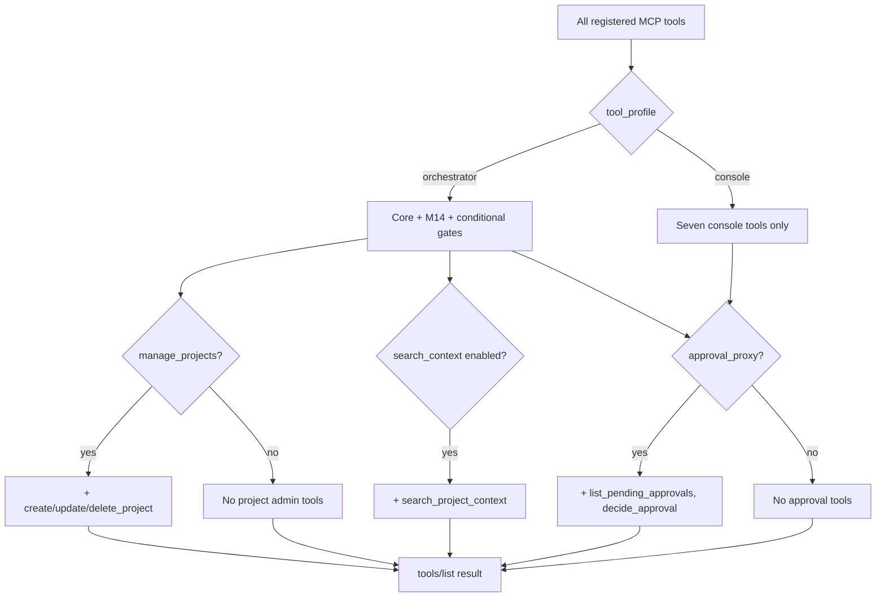

# Per-client `tool_profile` spike (`orchestrator` vs `console`, T14.11), 2026-10-15

- Date: 2026-10-15
- Status: Research input (Delegated agent work, documentation only; not owner-approved). Findings are **Proposed**
  until T14.11 implementation and tests cite them.
- Used by: [ROADMAP](../ROADMAP.md) T14.11, [FR-CTL-11](../requirements/SRS.md), [CAP-15](../requirements/PRD.md),
  [LLD §3.4.10](../design/LLD.md#3410-tool_profile-fr-ctl-11), owner decisions 53 and 55 (Grok bot first chat client;
  Q-92 closed, Q-93 answered).
- Scope: Exact MCP tool names per profile, how `tools/list` scoping composes with existing per-client gates and
  `approval_proxy` ([ADR-0047](../adr/0047-approval-proxy-over-mcp.md)), and UX implications for the Grok bot webhook
  path. No code in this spike.

## Evidence labels

- **Verified (repo):** read in this repository on 2026-10-15.
- **Verified (spec):** requirement or LLD row cited by ID; decision text not restated.
- **Inferred:** author judgement from the sources above.

## Requirement mapping

| ID | What it fixes | This spike |
| --- | --- | --- |
| [FR-CTL-11](../requirements/SRS.md) | Each MCP client has `tool_profile` `orchestrator` (default) or `console` with a closed console tool set | §2 |
| [CAP-15](../requirements/PRD.md) | One chat client watches several projects; `console` tool profile is **Should** | §2, §5 |
| [FR-MCP-01](../requirements/SRS.md), [FR-MCP-02](../requirements/SRS.md) | Base orchestration tools | §2.1 |
| [FR-MCP-06](../requirements/SRS.md) | Per-client max trust profile; runs and projects scoped to the caller | §3 |
| [FR-CTL-01](../requirements/SRS.md), [FR-CTL-02](../requirements/SRS.md) | `list_runs`, `get_digest` with same visibility as `get_run` | §3 |
| [FR-CTL-08](../requirements/SRS.md), [ADR-0047](../adr/0047-approval-proxy-over-mcp.md) | Approval tools only for `approval_proxy` clients | §3 |
| [FR-CTL-10](../requirements/SRS.md), [ADR-0048](../adr/0048-notification-sinks.md) | Metadata-only webhook/ntfy egress (T14.9) | §5 |

Related discovery: [orchestration-layer-discovery §6 rank 9](orchestration-layer-discovery-2026-10-15.md#6-ranked-recommendations-add)
(`console` motivation: fewer tool descriptions per chat turn).

## 1. Configuration shape (Verified spec)

| Field | Values | Owner |
| --- | --- | --- |
| `mcp_clients[].tool_profile` | `orchestrator` (default) or `console` | [TDD §6](../design/TDD.md), [LLD §3.4.10](../design/LLD.md#3410-tool_profile-fr-ctl-11) |

Invalid or unknown values shall refuse config at load (same pattern as `approval_proxy` and `manage_projects` in TDD).
The field is operator configuration only; it is not settable over MCP and is not carried in OAuth tokens ([FR-MCP-14](../requirements/SRS.md)).

**First target client (owner decision 55):** the Grok bot is the first chat/console client for M14; T14.11 and T14.13
acceptance target it before the Claude app and OpenClaw ([ROADMAP §4.2](../ROADMAP.md#42-owner-decisions)).

## 2. Tool lists by profile

Tool **names** below are the MCP `tools/list` identifiers. Schemas stay the published closed JSON Schemas from [LLD §3](../design/LLD.md#3-mcp-tool-contracts)
and §3.4; T14.11 tests require console clients to receive exactly the console set with those schemas.

### 2.1 `orchestrator` — full set (default)

**Meaning (LLD §3.4.10):** unchanged from today's orchestrator-facing surface: every tool the controller would already
offer that client after existing per-client gates, plus the M14 control-plane tools once T14.1–T14.7 land.

#### Core tools (always for every client today — Verified repo)

From [FR-MCP-01](../requirements/SRS.md) and [FR-MCP-02](../requirements/SRS.md); implemented names match
`TOOL_NAMES` in `src/mcp/schemas.ts`:

| Tool | Requirement |
| --- | --- |
| `delegate_task` | FR-MCP-01, FR-MCP-03 |
| `continue_task` | FR-MCP-01 |
| `get_run` | FR-MCP-01, FR-MCP-04 |
| `cancel_run` | FR-MCP-01 |
| `get_artifacts` | FR-MCP-01 |
| `list_capabilities` | FR-MCP-01 |
| `list_projects` | FR-MCP-01, FR-PRJ-03 |
| `get_capacity` | FR-MCP-02 |
| `explain_route` | FR-MCP-02 |

#### Conditional additions (orchestrator only — same rules as today)

These are **not** part of the seven-name console list; they remain orchestrator-profile tools when the client qualifies:

| Tool(s) | Gate | Requirement |
| --- | --- | --- |
| `create_project`, `update_project`, `delete_project` | `mcp_clients[].manage_projects: true` | [FR-PRJ-10](../requirements/SRS.md), [LLD §3](../design/LLD.md#3-mcp-tool-contracts) |
| `search_project_context` | Retrieval enabled for at least one project the client may use | [FR-RAG-06](../requirements/SRS.md), T12.6 |

#### M14 control-plane tools (orchestrator includes them; console subset in §2.2)

Once implemented (T14.1–T14.6, T14.7), the full set also includes:

| Tool | Requirement |
| --- | --- |
| `list_runs` | FR-CTL-01 |
| `get_digest` | FR-CTL-02 |
| `steer_run` | FR-CTL-04 |
| `pause_project`, `resume_project` | FR-CTL-05 |

**Not in MCP:** global pause/resume for all projects stays operator CLI only (FR-CTL-05, T14.6).

#### Approval proxy (orthogonal to profile — Verified spec)

[LLD §3.4.10](../design/LLD.md#3410-tool_profile-fr-ctl-11): when `mcp_clients[].approval_proxy` is true,
`tools/list` **also** includes (for either profile):

| Tool | Requirement |
| --- | --- |
| `list_pending_approvals` | FR-CTL-08, [LLD §3.4.8](../design/LLD.md#348-approval-proxy-tools-fr-ctl-08-adr-0047) |
| `decide_approval` | FR-CTL-08, ADR-0047 |

Clients without `approval_proxy` do not see these tools (absent from the list, not an error at list time) per ADR-0047
item 1 and LLD §3.4.8.

### 2.2 `console` — closed set (FR-CTL-11, LLD §3.4.10)

Exactly these seven tools (pause = both project pause tools):

| Tool | Requirement |
| --- | --- |
| `get_digest` | FR-CTL-02 |
| `list_runs` | FR-CTL-01 |
| `get_run` | FR-MCP-01 (read path) |
| `delegate_task` | FR-MCP-01, FR-MCP-03 |
| `steer_run` | FR-CTL-04 |
| `pause_project` | FR-CTL-05 |
| `resume_project` | FR-CTL-05 |

**Explicitly excluded from console** (orchestrator keeps them): `continue_task`, `cancel_run`, `get_artifacts`,
`list_capabilities`, `list_projects`, `get_capacity`, `explain_route`, dynamic-project tools, `search_project_context`,
and any tool not named above. **Inferred:** a console client that must cancel or continue work does so by steering or
delegating a follow-up task, or the operator uses CLI/`orchestrator` clients; that trade-off matches discovery rank 9
(short descriptions; detail via `get_run` and artifacts on orchestrator paths).

**Console vs orchestrator on `delegate_task`:** the same admission pipeline and trust ceiling ([FR-MCP-06](../requirements/SRS.md))
apply; only the tool surface shrinks.

## 3. How `tools/list` scoping composes (no implementation in this spike)

Think of visibility as **layers** applied at list time and again at call time (T14.11 acceptance: list exactness plus
unchanged orchestrator behaviour):

### 3.1 `tool_profile` (new, T14.11)

- Applied at `tools/list` in COMP-MCP ([LLD §3.4](../design/LLD.md#34-control-plane-m14-proposed-t140)).
- **Proposed (Delegated):** `tools/call` for a name not returned for that client fails closed with `INVALID_REQUEST`
  (or the same pattern used for absent `manage_projects` tools today), so clients cannot call orchestrator-only tools by
  name.

### 3.2 Existing caller scoping (unchanged by profile)

`tool_profile` does **not** widen or narrow **data** inside a listed tool:

| Mechanism | What it limits | Examples |
| --- | --- | --- |
| [FR-MCP-06](../requirements/SRS.md) | `max_trust_profile` on `delegate_task` / continuation | Console cannot raise trust above config |
| `mcp_clients[].projects` | Which configured projects a client may use | `list_projects`, `delegate_task` `project` |
| Run ownership | Runs visible in `get_run`, `list_runs`, digest rows | [FR-CTL-01](../requirements/SRS.md), LLD §3.4.2: caller sees runs it started and runs of projects it may use |
| Dynamic projects | Visible only to creating client | FR-PRJ-10 |
| `manage_projects` | Whether project-admin tools appear at all | Orchestrator only |
| Retrieval config | Whether `search_project_context` exists | Orchestrator only |

[FR-MCP-02](../requirements/SRS.md) is cited on T14.11 because `get_capacity` and `explain_route` are **Must** tools on
the orchestrator profile and are **absent** on console; no new behaviour inside those tools is required for T14.11.

### 3.3 `approval_proxy` (ADR-0047, T14.8)

- **Independent dimension:** LLD §3.4.10 states approval-proxy tools are added when `approval_proxy` is true
  **regardless of profile**.
- A Grok bot entry might use `tool_profile: console` **and** `approval_proxy: true` if the operator wants a small tool
  surface plus proxied approvals under ADR-0047 controls (digest binding, `decided_via: mcp_proxy`, sink announcement).
  That combination is **Proposed** operator wiring, not mandated by FR-CTL-11.
- ADR decision text is not repeated here; see [ADR-0047](../adr/0047-approval-proxy-over-mcp.md) and LLD §3.4.8.

## 4. Switchboard today vs target (Verified repo)

| Topic | As built on `main` (2026-10-15) | After T14.11 |
| --- | --- | --- |
| `tool_profile` config key | Documented in TDD/LLD; **not** in config schema or `tools/list` filter | Filter in `src/mcp/server.ts` (hot file) |
| Tool inventory | Nine core tools + conditional project/search tools | Same for `orchestrator`; seven tools for `console` once M14 tools exist |
| M14 tools | Not on `main` yet (T14.1+) | Console set includes digest/list/steer/pause; orchestrator includes everything |

## 5. Grok bot: webhook path and console UX (metadata only)

Owner decision 53: the operator points a **generic webhook** sink at the Grok bot's deployment-generated URL; Switchboard
ships no Grok-specific sink code ([ROADMAP](../ROADMAP.md) T14.9, [LLD §3.4.9](../design/LLD.md#349-notification-sinks-fr-ctl-10-adr-0048)).
Payload fields are closed to `notification_payload` (project, event kind, reason code, run ID, link) per ADR-0048.

**Interaction with `console` profile (Inferred):**

| Path | Role |
| --- | --- |
| Webhook (T14.9) | Out-of-band **wake**: user gets metadata + link while the chat app is closed; no transcripts or secrets |
| MCP `console` | In-band **control**: `get_digest(since_cursor)` for inbox-style state; `list_runs` / `get_run` for detail; `delegate_task` / `steer_run` / pause for action |
| Orchestrator elsewhere | Coding agents keep `tool_profile: orchestrator` (or default) with `continue_task`, `cancel_run`, routing tools, etc. |

**UX implications:**

1. **Two channels by design.** Chat apps may not hold MCP streams ([discovery §6 rank 2](orchestration-layer-discovery-2026-10-15.md#6-ranked-recommendations-add));
   notifications (T14.9) complement MCP; they do not replace `get_digest`.
2. **Shorter tool list.** Console drops `get_capacity`, `explain_route`, `list_capabilities`, and artifact/cancel/continue
   tools so each Grok turn carries fewer tool definitions (discovery rank 9).
3. **Links.** Sink `link` uses operator `public_url` paths (`/digest`, `/runs/<run_id>`) or `switchboard://run/<run_id>`
   when HTTP is unset (LLD §3.4.9). Fit with the Grok bot's webhook message format remains **Assumption** until operator
   deployment (Q-92 answered for URL source; format check at deploy).
4. **Approvals.** If the bot should approve from chat, that is `approval_proxy` + T14.8, not part of the seven-tool console
   list; consent-page links remain secondary (FR-CTL-09, T14.10).
5. **Trust.** Console still obeys `max_trust_profile` and project lists; digest agent text stays labelled untrusted and
   length-capped (FR-CTL-02, FR-CTL-03).

Cross-read: [MCP 2026-07-28 readiness spike](mcp-2026-07-28-readiness-spike-2026-10-15.md) (subscriptions are not a
substitute for webhook sinks); [adapter steer-input spike](adapter-steer-input-spike-2026-10-15.md) (T14.7 boundary
behaviour for `steer_run`).

## 6. Remaining work (implementation and tests)

| Item | Task | Notes |
| --- | --- | --- |
| Config validation | T14.11 | `tool_profile` enum on `mcp_clients[]` |
| `tools/list` filter | T14.11 | COMP-MCP; preserve orchestrator list exactly |
| `tools/call` guard | T14.11 | Fail closed for tools not listed |
| M14 tool handlers | T14.1–T14.7 | Console set is meaningless until `get_digest`, `list_runs`, etc. exist |
| Acceptance tests | T14.11, T14.13 | Console exact set + schemas; orchestrator unchanged; fake adapters, no provider CLI |
| Grok deployment | Operator | Webhook URL + message format; live-run policy applies only for operator verify |
| ADR acceptance | ROADMAP §6.13 | ADR-0047 and ADR-0048 still **Proposed**; blocks M14 Done |

## 7. Open points (for Linus / zemdregon, not answered here)

- Whether a `console` client with `manage_projects: true` should ever expose project-admin tools (**spec silent**;
  LLD console table lists seven tools only — **Proposed:** ignore `manage_projects` for console profile).
- Default `tool_profile` for a new Grok bot client entry (**Proposed:** `console` for chat wiring;
  `orchestrator` remains default in schema).
