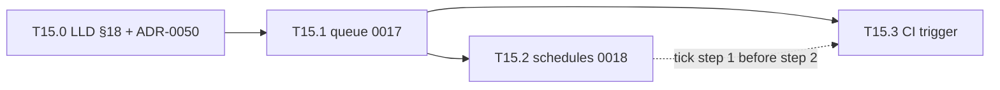
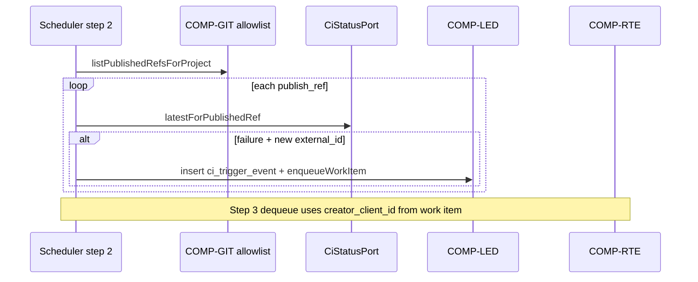

# M15 CI failure trigger spike (T15.3), 2026-10-15

- Date: 2026-10-15
- Status: Research input (Delegated agent work, documentation only; not owner-approved). Normative trigger tables,
  poll behaviour, untrusted text rules and `CiStatusPort` name remain
  [LLD §18.6](../design/LLD.md#186-ci-failure-trigger-fr-que-03-adr-0050) and
  [ADR-0050](../adr/0050-ci-status-via-operator-gh-cli.md) (Proposed; owner decision 54 / Q-91). Enqueued fix-up work
  follows [LLD §18.4](../design/LLD.md#184-admission-through-the-creating-clients-ceiling-fr-que-01) and the
  [T15.1 queue admission spike](m15-queue-admission-spike-2026-10-15.md).
- Used by: [ROADMAP](../ROADMAP.md) T15.3 (implementation plan). Cross-links
  [T15.0](../ROADMAP.md#614-m15-project-queue-schedules-and-ci-triggers-tasks) (design gate),
  [T15.1](m15-queue-admission-spike-2026-10-15.md) (migration **0017**, dequeue admission),
  T15.2 schedules spike (draft [PR #453](https://github.com/zemdregon/switchboard/pull/453);
  scheduler tick step 1 and migration **0018** sequencing; local path
  `docs/research/m15-schedules-spike-2026-10-15.md` lands when that PR merges). Does not restate LLD §18 bodies.
- Scope: `CiStatusPort` and `gh` subprocess boundary, closed argv and JSON field allowlists, published-ref allowlist,
  dedup by stable external ids, `untrusted_external_text` handling, enqueue as T15.1 work items under
  `creator_client_id`, fake-CI-event test matrix (ROADMAP done-when), migration and hot-file sequencing vs **0017** /
  `src/ledger/repo.ts`, explicit non-goals. **No code.**

## Evidence labels

- **Verified (repo):** read in this repository on 2026-10-15.
- **Verified (spec):** requirement, ADR or LLD row cited by ID.
- **Proposed:** module paths, exact `gh` argv templates fixed at implementation and audited per
  [ADR-0037](../adr/0037-argv-audit-short-flags-and-bypass-values.md); not owner-approved until code review.

## Primary sources

| ID | Source | Why it matters |
| --- | --- | --- |
| R1 | [LLD §18.6](../design/LLD.md#186-ci-failure-trigger-fr-que-03-adr-0050) | CI tables, trigger logic, `CiStatusPort`, tests note |
| R2 | [LLD §18.1](../design/LLD.md#181-configuration-operator-defaults) | `ci_trigger.*` operator defaults, poll interval |
| R3 | [LLD §18.7](../design/LLD.md#187-scheduler-integration-comp-rte) | Tick step 2 (CI poll); T15.3 implements step 2 only |
| R4 | [ADR-0050](../adr/0050-ci-status-via-operator-gh-cli.md) | Subprocess-only CI facts; no credential; port for tests |
| R5 | [FR-QUE-03](../requirements/SRS.md#318-project-queue-and-triggers-fr-que) | Published-branch scope; untrusted event text |
| R6 | [FR-QUE-01](../requirements/SRS.md#318-project-queue-and-triggers-fr-que) | Enqueue admits as creating client's `delegate_task` |
| R7 | [HLD TB-15](../design/HLD.md#3-trust-boundaries) | Threat model for forged text and argv exfiltration |
| R8 | [SDD FR-QUE-03 row](../design/SDD.md#5-requirements-to-design-traceability) | COMP-PRJ, COMP-GIT, COMP-RTE, COMP-LED collaboration |
| R9 | [T15.1 spike](m15-queue-admission-spike-2026-10-15.md) | `project_work_item`, admission pipeline, scheduler step 3 |
| R10 | [LLD §12.3](../design/LLD.md#123-commit-algorithm-and-refs) | Publish refs and successful `git_push` definition |
| R11 | [ADR-0003](../adr/0003-no-credential-handling.md) | No `GH_TOKEN` / token read for CI |

## Dependency graph



**Verified (spec):** T15.3 depends on **T15.1** (enqueue + admission) and **T15.0** (design). Scheduler ordering:
schedules (T15.2 step 1) → CI poll (T15.3 step 2) → queue dequeue (T15.1 step 3)
([LLD §18.7](../design/LLD.md#187-scheduler-integration-comp-rte)).

T15.3 code must not land before migration **0017** is on `main` ([T15.1 spike](m15-queue-admission-spike-2026-10-15.md)).

## `CiStatusPort` and subprocess boundary

**Verified (spec):** [ADR-0050](../adr/0050-ci-status-via-operator-gh-cli.md) and [LLD §18.6](../design/LLD.md#186-ci-failure-trigger-fr-que-03-adr-0050).

### Port contract (Proposed)

Production and tests share one narrow interface; only the production adapter spawns `gh`.

```typescript
// Proposed: src/ci/ci-status-port.ts (name illustrative)

export type CiConclusion = "success" | "failure" | "cancelled" | "timed_out" | "skipped" | "neutral" | "pending";

export type CiStatusObservation = {
  /** Stable host id for dedup — workflow run databaseId or check run databaseId (stringified). */
  externalId: string;
  conclusion: CiConclusion;
  /** refs/heads/... tip that was evaluated; must match publish-ref allowlist entry. */
  publishRef: string;
  /** Tip commit SHA (40 hex) at observation time; for audit only, not dedup key. */
  headSha: string;
};

export type CiStatusPort = {
  /**
   * Latest actionable CI state for one published ref's tip commit.
   * Returns null when no workflow/check applies or conclusion is not yet terminal.
   * Throws CiStatusError with reason AUTH_REQUIRED | GH_FAILED | PARSE_FAILED (no raw stderr in error.message).
   */
  latestForPublishedRef(input: {
    owner: string;
    repo: string;
    publishRef: string; // refs/heads/name
    headSha: string;
  }): Promise<CiStatusObservation | null>;
};
```

| Boundary rule | Enforcement |
| --- | --- |
| No GitHub HTTP from Switchboard | Only `spawn(gh, argv, { shell: false })` via existing run supervisor pattern ([`src/exec/supervisor.ts`](../../src/exec/supervisor.ts)) |
| No credential import | Do not set `GH_TOKEN`, `GITHUB_TOKEN`, or read netrc; inherit operator OS user env only ([ADR-0050](../adr/0050-ci-status-via-operator-gh-cli.md)) |
| No shell | Argv array only; branch names and SHAs are separate argv cells |
| No provider overlap | `gh` invocations live outside adapter modules; adapters keep FR-GIT-01 "no `gh` in argv" tests |
| Tests | `FakeCiStatusPort` in test harness; CI never executes real `gh` |
| Operator verify | Real `gh` only via operator host procedures outside CI ([AGENTS.md](../../AGENTS.md) live-run policy does not apply to `gh`; optional manual `doctor` check **Proposed**) |

### `GhCiStatusPort` (production adapter)

**Proposed wiring:**

1. Resolve `owner/repo` once per project per tick from the Git remote URL via read-only
   `git config remote.<name>.url` in the project worktree (same class of local `git` reads as COMP-GIT; no network
   credential in Switchboard).
2. For each allowlisted `publish_ref`, resolve tip SHA via read-only `git rev-parse <short-ref>` (local).
3. Call `CiStatusPort.latestForPublishedRef`.
4. Map `AUTH_REQUIRED` from `gh` exit code / stderr class to trigger error telemetry; **no enqueue**.

## Closed `gh` argv allowlist

**Verified (spec):** Only allowlisted subcommands ([ADR-0050](../adr/0050-ci-status-via-operator-gh-cli.md));
exact templates fixed in implementation and covered by argv audit tests (**Proposed**, mirror provider audit in
`src/adapters/audit.ts` or a sibling `src/ci/gh-argv.ts`).

### Allowed invocations (exhaustive plan)

All invocations use `ci_trigger.gh_binary` from config (default `"gh"`, resolved at `serve` startup). Each row is one spawn;
`{owner}`, `{repo}`, `{branch}`, `{sha}` are validated before argv construction (`owner`/`repo` from remote parse;
`branch` without `refs/heads/` prefix; `sha` matches `/^[0-9a-f]{40}$/i`).

| ID | argv template | Purpose |
| --- | --- | --- |
| G1 | `gh`, `run`, `list`, `--repo`, `{owner}/{repo}`, `--branch`, `{branch}`, `--limit`, `1`, `--json`, `databaseId,conclusion,headBranch,status,headSha` | Primary: latest workflow run on published branch |
| G2 | `gh`, `run`, `view`, `{runDatabaseId}`, `--repo`, `{owner}/{repo}`, `--json`, `databaseId,conclusion,status` | Confirm terminal conclusion when G1 returns `status=completed` |
| G3 | `gh`, `api`, `repos/{owner}/{repo}/commits/{sha}/check-runs`, `--paginate`, `--jq`, `{jq_filter}` | Fallback when G1 returns empty and project config enables check-run path (**Proposed** feature flag `ci_trigger.use_check_runs_fallback`, default off) |

**Forbidden (must fail closed in builder and audit tests):**

- `gh auth`, `gh login`, `gh secret`, `gh api` with any path not exactly matching G3 template (no user-supplied path segments).
- Shell metacharacters, `-c`, `$(...)`, or string interpolation into a single argv word for branch or SHA.
- Environment overrides that inject tokens for the child process.
- Any `gh` subcommand not listed in the table above.

**`jq_filter` for G3 (fixed string in code, not configurable):** select the latest completed check run on the commit, e.g.
`.check_runs | map(select(.status==\"completed\")) | sort_by(.completed_at) | last | {databaseId, conclusion}` — exact
filter committed in `gh-argv.ts` and snapshot-tested.

### Closed JSON field allowlist

Parse only these keys from `gh --json` or G3 `jq` output; ignore all other properties.

| Source command | Allowed fields | Maps to |
| --- | --- | --- |
| G1 / G2 | `databaseId`, `conclusion`, `headBranch`, `status`, `headSha` | `externalId` ← string(`databaseId`); `conclusion`; verify `headBranch` matches `{branch}` |
| G3 jq object | `databaseId`, `conclusion` | `externalId`; `conclusion` |

**Conclusions that may enqueue** (per [LLD §18.6](../design/LLD.md#186-ci-failure-trigger-fr-que-03-adr-0050)):
`failure`, `cancelled`, `timed_out` only. Treat `success`, `skipped`, `neutral`, `pending` and missing/`null` as no enqueue.

**Free-text discard:** Do not copy `name`, `title`, `display_title`, log URLs or workflow names into ledger, MCP,
prompts or notifications ([ADR-0050](../adr/0050-ci-status-via-operator-gh-cli.md) structured output only).

## Published-ref allowlist

**Verified (spec):** [LLD §18.6 published branch](../design/LLD.md#186-ci-failure-trigger-fr-que-03-adr-0050) and
[§12.3](../design/LLD.md#123-commit-algorithm-and-refs).

### Definition (implementation query plan)

A ref is eligible for CI polling when **all** hold:

1. **Kind:** `publish_ref` is `refs/heads/*` (not tags, not `refs/remotes/*`).
2. **Project binding:** An ACCEPTED `git_push` row exists for that ref whose run's `policy_snapshot_json.project.id`
   equals the trigger's `project_id`, and the push outcome was success (same rules as "published" in LLD §18.6).
3. **Current tip:** Tip SHA comes from local `git rev-parse` in the project context (COMP-PRJ / COMP-GIT), not from
   notification text.

**Proposed helper:** `listPublishedRefsForProject(projectId): { publishRef, headSha }[]` in COMP-GIT or COMP-PRJ,
backed by ledger `git_push` + live ref tip; cache per tick only.

| Case | Behaviour |
| --- | --- |
| Branch never pushed by Switchboard for this project | Out of scope; CI poll skips |
| Push failed or withheld | Ref not on allowlist |
| Operator pushes outside Switchboard | Out of scope until a successful Switchboard `git_push` recorded |
| Multiple heads over time | Allowlist is set of refs ever successfully published; tip is current SHA |

## Dedup keys (stable ids, not message text)

**Verified (spec):** [ADR-0050](../adr/0050-ci-status-via-operator-gh-cli.md) item 3;
[LLD §18.6](../design/LLD.md#186-ci-failure-trigger-fr-que-03-adr-0050) `ci_trigger_event.UNIQUE (project_id, external_id)`.

| Field | Source | Never use for dedup |
| --- | --- | --- |
| `external_id` | `databaseId` from G1/G2/G3 JSON | Notification body, commit message, check name, log excerpt |
| `project_id` | Switchboard project | Branch name alone (without project) |
| `publish_ref` | Allowlist row | — |

**Algorithm (Proposed):**

1. After `CiStatusPort` returns a failing terminal conclusion, compute `external_id = String(databaseId)`.
2. `INSERT` `ci_trigger_event` in the same transaction as `enqueueWorkItem`; unique violation → no second work item.
3. Restart mid-transaction: rely on SQLite transaction; if event row exists without `work_item_id`, reconciliation job
   **Proposed** completes or deletes orphan event (implementation choice; prefer complete enqueue once).

Optional operator-forwarded notification must not supply `external_id`; if present in a file, ignore for dedup and still
require `gh` observation.

## Untrusted external text (`untrusted_external_text`)

**Verified (spec):** [ADR-0050](../adr/0050-ci-status-via-operator-gh-cli.md) item 4;
[LLD §18.6](../design/LLD.md#186-ci-failure-trigger-fr-que-03-adr-0050) `untrusted_summary` and `{{ci_untrusted_summary}}`.

| Rule | Plan |
| --- | --- |
| Storage | `ci_trigger_event.untrusted_summary` max **500** chars; metadata label `untrusted_external_text` on read paths |
| Admission authority | **Never** — enqueue requires failed/cancelled/timed_out conclusion from `CiStatusPort` on allowlisted ref |
| Policy | Text does not select profile, ceiling, provider, or bypass; no parsing for instructions |
| Prompts | Not copied into `delegate_task` objective unless template contains explicit `{{ci_untrusted_summary}}`; substitute through same `untrusted_text` wrapper as [LLD §3.4.1](../design/LLD.md#341-shared-types) |
| Ingress **Proposed** | Operator CLI `switchboard ci note --project … --file …` or env-free file path argument; no HTTP listener in M15 |
| Normalisation | NFC trim; strip NUL; truncate with ellipsis; redact token-shaped substrings (NFR-SEC-01) |

**Test focus:** A crafted summary claiming "CI failed" without a matching `FakeCiStatusPort` observation must not enqueue.

## Admission as T15.1 queue items (creator ceiling)

**Verified (spec):** [LLD §18.6](../design/LLD.md#186-ci-failure-trigger-fr-que-03-adr-0050) trigger step 2;
[LLD §18.4](../design/LLD.md#184-admission-through-the-creating-clients-ceiling-fr-que-01).

When a new `ci_trigger_event` row is inserted:

1. Build `request_json` from `project_ci_trigger.template_json` (delegate_task shape frozen at enable time).
2. Insert `project_work_item` with `source_kind = 'ci_trigger'`, `source_id = cie_*`, `creator_client_id` from
   `project_ci_trigger.creator_client_id` (client that enabled the trigger — not the OS user).
3. On the same scheduler tick, step 3 dequeues through [T15.1 admission](m15-queue-admission-spike-2026-10-15.md):
   ceiling, pause, FR-CAP-04, ADR-0030 widening gates unchanged.



| ROADMAP done-when theme | Plan |
| --- | --- |
| Only published branches | Negative tests: unpublish ref, wrong project push, `refs/tags/*` |
| Creator ceiling | Lower client ceiling after enable → `FAILED_ADMISSION` on dequeue, not widened trigger |
| No credential in Switchboard | Static scan: no `GH_TOKEN` reads; spawn env allowlist unchanged |

## Forward migration and ledger helpers

**Verified (spec):** [LLD §18.6](../design/LLD.md#186-ci-failure-trigger-fr-que-03-adr-0050) assigns CI DDL to migration
**0018** alongside schedules. **Proposed sequencing** (aligned with T15.2 schedules spike approach A on
[PR #453](https://github.com/zemdregon/switchboard/pull/453)):

| Migration | Contents | Task |
| --- | --- | --- |
| **0017** | `project_work_item`, dependencies | T15.1 |
| **0018** | `project_schedule` only | T15.2 ([PR #453](https://github.com/zemdregon/switchboard/pull/453)) |
| **0019** | `project_ci_trigger`, `ci_trigger_event` | T15.3 implementation |

T15.3 implementation PR should update LLD §18.5/18.6 migration numbers if **0019** is adopted (documentation-only follow-up
in the same PR as `0019` code).

### Ledger helpers (`src/ledger/repo.ts`) — Proposed

| Helper | Responsibility |
| --- | --- |
| `upsertCiTriggerConfig(...)` | Enable/disable per project; store `template_json`, `creator_client_id` |
| `insertCiTriggerEvent(...)` | Dedup via `UNIQUE (project_id, external_id)` |
| `linkCiEventToWorkItem(...)` | Set `work_item_id` after enqueue |
| `getCiTriggerForProject(...)` | Poll gate: `enabled` and template |

**Serial with T15.1** queue helpers on `repo.ts` ([T15.1 hot files](m15-queue-admission-spike-2026-10-15.md#implementation-order-and-hot-files)).

## Scheduler integration (T15.3 slice)

**Verified (spec):** [LLD §18.7](../design/LLD.md#187-scheduler-integration-comp-rte) step 2.

**Proposed:**

- `pollCiTriggers(now)` in `src/ci/trigger.ts` (or `src/queue/ci-trigger.ts`) called from the same `schedulerTick()` as
  T15.1/T15.2.
- Respect `ci_trigger.enabled` (operator) and `project_ci_trigger.enabled` (per project).
- Skip when `poll_interval_seconds` is 0 or master disabled.
- Skip project when paused (FR-CTL-05).
- Do not run inside MCP handler.

## Fake-CI-event test matrix (T15.3 done-when)

Use `FakeCiStatusPort` and synthetic ledger fixtures only; no real `gh` in CI
([LLD §18.6 tests](../design/LLD.md#186-ci-failure-trigger-fr-que-03-adr-0050)).

| # | Scenario | Fake port / setup | Expected |
| --- | --- | --- | --- |
| C1 | Failure on published ref | `conclusion=failure`, new `databaseId` | One `ci_trigger_event`, one `project_work_item`, `source_kind=ci_trigger` |
| C2 | Success on published ref | `conclusion=success` | No event, no enqueue |
| C3 | Unpublished branch | Port returns failure for ref not in allowlist | No poll call or no enqueue (allowlist empty) |
| C4 | Dedup same `databaseId` | Two polls same id | Single event row; single work item |
| C5 | Dedup differs by id only | Same notification text, different `databaseId` | Two events if both failures (text not dedup key) |
| C6 | Untrusted summary alone | Summary "fail" + port `success` | No enqueue |
| C7 | Untrusted summary with real failure | Summary 600 chars + port `failure` | Stored ≤500; labelled untrusted; enqueue from port only |
| C8 | Summary never authorises | Summary says "approve privileged" + port `success` | No enqueue; no bypass |
| C9 | `{{ci_untrusted_summary}}` template | Failure + summary | Objective contains wrapped untrusted block only when token present |
| C10 | Creator ceiling | Enable under client A; lower A's ceiling; dequeue | `FAILED_ADMISSION`; trigger does not widen |
| C11 | Trigger disabled | `enabled=0` on `project_ci_trigger` | No port calls |
| C12 | Operator master off | `ci_trigger.enabled=false` | No port calls |
| C13 | AUTH_REQUIRED | Port throws `AUTH_REQUIRED` | No enqueue; error recorded (**Proposed** `doctor`/`list` surfacing) |
| C14 | Restart after event insert | Event committed, crash before work item | Reconciliation completes or idempotent enqueue (**Proposed** hook) |
| C15 | No credential | Spawn stub records env | Child env has no injected `GH_TOKEN`/`GITHUB_TOKEN` |
| C16 | Argv audit | Compile all G1–G3 templates | Only allowlisted argv; no shell |
| C17 | JSON hardening | Fixture with extra keys and injection in `title` | Parser ignores extras; no title in ledger |
| C18 | FR-CAP-04 | Failure + ingress full | Event may be recorded; work item `READY` after admission backpressure (via step 3) |

**Proposed test paths:** `src/ci/ci-trigger.test.ts`, `src/ledger/ledger.test.ts` (migration 0019), extend scheduler
integration test when `schedulerTick()` exists.

## Implementation order and hot files

**Task order:** T15.0 (Done) → T15.1 (**0017**) → T15.2 (**0018**, optional before T15.3) → **T15.3** (**0019** + port).

| Hot file | T15.3 touch | Serial with |
| --- | --- | --- |
| `src/ledger/migrations/0019_*.ts`, `migrations/index.ts` | CI tables | T15.2 **0018** (strict version order) |
| `src/ledger/repo.ts` | CI trigger helpers | T15.1 queue slice, M14/M5 lanes |
| `src/cli/serve.ts` / scheduler | Step 2 hook | T15.1 step 3, T15.2 step 1 |
| `src/config/schema.ts` | `ci_trigger.*` keys | Low contention |
| `src/ci/gh-argv.ts`, `gh-ci-status-port.ts` | New module | Independent of `src/adapters/**` |

**Do not edit (parallel lanes, 2026-10-15):** `src/adapters/**`, `src/inner/**`, `test/**` owned by other workers.

**Recommended waves (Proposed):**

1. Migration **0019** + repo helpers + ledger tests.
2. `CiStatusPort` fake + trigger logic unit tests (matrix C1–C8, C15–C17).
3. `GhCiStatusPort` + argv audit + scheduler wiring.
4. Operator CLI enable/disable/list (**Proposed** `switchboard ci-trigger …`, FR-OPS-01 pattern).

## Explicit non-goals (M15 / T15.3)

| Non-goal | Rationale |
| --- | --- |
| Inbound HTTP(S) API or GitHub webhooks to Switchboard | [ADR-0050](../adr/0050-ci-status-via-operator-gh-cli.md) rejected for M15; FR-SUB-01 stays Deferred |
| Reading `GH_TOKEN`, `GITHUB_TOKEN`, netrc or `gh` credential store | [ADR-0003](../adr/0003-no-credential-handling.md) |
| Direct GitHub REST/GraphQL from the controller | ADR-0050 subprocess-only |
| Trusting notification or webhook body for admission | FR-QUE-03 untrusted text |
| CI on unpublish branches or forks | LLD §18.6 published-branch definition |
| Provider adapter changes | Parallel lanes own `src/adapters/**` |
| Real `gh` in CI or unit tests | ADR-0050 item 6 |

## Open items for Linus / implementation PR

- Confirm migration **0019** vs combined **0018** when T15.2 merges ([PR #453](https://github.com/zemdregon/switchboard/pull/453)).
- Whether G3 check-run fallback ships in v1 or stays behind `use_check_runs_fallback` default off.
- Operator ingress for `untrusted_summary` (CLI only vs deferred).
- `doctor` checks: `gh` on PATH, auth hint without scraping tokens (**Proposed**).

## CI and done-when checklist (T15.3 code task)

- [ ] Fake `CiStatusPort` matrix C1–C18 (minimum C1–C8, C10, C15 per ROADMAP)
- [ ] Published-ref allowlist negative cases (C3)
- [ ] Dedup by `external_id` only (C4–C5)
- [ ] Untrusted summary length and non-authority (C6–C8)
- [ ] No credential handling static checks (C15)
- [ ] `node scripts/check-docs.mjs` if LLD migration numbers updated
- [ ] Full `npm test`; no real `gh` in CI
