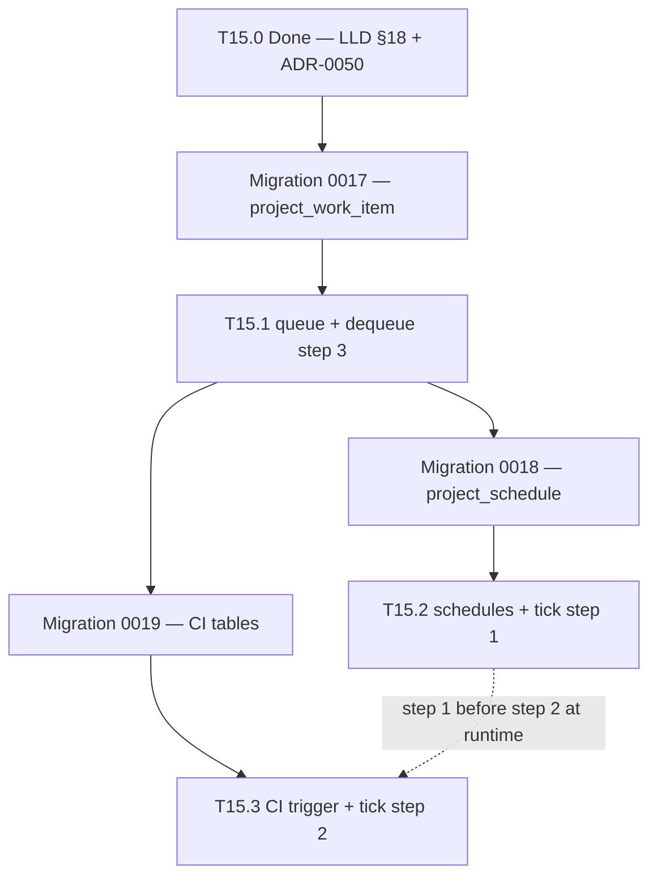

# M15 implementation sequencing, 2026-10-15

Merged as [PR #460](https://github.com/zemdregon/switchboard/pull/460).

- Roadmap §6.14 cross-links to this note: merged [PR #463](https://github.com/zemdregon/switchboard/pull/463).

- Date: 2026-10-15
- Status: Research input (Delegated agent work, documentation only; not owner-approved). This note **orders**
  implementation waves and hot files; normative shapes, scheduler steps and trust rules remain
  [LLD §18](../design/LLD.md#18-project-queue-schedules-and-ci-triggers-m15-proposed-t150) (T15.0) and
  [ADR-0050](../adr/0050-ci-status-via-operator-gh-cli.md) (Proposed).
- Used by: [ROADMAP](../ROADMAP.md) M15 row and [§6.14](../ROADMAP.md#614-m15-project-queue-schedules-and-ci-triggers-tasks)
  (T15.1–T15.3 implementation). Cross-links task spikes only; does not restate spike bodies:
  [T15.1 queue admission](m15-queue-admission-spike-2026-10-15.md),
  [T15.2 schedules](m15-schedules-spike-2026-10-15.md),
  [T15.3 CI trigger](m15-ci-trigger-spike-2026-10-15.md) (merged [PR #454](https://github.com/zemdregon/switchboard/pull/454)).
- Scope: Migration order **0017** → **0018** → **0019**, task order queue (T15.1) before schedules (T15.2) before CI
  trigger (T15.3), consolidated hot files per [LLD §18.7](../design/LLD.md#187-scheduler-integration-comp-rte), Done-when
  test-matrix pointers, explicit deferrals. **No code.**

## Evidence labels

- **Verified (spec):** requirement or LLD row cited by ID.
- **Verified (research):** merged T15.1–T15.3 plan spikes on `main` as of 2026-10-15.
- **Proposed:** PR split, module paths, or migration numbering follow-ups until implementation lands.

## Task and migration order (canonical)

**Verified (spec):** Scheduler tick order is schedules (step 1) → CI poll (step 2) → queue dequeue (step 3)
([LLD §18.7](../design/LLD.md#187-scheduler-integration-comp-rte)). **Implementation land order** still serialises
**ledger and admission foundations first**:

| Wave | Migration | Task | Delivers (summary) | Must follow |
| --- | --- | --- | --- | --- |
| 1 | **0017** | **T15.1** | Queue tables, `repo.ts` queue helpers, dequeue/admission under `creator_client_id`, scheduler **step 3** | T15.0; soft: T14.1 for `list_work` scoping ([T15.1 spike](m15-queue-admission-spike-2026-10-15.md)) |
| 2 | **0018** | **T15.2** | `project_schedule`, fire-to-queue, operator schedule CLI, scheduler **step 1** | **0017** on `main` ([T15.2 spike](m15-schedules-spike-2026-10-15.md)) |
| 3 | **0019** | **T15.3** | `project_ci_trigger`, `ci_trigger_event`, `CiStatusPort`, scheduler **step 2** | **0017** on `main`; **0018** before **0019** append; T15.2 step 1 wired before relying on step 2 in integration tests |

**Proposed:** T15.3 uses migration **0019** for CI DDL while **0018** stays schedule-only (approach A in the T15.2 and
T15.3 spikes). A single combined **0018** remains possible but blocks independent T15.2 merge; prefer **0018** + **0019**.

**Verified (research):** T15.3 must not ship before **0017** ([T15.1 spike](m15-queue-admission-spike-2026-10-15.md));
enqueue always flows through T15.1 `project_work_item` + creator ceiling ([LLD §18.4](../design/LLD.md#184-admission-through-the-creating-clients-ceiling-fr-que-01)).

## Implementation waves (per task)

Each wave list is the **recommended PR sequence** inside the task; details and helper names live in the task spike.

### T15.1 waves ([spike](m15-queue-admission-spike-2026-10-15.md#implementation-order-and-hot-files))

1. Migration **0017** + ledger tests + `repo.ts` queue helpers (no scheduler).
2. Internal admission + dequeue tick (step 3) + `ADMITTING` reconciliation (fake adapter).
3. MCP `enqueue_work` / `list_work` / `cancel_work` (after T14.1 scoping or shared helper).
4. Operator `switchboard queue list|cancel` (optional same PR as MCP).

### T15.2 waves ([spike](m15-schedules-spike-2026-10-15.md#implementation-order-and-hot-files))

1. Migration **0018** + schedule `repo.ts` helpers + ledger tests.
2. `fireDueSchedules` + injected-clock scenarios (matrix **S1–S6** minimum).
3. CLI `schedule list|disable|enable|approve`.
4. MCP create (+ widening) with T15.1 dequeue enabled (**S9–S11**).

### T15.3 waves ([spike](m15-ci-trigger-spike-2026-10-15.md#implementation-order-and-hot-files))

1. Migration **0019** + CI `repo.ts` helpers + ledger tests.
2. `FakeCiStatusPort` + trigger logic (**C1–C8**, **C15–C17**).
3. `GhCiStatusPort` + argv audit + scheduler step 2 wiring.
4. Operator `ci-trigger` CLI (FR-OPS-01 pattern).

## Hot files (one serial editor per file)

Consolidated from T15.1–T15.3 spikes and [LLD §18.7](../design/LLD.md#187-scheduler-integration-comp-rte). Queue,
schedule and CI modules all touch the same scheduler hook and `src/ledger/repo.ts`.

| Hot file | Tasks | Notes |
| --- | --- | --- |
| `src/ledger/migrations/0017_*.ts`, `0018_*.ts`, `0019_*.ts`, `migrations/index.ts` | T15.1 → T15.2 → T15.3 | Strict version order; append-only |
| `src/ledger/repo.ts` | T15.1, T15.2, T15.3 | Queue slice first, then schedule CRUD/fire, then CI helpers — **rebase serially** |
| `src/lifecycle/lifecycle.ts` | T15.1 | Admission entry, run terminal → work item `DONE` |
| `src/cli/serve.ts` | T15.1–T15.3 | Shared `schedulerTick()`: step 1 (T15.2) → step 2 (T15.3) → step 3 (T15.1) |
| `src/lifecycle/` or `src/queue/scheduler.ts` (**Proposed**) | T15.1–T15.3 | Single module owns tick ordering |
| `src/mcp/server.ts` | T15.1, T15.2 | Queue and schedule tools; after T14.1 patterns |
| `src/config/schema.ts`, `load.ts` | T15.1–T15.3 | `queue.*`, schedule keys, `ci_trigger.*` |
| `src/cli/commands/schedule*.ts` | T15.2 | list / disable / enable / approve |
| `src/ci/gh-argv.ts`, `gh-ci-status-port.ts` (**Proposed**) | T15.3 | Subprocess boundary only; no `src/adapters/**` |

**Do not edit (parallel worker lanes, 2026-10-15):** `src/adapters/**`, `src/inner/**`, `test/**` owned by other slots;
feature tests live in `src/**/*.test.ts` beside modules.

**Verified (ROADMAP):** M14 documents hot-file serialisation ([§6.13](../ROADMAP.md#613-m14-control-plane-tasks)); this
note is the M15 counterpart for §6.14 implementers.

## Done-when test matrices (cross-links)

ROADMAP T15.1–T15.3 done-when clauses map to named matrices in the spikes; implementation PRs should cite these
sections, not duplicate tables here.

| Task | ROADMAP done-when theme | Matrix (owner) | Minimum CI subset |
| --- | --- | --- | --- |
| T15.1 | Migration fresh/upgrade; creator ceiling; dynamic project gate; restart (NFR-REL-01) | [Q1–Q10](m15-queue-admission-spike-2026-10-15.md#restart-idempotency-and-nfr-rel-01-test-plan) | Q1–Q3, creator ceiling, migration tests |
| T15.2 | Inert until enabled; one item per due time; no duplicate after restart; disable; widening approval | [S1–S12](m15-schedules-spike-2026-10-15.md#injected-clock-test-matrix) | S1–S6, S4 restart dedup, S6 disable |
| T15.3 | Published branches only; untrusted text; no credential; fake CI event | [C1–C18](m15-ci-trigger-spike-2026-10-15.md#fake-ci-event-test-matrix-t153-done-when) | C1–C8, C10, C15 per ROADMAP; C3 published-ref negatives |

Use fake adapters, `FakeCiStatusPort`, and injected clocks only in automated tests.

## Explicit deferrals and non-goals

| Deferral | Rationale |
| --- | --- |
| **No real `gh` in CI or unit tests** | [ADR-0050](../adr/0050-ci-status-via-operator-gh-cli.md) item 6; T15.3 matrix uses `FakeCiStatusPort` only |
| **No live `gh` subprocess in CI jobs** | Operator host may run `gh` at runtime; CI must not depend on GitHub auth or CLI install |
| **No `GH_TOKEN` / credential read** | [ADR-0003](../adr/0003-no-credential-handling.md) |
| **No inbound GitHub webhooks / FR-SUB-01** | [ADR-0050](../adr/0050-ci-status-via-operator-gh-cli.md); narrowed CI fix-up is T15.3 poll only |
| **No `src/adapters/**` changes for M15** | Parallel adapter lanes; CI trigger is `src/ci/*` + ledger |
| **Opt-in operator `gh` smoke** | Outside CI; not a T15.3 done-when gate |

Full T15.3 non-goal table: [spike §Explicit non-goals](m15-ci-trigger-spike-2026-10-15.md#explicit-non-goals-m15--t153).

## M15 `Done` gate (reminder)

**Verified (ROADMAP):** M15 row acceptance stays: creator ceiling on queue items; schedules only when enabled; CI trigger
only on published branches with untrusted event text. Implementation is **Planned** until T15.1–T15.3 code tasks land
with the matrices above and `npm test` green without provider CLIs or live `gh`.

## Open items for Linus / implementation PRs

- Confirm **0019** vs combined **0018** when schedule PR merges (spikes default **0018** schedule-only).
- Shared `schedulerTick()` module path (`src/queue/` vs `src/lifecycle/scheduler.ts`).
- Whether `project_work_event` ships in **0017** ([T15.1 spike](m15-queue-admission-spike-2026-10-15.md)).
- Operator-only `gh` doctor checks without token scraping ([T15.3 spike](m15-ci-trigger-spike-2026-10-15.md)).
