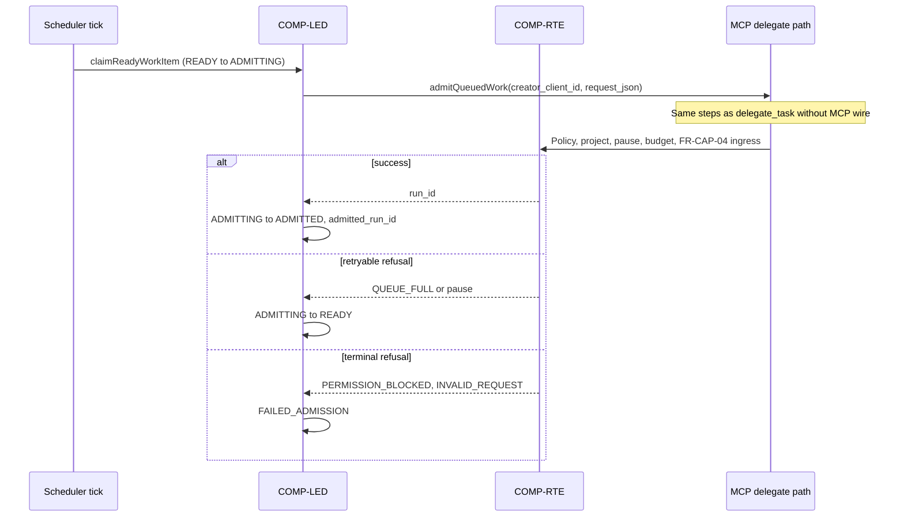

# M15 queue admission spike (T15.1), 2026-10-15

- Date: 2026-10-15
- Status: Research input (Delegated agent work, documentation only; not owner-approved). Normative table shapes,
  state machine and admission rules remain [LLD §18](../design/LLD.md#18-project-queue-schedules-and-ci-triggers-m15-proposed-t150)
  (T15.0). CI external-input boundary: [ADR-0050](../adr/0050-ci-status-via-operator-gh-cli.md) (Proposed; T15.3).
- Used by: [ROADMAP](../ROADMAP.md) T15.1 (implementation plan), T15.2–T15.3 (enqueue sources). Cross-links
  [T15.0 Done evidence](../ROADMAP.md#614-m15-project-queue-schedules-and-ci-triggers-tasks) only; does not restate
  LLD §18 bodies.
- Scope: Forward migration **0017**, ledger helpers, dequeue admission through the existing `delegate_task` pipeline under
  `creator_client_id`, MCP `enqueue_work` / `list_work` / `cancel_work`, scheduler tick hook (queue leg only), restart and
  idempotency tests (NFR-REL-01), dependency on T14.1 `list_runs` scoping, and hot-file sequencing vs `src/ledger/repo.ts`.
  **No code.**

## Evidence labels

- **Verified (repo):** read in this repository on 2026-10-15.
- **Verified (spec):** requirement or LLD row cited by ID.
- **Proposed:** file names, helper splits, or test choreography not fixed until T15.1 implementation lands.

## Primary sources

| ID | Source | Why it matters |
| --- | --- | --- |
| R1 | [LLD §18.2–18.4](../design/LLD.md#182-queue-work-item-record-fr-que-01) | Queue tables, states, admission through creator ceiling |
| R2 | [LLD §18.7](../design/LLD.md#187-scheduler-integration-comp-rte) | Scheduler tick ordering; T15.1 implements dequeue step 3 only |
| R3 | [ADR-0050](../adr/0050-ci-status-via-operator-gh-cli.md) | CI trigger is out of T15.1; boundary for T15.3 |
| R4 | [FR-QUE-01](../requirements/SRS.md#318-project-queue-and-triggers-fr-que) | Durable queue; admission as creator's `delegate_task` |
| R5 | [FR-PRJ-10](../requirements/SRS.md#312-projects-and-contexts-fr-prj) | Dynamic project approval and creator-only visibility |
| R6 | [FR-MCP-03](../requirements/SRS.md#31-mcp-interface-fr-mcp) | `delegate_task` admission path to reuse |
| R7 | [FR-CAP-04](../requirements/SRS.md#38-capacity-scheduling-and-resilience-fr-cap) | Bounded run ingress; `QUEUE_FULL` leaves work item `READY` |
| R8 | [NFR-REL-01](../requirements/SRS.md#42-reliability-nfr-rel) | Restart consistency for queued and admitting items |
| R9 | [LLD §3.4.2](../design/LLD.md#342-list_runs-fr-ctl-01) | Caller scoping model for `list_work` (T14.1) |
| R10 | [ADR-0005](../adr/0005-sqlite-ledger.md) | Forward-only migrations; checksum in `schema_migrations` |
| R11 | [ADR-0030](../adr/0030-dynamic-project-revisions-and-approval.md) | Widening dynamic projects before admission |

## Distinction: project work queue vs FR-CAP-04 ingress

**Verified (spec):** [LLD §18 intro](../design/LLD.md#18-project-queue-schedules-and-ci-triggers-m15-proposed-t150)
separates the
M15 **project work queue** (pending objectives persisted as `project_work_item`) from the **run-admission** bounded queue
while a run is `QUEUED` (FR-CAP-04). Dequeue still flows through the normal lifecycle admission path; a full ingress queue
returns `QUEUE_FULL` and the work item stays `READY` for a later tick ([LLD §18.3](../design/LLD.md#183-priority-and-dependencies-fr-que-01)).

## Forward migration 0017 (outline)

**Verified (repo):** Latest released migration is **0016** (`handoff_condense_artifact`) in
`src/ledger/migrations/index.ts`. **Next free number: 0017** ([LLD §18.2](../design/LLD.md#182-queue-work-item-record-fr-que-01)).

### Deliverables (implementation task)

| Step | Path / action | Notes |
| --- | --- | --- |
| 1 | `src/ledger/migrations/0017_project_work_queue.ts` | Export `sql` string; header cites FR-QUE-01, LLD §18.2–18.3, ADR-0005 |
| 2 | Append to `MIGRATIONS` in `src/ledger/migrations/index.ts` | `{ version: 17, name: "project_work_queue", sql }` |
| 3 | `src/ledger/ledger.test.ts` | Fresh DB at 17; upgrade from 16 with fixture rows preserved on unrelated tables |
| 4 | `Ledger` helpers in `src/ledger/repo.ts` | See §Ledger helpers below |

### SQL scope (cite LLD; do not duplicate full DDL here)

Migration **0017** creates exactly what T15.0 locked in LLD §18.2:

- `project_work_item` (mutable columns: `state`, `admitted_run_id`, `terminal_at`, `updated_at`, `last_error_code`)
- `project_work_dependency` (insert-only edges)
- Indexes `project_work_item_project_state_prio` and partial unique `project_work_item_creator_idem`

**Proposed (T15.1 implementation, not in LLD SQL block):** append-only `project_work_event` for audit counts
([LLD §18.2 events sentence](../design/LLD.md#182-queue-work-item-record-fr-que-01)):

```sql
-- Proposed shape for T15.1 code review; normative event *types* are in LLD §18.2
CREATE TABLE project_work_event (
  id            TEXT PRIMARY KEY,          -- pwe_* (Proposed prefix)
  work_item_id  TEXT NOT NULL REFERENCES project_work_item(id),
  type          TEXT NOT NULL CHECK (type IN (
                  'enqueued','ready','admitted','done','cancelled','admission_failed')),
  detail_json   TEXT,                      -- optional bounded metadata; no agent text
  created_at    TEXT NOT NULL
) STRICT;
CREATE INDEX project_work_event_item ON project_work_event (work_item_id, created_at);
```

If implementation prefers events-only telemetry without this table, that is a **Proposed** deviation requiring an LLD patch
in the same PR as the code; default plan follows the LLD event sentence.

### Migration test matrix (Verified — ROADMAP T15.1 done-when)

| Case | Assertion |
| --- | --- |
| Fresh ledger | `PRAGMA user_version` / `schema_migrations` reaches 17; tables exist; `CHECK` on `state` and `source_kind` rejects invalid values |
| Upgrade from 16 | Pre-seeded runs, artifacts, affinity rows unchanged; 0017 is additive only (`foreignKeysOff` not expected) |
| Idempotency index | Two rows with same `(creator_client_id, idempotency_key)` where key non-null → second insert fails |
| Dependency FK | `project_work_dependency` rejects unknown `successor_id` / `predecessor_id` |

## Ledger helpers (`src/ledger/repo.ts`)

**Verified (repo):** `createLedger` in `src/ledger/repo.ts` centralises SQL for runs, projects, approvals, affinity, inner
calls, and control-plane flags. T15.1 adds a **queue slice** without reshaping unrelated helpers.

**Proposed public surface** (names illustrative; match existing `Ledger` style at implementation):

| Helper | Responsibility |
| --- | --- |
| `enqueueWorkItem(...)` | Insert `project_work_item` + `enqueued` event; optional dependencies; cycle check; enforce `max_items_per_project` from config |
| `cancelWorkItem(...)` | Creator or operator path; `CANCELLED` + event |
| `listWorkItems(...)` | Filter by `project_id`, `state_in`, cursor; **caller scoping** same as `list_runs` (§T14.1) |
| `claimReadyWorkItem(...)` | `READY` → `ADMITTING` in `BEGIN IMMEDIATE`; priority order per LLD §18.3 |
| `completeAdmission(...)` | `ADMITTING` → `ADMITTED` with `admitted_run_id`, or `FAILED_ADMISSION` with `last_error_code` |
| `markWorkItemDone(...)` | On run terminal `SUCCEEDED`: `ADMITTED` → `DONE`; unblock dependents `PENDING` → `READY` |
| `reconcileAdmittingWorkItems(...)` | Startup: `ADMITTING` and no `admitted_run_id` → `READY` ([LLD §18.2](../design/LLD.md#182-queue-work-item-record-fr-que-01), FR-EXE-06 pass) |

Enqueue and admission mutations run in the same SQLite transaction patterns as `delegate_task` admission (immediate
transactions where races matter).

## Admission through `delegate_task` (creator ceiling)

**Verified (spec):** [LLD §18.4](../design/LLD.md#184-admission-through-the-creating-clients-ceiling-fr-que-01) and
[FR-QUE-01](../requirements/SRS.md#318-project-queue-and-triggers-fr-que).

### Pipeline (implementation plan)



**Proposed refactor (minimal):** Extract an internal
`admitDelegateRequest({ clientId, input, idempotencyKey?, source: "mcp" | "queue" })` from the existing MCP handler and
lifecycle admission entry so the scheduler does not open a fake MCP session. The queue path passes `creator_client_id` from
the row, not the console client and not the OS user.

| Rule (LLD §18.4) | Test idea |
| --- | --- |
| Identity | Dequeue uses stored `creator_client_id`; another client's higher ceiling cannot admit the item |
| Ceiling at admission time | Lower creator `max_trust_profile` after enqueue → `FAILED_ADMISSION` |
| Dynamic project widening | Pending `project_revision` without `projects approve` → stays `READY` or fails closed per ADR-0030 |
| Pause / budgets | Same as direct `delegate_task` ([operator budget spike](operator-budget-admission-spike-2026-10-15.md) when T14.4 lands) |
| FR-CAP-04 | Fill ingress queue → item stays `READY`, no duplicate run |
| Privileged | Run reaches `AWAITING_APPROVAL`; item `ADMITTED` when run exists; `DONE` only on run `SUCCEEDED` |
| Idempotency | Dequeue injects idempotency key derived from `que_*` ([LLD §18.2 `request_json`](../design/LLD.md#182-queue-work-item-record-fr-que-01)) |

**FR-PRJ-10:** `list_work` / `enqueue_work` visibility matches dynamic-project rules: only the creating client sees its
dynamic project's queue rows; configured projects follow `mcp_clients[].projects` lists.

## MCP tools (T15.1)

**Verified (spec):** [LLD §18.4 proposed tools](../design/LLD.md#184-admission-through-the-creating-clients-ceiling-fr-que-01):
`enqueue_work`, `cancel_work`, `list_work`.

| Tool | Depends on | Notes |
| --- | --- | --- |
| `enqueue_work` | — | Validates `request_json` shape; dependencies optional |
| `cancel_work` | — | Creator-only; operator uses `switchboard queue cancel` (FR-OPS-01) |
| `list_work` | **T14.1** | Project scoping and filter ergonomics mirror `list_runs` ([LLD §3.4.2](../design/LLD.md#342-list_runs-fr-ctl-01)) |

### T14.1 `list_runs` dependency

**Verified (ROADMAP):** T15.1 lists **T14.1** as a dependency. T14.1 is **Planned** on `main` ([ROADMAP §6.13](../ROADMAP.md#613-m14-control-plane-tasks)).

| Concern | Without T14.1 | With T14.1 |
| --- | --- | --- |
| Scoping helper | **Proposed:** duplicate `get_run` visibility predicate in queue list path | Reuse one `visibleProjects(clientId)` / run-list scoping module |
| Console profile | `list_work` may be absent from `console` until T14.11 registers tools | `console` gains `list_runs` and can gain `list_work` in the same profile table |
| Tests | Queue tests assert scoping inline | Shared MCP tests: another client's work items and unknown `project_id` refused |

**Recommended sequencing:** Land T14.1 (or extract scoping helper in T14.1's PR) before merging `list_work` MCP tests.
Migration **0017** and dequeue admission can land in an earlier PR if `list_work` is deferred behind a feature flag
(**Proposed**; prefer single T15.1 PR if hot-file contention allows).

## Scheduler integration (T15.1 slice)

**Verified (spec):** [LLD §18.7](../design/LLD.md#187-scheduler-integration-comp-rte) orders schedule fire, CI poll, then
queue dequeue. **T15.1 implements step 3 only** (steps 1–2 are T15.2/T15.3).

**Proposed wiring:**

- Hook in `src/cli/serve.ts` after existing reconciliation (FR-EXE-06), on the same timer loop as capacity dequeue
  (or adjacent tick — **Proposed** single `schedulerTick()` module under `src/lifecycle/` or `src/queue/`).
- Per project: dequeue up to `queue.dequeue_batch` (default 1) from config ([LLD §18.1](../design/LLD.md#181-configuration-operator-defaults)).
- Respect project pause before `claimReadyWorkItem`.

T15.3 **CiStatusPort** and `gh` subprocess stay out of T15.1 ([ADR-0050](../adr/0050-ci-status-via-operator-gh-cli.md)).

## Restart, idempotency and NFR-REL-01 test plan

**Verified (spec):** [NFR-REL-01](../requirements/SRS.md#42-reliability-nfr-rel); queue-specific recovery
[LLD §18.2](../design/LLD.md#182-queue-work-item-record-fr-que-01) (`ADMITTING` reset); ROADMAP T15.1 done-when
("queue survives a controller restart with no run lost").

Use fake adapters and injected clocks only; no provider CLIs in CI.

| # | Scenario | Setup | Kill / restart | Expected |
| --- | --- | --- | --- | --- |
| Q1 | Enqueued survives | `enqueue_work` → `PENDING` or `READY` | `SIGKILL` during `serve`, restart | Same row id, state unchanged, no `run` row |
| Q2 | ADMITTING reset | Force `ADMITTING` without `admitted_run_id` (test hook or crash injection) | Restart + `reconcileAdmittingWorkItems` | State `READY`; no duplicate admission on next tick |
| Q3 | ADMITTED survives | Dequeue success → `ADMITTED` + `admitted_run_id` | Restart | Item stays `ADMITTED`; run reconciled per FR-EXE-06, not re-dequeued |
| Q4 | No double run | Two scheduler ticks race | Concurrent ticks serialized by SQLite | At most one `run` per work item |
| Q5 | Idempotency key | Same client enqueues with same `idempotency_key` | — | Second call returns same `que_*` (or `INVALID_REQUEST` if payload differs — **Proposed:** match `delegate_task` idempotency rules) |
| Q6 | Creator idempotency scope | Different clients, same key string | — | Both allowed (unique index is per `creator_client_id`) |
| Q7 | Dependency after restart | Predecessor `DONE` during crash | Restart | Successor becomes `READY` if transaction committed; otherwise replay from ledger state |
| Q8 | FAILED_ADMISSION not retried | Ceiling block | Restart | Stays `FAILED_ADMISSION` until operator requeues (**Proposed** CLI `switchboard queue requeue`) |
| Q9 | FR-CAP-04 backpressure | Ingress full | Tick | `READY` retained; run count unchanged |
| Q10 | Dynamic project gate | Unapproved widening revision | Tick | No admission; item `READY` or explicit `FAILED_ADMISSION` per implementation choice (**Proposed:** `READY` while approval pending) |

**Test files (Proposed):** `src/ledger/ledger.test.ts` (migration); `src/queue/work-queue.test.ts` or extend
`src/lifecycle/lifecycle.test.ts` for admission; `src/mcp/queue-tools.test.ts` after T14.1 patterns exist.

## Implementation order and hot files

**Verified (ROADMAP):** M14 documents hot-file serialisation ([§6.13](../ROADMAP.md#613-m14-control-plane-tasks));
M15 §6.14 does not yet list hot files — this spike records **Proposed** M15 ordering for implementers.

**Task order:** T15.0 (Done) → **T15.1** → T15.2 → T15.3. T15.1 hard dependency: **T14.1** for `list_work` scoping parity
(soft: migration-only PR may precede T14.1 if MCP tools are split).

**Hot files (one serial editor per file among concurrent PRs):**

| Hot file | T15.1 touch | Serial with (known lanes) |
| --- | --- | --- |
| `src/ledger/migrations/0017_*.ts`, `migrations/index.ts` | New migration | Other migration PRs (append-only) |
| `src/ledger/repo.ts` | Queue helpers, events, transactions | M14 T14.4/T14.6/T14.8; M5 handoff; M7 affinity — **queue PR merges after or rebases on open repo.ts work** |
| `src/lifecycle/lifecycle.ts` | Internal admit entry, `DONE` hook from run terminal | Successor/retry lanes |
| `src/cli/serve.ts` | Scheduler tick step 3 | T14 pause/budget ticks when present |
| `src/mcp/server.ts` | `enqueue_work`, `list_work`, `cancel_work` | **After T14.1** `list_runs` lands to reduce `server.ts` churn |
| `src/config/schema.ts`, `load.ts` | `queue.*` keys ([LLD §18.1](../design/LLD.md#181-configuration-operator-defaults)) | Low contention |

**Do not edit (parallel worker lanes, 2026-10-15):** `src/adapters/**`, `src/inner/**`, `test/**` owned by other slots;
T15.1 tests live in `src/**/*.test.ts` beside modules.

**Recommended implementation waves (Proposed):**

1. Migration 0017 + ledger tests + repo helpers (no scheduler).
2. Internal admission + dequeue tick + reconciliation (fake adapter end-to-end).
3. MCP tools + scoping (after T14.1 or shared scoping extract).
4. Operator CLI `switchboard queue list|cancel` (optional same PR as MCP if FR-OPS-01 required for done-when).

## CI and done-when checklist (T15.1 code task)

- [ ] `0017` on fresh and v16 ledgers (`src/ledger/ledger.test.ts`)
- [ ] Creator ceiling and dynamic-project approval scenarios
- [ ] Restart matrix Q1–Q3 at minimum (NFR-REL-01)
- [ ] `node scripts/check-docs.mjs` if LLD/TDD/ROADMAP updated
- [ ] Full `npm test`; no real provider or `gh` in CI

## Open items for Linus / implementation PR

- Whether `project_work_event` ships in 0017 or a follow-up migration (**Proposed** include in 0017).
- Exact module path for scheduler (`src/queue/` vs `src/lifecycle/scheduler.ts`).
- Operator `queue requeue` for `FAILED_ADMISSION` (not in T15.1 ROADMAP done-when; CLI list/cancel cited in LLD).
